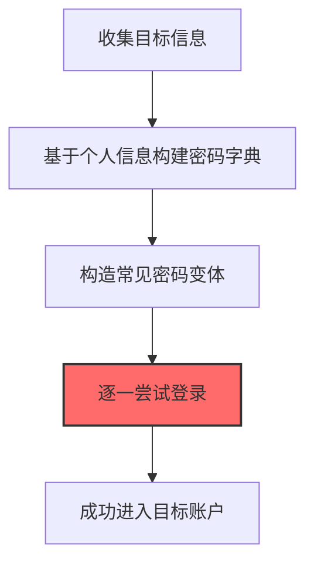

# 密码猜测 (T1110.001)

## 一句话通俗理解

> **根据目标信息（生日、公司名）猜测可能的密码**

## 30秒速查卡

| 维度 | 你需要知道的 |
|------|-------------|
| 这是什么？ | 执行密码猜测攻击技术 |
| 为什么危险？ | 这是密码猜测的典型应用场景，攻击者可以利用它获取系统凭证 |
| 谁需要关心？ | SOC分析师、安全运营团队 |
| 你的第一步防御 | 部署针对密码猜测的检测规则和防御措施 |
| 如果只做一件事 | 监控与密码猜测相关的系统日志和异常行为 |

## 难度等级

⭐ 初级 - 入门级技术，基础操作

## 前置知识检查

**读这个文件需要什么？**

- [ ] Windows认证体系（NTLM/Kerberos/LSASS）
- [ ] 哈希基础（NTLM Hash/SHA）
- [ ] 网络认证协议（SMB/LDAP/Kerberos）

## 技术描述

**密码猜测**（T1110.001）是 **暴力破解**（T1110）的一个具体变体，属于 **凭证访问** 阶段的攻击技术。

简单来说，就像拿着一本字典，一个一个试密码。

### 具体怎么理解？

根据目标信息（生日、公司名）猜测可能的密码

攻击者使用这种技术时，通常是在凭证访问阶段，想要达到特定的攻击目标。与父技术 T1110 相比，T1110.001 有自己独特的特点和使用场景。

### 为什么有效？

这种技术之所以有效，是因为：
1. **隐蔽性**：利用了正常系统功能或常见协议，不容易被发现
2. **技术门槛适中**：不需要特别高深的技术知识就能实施

**过渡段：** 不要误解凭证访问只是'窃取密码'——在现代企业中，凭证存在于内存、磁盘、网络流量等多个位置。
3. **广泛适用**：可以在多种环境和系统中使用

## 真实攻击流程

### 典型场景

攻击者在 **凭证访问** 阶段使用 密码猜测 技术，以下是典型的攻击步骤：



**步骤详解：**

1. **收集目标信息** - 通过OSINT搜集目标的姓名、生日、公司名、电话号码等个人信息，了解其密码习惯
2. **基于个人信息构建密码字典** - 将目标信息组合成可能的密码列表，如"Zhang1990!"、"Company2025"等
3. **构造常见密码变体** - 在基础词上添加数字、符号、大小写变化，如"Password1"、"P@ssw0rd"等常见模式
4. **逐一尝试登录** - 使用手工或自动化工具对目标系统（邮箱、VPN、OA）进行少量尝试，避免触发账户锁定
5. **成功进入目标账户** - 猜中密码后获得合法登录凭证，可正常访问系统而不触发安全告警

## 攻击流程

```
收集目标信息 --> 构建密码字典 --> 构造密码变体 --> 低频尝试登录 --> 获取合法凭证
```


**步骤详解：**
1. **收集目标信息**
   - 通俗描述：通过公开渠道搜集目标的姓名、生日、公司名、电话等个人信息
   - 技术细节：利用LinkedIn、Facebook、企业官网等OSINT源构建目标画像，分析其密码命名习惯和偏好
   - 常用工具：Maltego、theHarvester、Sherlock、Social Searcher
2. **构建密码字典**
   - 通俗描述：将收集到的个人信息组合成可能的密码列表
   - 技术细节：基于"姓名+年份""公司名+数字"等模式生成候选密码，如Zhang1990!、Company2025，结合文化习惯和常见密码结构
   - 常用工具：CUPP（Common User Passwords Profiler）、Mentalist、自定义Python脚本
3. **构造密码变体**
   - 通俗描述：在基础词上添加数字、符号、大小写变化生成更多候选
   - 技术细节：应用密码变体规则（如首字母大写、尾部追加!@#、leet替换o→0、a→@），生成Password1、P@ssw0rd等模式
   - 常用工具：Hashcat规则、John the Ripper规则、ruler
4. **低频尝试登录**
   - 通俗描述：对目标系统进行少量针对性尝试，避免触发账户锁定
   - 技术细节：分散登录尝试时间，单账户每日3-5次尝试，使用代理轮换源IP避免被黑名单，优先攻击未启用MFA的入口
   - 常用工具：Hydra、Medusa、Ncrack、自定义Python脚本
5. **获取合法凭证**
   - 通俗描述：猜中密码后获得合法登录凭证，伪装成正常用户访问
   - 技术细节：登录成功后配置邮件自动转发、VPN持久化，避免触发异常行为告警，使用合法Session横向移动
   - 常用工具：Outlook Web App、VPN客户端、SSH

## 真实案例

### 案例1：APT28 -- 针对欧洲政府OWA的精准密码猜测（2016-2017）

- **时间**: 2016-2017年
- **目标**: 欧洲多国政府外交部OWA邮箱（挪威、荷兰、黑山）
- **攻击组织**: APT28（Fancy Bear，俄罗斯GRU 26165部队）
- **手法**: APT28通过前期OSINT收集目标外交官的姓名、出生日期和子女信息，构造个性化密码字典（如"Born1985!"、"Moscow2016"等组合）。使用自动化脚本针对Outlook Web Access登录接口进行低速猜测，每个账户每天仅尝试3-5次以避开账户锁定策略。成功登录后立即配置邮件转发规则持续窃取邮件
- **影响**: 窃取多个欧洲国家外交部高级官员邮箱，导致北约内部通信泄露
- **参考链接**: [Secureworks APT28分析](https://www.secureworks.com/research/threat-group-4127)

### 案例2：MuddyWater -- 针对中东电信和政府的密码猜测（2021-2022）

- **时间**: 2021-2022年
- **目标**: 中东电信运营商和政府机构（伊朗、伊拉克、阿塞拜疆）
- **攻击组织**: MuddyWater（MERCURY，伊朗APT组织）
- **手法**: MuddyWater使用PowerShell脚本结合`Invoke-WebRequest`对目标的Exchange OWA和VPN登录页面进行密码猜测，字典基于目标公司域名、波斯语常用词和季节性密码模式构造。脚本在每次尝试间插入随机延迟（30-120秒）以规避速率限制，每成功猜测一个账户就立即横向移动至内部SharePoint和文件服务器
- **影响**: 长期潜伏中东电信运营商网络，窃取客户数据和政府监听目标信息
- **参考链接**: [Mandiant MuddyWater报告](https://www.mandiant.com/resources/muddywater-mercury)

### 案例3：APT35 — 伊朗黑客针对学术和医学研究者的密码猜测与凭证恢复滥用（2018-2023）

- **时间**: 2018-2023年
- **目标**: 美国、以色列、欧洲的学术研究者、医学研究者（遗传学、神经学、肿瘤学）、伊朗异见人士、美国政府官员和记者
- **攻击组织**: APT35（Charming Kitten / Phosphorus / TA453 / Ajax，伊朗伊斯兰革命卫队（IRGC）支持的APT组织，约2014年活跃）
- **手法**: APT35通过前期OSINT收集目标的学术背景、家庭成员、政治立场和电话号码等信息，结合密码恢复流程对Microsoft Outlook、Gmail、Yahoo等邮件账户进行针对性凭证猜测。2019年针对美国、法国和中东研究伊朗问题的学者的攻击中，攻击者先收集目标社交账号信息，再对邮件账户尝试基于个人信息的密码组合，同时配合伪造的"账户异常登录"邮件引导目标点击仿冒链接。2020年"BadBlood"行动针对美国和以色列25名资深医学研究者，使用1drv[.]casa仿冒OneDrive域名配合密码猜测和凭证收集
- **影响**: Microsoft于2019年10月确认APT35在8-9月间试图访问美国总统竞选团队、现任和前任美国政府官员及知名伊朗侨民的邮件账户；累计监控数十名学者和记者的通信
- **参考链接**: [Clearsky Charming Kitten报告](https://www.clearskysec.com/the-kittens-are-back-in-town/)

## 红队视角

> ⚠️ **免责声明**：以下内容仅用于合法的安全测试、渗透测试和教育目的。未经授权对他人系统进行测试是违法行为。

### 实战技巧

1. **深入理解原理**：在实战应用前，充分理解密码猜测的技术原理和适用场景
2. **环境适配**：根据目标系统的操作系统版本、安全配置等因素调整攻击策略
3. **组合使用**：将该技术与其他技术组合使用，构建完整的攻击链
4. **隐蔽性考虑**：注意操作痕迹的清理，避免被安全设备检测

### 常用工具

| 工具名称 | 用途 | 平台 | 链接 |
| -------- | ---- | ---- | ---- |
| Hydra | 多协议在线密码猜测工具，支持SSH/RDP/HTTP/SMB等50+协议 | Linux/Windows | [Hydra](https://github.com/vanhauser-thc/thc-hydra) |
| Medusa | 并行在线密码爆破工具，支持模块化扩展协议 | Linux | [Medusa](https://github.com/jmk-foofus/medusa) |
| NCrack | Nmap项目的高性能网络认证破解工具 | Linux/Windows | [NCrack](https://nmap.org/ncrack/) |
| Patator | 多功能暴力破解框架，支持模块化组合密码生成和协议测试 | Linux | [Patator](https://github.com/lanjelot/patator) |

### 注意事项

- 在授权的测试环境中使用这些技术
- 注意操作安全（OPSEC），避免被检测系统发现
- 使用匿名化技术和代理隐藏真实身份

## 蓝队视角

### 检测要点

1. **系统日志监控**：关注与密码猜测相关的系统日志和审计记录
2. **异常行为检测**：监控系统中与该技术相关的异常进程、网络连接和文件操作
3. **工具特征识别**：识别攻击者可能使用的工具在系统中的运行特征

### 监控建议

- 部署端点检测和响应（EDR）系统，监控与密码猜测相关的异常行为
- 配置SIEM规则，关联分析来自多个来源的告警
- 定期进行安全评估和渗透测试，验证检测规则的有效性

## 避坑指南

组织中最危险盲区：认为强密码就足够安全。

## 检测建议

### 检测思路

检测 密码猜测 的关键是识别异常行为模式。以下是三个层面的检测方法：

### 网络层检测

**方法**：监控网络流量中的异常模式

```bash
# 检测异常的网络连接和数据传输
# 根据具体协议和端口设置检测规则
```

### 主机层检测

**Windows事件ID**：
- 事件ID 4688：进程创建（监控可疑进程）
- 事件ID 4104：PowerShell执行（监控可疑脚本）

**Linux日志**：
- /var/log/auth.log：认证日志
- /var/log/syslog：系统日志

```bash
# 检测异常进程和命令执行
grep -i "suspicious" /var/log/auth.log
```

### 应用层检测

**用人话说：** 这条规则在监控是否有针对特定账户的精细化密码尝试。密码猜测不同于暴力破解的'地毯式轰炸'，更像是'量身定做'——攻击者会先收集目标的个人信息（生日、配偶名字、公司名、宠物名、喜欢的球队），然后用这些信息生成候选密码列表逐一尝试。比如知道目标叫'张三'、在'ABC科技'工作、2015年入职、喜欢曼联，攻击者就会试Zhang2015、Abc@2024、ZhangSan!、ManchesterUnited1等组合。与暴力破解动辄每秒上百次尝试不同，密码猜测可能每小时只试几个精心构造的密码，更隐蔽、更难被锁定策略拦截。关键看的是猜测的'精准度'而非'数量'：一个账户在几分钟内出现3-5次失败后突然成功登录，往往就是密码猜测得手了。

**Sigma规则示例**：

```yaml
title: 检测密码猜测
status: experimental
description: 检测可能的密码猜测活动
logsource:
    category: process_creation
    product: windows
detection:
    selection:
        EventID: 4688
    condition: selection
level: medium
tags:
    - attack.T1110001
```

## 缓解措施

### 优先级1：关键措施

**限制攻击面**：减少暴露的服务和端口，降低被利用的风险

```bash
# 防火墙规则示例：只允许必要的出站连接
iptables -A OUTPUT -p tcp --dport 443 -j ACCEPT  # 允许HTTPS
iptables -A OUTPUT -p tcp --dport 80 -j ACCEPT   # 允许HTTP
iptables -A OUTPUT -p tcp -j DROP                 # 阻止其他TCP
```

### 优先级2：重要措施

**加强监控**：部署EDR和SIEM系统，实时监控异常行为

### 优先级3：建议措施

**安全意识培训**：教育员工识别相关攻击手法

## 动手实验

> ⚠️ **所有实验必须在隔离的实验室环境中进行**

### 实验1：理解基本原理（初级）

**目标**：理解 密码猜测 的工作原理

**步骤**：
1. 在隔离环境中搭建测试系统
2. 使用基础工具模拟攻击行为
3. 观察系统日志和网络流量

**学习要点**：理解该技术的核心机制

### 实验2：实际操作（中级）

**目标**：掌握 密码猜测 的实际使用方法

**步骤**：
1. 使用专业工具进行攻击模拟
2. 尝试不同的绕过技术
3. 分析检测日志的特征

**学习要点**：掌握工具使用和日志分析

### 实验3：防御验证（高级）

**目标**：验证检测规则的有效性

**步骤**：
1. 部署检测规则
2. 执行攻击模拟
3. 验证检测告警是否触发

**学习要点**：理解攻防对抗的实际效果

## 术语解释

| 术语 | 通俗解释 |
|------|---------|
| **ATT&CK** | MITRE公司维护的攻击技术知识库，像一本"黑客手法百科全书" |
| **密码猜测** | T1110.001，ATT&CK框架中定义的一种具体攻击技术 |
| **暴力破解** | T1110，密码猜测所属的父技术类别 |
| **凭证访问** | 攻击链中的一个阶段，攻击者在这个阶段的目标 |
| **C2** | 命令与控制，攻击者用来远程控制被入侵系统的"遥控器" |
| **EDR** | 端点检测与响应，部署在电脑上的安全监控软件 |

## 被引用情况

以下父技术文档引用了本子技术：

- [T1110 - 暴力破解](../T1110-Brute-Force.md)

## 参考资料

### 📚 官方文档（深入了解）

- [MITRE ATT&CK - 密码猜测 (T1110.001)](https://attack.mitre.org/techniques/T1110/001/)
- [MITRE ATT&CK - 暴力破解 (T1110)](https://attack.mitre.org/techniques/T1110/)

### 📰 安全报告（真实攻击）

- [MITRE ATT&CK 官方文档](https://attack.mitre.org/) - ATT&CK 框架官方资源

### 🔧 工具与资源（动手试试）

- [Atomic Red Team](https://github.com/redcanaryco/atomic-red-team) - 检测规则测试框架
- [MITRE ATT&CK Navigator](https://mitre-attack.github.io/attack-navigator/) - ATT&CK 可视化工具

### 📚 学习资料（深入了解）

- [MITRE ATT&CK 知识库](https://attack.mitre.org/resources/) - ATT&CK 官方资源中心
