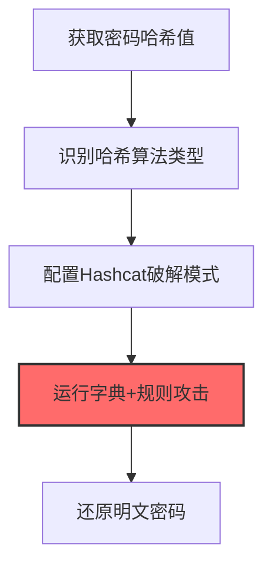
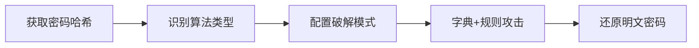

# 密码破解 (T1110.002)

## 一句话通俗理解

> **离线破解已获取的密码哈希**

## 30秒速查卡

| 维度 | 你需要知道的 |
|------|-------------|
| 这是什么？ | 离线破解已获取的密码哈希，还原出明文密码 |
| 为什么危险？ | 拿到哈希只是第一步，离线破解不需要再接触目标系统，而且可以使用GPU加速大幅提高速度 |
| 谁需要关心？ | SOC分析师、渗透测试人员、安全运营团队 |
| 你的第一步防御 | 使用强密码策略确保哈希难以破解，部署密码喷射检测规则 |
| 如果只做一件事 | 监控域控制器上的事件ID 4625（登录失败），短时间内大量失败登录尝试是密码喷射的典型特征 |

## 难度等级

⭐ 初级 - 入门级技术，基础操作

## 前置知识检查

**读这个文件需要什么？**

- [ ] Windows认证体系（NTLM/Kerberos/LSASS）
- [ ] 哈希基础（NTLM Hash/SHA）
- [ ] 网络认证协议（SMB/LDAP/Kerberos）

## 技术描述

**密码破解**（T1110.002）是 **暴力破解**（T1110）的一个具体变体，属于 **凭证访问** 阶段的攻击技术。

简单来说，就像拿着一本字典，一个一个试密码。

### 具体怎么理解？

离线破解已获取的密码哈希

攻击者使用这种技术时，通常是在凭证访问阶段，想要达到特定的攻击目标。与父技术 T1110 相比，T1110.002 有自己独特的特点和使用场景。

### 为什么有效？

这种技术之所以有效，是因为：
1. **隐蔽性**：利用了正常系统功能或常见协议，不容易被发现
2. **技术门槛适中**：不需要特别高深的技术知识就能实施

**过渡段：** 不要误解凭证访问只是'窃取密码'——在现代企业中，凭证存在于内存、磁盘、网络流量等多个位置。
3. **广泛适用**：可以在多种环境和系统中使用

## 真实攻击流程

### 典型场景

攻击者在 **凭证访问** 阶段使用 密码破解 技术，以下是典型的攻击步骤：



**步骤详解：**

1. **获取密码哈希值** - 通过LSASS转储、NTDS提取或/etc/shadow读取等方式获取目标密码的哈希值
2. **识别哈希算法类型** - 使用hashid或hash-identifier工具判断哈希格式（NTLM、bcrypt、SHA-512等），选择对应破解模式
3. **配置Hashcat破解模式** - 根据哈希类型选择Hashcat模式号（如NTLM为1000，bcrypt为3200），配置GPU加速参数
4. **运行字典+规则攻击** - 使用rockyou等常用字典配合规则变换（大小写、追加数字等）进行批量尝试
5. **还原明文密码** - 破解成功后获得明文密码，可直接用于登录或横向移动

## 攻击流程

```
获取密码哈希 --> 识别算法类型 --> 配置破解模式 --> 字典+规则攻击 --> 还原明文密码
```



**步骤详解：**
1. **获取密码哈希**
   - 通俗描述：通过LSASS转储、NTDS提取或读取/etc/shadow获取密码哈希
   - 技术细节：使用Mimikatz sekurlsa::logonpasswords获取NTLM哈希，或volume shadow copy提取NTDS.dit，Linux下读取/etc/shadow中的$6$字段
   - 常用工具：Mimikatz、secretsdump.py、ntdsutil、Impacket
2. **识别算法类型**
   - 通俗描述：判断哈希格式以选择对应的破解模式
   - 技术细节：通过哈希长度和前缀判断（NTLM为32位十六进制、bcrypt以$2a$开头、SHA-512 crypt以$6$开头），自动匹配Hashcat模式号
   - 常用工具：hashid、hash-identifier、Hashcat --identify
3. **配置破解模式**
   - 通俗描述：根据哈希类型配置Hashcat的破解参数和GPU加速
   - 技术细节：NTLM模式1000、bcrypt模式3200、WPA2模式22000，配置-w 3高性能模式、-O优化内核，多GPU并行分配任务
   - 常用工具：Hashcat、John the Ripper、oclHashcat
4. **字典+规则攻击**
   - 通俗描述：使用常用字典配合规则变换进行批量哈希碰撞
   - 技术细节：加载rockyou.txt等泄露字典，应用best64规则集进行大小写变换、数字追加、leet替换，结合掩码攻击?u?l?l?l?d?d?d
   - 常用工具：rockyou.txt、Hashcat规则集、CeWL自定义字典生成
5. **还原明文密码**
   - 通俗描述：哈希碰撞成功后获得明文密码
   - 技术细节：使用--show参数查看已破解结果，将明文密码与用户名关联，可直接用于RDP/SSH/OWA登录或Pass-the-Hash横向移动
   - 常用工具：Hashcat --show、自定义脚本、CrackMapExec

## 真实案例

### 案例1：APT29 -- 离线破解NTLM哈希横向移动（2019-2020）

- **时间**: 2019-2020年
- **目标**: 欧美非政府组织和智库机构
- **攻击组织**: APT29（Cozy Bear / The Dukes，俄罗斯SVR 16145部队）
- **手法**: APT29在通过供应链攻击植入后门后，使用Mimikatz提取LSASS中的NTLM哈希，外传至C2后使用Hashcat模式1000(NTLM)配合GPU集群进行离线破解。字典基于常见弱密码和OSINT收集的目标员工信息生成，破解出的明文密码被用于登录VPN和Exchange，绕过MFA。破解过程中还使用了规则攻击（如best64.rule）扩大字典覆盖
- **影响**: 成功破解超过40个账户密码，横向移动至内部代码仓库和文档服务器
- **参考链接**: [CrowdStrike APT29报告](https://www.crowdstrike.com/blog/why-nobelium-calls-cozy-bear/)

### 案例2：FIN7 -- 零售业密码哈希离线破解（2017-2018）

- **时间**: 2017-2018年
- **目标**: 美国连锁餐厅、酒店和零售商POS系统
- **攻击组织**: FIN7（Carbanak Group，金融犯罪组织）
- **手法**: FIN7在入侵企业内网后通过CARBANAK后门导出Windows SAM数据库和Active Directory NTDS.dit，使用Impacket secretsdump.py离线提取NTLM哈希。随后使用oclHashcat在GPU集群上执行模式1000字典攻击，配合RockYou字典和自定义规则破解员工密码。破解后的密码被用于横向访问财务系统和支付网关
- **影响**: 累计攻击超过100家企业，窃取超过1500万张信用卡数据
- **参考链接**: [US DOJ FIN7起诉书](https://www.justice.gov/opa/pr/three-members-notorious-international-cybercrime-group-fin7-cybercrimes-impacting)

### 案例3：LockBit — 勒索软件组织离线破解NTLM哈希横向移动（2022-2024）

- **时间**: 2022-2024年
- **目标**: 全球范围内的关键基础设施组织，包括医疗保健、制造业、政府机构和金融服务
- **攻击组织**: LockBit（LockBit 3.0 / LockBit Black，俄语背景的勒索软件即服务RaaS组织，2020年1月起活跃，2022-2023年为全球使用最广泛的RaaS）
- **手法**: LockBit附属成员在入侵企业内网后，使用Mimikatz、CrackMapExec、ExtPassword和LostMyPassword等工具批量转储LSASS内存、SAM数据库和Active Directory中的NTLM哈希。提取的哈希外传至攻击者控制的GPU工作站后，使用Hashcat模式1000（NTLM）配合rockyou.txt等常用字典进行离线破解，破解出的明文密码立即用于横向移动至域控制器和财务系统，为最终部署LockBit 3.0勒索软件做准备。LockBit 3.0可执行文件本身还内置32字符密码参数（-pass）保护以规避静态分析
- **影响**: 2022-2023年期间成为全球最活跃的勒索软件即服务组织，攻击对象覆盖多国关键基础设施；2023年6月CISA联合FBI及9国网络安全机构发布专项警告
- **参考链接**: [CISA LockBit安全建议](https://www.cisa.gov/news-events/cybersecurity-advisories/aa23-165a)

## 红队视角

> ⚠️ **免责声明**：以下内容仅用于合法的安全测试、渗透测试和教育目的。未经授权对他人系统进行测试是违法行为。

### 实战技巧

1. **深入理解原理**：在实战应用前，充分理解密码破解的技术原理和适用场景
2. **环境适配**：根据目标系统的操作系统版本、安全配置等因素调整攻击策略
3. **组合使用**：将该技术与其他技术组合使用，构建完整的攻击链
4. **隐蔽性考虑**：注意操作痕迹的清理，避免被安全设备检测

### 常用工具

| 工具名称 | 用途 | 平台 | 链接 |
| -------- | ---- | ---- | ---- |
| Hashcat | GPU加速密码破解，支持300+哈希模式含NTLM(1000)/Kerberos(13100)/sha512crypt(1800) | Linux/Windows | [Hashcat](https://hashcat.net/hashcat/) |
| John the Ripper | 经典CPU密码破解工具，支持字典攻击/规则攻击/模式攻击 | Linux/Windows/macOS | [John the Ripper](https://www.openwall.com/john/) |
| oclHashcat | Hashcat的OpenCL版本，支持AMD/Intel GPU | Linux/Windows | [oclHashcat](https://hashcat.net/oclhashcat/) |
| hashcat-utils | Hashcat配套工具集，含字典预处理、规则生成和密码模式分析 | Linux/Windows | [hashcat-utils](https://github.com/hashcat/hashcat-utils) |

### 注意事项

- 在授权的测试环境中使用这些技术
- 注意操作安全（OPSEC），避免被检测系统发现
- 使用匿名化技术和代理隐藏真实身份

## 蓝队视角

### 检测要点

1. **系统日志监控**：关注与密码破解相关的系统日志和审计记录
2. **异常行为检测**：监控系统中与该技术相关的异常进程、网络连接和文件操作
3. **工具特征识别**：识别攻击者可能使用的工具在系统中的运行特征

### 监控建议

- 部署端点检测和响应（EDR）系统，监控与密码破解相关的异常行为
- 配置SIEM规则，关联分析来自多个来源的告警
- 定期进行安全评估和渗透测试，验证检测规则的有效性

## 避坑指南

组织中最危险盲区：认为强密码就足够安全。

## 检测建议

### 检测思路

检测 密码破解 的关键是识别异常行为模式。以下是三个层面的检测方法：

### 网络层检测

**方法**：监控网络流量中的异常模式

```bash
# 检测异常的网络连接和数据传输
# 根据具体协议和端口设置检测规则
```

### 主机层检测

**Windows事件ID**：
- 事件ID 4688：进程创建（监控可疑进程）
- 事件ID 4104：PowerShell执行（监控可疑脚本）

**Linux日志**：
- /var/log/auth.log：认证日志
- /var/log/syslog：系统日志

```bash
# 检测异常进程和命令执行
grep -i "suspicious" /var/log/auth.log
```

### 应用层检测

**用人话说：** 这条规则在监控攻击者是否在离线破解已经获取到的密码哈希。密码破解和在线试密码是两码事：攻击者已经通过Mimikatz、DCSync等手段拿到了密码哈希（像是拿到了一串加密的'密码指纹'），然后在自己的机器上用Hashcat或John the Ripper对这些哈希进行离线穷举，一秒能试数百亿个密码组合，直到找到匹配的那个。这个过程完全发生在攻击者的电脑上，目标系统看不到任何登录失败日志——不像暴力破解会触发4625事件。8位纯数字密码几秒就能破解完，8位大小写字母+数字组合也撑不过几天。关键在于发现哈希被批量导出（LSASS读取、NTDS.dit访问）后是否有对应的破解工具痕迹。

**Sigma规则示例**：

```yaml
title: 检测密码破解
status: experimental
description: 检测可能的密码破解活动
logsource:
    category: process_creation
    product: windows
detection:
    selection:
        EventID: 4688
    condition: selection
level: medium
tags:
    - attack.T1110002
```

## 缓解措施

### 优先级1：关键措施

**限制攻击面**：减少暴露的服务和端口，降低被利用的风险

```bash
# 防火墙规则示例：只允许必要的出站连接
iptables -A OUTPUT -p tcp --dport 443 -j ACCEPT  # 允许HTTPS
iptables -A OUTPUT -p tcp --dport 80 -j ACCEPT   # 允许HTTP
iptables -A OUTPUT -p tcp -j DROP                 # 阻止其他TCP
```

### 优先级2：重要措施

**加强监控**：部署EDR和SIEM系统，实时监控异常行为

### 优先级3：建议措施

**安全意识培训**：教育员工识别相关攻击手法

## 动手实验

> ⚠️ **所有实验必须在隔离的实验室环境中进行**

### 实验1：理解基本原理（初级）

**目标**：理解 密码破解 的工作原理

**步骤**：
1. 在隔离环境中搭建测试系统
2. 使用基础工具模拟攻击行为
3. 观察系统日志和网络流量

**学习要点**：理解该技术的核心机制

### 实验2：实际操作（中级）

**目标**：掌握 密码破解 的实际使用方法

**步骤**：
1. 使用专业工具进行攻击模拟
2. 尝试不同的绕过技术
3. 分析检测日志的特征

**学习要点**：掌握工具使用和日志分析

### 实验3：防御验证（高级）

**目标**：验证检测规则的有效性

**步骤**：
1. 部署检测规则
2. 执行攻击模拟
3. 验证检测告警是否触发

**学习要点**：理解攻防对抗的实际效果

## 术语解释

| 术语 | 通俗解释 |
|------|---------|
| **ATT&CK** | MITRE公司维护的攻击技术知识库，像一本"黑客手法百科全书" |
| **密码破解** | T1110.002，ATT&CK框架中定义的一种具体攻击技术 |
| **暴力破解** | T1110，密码破解所属的父技术类别 |
| **凭证访问** | 攻击链中的一个阶段，攻击者在这个阶段的目标 |
| **C2** | 命令与控制，攻击者用来远程控制被入侵系统的"遥控器" |
| **EDR** | 端点检测与响应，部署在电脑上的安全监控软件 |

## 被引用情况

以下父技术文档引用了本子技术：

- [T1110 - 暴力破解](../T1110-Brute-Force.md)

## 参考资料

### 📚 官方文档（深入了解）

- [MITRE ATT&CK - 密码破解 (T1110.002)](https://attack.mitre.org/techniques/T1110/002/)
- [MITRE ATT&CK - 暴力破解 (T1110)](https://attack.mitre.org/techniques/T1110/)

### 📰 安全报告（真实攻击）

- [MITRE ATT&CK 官方文档](https://attack.mitre.org/) - ATT&CK 框架官方资源

### 🔧 工具与资源（动手试试）

- [Atomic Red Team](https://github.com/redcanaryco/atomic-red-team) - 检测规则测试框架
- [MITRE ATT&CK Navigator](https://mitre-attack.github.io/attack-navigator/) - ATT&CK 可视化工具

### 📚 学习资料（深入了解）

- [MITRE ATT&CK 知识库](https://attack.mitre.org/resources/) - ATT&CK 官方资源中心
