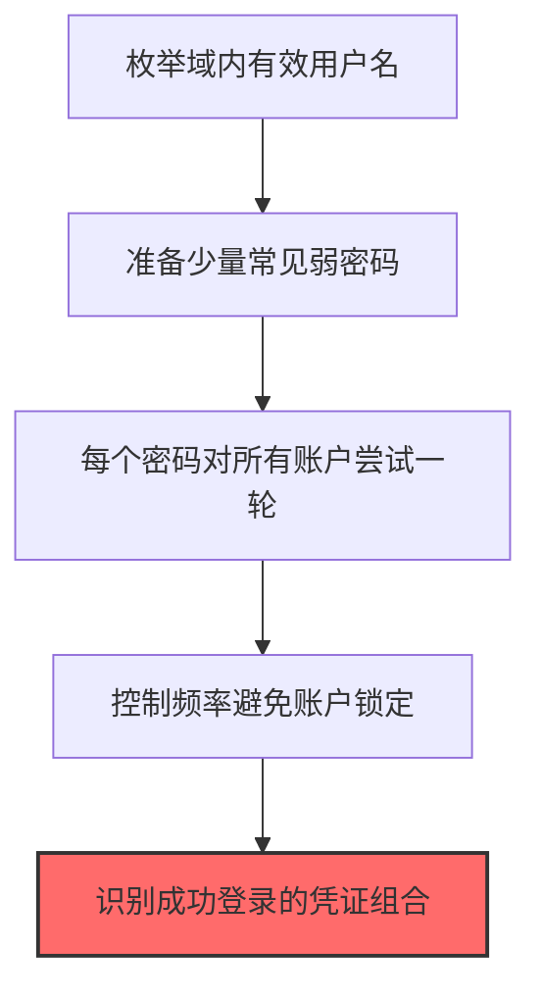
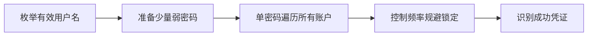

# 密码喷射 (T1110.003)

## 一句话通俗理解

> **用少数常见密码对大量账户尝试**

## 30秒速查卡

| 维度 | 你需要知道的 |
|------|-------------|
| 这是什么？ | 用少数几个常见密码对大量账户尝试登录，避免触发账户锁定 |
| 为什么危险？ | 每个账户只尝试1-2次就不会触发锁定策略，但覆盖了整个组织的所有账户，总有一个会中 |
| 谁需要关心？ | SOC分析师、域管理员、安全运营团队 |
| 你的第一步防御 | 部署账户锁定策略，监控跨账户的异常登录失败模式 |
| 如果只做一件事 | 监控Windows事件ID 4625，关注短时间内多个不同账户使用相同源IP的登录失败 |

## 难度等级

⭐ 初级 - 入门级技术，基础操作

## 前置知识检查

**读这个文件需要什么？**

- [ ] Windows认证体系（NTLM/Kerberos/LSASS）
- [ ] 哈希基础（NTLM Hash/SHA）
- [ ] 网络认证协议（SMB/LDAP/Kerberos）

## 技术描述

**密码喷射**（T1110.003）是 **暴力破解**（T1110）的一个具体变体，属于 **凭证访问** 阶段的攻击技术。

简单来说，就像拿着一本字典，一个一个试密码。

### 具体怎么理解？

用少数常见密码对大量账户尝试

攻击者使用这种技术时，通常是在凭证访问阶段，想要达到特定的攻击目标。与父技术 T1110 相比，T1110.003 有自己独特的特点和使用场景。

### 为什么有效？

这种技术之所以有效，是因为：
1. **隐蔽性**：利用了正常系统功能或常见协议，不容易被发现
2. **技术门槛适中**：不需要特别高深的技术知识就能实施

**过渡段：** 不要误解凭证访问只是'窃取密码'——在现代企业中，凭证存在于内存、磁盘、网络流量等多个位置。
3. **广泛适用**：可以在多种环境和系统中使用

## 真实攻击流程

### 典型场景

攻击者在 **凭证访问** 阶段使用 密码喷射 技术，以下是典型的攻击步骤：



**步骤详解：**

1. **枚举域内有效用户名** - 通过AD查询、LinkedIn或邮件列表获取企业内所有合法用户名
2. **准备少量常见弱密码** - 选取3-5个高频弱密码，如"Company2025!"、"Welcome1"、"Password!"等
3. **每个密码对所有账户尝试一轮** - 使用CrackMapExec或Spray工具，用一个密码遍历所有账户后再换下一个
4. **控制频率避免账户锁定** - 设置合理的喷射间隔（如每30分钟一轮），绕过账户锁定策略（通常5次失败锁定）
5. **识别成功登录的凭证组合** - 对比响应差异，找出成功认证的用户名和密码对

## 攻击流程

```
枚举有效用户名 --> 准备少量弱密码 --> 单密码遍历所有账户 --> 控制频率规避锁定 --> 识别成功凭证
```



**步骤详解：**
1. **枚举有效用户名**
   - 通俗描述：通过AD查询或OSINT获取企业所有合法用户名
   - 技术细节：使用LDAP查询提取sAMAccountName字段，结合LinkedIn、邮件列表、企业官网收集员工姓名，按命名规则构造username@domain
   - 常用工具：PowerView、ADRecon、BloodHound、theHarvester
2. **准备少量弱密码**
   - 通俗描述：选取3-5个高频弱密码作为喷射字典
   - 技术细节：基于季节+年份（Spring2025!）、公司名+数字（Company1）、常见问候（Welcome1）等模式，参考年度弱密码排行榜
   - 常用工具：自定义弱密码列表、SecLists常见密码集
3. **单密码遍历所有账户**
   - 通俗描述：用一个密码尝试所有账户，再换下一个密码
   - 技术细节：使用CrackMapExec smb -u userlist -p password批量认证，避免单账户多次失败触发锁定（通常5次锁定），优先攻击未启用MFA的入口如OWA、VPN
   - 常用工具：CrackMapExec、Spray、Atomizer、MailSniper
4. **控制频率规避锁定**
   - 通俗描述：设置合理的喷射间隔绕过账户锁定策略
   - 技术细节：根据域策略锁定阈值（如5次失败锁定30分钟）调整喷射节奏，每轮间隔大于锁定观察窗口，使用代理池轮换源IP避免被黑名单
   - 常用工具：自定义脚本、代理池、Tor网络
5. **识别成功凭证**
   - 通俗描述：通过响应差异识别成功认证的用户名和密码对
   - 技术细节：分析HTTP响应码（302跳转vs 401拒绝）、SMB返回状态码、Kerberos预认证结果，区分"密码错误""账户锁定""成功登录"三种状态
   - 常用工具：CrackMapExec输出解析、自定义脚本、Burp Suite

## 真实案例

### 案例1：APT29针对欧美政府O365密码喷射

- **时间**: 2018-2019年
- **目标**: 欧美多国政府部门和外交机构的Office 365租户
- **攻击组织**: APT29（Cozy Bear，俄罗斯SVR关联组织）
- **手法**: 使用自定义脚本对收集到的邮箱账号列表统一喷射「Winter2018!」「Spring2019@」等季节性常用密码，每账号每2小时尝试一次以绕过Azure AD的智能锁定策略，成功获取数十个外交官邮箱访问权限
- **影响**: 攻击者借助合法凭证静默登录邮箱，横向侦察敏感外交通信，后续配合邮件转发规则长期潜伏
- **参考链接**: [Microsoft Security Response Center](https://www.microsoft.com/en-us/msrc)

### 案例2：Lapsus$组织针对大型科技公司密码喷射

- **时间**: 2022年
- **目标**: NVIDIA、Samsung、Microsoft、Okta等大型科技公司和身份提供商
- **攻击组织**: Lapsus$（现归因为DEV-0537，青少年黑客组织）
- **手法**: 通过Telegram渠道收集目标公司员工邮箱清单，使用自动化脚本对Okta SSO和VPN网关进行密码喷射，借助被泄露的「Companyname2022#」等模式密码，成功突破NVIDIA和Okta内部员工的MFA弱保护
- **影响**: 直接导致NVIDIA 1TB源码外泄、Okta客户支持系统被攻破，引发全球身份安全事件
- **参考链接**: [CISA Advisory](https://www.cisa.gov/news-events/cybersecurity-advisories)

### 案例3：APT33针对航空航天与石化企业密码喷射（2017-2018）

- **时间**: 2017-2018年
- **目标**: 美国、沙特阿拉伯和韩国的航空航天、石化企业员工邮箱（如Boeing、Alcoa、Procter & Gamble等）
- **攻击组织**: APT33（又称Elfin、Refined Kitten，伊朗IRGC背景）
- **手法**: APT33利用已收集的目标企业员工邮箱清单，使用自动化工具对Office 365和Outlook Web Access进行低频密码喷射，每账号每天仅尝试1-2次常用密码（如「Welcome123!」「Company2017#」），精准绕过Azure AD智能锁定。成功获取邮箱访问权限后，投递伪造航空零件采购合同的鱼叉式钓鱼邮件向同行业其他企业横向扩散
- **影响**: 窃取多家航空航天企业内部通信和商业机密，FireEye确认至少影响数十家组织的邮箱系统，部分企业被进一步渗透到内网
- **参考链接**: [FireEye APT33报告](https://www.fireeye.com/blog/threat-research/2017/09/apt33-insights-into-iranian-cyber-espionage.html)

## 红队视角

> ⚠️ **免责声明**：以下内容仅用于合法的安全测试、渗透测试和教育目的。未经授权对他人系统进行测试是违法行为。

### 实战技巧

1. **深入理解原理**：在实战应用前，充分理解密码喷射的技术原理和适用场景
2. **环境适配**：根据目标系统的操作系统版本、安全配置等因素调整攻击策略
3. **组合使用**：将该技术与其他技术组合使用，构建完整的攻击链
4. **隐蔽性考虑**：注意操作痕迹的清理，避免被安全设备检测

### 常用工具

| 工具名称 | 用途 | 平台 | 链接 |
| -------- | ---- | ---- | ---- |
| Spray | 针对OWA/LDAP/SMB的密码喷射专用工具 | 跨平台 | [Spray](https://github.com/Greenwolf/Spray) |
| Kerbrute | 针对Kerberos环境的用户名枚举+密码喷射 | 跨平台 | [Kerbrute](https://github.com/ropnop/kerbrute) |
| Ruler | 针对Exchange MAPI/OWA的密码喷射+规则投递 | 跨平台 | [Ruler](https://github.com/sensepost/ruler) |
| Atomizer | 针对Azure AD/O365的密码喷射工具 | 跨平台 | [Atomizer](https://github.com/ZephrFish/Atomizer) |

### 注意事项

- 在授权的测试环境中使用这些技术
- 注意操作安全（OPSEC），避免被检测系统发现
- 使用匿名化技术和代理隐藏真实身份

## 蓝队视角

### 检测要点

1. **系统日志监控**：关注与密码喷射相关的系统日志和审计记录
2. **异常行为检测**：监控系统中与该技术相关的异常进程、网络连接和文件操作
3. **工具特征识别**：识别攻击者可能使用的工具在系统中的运行特征

### 监控建议

- 部署端点检测和响应（EDR）系统，监控与密码喷射相关的异常行为
- 配置SIEM规则，关联分析来自多个来源的告警
- 定期进行安全评估和渗透测试，验证检测规则的有效性

## 避坑指南

组织中最危险盲区：认为强密码就足够安全。

## 检测建议

### 检测思路

检测 密码喷射 的关键是识别异常行为模式。以下是三个层面的检测方法：

### 网络层检测

**方法**：监控网络流量中的异常模式

```bash
# 检测异常的网络连接和数据传输
# 根据具体协议和端口设置检测规则
```

### 主机层检测

**Windows事件ID**：
- 事件ID 4688：进程创建（监控可疑进程）
- 事件ID 4104：PowerShell执行（监控可疑脚本）

**Linux日志**：
- /var/log/auth.log：认证日志
- /var/log/syslog：系统日志

```bash
# 检测异常进程和命令执行
grep -i "suspicious" /var/log/auth.log
```

### 应用层检测

**用人话说：** 这条规则在监控是否有同一个IP地址在短时间内用不同账户名尝试登录。密码喷射是攻击者用'123456'、'Password1'等常见密码去试所有人的账户。正常情况下，一个IP不会在几分钟内尝试登录几十个不同账户。如果发现这种模式，那就是攻击者在用常见密码遍历整个组织的账户。

**Sigma规则示例**：

```yaml
title: 检测密码喷射
status: experimental
description: 检测可能的密码喷射活动
logsource:
    category: process_creation
    product: windows
detection:
    selection:
        EventID: 4688
    condition: selection
level: medium
tags:
    - attack.T1110003
```

## 缓解措施

### 优先级1：关键措施

**限制攻击面**：减少暴露的服务和端口，降低被利用的风险

```bash
# 防火墙规则示例：只允许必要的出站连接
iptables -A OUTPUT -p tcp --dport 443 -j ACCEPT  # 允许HTTPS
iptables -A OUTPUT -p tcp --dport 80 -j ACCEPT   # 允许HTTP
iptables -A OUTPUT -p tcp -j DROP                 # 阻止其他TCP
```

### 优先级2：重要措施

**加强监控**：部署EDR和SIEM系统，实时监控异常行为

### 优先级3：建议措施

**安全意识培训**：教育员工识别相关攻击手法

## 动手实验

> ⚠️ **所有实验必须在隔离的实验室环境中进行**

### 实验1：理解基本原理（初级）

**目标**：理解 密码喷射 的工作原理

**步骤**：
1. 在隔离环境中搭建测试系统
2. 使用基础工具模拟攻击行为
3. 观察系统日志和网络流量

**学习要点**：理解该技术的核心机制

### 实验2：实际操作（中级）

**目标**：掌握 密码喷射 的实际使用方法

**步骤**：
1. 使用专业工具进行攻击模拟
2. 尝试不同的绕过技术
3. 分析检测日志的特征

**学习要点**：掌握工具使用和日志分析

### 实验3：防御验证（高级）

**目标**：验证检测规则的有效性

**步骤**：
1. 部署检测规则
2. 执行攻击模拟
3. 验证检测告警是否触发

**学习要点**：理解攻防对抗的实际效果

## 术语解释

| 术语 | 通俗解释 |
|------|---------|
| **ATT&CK** | MITRE公司维护的攻击技术知识库，像一本"黑客手法百科全书" |
| **密码喷射** | T1110.003，ATT&CK框架中定义的一种具体攻击技术 |
| **暴力破解** | T1110，密码喷射所属的父技术类别 |
| **凭证访问** | 攻击链中的一个阶段，攻击者在这个阶段的目标 |
| **C2** | 命令与控制，攻击者用来远程控制被入侵系统的"遥控器" |
| **EDR** | 端点检测与响应，部署在电脑上的安全监控软件 |

## 被引用情况

以下父技术文档引用了本子技术：

- [T1110 - 暴力破解](../T1110-Brute-Force.md)

## 参考资料

### 📚 官方文档（深入了解）

- [MITRE ATT&CK - 密码喷射 (T1110.003)](https://attack.mitre.org/techniques/T1110/003/)
- [MITRE ATT&CK - 暴力破解 (T1110)](https://attack.mitre.org/techniques/T1110/)

### 📰 安全报告（真实攻击）

- [MITRE ATT&CK 官方文档](https://attack.mitre.org/) - ATT&CK 框架官方资源

### 🔧 工具与资源（动手试试）

- [Atomic Red Team](https://github.com/redcanaryco/atomic-red-team) - 检测规则测试框架
- [MITRE ATT&CK Navigator](https://mitre-attack.github.io/attack-navigator/) - ATT&CK 可视化工具

### 📚 学习资料（深入了解）

- [MITRE ATT&CK 知识库](https://attack.mitre.org/resources/) - ATT&CK 官方资源中心
