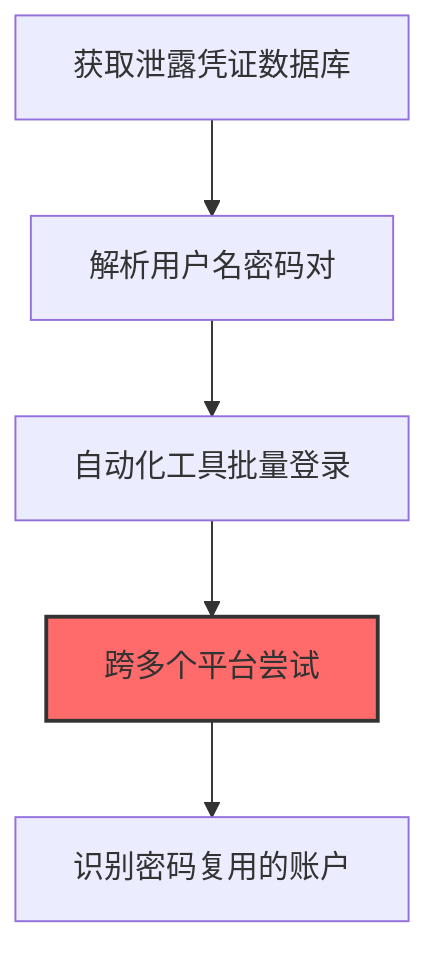
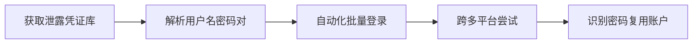

# 凭证填充 (T1110.004)

## 一句话通俗理解

> **用泄露的密码库直接尝试登录**

## 30秒速查卡

| 维度 | 你需要知道的 |
|------|-------------|
| 这是什么？ | 用从其他网站泄露的账号密码库直接尝试登录目标系统 |
| 为什么危险？ | 很多人在多个网站用同一个密码，泄露的密码库可以用来攻击其他网站，成功率远高于暴力破解 |
| 谁需要关心？ | Web应用安全工程师、SOC分析师、安全运营团队 |
| 你的第一步防御 | 部署多因素认证（MFA），监控来自已知泄露IP的登录尝试 |
| 如果只做一件事 | 监控来自已知泄露IP地址的登录请求，结合地理位置和用户行为分析识别异常登录 |

## 难度等级

⭐ 初级 - 入门级技术，基础操作

## 前置知识检查

**读这个文件需要什么？**

- [ ] Windows认证体系（NTLM/Kerberos/LSASS）
- [ ] 哈希基础（NTLM Hash/SHA）
- [ ] 网络认证协议（SMB/LDAP/Kerberos）

## 技术描述

**凭证填充**（T1110.004）是 **暴力破解**（T1110）的一个具体变体，属于 **凭证访问** 阶段的攻击技术。

简单来说，就像拿着一本字典，一个一个试密码。

### 具体怎么理解？

用泄露的密码库直接尝试登录

攻击者使用这种技术时，通常是在凭证访问阶段，想要达到特定的攻击目标。与父技术 T1110 相比，T1110.004 有自己独特的特点和使用场景。

### 为什么有效？

这种技术之所以有效，是因为：
1. **隐蔽性**：利用了正常系统功能或常见协议，不容易被发现
2. **技术门槛适中**：不需要特别高深的技术知识就能实施

**过渡段：** 不要误解凭证访问只是'窃取密码'——在现代企业中，凭证存在于内存、磁盘、网络流量等多个位置。
3. **广泛适用**：可以在多种环境和系统中使用

## 真实攻击流程

### 典型场景

攻击者在 **凭证访问** 阶段使用 凭证填充 技术，以下是典型的攻击步骤：



**步骤详解：**

1. **获取泄露凭证数据库** - 从暗网论坛、Pastebin或泄露数据库（如Collection #1-5）获取大量已泄露的用户名和密码对
2. **解析用户名密码对** - 清洗和格式化数据，去除无效条目，形成"email:password"或"username:password"格式的字典
3. **自动化工具批量登录** - 使用OpenBullet、Sentry MBA等工具配置登录请求模板，自动化执行凭证填充
4. **跨多个平台尝试** - 将同一组凭证尝试登录目标企业邮箱、VPN、云服务、社交媒体等多个平台
5. **识别密码复用的账户** - 利用用户在多个平台使用相同密码的习惯，找到有效凭证并获取未授权访问

## 攻击流程

```
获取泄露凭证库 --> 解析用户名密码对 --> 自动化批量登录 --> 跨多平台尝试 --> 识别密码复用账户
```



**步骤详解：**
1. **获取泄露凭证库**
   - 通俗描述：从暗网或泄露数据库获取大量已泄露的用户名和密码对
   - 技术细节：收集Collection #1-5、Collection of Dropbox、LinkedIn泄露等大型凭证集，包含email:password格式条目，目标量级通常为数亿条
   - 常用工具：暗网论坛、Pastebin、Telegram泄露频道、BreachForums
2. **解析用户名密码对**
   - 通俗描述：清洗和格式化数据，去除无效条目形成可用字典
   - 技术细节：使用正则提取email:password格式，去除重复项、测试账号、明显假数据，按域名分类便于针对性攻击目标企业
   - 常用工具：自定义Python脚本、Combiner工具、SNIPR
3. **自动化批量登录**
   - 通俗描述：使用自动化工具配置登录请求模板批量执行凭证填充
   - 技术细节：抓包分析目标站点登录请求格式，配置HTTP Method、Headers、POST Body模板，设置Proxy和User-Agent轮换规避WAF
   - 常用工具：OpenBullet、Sentry MBA、SilverBullet、SNIPR
4. **跨多平台尝试**
   - 通俗描述：将同一组凭证尝试登录企业邮箱、VPN、云服务等多个平台
   - 技术细节：针对同一email域名（如@company.com）的凭证，同时尝试Microsoft 365、AWS Console、Slack、GitHub等多个SaaS入口，最大化命中率
   - 常用工具：自定义脚本、Multi-Platform Checker
5. **识别密码复用账户**
   - 通俗描述：找到在多个平台使用相同密码的账户并获取未授权访问
   - 技术细节：通过HTTP响应码和页面关键字（"Welcome""Dashboard"vs"Invalid"）判断登录成功，记录有效凭证并配置持久化Session，规避异地登录告警
   - 常用工具：Cookie管理器、Session持久化、代理中转

## 真实案例

### 案例1：Lapsus$组织针对大型科技公司的凭证填充

- **时间**: 2021-2022年
- **目标**: NVIDIA、三星、Microsoft、Okta、英伟达等大型科技公司员工账户
- **攻击组织**: Lapsus$（DEV-0537，青少年黑客组织）
- **手法**: 从公开的Collection#1-5和LeakCheck等泄露数据库收集目标公司员工邮箱+密码组合，使用自动化脚本批量填充到Okta SSO、VPN网关和GitLab登录页，配合「重用旧密码」习惯成功突破多家公司员工的MFA弱保护
- **影响**: 直接导致NVIDIA显卡驱动和DLSS源码外泄、Okta客户支持系统370个客户被影响，造成全球供应链级身份安全事件
- **参考链接**: [CISA Alert AA22-040A](https://www.cisa.gov/news-events/cybersecurity-advisories/aa22-040a)

### 案例2：TA505针对金融行业的凭证填充

- **时间**: 2019-2020年
- **目标**: 北美和欧洲银行及支付平台的在线银行登录入口
- **攻击组织**: TA505（FIN11，俄罗斯/印度金融犯罪团伙）
- **手法**: 通过暗网市场购买包含1.5亿条凭证的泄露数据库，使用Sentry和STORM凭证填充工具针对银行Web门户批量尝试，借助旋转代理池规避IP封锁，成功劫持数千个银行账户发起欺诈转账
- **影响**: 导致多家银行被迫冻结在线业务、累计经济损失超过3000万美元，并引发欧盟支付服务指令PSD2的强制MFA合规升级
- **参考链接**: [OWASP Credential Stuffing Guide](https://owasp.org/www-community/attacks/Credential_stuffing)

### 案例3：UNC5537针对Snowflake云数据仓库客户的凭证填充窃取与勒索（2024）

- **时间**: 2024年4月起
- **目标**: 全球使用Snowflake云数据仓库的企业客户（含AT&T、Ticketmaster、Santander等165+组织）
- **攻击组织**: UNC5537（Mandiant追踪编号，疑似多个独立威胁者组成的联合团伙，含已知主犯Alexander Moucka及协作成员John Erin Binns）
- **手法**: UNC5537从暗网泄露数据库（如Fiverr、Glassdoor等历史泄露）收集目标企业员工的企业邮箱+密码组合，使用自动化凭证填充工具针对Snowflake客户登录端点批量尝试，利用客户未启用MFA的疏忽成功登录Snowflake租户；随后通过Snowflake的`COPY INTO`命令将客户数据仓库中的数据外传至攻击者控制的云存储，并以公开泄露为要挟勒索赎金
- **影响**: 至少攻陷165+组织，Ticketmaster泄露5.6亿用户数据、AT&T泄露约1.09亿用户通话记录、Santander泄露超3000万客户数据；Mandiant联合Snowflake发布威胁狩猎指南，CISA发布AA24-179A联合警报
- **参考链接**: [Mandiant: UNC5537 targeting Snowflake Customer Instances for Data Theft and Extortion](https://cloud.google.com/blog/topics/threat-intelligence/unc5537-snowflake-data-theft-extortion) | [Snowflake Threat Hunting Guide PDF](https://services.google.com/fh/files/misc/snowflake-threat-hunting-guide.pdf)

## 红队视角

> ⚠️ **免责声明**：以下内容仅用于合法的安全测试、渗透测试和教育目的。未经授权对他人系统进行测试是违法行为。

### 实战技巧

1. **深入理解原理**：在实战应用前，充分理解凭证填充的技术原理和适用场景
2. **环境适配**：根据目标系统的操作系统版本、安全配置等因素调整攻击策略
3. **组合使用**：将该技术与其他技术组合使用，构建完整的攻击链
4. **隐蔽性考虑**：注意操作痕迹的清理，避免被安全设备检测

### 常用工具

| 工具名称 | 用途 | 平台 | 链接 |
| -------- | ---- | ---- | ---- |
| Sentry | 自动化凭证填充工具，支持代理池轮换 | 跨平台 | [Sentry](https://github.com/daniel0x00/Sentry) |
| Snusbase | 凭证数据库查询+填充一体化平台 | 跨平台 | [Snusbase](https://snusbase.com/) |
| OpenBullet | 模块化凭证填充框架，支持多种Web登录 | Windows | [OpenBullet](https://github.com/openbullet/openbullet) |
| SN1PER | 综合渗透工具，含凭证填充模块 | 跨平台 | [SN1PER](https://github.com/1N3/Sn1per) |

### 注意事项

- 在授权的测试环境中使用这些技术
- 注意操作安全（OPSEC），避免被检测系统发现
- 使用匿名化技术和代理隐藏真实身份

## 蓝队视角

### 检测要点

1. **系统日志监控**：关注与凭证填充相关的系统日志和审计记录
2. **异常行为检测**：监控系统中与该技术相关的异常进程、网络连接和文件操作
3. **工具特征识别**：识别攻击者可能使用的工具在系统中的运行特征

### 监控建议

- 部署端点检测和响应（EDR）系统，监控与凭证填充相关的异常行为
- 配置SIEM规则，关联分析来自多个来源的告警
- 定期进行安全评估和渗透测试，验证检测规则的有效性

## 避坑指南

组织中最危险盲区：认为强密码就足够安全。

## 检测建议

### 检测思路

检测 凭证填充 的关键是识别异常行为模式。以下是三个层面的检测方法：

### 网络层检测

**方法**：监控网络流量中的异常模式

```bash
# 检测异常的网络连接和数据传输
# 根据具体协议和端口设置检测规则
```

### 主机层检测

**Windows事件ID**：
- 事件ID 4688：进程创建（监控可疑进程）
- 事件ID 4104：PowerShell执行（监控可疑脚本）

**Linux日志**：
- /var/log/auth.log：认证日志
- /var/log/syslog：系统日志

```bash
# 检测异常进程和命令执行
grep -i "suspicious" /var/log/auth.log
```

### 应用层检测

**用人话说：** 这条规则在监控是否有来自已知泄露IP地址的登录尝试。凭证填充是攻击者用从其他网站偷来的账号密码去试你的系统。因为很多人多个网站用同一个密码，所以成功率很高。如果你发现有登录请求来自已知的代理IP或泄露数据库关联的IP，那很可能是在进行凭证填充攻击。

**Sigma规则示例**：

```yaml
title: 检测凭证填充
status: experimental
description: 检测可能的凭证填充活动
logsource:
    category: process_creation
    product: windows
detection:
    selection:
        EventID: 4688
    condition: selection
level: medium
tags:
    - attack.T1110004
```

## 缓解措施

### 优先级1：关键措施

**限制攻击面**：减少暴露的服务和端口，降低被利用的风险

```bash
# 防火墙规则示例：只允许必要的出站连接
iptables -A OUTPUT -p tcp --dport 443 -j ACCEPT  # 允许HTTPS
iptables -A OUTPUT -p tcp --dport 80 -j ACCEPT   # 允许HTTP
iptables -A OUTPUT -p tcp -j DROP                 # 阻止其他TCP
```

### 优先级2：重要措施

**加强监控**：部署EDR和SIEM系统，实时监控异常行为

### 优先级3：建议措施

**安全意识培训**：教育员工识别相关攻击手法

## 动手实验

> ⚠️ **所有实验必须在隔离的实验室环境中进行**

### 实验1：理解基本原理（初级）

**目标**：理解 凭证填充 的工作原理

**步骤**：
1. 在隔离环境中搭建测试系统
2. 使用基础工具模拟攻击行为
3. 观察系统日志和网络流量

**学习要点**：理解该技术的核心机制

### 实验2：实际操作（中级）

**目标**：掌握 凭证填充 的实际使用方法

**步骤**：
1. 使用专业工具进行攻击模拟
2. 尝试不同的绕过技术
3. 分析检测日志的特征

**学习要点**：掌握工具使用和日志分析

### 实验3：防御验证（高级）

**目标**：验证检测规则的有效性

**步骤**：
1. 部署检测规则
2. 执行攻击模拟
3. 验证检测告警是否触发

**学习要点**：理解攻防对抗的实际效果

## 术语解释

| 术语 | 通俗解释 |
|------|---------|
| **ATT&CK** | MITRE公司维护的攻击技术知识库，像一本"黑客手法百科全书" |
| **凭证填充** | T1110.004，ATT&CK框架中定义的一种具体攻击技术 |
| **暴力破解** | T1110，凭证填充所属的父技术类别 |
| **凭证访问** | 攻击链中的一个阶段，攻击者在这个阶段的目标 |
| **C2** | 命令与控制，攻击者用来远程控制被入侵系统的"遥控器" |
| **EDR** | 端点检测与响应，部署在电脑上的安全监控软件 |

## 被引用情况

以下父技术文档引用了本子技术：

- [T1110 - 暴力破解](../T1110-Brute-Force.md)

## 参考资料

### 📚 官方文档（深入了解）

- [MITRE ATT&CK - 凭证填充 (T1110.004)](https://attack.mitre.org/techniques/T1110/004/)
- [MITRE ATT&CK - 暴力破解 (T1110)](https://attack.mitre.org/techniques/T1110/)

### 📰 安全报告（真实攻击）

- [MITRE ATT&CK 官方文档](https://attack.mitre.org/) - ATT&CK 框架官方资源

### 🔧 工具与资源（动手试试）

- [Atomic Red Team](https://github.com/redcanaryco/atomic-red-team) - 检测规则测试框架
- [MITRE ATT&CK Navigator](https://mitre-attack.github.io/attack-navigator/) - ATT&CK 可视化工具

### 📚 学习资料（深入了解）

- [MITRE ATT&CK 知识库](https://attack.mitre.org/resources/) - ATT&CK 官方资源中心
