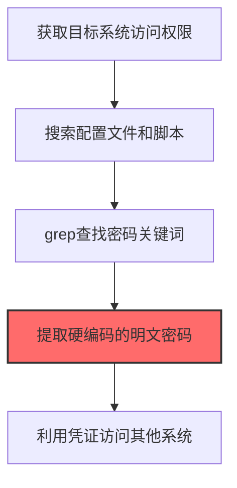

# Credentials in Files (T1552.001)

## 一句话通俗理解

> **在配置文件和脚本中找到明文密码**

## 30秒速查卡

| 维度 | 你需要知道的 |
|------|-------------|
| 这是什么？ | 在配置文件、脚本、数据库中找到明文存储的密码 |
| 为什么危险？ | 开发者经常把密码写在配置文件里，攻击者只需要找到这些文件就能拿到大量凭证，完全不需要破解 |
| 谁需要关心？ | 开发人员、DevOps工程师、SOC分析师 |
| 你的第一步防御 | 使用密钥管理工具替代明文存储，扫描代码仓库中的敏感信息 |
| 如果只做一件事 | 使用git-secrets或trufflehog扫描代码仓库，确保密码和密钥不会被提交到版本控制 |

## 难度等级

⭐ 初级 - 入门级技术，基础操作

## 前置知识检查

**读这个文件需要什么？**

- [ ] Windows认证体系（NTLM/Kerberos/LSASS）
- [ ] 哈希基础（NTLM Hash/SHA）
- [ ] 网络认证协议（SMB/LDAP/Kerberos）

## 技术描述

**文件中的凭证**（T1552.001）是 **不安全的凭证**（T1552）的一个具体变体，属于 **凭证访问** 阶段的攻击技术。

> 📄 **打个比方**：就像在办公桌上翻找贴了密码的便利贴——攻击者搜素系统中的配置文件、脚本和文档，找硬编码的密码。

### 具体怎么理解？

在配置文件和脚本中找到明文密码

攻击者使用这种技术时，通常是在凭证访问阶段，想要达到特定的攻击目标。与父技术 T1552 相比，T1552.001 有自己独特的特点和使用场景。

### 为什么有效？

这种技术之所以有效，是因为：
1. **隐蔽性**：利用了正常系统功能或常见协议，不容易被发现
2. **技术门槛适中**：不需要特别高深的技术知识就能实施

**过渡段：** 不要误解凭证访问只是'窃取密码'——在现代企业中，凭证存在于内存、磁盘、网络流量等多个位置。
3. **广泛适用**：可以在多种环境和系统中使用

## 真实攻击流程

### 典型场景

攻击者在 **凭证访问** 阶段使用 文件中的凭证 技术，以下是典型的攻击步骤：



**步骤详解：**

1. **获取目标系统访问权限** - 通过初始入侵获得在目标主机上执行命令的能力
2. **搜索配置文件和脚本** - 在Web目录、部署脚本、.git仓库中查找包含credential、password、key等关键词的文件
3. **grep查找密码关键词** - 使用grep -r "password\|passwd\|secret\|api_key"等命令快速定位凭证存储位置
4. **提取硬编码的明文密码** - 从config.xml、web.config、.env、application.properties等文件中直接读取明文密码
5. **利用凭证访问其他系统** - 用提取的凭证尝试登录数据库、云服务、第三方API等其他系统

## 攻击流程

```
获取系统访问权限 --> 搜索配置文件和脚本 --> grep查找密码关键词 --> 提取硬编码凭证 --> 横向访问其他系统
```


**步骤详解：**

1. **获取系统访问权限**
   - 通俗描述：攻击者通过漏洞利用或钓鱼等方式拿到目标主机的执行权限
   - 技术细节：利用初始访问漏洞（如 WebShell、反序列化）拿到 shell，或在已沦陷主机上执行命令
   - 常用工具：Cobalt Strike、Metasploit、Empire、自定义 WebShell

2. **搜索配置文件和脚本**
   - 通俗描述：在 Web 目录、部署脚本、.git 仓库中翻找可能含密码的文件
   - 技术细节：枚举常见路径如 `/var/www/`、`~/.ssh/`、`/opt/app/`、`.env`、`config.xml`、`web.config`、`application.properties`
   - 常用工具：find、locate、PowerShell Get-ChildItem、Seatbelt

3. **grep查找密码关键词**
   - 通俗描述：用关键字快速定位配置文件中包含密码的位置
   - 技术细节：执行 `grep -rniE "password|passwd|secret|api_key|token"` 等正则批量扫描
   - 常用工具：grep、ripgrep (rg)、Select-String、WinGrep

4. **提取硬编码凭证**
   - 通俗描述：从配置文件、脚本、备份中直接读取明文密码或密钥
   - 技术细节：解析 XML/JSON/YAML/properties 文件中的凭证字段，提取 API Key、数据库连接串、SSH 私钥
   - 常用工具：LaZagne、SharpCloud、TruffleHog、GitLeaks

5. **横向访问其他系统**
   - 通俗描述：用提取的凭证尝试登录数据库、云服务、第三方 API 等其他系统
   - 技术细节：拿凭证横向测试 SSH、RDP、SQL、S3、Azure、GitLab 等，识别密码复用与权限边界
   - 常用工具：CrackMapExec、Hydra、MicroBurst、ROADtools

## 真实案例

### 案例1：Volt Typhoon针对关基设施的凭证文件搜索

- **时间**: 2021-2023年
- **目标**: 美国关岛和本土的电力、水务、交通等关键基础设施组织
- **攻击组织**: Volt Typhoon（BRONZE SILHOUETTE，中国关联APT组织）
- **手法**: 通过K compromise入侵边缘设备（如SOHO路由器）后，在内网使用findstr /s /i "password" *.txt *.xml *.config和PowerShell脚本递归搜索Web目录和IT管理员主机的.webconfig、.env、credentials.xml等文件，提取明文密码和API密钥用于访问企业VPN和OT网络
- **影响**: 持续潜伏5年未被发现，是首次确认针对美国本土电力系统的国家级APT活动，引发总统级行政令调查
- **参考链接**: [CISA Alert AA24-038A](https://www.cisa.gov/news-events/cybersecurity-advisories/aa24-038a)

### 案例2：APT41针对云环境的配置文件凭证窃取

- **时间**: 2020-2022年
- **目标**: 全球多个云服务客户的AWS和Azure租户
- **攻击组织**: APT41（BARIUM，双面间谍+犯罪组织）
- **手法**: 利用配置错误的S3存储桶和公共Docker镜像仓库，下载目标企业的docker-compose.yml、.aws/credentials、application.properties等配置文件，提取硬编码的AWS AccessKey和数据库密码，横向访问约200家企业的云数据库和S3存储桶
- **影响**: 导致全球云供应链级凭证泄露，多家企业被迫轮换所有云凭证和IAM密钥
- **参考链接**: [Mandiant APT41 Report](https://www.mandiant.com/resources)

### 案例3：Conti勒索软件的配置文件凭证收割

- **时间**: 2021-2022年
- **目标**: 全球各类企业（医疗机构、制造商、政府机构）
- **攻击组织**: Conti勒索软件团伙（俄语系勒索组织，2022年泄露后解散）
- **手法**: Conti在2022年泄露的内部聊天和操作手册中披露，其自研"Credential stealer"工具会递归扫描受害主机本地文件系统，从text文件和文档中提取用户密码；同时从泄露的配置文件仓库中直接读取database.php等文件中的PostgreSQL数据库明文密码，用于横向访问数据库服务器
- **影响**: 数百个组织被勒索，累计赎金超过27亿美元，泄露的操作手册成为后续勒索团伙的标准教科书
- **参考链接**: [Conti团伙泄露分析 - CyberArk Labs](https://www.cyberark.com/resources/threat-research-blog/conti-group-leaked)

## 红队视角

> ⚠️ **免责声明**：以下内容仅用于合法的安全测试、渗透测试和教育目的。未经授权对他人系统进行测试是违法行为。

### 实战技巧

1. **深入理解原理**：在实战应用前，充分理解Credentials in Files的技术原理和适用场景
2. **环境适配**：根据目标系统的操作系统版本、安全配置等因素调整攻击策略
3. **组合使用**：将该技术与其他技术组合使用，构建完整的攻击链
4. **隐蔽性考虑**：注意操作痕迹的清理，避免被安全设备检测

### 常用工具

| 工具名称 | 用途 | 平台 | 链接 |
| -------- | ---- | ---- | ---- |
| LinPEAS | Linux权限提升扫描含凭证文件 | Linux | [LinPEAS](https://github.com/carlospolop/PEASS-ng) |
| WinPEAS | Windows权限提升扫描含凭证文件 | Windows | [WinPEAS](https://github.com/carlospolop/PEASS-ng) |
| Seatbelt | .NET Windows信息收集含凭证查询 | Windows | [Seatbelt](https://github.com/GhostPack/Seatbelt) |
| SharpStack | .NET凭证文件枚举和提取 | Windows | [SharpStack](https://github.com/GoSecure/SharpStack) |

### 注意事项

- 在授权的测试环境中使用这些技术
- 注意操作安全（OPSEC），避免被检测系统发现
- 使用匿名化技术和代理隐藏真实身份

## 蓝队视角

### 检测要点

1. **系统日志监控**：关注与Credentials in Files相关的系统日志和审计记录
2. **异常行为检测**：监控系统中与该技术相关的异常进程、网络连接和文件操作
3. **工具特征识别**：识别攻击者可能使用的工具在系统中的运行特征

### 监控建议

- 部署端点检测和响应（EDR）系统，监控与Credentials in Files相关的异常行为
- 配置SIEM规则，关联分析来自多个来源的告警
- 定期进行安全评估和渗透测试，验证检测规则的有效性

## 避坑指南

组织中最危险盲区：认为强密码就足够安全。

## 检测建议

### 检测思路

检测 文件中的凭证 的关键是识别异常行为模式。以下是三个层面的检测方法：

### 网络层检测

**方法**：监控网络流量中的异常模式

```bash
# 检测异常的网络连接和数据传输
# 根据具体协议和端口设置检测规则
```

### 主机层检测

**Windows事件ID**：
- 事件ID 4688：进程创建（监控可疑进程）
- 事件ID 4104：PowerShell执行（监控可疑脚本）

**Linux日志**：
- /var/log/auth.log：认证日志
- /var/log/syslog：系统日志

```bash
# 检测异常进程和命令执行
grep -i "suspicious" /var/log/auth.log
```

### 应用层检测

**用人话说：** 这条规则在扫描代码仓库和配置文件中是否包含明文密码。很多开发者为了方便，会把数据库密码、API密钥直接写在代码或配置文件里。如果这些文件被攻击者找到，就等于把密码直接送给了他们。定期扫描代码仓库中的敏感信息，能提前发现这些'密码泄露点'。

**Sigma规则示例**：

```yaml
title: 检测文件中的凭证
status: experimental
description: 检测可能的文件中的凭证活动
logsource:
    category: process_creation
    product: windows
detection:
    selection:
        EventID: 4688
    condition: selection
level: medium
tags:
    - attack.T1552001
```

## 缓解措施

### 优先级1：关键措施

**限制攻击面**：减少暴露的服务和端口，降低被利用的风险

```bash
# 防火墙规则示例：只允许必要的出站连接
iptables -A OUTPUT -p tcp --dport 443 -j ACCEPT  # 允许HTTPS
iptables -A OUTPUT -p tcp --dport 80 -j ACCEPT   # 允许HTTP
iptables -A OUTPUT -p tcp -j DROP                 # 阻止其他TCP
```

### 优先级2：重要措施

**加强监控**：部署EDR和SIEM系统，实时监控异常行为

### 优先级3：建议措施

**安全意识培训**：教育员工识别相关攻击手法

## 动手实验

> ⚠️ **所有实验必须在隔离的实验室环境中进行**

### 实验1：理解基本原理（初级）

**目标**：理解 文件中的凭证 的工作原理

**步骤**：
1. 在隔离环境中搭建测试系统
2. 使用基础工具模拟攻击行为
3. 观察系统日志和网络流量

**学习要点**：理解该技术的核心机制

### 实验2：实际操作（中级）

**目标**：掌握 文件中的凭证 的实际使用方法

**步骤**：
1. 使用专业工具进行攻击模拟
2. 尝试不同的绕过技术
3. 分析检测日志的特征

**学习要点**：掌握工具使用和日志分析

### 实验3：防御验证（高级）

**目标**：验证检测规则的有效性

**步骤**：
1. 部署检测规则
2. 执行攻击模拟
3. 验证检测告警是否触发

**学习要点**：理解攻防对抗的实际效果

## 术语解释

| 术语 | 通俗解释 |
|------|---------|
| **ATT&CK** | MITRE公司维护的攻击技术知识库，像一本"黑客手法百科全书" |
| **文件中的凭证** | T1552.001，ATT&CK框架中定义的一种具体攻击技术 |
| **不安全的凭证** | T1552，文件中的凭证所属的父技术类别 |
| **凭证访问** | 攻击链中的一个阶段，攻击者在这个阶段的目标 |
| **C2** | 命令与控制，攻击者用来远程控制被入侵系统的"遥控器" |
| **EDR** | 端点检测与响应，部署在电脑上的安全监控软件 |

## 被引用情况

以下父技术文档引用了本子技术：

- [T1552 - 不安全的凭证](../T1552-Unsecured-Credentials.md)

## 参考资料

### 📚 官方文档（深入了解）

- [MITRE ATT&CK - Credentials in Files (T1552.001)](https://attack.mitre.org/techniques/T1552/001/)
- [MITRE ATT&CK - 不安全的凭证 (T1552)](https://attack.mitre.org/techniques/T1552/)

### 📰 安全报告（真实攻击）

- [MITRE ATT&CK 官方文档](https://attack.mitre.org/) - ATT&CK 框架官方资源

### 🔧 工具与资源（动手试试）

- [Atomic Red Team](https://github.com/redcanaryco/atomic-red-team) - 检测规则测试框架
- [MITRE ATT&CK Navigator](https://mitre-attack.github.io/attack-navigator/) - ATT&CK 可视化工具

### 📚 学习资料（深入了解）

- [MITRE ATT&CK 知识库](https://attack.mitre.org/resources/) - ATT&CK 官方资源中心
