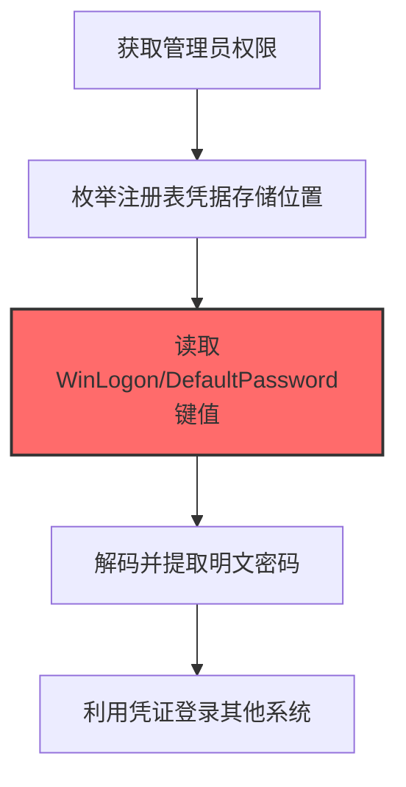
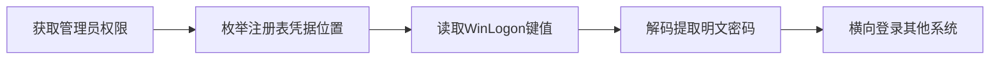

# Credentials in Registry (T1552.002)

## 一句话通俗理解

> **从Windows注册表里提取保存的密码**

## 30秒速查卡

| 维度 | 你需要知道的 |
|------|-------------|
| 这是什么？ | 从Windows注册表中提取保存的密码和认证信息 |
| 为什么危险？ | Windows注册表是密码的'藏宝图'，很多应用程序会把密码存在注册表里，而且通常是明文或弱加密 |
| 谁需要关心？ | Windows安全工程师、SOC分析师 |
| 你的第一步防御 | 监控注册表中敏感键值的异常读取，使用组策略限制注册表访问 |
| 如果只做一件事 | 监控HKLM\SOFTWARE\Microsoft\Windows NT\CurrentVersion\Winlogon等敏感注册表键的读取 |

## 难度等级

⭐ 初级 - 入门级技术，基础操作

## 前置知识检查

**读这个文件需要什么？**

- [ ] Windows认证体系（NTLM/Kerberos/LSASS）
- [ ] 哈希基础（NTLM Hash/SHA）
- [ ] 网络认证协议（SMB/LDAP/Kerberos）

## 技术描述

**注册表中的凭证**（T1552.002）是 **不安全的凭证**（T1552）的一个具体变体，属于 **凭证访问** 阶段的攻击技术。

> 📋 **打个比方**：就像翻看电脑的记事本找保存的密码——攻击者在Windows注册表中搜索存储的明文或编码凭证。

### 具体怎么理解？

从Windows注册表里提取保存的密码

攻击者使用这种技术时，通常是在凭证访问阶段，想要达到特定的攻击目标。与父技术 T1552 相比，T1552.002 有自己独特的特点和使用场景。

### 为什么有效？

这种技术之所以有效，是因为：
1. **隐蔽性**：利用了正常系统功能或常见协议，不容易被发现
2. **技术门槛适中**：不需要特别高深的技术知识就能实施

**过渡段：** 不要误解凭证访问只是'窃取密码'——在现代企业中，凭证存在于内存、磁盘、网络流量等多个位置。
3. **广泛适用**：可以在多种环境和系统中使用

## 真实攻击流程

### 典型场景

攻击者在 **凭证访问** 阶段使用 注册表中的凭证 技术，以下是典型的攻击步骤：



**步骤详解：**

1. **获取管理员权限** - 需要管理员权限才能读取注册表中受保护的凭证存储位置
2. **枚举注册表凭据存储位置** - 搜索HKLM\SOFTWARE\Microsoft\Windows\CurrentVersion\Authentication等注册表路径下存储的凭证
3. **读取WinLogon/DefaultPassword键值** - 从HKLM\SOFTWARE\Microsoft\Windows NT\CurrentVersion\WinLogon中读取自动登录密码
4. **解码并提取明文密码** - 注册表中的密码可能是Base64编码或DPAPI保护，需要解码还原
5. **利用凭证登录其他系统** - 使用提取的自动登录凭证或存储的RDP凭证横向移动

## 攻击流程

```
获取管理员权限 --> 枚举注册表凭据位置 --> 读取WinLogon键值 --> 解码提取明文密码 --> 横向登录其他系统
```



**步骤详解：**

1. **获取管理员权限**
   - 通俗描述：拿到目标主机的管理员权限，才能访问受保护的注册表键
   - 技术细节：通过提权漏洞（如 CVE-2021-1675 PrintNightmare）或令牌窃取提升至 SYSTEM/管理员
   - 常用工具：Mimikatz、JuicyPotato、PrintSpoofer、Beacon

2. **枚举注册表凭据位置**
   - 通俗描述：搜索注册表中可能存密码的高价值路径
   - 技术细节：枚举 `HKLM\SOFTWARE\Microsoft\Windows NT\CurrentVersion\WinLogon`、`HKLM\SYSTEM\CurrentControlSet\Services\`、VNC/TeamViewer 等三方软件配置键
   - 常用工具：reg query、Seatbelt、PowerUp、PowerShell Get-ItemProperty

3. **读取WinLogon键值**
   - 通俗描述：从自动登录配置中读取用户名和密码
   - 技术细节：读取 `DefaultUserName`、`DefaultPassword`、`AltDefaultPassword` 等键值，获取自动登录的明文凭证
   - 常用工具：reg query、regedit、SharpDPAPI、Seatbelt

4. **解码提取明文密码**
   - 通俗描述：注册表中的密码可能编码或加密，需要还原成明文
   - 技术细节：Base64 解码、DPAPI 解密、AES 解密（部分三方工具的弱保护），还原出可用的明文密码
   - 常用工具：SharpDPAPI、mimikatz dpapi、CyberChef、Python dpapi

5. **横向登录其他系统**
   - 通俗描述：用提取的凭证尝试登录其他主机或服务
   - 技术细节：使用 PtH、RDP、WinRM、SSH 等方式横向移动，或登录 Exchange、SQL Server 等服务
   - 常用工具：CrackMapExec、Impacket、Evil-WinRM、xfreerdp

## 真实案例

### 案例1：APT29 SolarWinds中的注册表凭证窃取

- **时间**: 2020-2021年
- **目标**: 美国国务院、财政部等联邦政府机构
- **攻击组织**: APT29（Nobelium/Cozy Bear，俄罗斯SVR关联）
- **手法**: 通过SUNBURST后门落地后，使用reg query HKLM\SOFTWARE\Microsoft\Windows NT\CurrentVersion\WinLogon读取DefaultPassword和DefaultUserName键值，提取配置自动登录的服务账户明文密码，横向访问域内其他共享服务器
- **影响**: 借助合法凭据静默横向移动，持续9个月未被异常登录告警发现
- **参考链接**: [CISA Alert AA21-008A](https://www.cisa.gov/news-events/cybersecurity-advisories/aa21-008a)

### 案例2：FIN7针对零售业的注册表凭证收集

- **时间**: 2017-2019年
- **目标**: 美国连锁餐厅和POS零售商（如Chipotle、Arby's）
- **攻击组织**: FIN7（Carbanak Group，俄语系金融犯罪组织）
- **手法**: 通过Carbanak后端读取HKCU\Software\Microsoft\Terminal Server Client\Servers下保存的RDP连接历史和HKLM\SECURITY\Policy\Secrets中的LSA Secret，配合注册表存储的VNC和 pcAnywhere密码横向移动到POS控制器
- **影响**: 窃取超过1500万张信用卡数据，造成美国零售业约10亿美元损失
- **参考链接**: [US DOJ FIN7 Indictment](https://www.justice.gov/opa/pr)

### 案例3：LockBit 3.0通过SessionGopher提取注册表会话凭证

- **时间**: 2023-2024年
- **目标**: 使用泄露的LockBit 3.0构建器生成的定制勒索软件攻击全球组织
- **攻击组织**: LockBit 3.0勒索软件团伙（LockBit供应商及其附属成员）
- **手法**: LockBit 3.0攻击者使用SessionGopher脚本通过WMI查询HKEY_USERS注册表项，提取PuTTY、WinSCP、FileZilla和Microsoft远程桌面等工具的已保存会话信息，同时提取.ppk私钥文件、.rdp远程桌面文件和.sdtid令牌文件，用于横向访问SSH服务器和远程桌面主机
- **影响**: 泄露的构建器导致多个衍生勒索变种出现，造成全球范围内多起重大数据泄露事件
- **参考链接**: [LockBit 3.0实况分析 - Kaspersky Securelist](https://securelist.com/lockbit-3-0-based-custom-targeted-ransomware/112375/)

## 红队视角

> ⚠️ **免责声明**：以下内容仅用于合法的安全测试、渗透测试和教育目的。未经授权对他人系统进行测试是违法行为。

### 实战技巧

1. **深入理解原理**：在实战应用前，充分理解Credentials in Registry的技术原理和适用场景
2. **环境适配**：根据目标系统的操作系统版本、安全配置等因素调整攻击策略
3. **组合使用**：将该技术与其他技术组合使用，构建完整的攻击链
4. **隐蔽性考虑**：注意操作痕迹的清理，避免被安全设备检测

### 常用工具

| 工具名称 | 用途 | 平台 | 链接 |
| -------- | ---- | ---- | ---- |
| reg.exe query | Windows原生注册表查询工具 | Windows | 系统自带 |
| Seatbelt | .NET注册表凭证自动化收集 | Windows | [Seatbelt](https://github.com/GhostPack/Seatbelt) |
| SharpCloud | .NET云凭证注册表扫描 | Windows | [SharpCloud](https://github.com/NetSPI/SharpCloud) |
| PowerSploit | PowerShell注册表凭证提取模块 | Windows | [PowerSploit](https://github.com/PowerShellMafia/PowerSploit) |

### 注意事项

- 在授权的测试环境中使用这些技术
- 注意操作安全（OPSEC），避免被检测系统发现
- 使用匿名化技术和代理隐藏真实身份

## 蓝队视角

### 检测要点

1. **系统日志监控**：关注与Credentials in Registry相关的系统日志和审计记录
2. **异常行为检测**：监控系统中与该技术相关的异常进程、网络连接和文件操作
3. **工具特征识别**：识别攻击者可能使用的工具在系统中的运行特征

### 监控建议

- 部署端点检测和响应（EDR）系统，监控与Credentials in Registry相关的异常行为
- 配置SIEM规则，关联分析来自多个来源的告警
- 定期进行安全评估和渗透测试，验证检测规则的有效性

## 避坑指南

组织中最危险盲区：认为强密码就足够安全。

## 检测建议

### 检测思路

检测 注册表中的凭证 的关键是识别异常行为模式。以下是三个层面的检测方法：

### 网络层检测

**方法**：监控网络流量中的异常模式

```bash
# 检测异常的网络连接和数据传输
# 根据具体协议和端口设置检测规则
```

### 主机层检测

**Windows事件ID**：
- 事件ID 4688：进程创建（监控可疑进程）
- 事件ID 4104：PowerShell执行（监控可疑脚本）

**Linux日志**：
- /var/log/auth.log：认证日志
- /var/log/syslog：系统日志

```bash
# 检测异常进程和命令执行
grep -i "suspicious" /var/log/auth.log
```

### 应用层检测

**用人话说：** 这条规则在监控是否有非系统进程在读取Windows注册表中的敏感键值。很多应用程序（如远程桌面、VPN客户端）会把密码存在注册表里。正常情况下只有对应的程序会读这些键。如果有陌生进程读取这些敏感注册表键，那就是攻击者在偷存在注册表里的密码。

**Sigma规则示例**：

```yaml
title: 检测注册表中的凭证
status: experimental
description: 检测可能的注册表中的凭证活动
logsource:
    category: process_creation
    product: windows
detection:
    selection:
        EventID: 4688
    condition: selection
level: medium
tags:
    - attack.T1552002
```

## 缓解措施

### 优先级1：关键措施

**限制攻击面**：减少暴露的服务和端口，降低被利用的风险

```bash
# 防火墙规则示例：只允许必要的出站连接
iptables -A OUTPUT -p tcp --dport 443 -j ACCEPT  # 允许HTTPS
iptables -A OUTPUT -p tcp --dport 80 -j ACCEPT   # 允许HTTP
iptables -A OUTPUT -p tcp -j DROP                 # 阻止其他TCP
```

### 优先级2：重要措施

**加强监控**：部署EDR和SIEM系统，实时监控异常行为

### 优先级3：建议措施

**安全意识培训**：教育员工识别相关攻击手法

## 动手实验

> ⚠️ **所有实验必须在隔离的实验室环境中进行**

### 实验1：理解基本原理（初级）

**目标**：理解 注册表中的凭证 的工作原理

**步骤**：
1. 在隔离环境中搭建测试系统
2. 使用基础工具模拟攻击行为
3. 观察系统日志和网络流量

**学习要点**：理解该技术的核心机制

### 实验2：实际操作（中级）

**目标**：掌握 注册表中的凭证 的实际使用方法

**步骤**：
1. 使用专业工具进行攻击模拟
2. 尝试不同的绕过技术
3. 分析检测日志的特征

**学习要点**：掌握工具使用和日志分析

### 实验3：防御验证（高级）

**目标**：验证检测规则的有效性

**步骤**：
1. 部署检测规则
2. 执行攻击模拟
3. 验证检测告警是否触发

**学习要点**：理解攻防对抗的实际效果

## 术语解释

| 术语 | 通俗解释 |
|------|---------|
| **ATT&CK** | MITRE公司维护的攻击技术知识库，像一本"黑客手法百科全书" |
| **注册表中的凭证** | T1552.002，ATT&CK框架中定义的一种具体攻击技术 |
| **不安全的凭证** | T1552，注册表中的凭证所属的父技术类别 |
| **凭证访问** | 攻击链中的一个阶段，攻击者在这个阶段的目标 |
| **C2** | 命令与控制，攻击者用来远程控制被入侵系统的"遥控器" |
| **EDR** | 端点检测与响应，部署在电脑上的安全监控软件 |

## 被引用情况

以下父技术文档引用了本子技术：

- [T1552 - 不安全的凭证](../T1552-Unsecured-Credentials.md)

## 参考资料

### 📚 官方文档（深入了解）

- [MITRE ATT&CK - Credentials in Registry (T1552.002)](https://attack.mitre.org/techniques/T1552/002/)
- [MITRE ATT&CK - 不安全的凭证 (T1552)](https://attack.mitre.org/techniques/T1552/)

### 📰 安全报告（真实攻击）

- [MITRE ATT&CK 官方文档](https://attack.mitre.org/) - ATT&CK 框架官方资源

### 🔧 工具与资源（动手试试）

- [Atomic Red Team](https://github.com/redcanaryco/atomic-red-team) - 检测规则测试框架
- [MITRE ATT&CK Navigator](https://mitre-attack.github.io/attack-navigator/) - ATT&CK 可视化工具

### 📚 学习资料（深入了解）

- [MITRE ATT&CK 知识库](https://attack.mitre.org/resources/) - ATT&CK 官方资源中心
