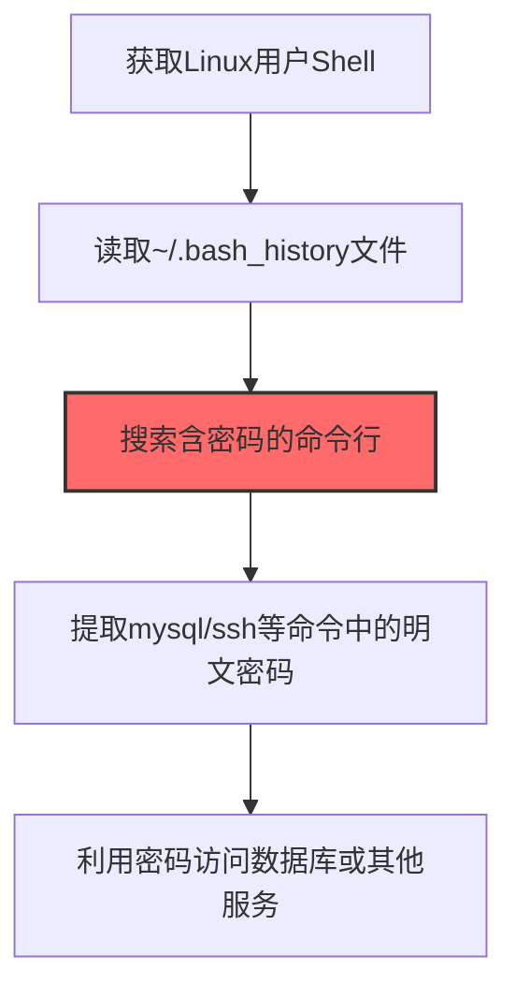
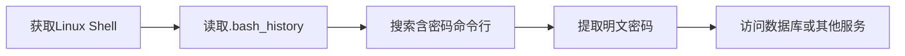

# Bash History (T1552.003)

## 一句话通俗理解

> **从命令行历史记录中翻出输入过的密码**

## 30秒速查卡

| 维度 | 你需要知道的 |
|------|-------------|
| 这是什么？ | 从Linux命令行历史记录中找到用户输入过的密码和敏感命令 |
| 为什么危险？ | 用户经常在命令行中直接输入密码，这些密码会保存在历史记录里，攻击者只需要读取就能拿到 |
| 谁需要关心？ | Linux系统管理员、SOC分析师、DevOps工程师 |
| 你的第一步防御 | 禁用包含敏感信息的命令历史记录，定期清理.bash_history |
| 如果只做一件事 | 监控对.bash_history文件的异常读取，特别是非用户本人的访问 |

## 难度等级

⭐ 初级 - 入门级技术，基础操作

## 前置知识检查

**读这个文件需要什么？**

- [ ] Windows认证体系（NTLM/Kerberos/LSASS）
- [ ] 哈希基础（NTLM Hash/SHA）
- [ ] 网络认证协议（SMB/LDAP/Kerberos）

## 技术描述

**Bash历史记录**（T1552.003）是 **不安全的凭证**（T1552）的一个具体变体，属于 **凭证访问** 阶段的攻击技术。

> 📜 **打个比方**：就像查看别人在终端输入过的命令历史——攻击者读取.bash_history等历史文件，找到曾经输入过的密码。

### 具体怎么理解？

从命令行历史记录中翻出输入过的密码

攻击者使用这种技术时，通常是在凭证访问阶段，想要达到特定的攻击目标。与父技术 T1552 相比，T1552.003 有自己独特的特点和使用场景。

### 为什么有效？

这种技术之所以有效，是因为：
1. **隐蔽性**：利用了正常系统功能或常见协议，不容易被发现
2. **技术门槛适中**：不需要特别高深的技术知识就能实施

**过渡段：** 不要误解凭证访问只是'窃取密码'——在现代企业中，凭证存在于内存、磁盘、网络流量等多个位置。
3. **广泛适用**：可以在多种环境和系统中使用

## 真实攻击流程

### 典型场景

攻击者在 **凭证访问** 阶段使用 Bash历史记录 技术，以下是典型的攻击步骤：



**步骤详解：**

1. **获取Linux用户Shell** - 通过SSH爆破或漏洞利用获得目标用户的Shell访问权限
2. **读取~/.bash_history文件** - 直接cat读取用户的命令历史记录，该文件记录了所有执行过的命令
3. **搜索含密码的命令行** - 过滤包含-p、--password、PASS=等参数的命令，这些命令中可能包含明文密码
4. **提取mysql/ssh等命令中的明文密码** - 从mysql -uroot -pP@ssw0rd、sshpass -p xxx等命令中提取密码字符串
5. **利用密码访问数据库或其他服务** - 使用提取的密码登录MySQL、Redis、MongoDB等数据库服务

## 攻击流程

```
获取Linux Shell --> 读取.bash_history --> 搜索含密码命令行 --> 提取明文密码 --> 访问数据库或其他服务
```



**步骤详解：**

1. **获取Linux Shell**
   - 通俗描述：拿到目标 Linux 用户的 shell 权限才能读取其历史记录
   - 技术细节：通过 SSH 弱口令爆破、Web 漏洞（RCE）、容器逃逸等方式获得交互式 shell
   - 常用工具：Hydra、Medusa、Cobalt Strike、reverse shell 脚本

2. **读取.bash_history**
   - 通俗描述：直接 cat 用户的历史命令记录文件
   - 技术细节：读取 `~/.bash_history`、`~/.zsh_history`、`~/.python_history`、`~/.mysql_history`、`~/.psql_history` 等历史文件
   - 常用工具：cat、less、tail、strings（针对二进制历史文件）

3. **搜索含密码命令行**
   - 通俗描述：从历史记录中过滤出包含密码参数的命令
   - 技术细节：grep 过滤 `-p`、`--password`、`PASS=`、`-passwd`、`token=` 等模式，识别 mysql/psql/sshpass/curl 等命令
   - 常用工具：grep、rg、awk、sed

4. **提取明文密码**
   - 通俗描述：从命令行参数中提取出明文密码字符串
   - 技术细节：解析 `mysql -uroot -pP@ssw0rd`、`sshpass -p xxx`、`curl -u admin:pass` 等命令的密码字段
   - 常用工具：grep -oP、awk、sed、自定义 Python 脚本

5. **访问数据库或其他服务**
   - 通俗描述：用提取的密码尝试登录数据库或其他服务
   - 技术细节：使用凭证连接 MySQL、Redis、MongoDB、PostgreSQL、SSH 等服务，或横向尝试其他用户复用
   - 常用工具：mysql、psql、redis-cli、ssh、CrackMapExec

## 真实案例

### 案例1：TeamTNT针对云Linux主机的命令历史窃取

- **时间**: 2020-2023年
- **目标**: 全球云上Linux主机（AWS/阿里云/腾讯云），主要针对运行Docker和Kubernetes的运维主机
- **攻击组织**: TeamTNT（云原生威胁组织）
- **手法**: TeamTNT通过暴露的Docker API或Redis未授权访问进入云主机后，执行`cat ~/.bash_history`和`cat /root/.bash_history`读取运维人员历史命令，从中提取明文的AWS Access Key、mysql -p密码、sshpass密码等凭证，进而横向到其他云主机和云资源
- **影响**: 窃取云账号凭证后用于挖矿和进一步横向，造成数千台云主机被入侵
- **参考链接**: [TeamTNT分析报告 - Aqua Security](https://blog.aquasec.com/)

### 案例2：APT41针对Linux服务器的命令历史分析

- **时间**: 2019-2020年
- **目标**: 东南亚电信企业和政府机构的Linux服务器
- **攻击组织**: APT41（双尾蝎/Wicked Panda）
- **手法**: APT41通过Web漏洞（Confluence、Citrix等）获得Shell后，使用`grep -E "password|passwd|pwd|mysql|ssh" /home/*/.bash_history /root/.bash_history`批量扫描所有用户的历史命令，从中提取数据库密码和SSH跳板密码，用于横向到内网数据库服务器
- **影响**: 成功窃取多个数据库凭证并访问敏感数据
- **参考链接**: [APT41报告 - FireEye](https://www.fireeye.com/)

### 案例3：8220 Gang的云主机命令历史凭证收割

- **时间**: 2022年
- **目标**: 全球云Linux主机（AWS/Azure/GCP/阿里云），主要针对运行Docker、Redis、WebLogic的云服务器
- **攻击组织**: 8220 Gang（云挖矿团伙，Rocke Group的后继者）
- **手法**: 8220 Gang的感染脚本第七步执行"Local SSH key collection, connectivity testing, and lateral spreading"，在被入侵云主机上收集SSH密钥和凭证，同时扫描运维人员的shell历史命令文件（.bash_history）提取通过命令行传递的mysql -p密码和sshpass密码，配合"Spirit"工具中450个硬编码SSH凭证进行暴力破解，横向传播到更多云主机
- **影响**: 感染超过30000台云主机，组建大规模挖矿僵尸网络，云账号被滥用产生巨额算力费用
- **参考链接**: [8220 Gang云僵尸网络分析 - SentinelOne](https://www.sentinelone.com/blog/from-the-front-lines-8220-gang-massively-expands-cloud-botnet-to-30000-infected-hosts/)

## 红队视角

> ⚠️ **免责声明**：以下内容仅用于合法的安全测试、渗透测试和教育目的。未经授权对他人系统进行测试是违法行为。

### 实战技巧

1. **深入理解原理**：在实战应用前，充分理解Bash History的技术原理和适用场景
2. **环境适配**：根据目标系统的操作系统版本、安全配置等因素调整攻击策略
3. **组合使用**：将该技术与其他技术组合使用，构建完整的攻击链
4. **隐蔽性考虑**：注意操作痕迹的清理，避免被安全设备检测

### 常用工具

| 工具名称 | 用途 | 平台 | 链接 |
| -------- | ---- | ---- | ---- |
| cat/grep/awk | 直接读取并过滤.bash_history中的密码行 | Linux | 系统自带 |
| LinPEAS | Linux权限提升枚举脚本，自动扫描所有用户的bash_history | Linux | [LinPEAS](https://github.com/carlospolop/PEASS-ng) |
| Shell History Parser | 专门解析shell历史文件提取凭证的脚本 | Linux | [shell-history-parser](https://github.com/) |
| LaZagne | 凭证抓取工具，可读取并解析shell历史中的密码 | 跨平台 | [LaZagne](https://github.com/AlessandroZ/LaZagne) |

### 注意事项

- 在授权的测试环境中使用这些技术
- 注意操作安全（OPSEC），避免被检测系统发现
- 使用匿名化技术和代理隐藏真实身份

## 蓝队视角

### 检测要点

1. **系统日志监控**：关注与Bash History相关的系统日志和审计记录
2. **异常行为检测**：监控系统中与该技术相关的异常进程、网络连接和文件操作
3. **工具特征识别**：识别攻击者可能使用的工具在系统中的运行特征

### 监控建议

- 部署端点检测和响应（EDR）系统，监控与Bash History相关的异常行为
- 配置SIEM规则，关联分析来自多个来源的告警
- 定期进行安全评估和渗透测试，验证检测规则的有效性

## 避坑指南

组织中最危险盲区：认为强密码就足够安全。

## 检测建议

### 检测思路

检测 Bash历史记录 的关键是识别异常行为模式。以下是三个层面的检测方法：

### 网络层检测

**方法**：监控网络流量中的异常模式

```bash
# 检测异常的网络连接和数据传输
# 根据具体协议和端口设置检测规则
```

### 主机层检测

**Windows事件ID**：
- 事件ID 4688：进程创建（监控可疑进程）
- 事件ID 4104：PowerShell执行（监控可疑脚本）

**Linux日志**：
- /var/log/auth.log：认证日志
- /var/log/syslog：系统日志

```bash
# 检测异常进程和命令执行
grep -i "suspicious" /var/log/auth.log
```

### 应用层检测

**用人话说：** 这条规则在监控是否有非用户本人在读取.bash_history文件。很多Linux用户会在命令行中直接输入密码（比如mysql -u root -pMyPassword），这些命令会保存在.bash_history中。如果有陌生进程读取这个文件，那就是攻击者在翻你的'命令行日记'找密码。

**Sigma规则示例**：

```yaml
title: 检测Bash历史记录
status: experimental
description: 检测可能的Bash历史记录活动
logsource:
    category: process_creation
    product: windows
detection:
    selection:
        EventID: 4688
    condition: selection
level: medium
tags:
    - attack.T1552003
```

## 缓解措施

### 优先级1：关键措施

**限制攻击面**：减少暴露的服务和端口，降低被利用的风险

```bash
# 防火墙规则示例：只允许必要的出站连接
iptables -A OUTPUT -p tcp --dport 443 -j ACCEPT  # 允许HTTPS
iptables -A OUTPUT -p tcp --dport 80 -j ACCEPT   # 允许HTTP
iptables -A OUTPUT -p tcp -j DROP                 # 阻止其他TCP
```

### 优先级2：重要措施

**加强监控**：部署EDR和SIEM系统，实时监控异常行为

### 优先级3：建议措施

**安全意识培训**：教育员工识别相关攻击手法

## 动手实验

> ⚠️ **所有实验必须在隔离的实验室环境中进行**

### 实验1：理解基本原理（初级）

**目标**：理解 Bash历史记录 的工作原理

**步骤**：
1. 在隔离环境中搭建测试系统
2. 使用基础工具模拟攻击行为
3. 观察系统日志和网络流量

**学习要点**：理解该技术的核心机制

### 实验2：实际操作（中级）

**目标**：掌握 Bash历史记录 的实际使用方法

**步骤**：
1. 使用专业工具进行攻击模拟
2. 尝试不同的绕过技术
3. 分析检测日志的特征

**学习要点**：掌握工具使用和日志分析

### 实验3：防御验证（高级）

**目标**：验证检测规则的有效性

**步骤**：
1. 部署检测规则
2. 执行攻击模拟
3. 验证检测告警是否触发

**学习要点**：理解攻防对抗的实际效果

## 术语解释

| 术语 | 通俗解释 |
|------|---------|
| **ATT&CK** | MITRE公司维护的攻击技术知识库，像一本"黑客手法百科全书" |
| **Bash历史记录** | T1552.003，ATT&CK框架中定义的一种具体攻击技术 |
| **不安全的凭证** | T1552，Bash历史记录所属的父技术类别 |
| **凭证访问** | 攻击链中的一个阶段，攻击者在这个阶段的目标 |
| **C2** | 命令与控制，攻击者用来远程控制被入侵系统的"遥控器" |
| **EDR** | 端点检测与响应，部署在电脑上的安全监控软件 |

## 被引用情况

以下父技术文档引用了本子技术：

- [T1552 - 不安全的凭证](../T1552-Unsecured-Credentials.md)

## 参考资料

### 📚 官方文档（深入了解）

- [MITRE ATT&CK - Bash History (T1552.003)](https://attack.mitre.org/techniques/T1552/003/)
- [MITRE ATT&CK - 不安全的凭证 (T1552)](https://attack.mitre.org/techniques/T1552/)

### 📰 安全报告（真实攻击）

- [MITRE ATT&CK 官方文档](https://attack.mitre.org/) - ATT&CK 框架官方资源

### 🔧 工具与资源（动手试试）

- [Atomic Red Team](https://github.com/redcanaryco/atomic-red-team) - 检测规则测试框架
- [MITRE ATT&CK Navigator](https://mitre-attack.github.io/attack-navigator/) - ATT&CK 可视化工具

### 📚 学习资料（深入了解）

- [MITRE ATT&CK 知识库](https://attack.mitre.org/resources/) - ATT&CK 官方资源中心
