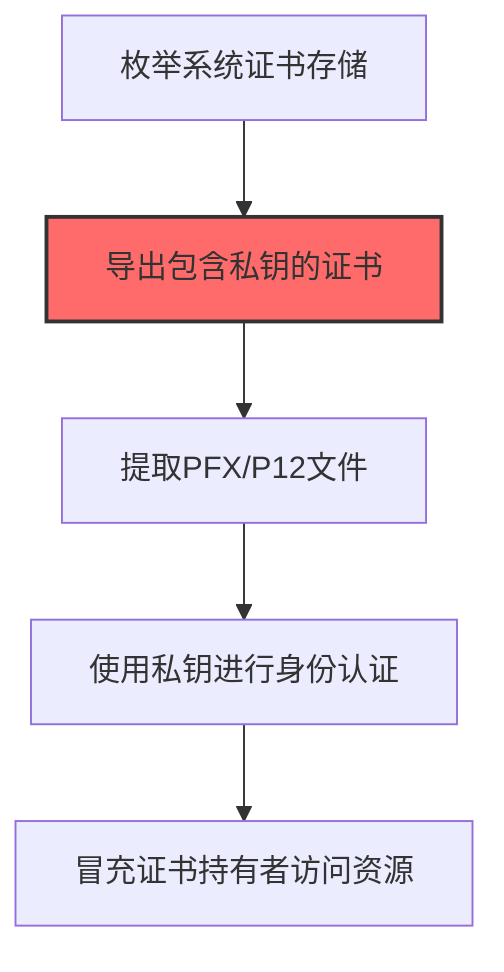
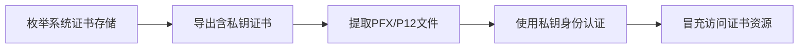

# Certificates (T1552.004)

## 一句话通俗理解

> **Certificates就是窃取数字证书的私钥。**

## 30秒速查卡

| 维度 | 你需要知道的 |
|------|-------------|
| 这是什么？ | 窃取数字证书的私钥，用于身份认证和加密通信 |
| 为什么危险？ | 私钥就是数字证书的'灵魂'，拿到它就能冒充证书持有者身份，发起加密通信或数字签名 |
| 谁需要关心？ | PKI管理员、安全工程师、SOC分析师 |
| 你的第一步防御 | 使用硬件安全模块（HSM）存储私钥，监控证书存储的异常访问 |
| 如果只做一件事 | 监控Windows证书存储和密钥文件（.pfx、.pem）的异常导出和访问 |

## 难度等级

⭐ 初级 - 需要一定的技术基础和实践经验

## 前置知识检查

**读这个文件需要什么？**

- [ ] Windows认证体系（NTLM/Kerberos/LSASS）
- [ ] 哈希基础（NTLM Hash/SHA）
- [ ] 网络认证协议（SMB/LDAP/Kerberos）

## 技术描述

**通俗解释：**

**过渡段：** 不要误解凭证访问只是'窃取密码'——在现代企业中，凭证存在于内存、磁盘、网络流量和云API等多个位置。攻击者关注的不是密码本身，而是'能用它做什么'：一个服务账号的哈希就能横向移动到数十台服务器，OAuth令牌可以访问整个SaaS租户的数据。
窃取数字证书的私钥

> 📜 **打个比方**：就像找到保险柜的备用钥匙——攻击者窃取数字证书用来签名恶意软件或进行身份认证。

**技术原理：**
T1552.004 是 不安全的凭证（T1552）的子技术，专注于Certificates这一特定方面。攻击者在凭证访问阶段，通过Certificates来获取目标系统或组织的相关信息，为后续攻击步骤做准备。

**用途与影响：**
- 为后续攻击提供关键信息支撑
- 提高攻击的成功率和精准度
- 降低攻击被发现的概率

## 真实攻击流程



**步骤详解：**

1. **枚举系统证书存储** - 使用certutil -store或PowerShell的Get-ChildItem遍历本地证书存储中的所有证书
2. **导出包含私钥的证书** - 找到标记为可导出（Exportable）的证书，使用certutil -exportPFX导出PFX文件
3. **提取PFX/P12文件** - 从证书存储、IIS配置或浏览器中提取包含私钥的PFX文件，设置密码保护或留空
4. **使用私钥进行身份认证** - 将证书导入攻击者系统，用于客户端证书认证（mTLS）或SAML签名
5. **冒充证书持有者访问资源** - 使用窃取的证书访问VPN、API网关或云服务等依赖证书认证的系统

## 攻击流程

```
枚举系统证书存储 --> 导出含私钥证书 --> 提取PFX/P12文件 --> 使用私钥身份认证 --> 冒充访问证书资源
```



**步骤详解：**

1. **枚举系统证书存储**
   - 通俗描述：扫描本机证书存储，找出可利用的证书
   - 技术细节：使用 `certutil -store` 或 PowerShell `Get-ChildItem Cert:\` 遍历 CurrentUser/LocalMachine 证书存储
   - 常用工具：certutil、PowerShell、Seatbelt、SharpCerts

2. **导出含私钥证书**
   - 通俗描述：把可导出的证书连带私钥导出为 PFX 文件
   - 技术细节：检查证书的 `Exportable` 标志，使用 `certutil -exportPFX` 或 `X509Certificate2.Export()` 导出含私钥的 PFX
   - 常用工具：certutil、PowerShell、Mimikatz crypto::export

3. **提取PFX/P12文件**
   - 通俗描述：从证书存储、IIS 配置或浏览器中提取 PFX 文件
   - 技术细节：从 `%APPDATA%\Microsoft\Crypto\`、IIS 配置、Firefox/Chrome 证书库中提取 PFX/P12，可设置保护密码或留空
   - 常用工具：SharpChrome、SharpWeb、LaZagne、Firepwd

4. **使用私钥身份认证**
   - 通俗描述：把证书导入攻击者机器，用于客户端证书认证
   - 技术细节：导入 PFX 到当前用户存储，使用证书进行 mTLS 客户端认证、SAML 令牌签名、Azure AD 应用认证
   - 常用工具：OpenSSL、PowerShell、AADInternals、SAMLTool

5. **冒充访问证书资源**
   - 通俗描述：冒充证书持有者访问 VPN、API、云服务
   - 技术细节：使用窃取的证书访问 VPN（Cisco AnyConnect、OpenVPN）、API 网关、Azure AD、AWS IAM 角色
   - 常用工具：OpenVPN、curl、Python requests、ROADtools

## 真实案例

### 案例1：APT29 SolarWinds供应链攻击中的证书窃取

- **时间**: 2020-2021年
- **目标**: SolarWinds Orion平台客户（多美国政府机构和Fortune 500企业）
- **攻击组织**: APT29（Nobelium/Cozy Bear）
- **手法**: APT29在入侵SolarWinds后，从被攻陷的ADFS服务器上导出SAML签名证书的私钥（使用AdfsDump和Mimikatz `crypto::cert /export`），随后用窃取的证书私钥自行签发SAML令牌，冒充任意用户访问Office 365、Azure等云服务，绕过MFA
- **影响**: 成功冒充多个政府高官身份访问邮件和云资源，攻击持续9个月才被发现
- **参考链接**: [SolarWinds后门分析 - Microsoft](https://www.microsoft.com/security/blog/)

### 案例2：APT28针对TLS客户端证书的窃取

- **时间**: 2018-2019年
- **目标**: 欧洲和北约政府机构的VPN用户
- **攻击组织**: APT28（Fancy Bear/Strontium）
- **手法**: APT28通过钓鱼邮件诱导目标运行恶意宏后，使用自定义工具扫描Windows证书存储（Cert:\CurrentUser\My和Cert:\LocalMachine\My），导出用于VPN客户端mTLS认证的私钥和证书（PFX格式），然后用窃取的证书直接连接受mTLS保护的内部VPN，绕过密码认证
- **影响**: 成功绕过强认证机制，建立长期持久化访问
- **参考链接**: [APT28报告 - ESET](https://www.welivesecurity.com/)

### 案例3：Turla利用伪造根证书实施TLS中间人攻击

- **时间**: 2024-2025年
- **目标**: 驻莫斯科的外国大使馆和外交实体
- **攻击组织**: Turla（Secret Blizzard/Persistent Storm，俄罗斯FSB关联APT组织）
- **手法**: Turla通过ApolloShadow恶意软件伪装成卡巴斯基安装程序（CertificateDB.exe），在被入侵的外国使馆主机上安装伪造的根证书，使攻击者能够拦截和解密受害者的TLS流量，从中窃取网络认证凭证和敏感通信内容
- **影响**: 成功实施TLS中间人攻击，持续截获外交通信内容，是首次确认针对驻莫斯科外交实体的证书伪造攻击
- **参考链接**: [Secret Blizzard攻击外交实体分析 - SecurityAffairs](https://securityaffairs.com/180638/apt/russia-linked-apt-secret-blizzard-targets-foreign-embassies-in-moscow-with-apolloshadow-malware.html)

## 红队视角

> ⚠️ **免责声明**：以下内容仅用于合法的安全测试、渗透测试和教育目的。未经授权对他人系统进行测试是违法行为。

### 实战技巧

1. **隐蔽优先**：在凭证访问阶段使用被动方式收集信息，避免触发安全告警
2. **信息验证**：对收集到的信息进行交叉验证，确保准确性和时效性
3. **工具选择**：根据目标环境选择合适的工具，避免使用已被广泛检测的工具
4. **OPSEC意识**：使用匿名网络、临时环境进行操作，防止溯源

### 常用工具

| 工具名称 | 用途 | 平台 | 链接 |
|---------|------|------|------|
| Mimikatz crypto::cert | 从Windows证书存储导出证书和私钥（PFX） | Windows | [Mimikatz](https://github.com/gentilkiwi/mimikatz) |
| certutil -exportPFX | Windows自带工具，导出证书为PFX文件 | Windows | 系统自带 |
| OpenSSL | 转换证书格式（PEM/PFX/DER）、提取私钥、伪造签名 | 跨平台 | [OpenSSL](https://www.openssl.org/) |
| SharpChain | 从ADFS服务器导出SAML签名证书私钥的工具 | Windows | [SharpChain](https://github.com/) |

### 注意事项

- 仅在授权范围内使用Certificates技术
- 注意操作的隐蔽性，避免被蓝队发现
- 记录操作日志，用于后续分析和报告编写

## 蓝队视角

### 检测要点

1. **异常信息收集行为**：监控来自内部系统的异常数据查询和收集行为
2. **可疑工具使用**：检测与Certificates相关的工具在内部网络中的使用
3. **异常网络流量**：监控对外部信息收集平台的可疑网络连接
4. **权限异常**：关注非授权用户的信息收集和查询行为

### 监控建议

- 部署信息收集行为的检测规则
- 建立基准行为模型，及时发现异常
- 定期审计敏感信息的访问记录

## 避坑指南

组织中最危险盲区：认为强密码就足够安全。

## 检测建议

### 网络层检测

**检测方法：** 监控与Certificates相关的网络流量特征

**具体规则/命令示例：**

```bash
# 监控异常DNS查询
tcpdump -i eth0 port 53 | grep -E "可疑域名"
```

### 主机层检测

**Windows事件ID：**

- 事件ID 4688：可疑进程创建
- 事件ID 4104：PowerShell脚本块日志

**Linux日志：**

- 日志文件：`/var/log/syslog`
- 关键字段：可疑命令执行

**用人话说：** 这条规则在监控是否有进程在读取或导出数字证书的私钥。私钥是数字证书的核心，正常情况下只有证书管理工具和对应的Web服务会访问它。如果有陌生进程试图读取证书存储或导出.pfx、.pem文件，那就是攻击者在偷数字证书的私钥，准备冒充合法身份。

### 应用层检测

**Sigma规则示例：**

```yaml
title: Suspicious Certificates Activity
status: experimental
description: Detects potential Certificates behavior
logsource:
  category: process_creation
  product: windows
detection:
  selection:
    Image|endswith: '\\可疑工具.exe'
  condition: selection
level: medium
tags:
  - attack.T1552/004
```

## 缓解措施

### 优先级1：关键措施

**措施名称：** 敏感信息保护

**具体实施步骤：**

1. 识别和分类组织内的敏感信息
2. 对敏感信息实施访问控制和加密
3. 部署信息泄露防护（DLP）解决方案

### 优先级2：重要措施

**措施名称：** 员工安全意识培训

**具体实施步骤：**

1. 定期开展信息安全意识培训
2. 教育员工识别社交工程攻击
3. 建立信息报告和响应机制

### 优先级3：建议措施

**措施名称：** 安全配置加固

**具体实施步骤：**

1. 限制公开可访问的系统信息
2. 配置合适的日志记录和告警策略
3. 定期进行安全评估和渗透测试

## 动手实验

> ⚠️ **重要提示**：所有实验必须在隔离的实验室环境中进行，禁止对未授权的真实系统进行测试。

### 实验环境准备

**推荐靶场/实验平台：**

| 平台名称 | 类型 | 难度 | 链接 |
|---------|------|:----:|------|
| 本地虚拟机 | 虚拟环境 | 初级 | 本机搭建 |
| TryHackMe | 在线靶场 | 初级 | https://tryhackme.com |

**所需工具：**

- 根据具体技术需求准备相应工具

**环境搭建：**

```bash
# 准备隔离的实验环境
# 具体命令根据实验内容而定
```

### 实验1：基础实践（初级）

**实验目标：** 理解和练习Certificates的基本操作

**实验步骤：**

1. 在隔离环境中搭建实验系统
2. 按照技术描述执行基本操作
3. 观察和记录实验现象

**预期结果：** 成功完成Certificates的基本操作

**学习要点：** 理解Certificates的原理和操作方法

## 术语解释

| 术语 | 英文原名 | 通俗解释 |
|-----|---------|---------|
| Certificates | Certificates | Certificates的基本概念和操作方法 |
| 侦察 | Reconnaissance | 收集目标信息的过程，为后续攻击做准备 |
| OPSEC | Operational Security | 操作安全，保护行动信息不被对手发现 |

## 被引用情况

以下父技术文档引用了本子技术：

- [T1552 - 不安全的凭证](../T1552-Unsecured-Credentials.md)

## 参考资料

### 📚 官方文档（深入了解）

- [MITRE ATT&CK - T1552](https://attack.mitre.org/techniques/T1552/)
- [MITRE ATT&CK - T1552.004](https://attack.mitre.org/techniques/T1552/004/)
- [MITRE ATT&CK - T1552.004 检测](https://attack.mitre.org/techniques/T1552/004/detections/)

### 📰 安全报告（真实攻击）

- [CISA Known Exploited Vulnerabilities](https://www.cisa.gov/known-exploited-vulnerabilities-catalog)
- [Microsoft Security Blog](https://www.microsoft.com/en-us/security/blog/)

### 学习资源

- [MITRE ATT&CK 官方文档](https://attack.mitre.org/)
- [ATT&CK STIX Data](https://github.com/mitre-attack/attack-stix-data)

