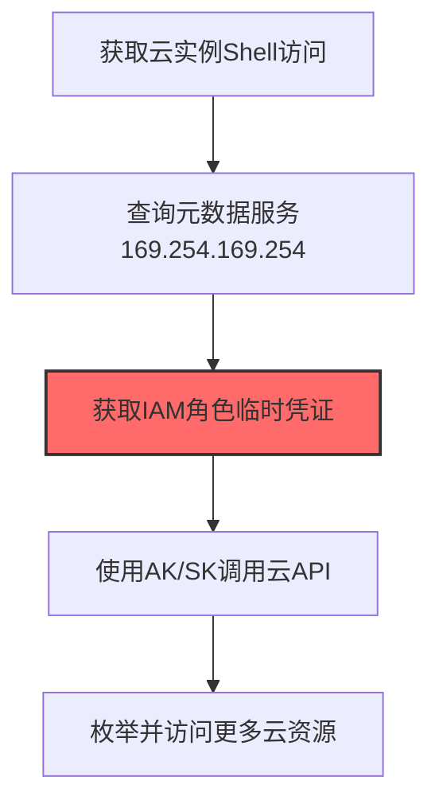
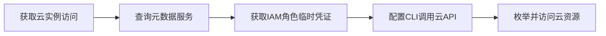

# Cloud Instance Metadata API (T1552.005)

## 一句话通俗理解

> **Cloud Instance Metadata API就是从云服务器"元数据"接口获取临时凭证。**

## 30秒速查卡

| 维度 | 你需要知道的 |
|------|-------------|
| 这是什么？ | 通过云服务器的元数据API获取临时访问凭证 |
| 为什么危险？ | 元数据API是云服务器的'身份证'，任何人都能从里面获取临时凭证，不需要任何认证 |
| 谁需要关心？ | 云安全工程师、DevOps工程师、SOC分析师 |
| 你的第一步防御 | 限制元数据API的访问，使用IMDSv2替代IMDSv1 |
| 如果只做一件事 | 监控对169.254.169.254元数据端点的异常HTTP请求，特别是来自Web应用的SSRF请求 |

## 难度等级

⭐ 初级 - 需要一定的技术基础和实践经验

## 前置知识检查

**读这个文件需要什么？**

- [ ] Windows认证体系（NTLM/Kerberos/LSASS）
- [ ] 哈希基础（NTLM Hash/SHA）
- [ ] 网络认证协议（SMB/LDAP/Kerberos）

## 技术描述

**通俗解释：**

**过渡段：** 不要误解凭证访问只是'窃取密码'——在现代企业中，凭证存在于内存、磁盘、网络流量和云API等多个位置。攻击者关注的不是密码本身，而是'能用它做什么'：一个服务账号的哈希就能横向移动到数十台服务器，OAuth令牌可以访问整个SaaS租户的数据。
从云服务器"元数据"接口获取临时凭证

> ☁️ **打个比方**：就像从云服务的管理员日志里找到API密钥——攻击者查询云实例元数据服务，获取临时凭证。

**技术原理：**
T1552.005 是 不安全的凭证（T1552）的子技术，专注于Cloud Instance Metadata API这一特定方面。攻击者在凭证访问阶段，通过Cloud Instance Metadata API来获取目标系统或组织的相关信息，为后续攻击步骤做准备。

**用途与影响：**
- 为后续攻击提供关键信息支撑
- 提高攻击的成功率和精准度
- 降低攻击被发现的概率

## 真实攻击流程



**步骤详解：**

1. **获取云实例Shell访问** - 通过SSRF漏洞或已入侵的云服务器获得在目标实例上执行命令的能力
2. **查询元数据服务169.254.169.254** - 向云实例元数据服务发送HTTP请求（如curl http://169.254.169.254/latest/meta-data/）
3. **获取IAM角色临时凭证** - 从元数据服务的iam/security-credentials/路径获取分配给实例的IAM角色的临时AK/SK/Token
4. **使用AK/SK调用云API** - 使用获取的临时凭证配置AWS CLI或SDK，以实例身份调用云API
5. **枚举并访问更多云资源** - 根据IAM角色权限枚举S3存储桶、RDS实例、Lambda函数等资源并窃取数据
5. **利用信息进行下一步攻击** - 基于收集到的信息制定后续攻击计划

## 攻击流程

```
获取云实例访问 --> 查询元数据服务 --> 获取IAM角色临时凭证 --> 配置CLI调用云API --> 枚举并访问云资源
```



**步骤详解：**

1. **获取云实例访问**
   - 通俗描述：通过 SSRF 漏洞或已沦陷的云服务器拿到在实例上发请求的能力
   - 技术细节：利用 SSRF（如 SSRF 漏洞、XXE）或通过 RCE 拿到云主机 shell，访问元数据服务 IP `169.254.169.254`
   - 常用工具：curl、SSRFProxy、Gopherus、Metasploit

2. **查询元数据服务**
   - 通俗描述：向云元数据服务发请求，了解实例身份与配置
   - 技术细节：发送 `curl http://169.254.169.254/latest/meta-data/`，AWS v1 无需认证；v2/IMDSv2 需先获取 token
   - 常用工具：curl、wget、Python requests、cloudsploit

3. **获取IAM角色临时凭证**
   - 通俗描述：从元数据中提取分配给实例的 IAM 角色临时凭证
   - 技术细节：访问 `iam/security-credentials/<role-name>` 路径，获取 AccessKeyId、SecretAccessKey、Token 三件套
   - 常用工具：curl、CloudGoat、Pacu、CloudSploit

4. **配置CLI调用云API**
   - 通俗描述：用临时凭证配置 AWS CLI 或 SDK，以实例身份调用云 API
   - 技术细节：设置 `AWS_ACCESS_KEY_ID`、`AWS_SECRET_ACCESS_KEY`、`AWS_SESSION_TOKEN` 环境变量，或写入 `~/.aws/credentials`
   - 常用工具：aws-cli、boto3、Azure CLI、gcloud

5. **枚举并访问云资源**
   - 通俗描述：根据 IAM 权限枚举 S3、RDS、Lambda 等资源并窃取数据
   - 技术细节：调用 `aws s3 ls`、`aws rds describe-db-instances`、`aws lambda list-functions` 等接口，识别可访问资源并下载
   - 常用工具：aws-cli、Pacu、MicroBurst、CloudFox

## 真实案例

### 案例1：Capital One数据泄露事件（SSRF+IMDS经典案例）

- **时间**: 2019年
- **目标**: Capital One银行，1.06亿信用卡用户数据
- **攻击组织**: Paige Thompson（前AWS工程师，单人作案）
- **手法**: 攻击者利用Capital One部署在AWS上的WAF存在SSRF漏洞，通过该漏洞从内部网络访问EC2实例元数据服务（IMDSv1，地址169.254.169.254），获取附加在EC2实例上的IAM角色凭证（AccessKey/SecretToken），然后用该凭证访问S3存储桶，下载了1.06亿条用户数据
- **影响**: 美国历史上最大的银行业数据泄露之一，Capital One被罚款1.9亿美元
- **参考链接**: [Capital One数据泄露 - DOJ起诉书](https://www.justice.gov/)

### 案例2：TeamTNT针对云实例IMDS的凭证窃取

- **时间**: 2021-2022年
- **目标**: 全球云上Linux主机（AWS/阿里云/GCP）
- **攻击组织**: TeamTNT（云原生威胁组织）
- **手法**: TeamTNT通过暴露的Docker API或Redis未授权访问进入云主机后，执行`curl http://169.254.169.254/latest/meta-data/iam/security-credentials/`获取附加在实例上的IAM角色名称，再请求`/latest/meta-data/iam/security-credentials/<role-name>`获取临时AWS凭证，进而配置aws cli访问云资源用于挖矿
- **影响**: 窃取大量云账号凭证，造成云算力被滥用挖矿
- **参考链接**: [TeamTNT云攻击分析 - Trend Micro](https://www.trendmicro.com/)

### 案例3：Kinsing通过Looney Tunables漏洞窃取云实例IMDS凭证

- **时间**: 2023年
- **目标**: 云原生环境（AWS、Azure）中运行易受攻击的Linux内核版本的Docker/Kubernetes主机
- **攻击组织**: Kinsing（云挖矿恶意软件团伙）
- **手法**: Kinsing利用Looney Tunables漏洞（CVE-2023-4911，Linux内核glibc缓冲区溢出）获取root权限后，访问云实例元数据服务http://169.254.169.254/latest/dynamic/instance-identity/document获取AWS实例身份文档和IAM角色凭证，这是首次记录到Kinsing收集IMDS凭证的行为
- **影响**: 首次确认Kinsing从云挖矿扩展到云凭证窃取，可能导致更大范围的云资源被接管
- **参考链接**: [Looney Tunables漏洞被Kinsing利用 - Aqua Security](https://www.aquasec.com/blog/loony-tunables-vulnerability-exploited-by-kinsing/)

## 红队视角

> ⚠️ **免责声明**：以下内容仅用于合法的安全测试、渗透测试和教育目的。未经授权对他人系统进行测试是违法行为。

### 实战技巧

1. **隐蔽优先**：在凭证访问阶段使用被动方式收集信息，避免触发安全告警
2. **信息验证**：对收集到的信息进行交叉验证，确保准确性和时效性
3. **工具选择**：根据目标环境选择合适的工具，避免使用已被广泛检测的工具
4. **OPSEC意识**：使用匿名网络、临时环境进行操作，防止溯源

### 常用工具

| 工具名称 | 用途 | 平台 | 链接 |
|---------|------|------|------|
| curl | 直接请求169.254.169.254元数据接口（最基础最常用） | 跨平台 | 系统自带 |
| Pacu | AWS攻击框架，含imds枚举模块自动抓取IAM凭证 | 跨平台 | [Pacu](https://github.com/RhinoSecurityLabs/pacu) |
| CloudSploit | 云配置扫描器，可枚举元数据服务暴露的凭证 | 跨平台 | [CloudSploit](https://github.com/aquasecurity/cloudsploit) |
| spoiled_scraper | 专门通过SSRF扫描IMDS泄露凭证的脚本 | 跨平台 | [spoiled_scraper](https://github.com/) |

### 注意事项

- 仅在授权范围内使用Cloud Instance Metadata API技术
- 注意操作的隐蔽性，避免被蓝队发现
- 记录操作日志，用于后续分析和报告编写

## 蓝队视角

### 检测要点

1. **异常信息收集行为**：监控来自内部系统的异常数据查询和收集行为
2. **可疑工具使用**：检测与Cloud Instance Metadata API相关的工具在内部网络中的使用
3. **异常网络流量**：监控对外部信息收集平台的可疑网络连接
4. **权限异常**：关注非授权用户的信息收集和查询行为

### 监控建议

- 部署信息收集行为的检测规则
- 建立基准行为模型，及时发现异常
- 定期审计敏感信息的访问记录

## 避坑指南

组织中最危险盲区：认为强密码就足够安全。

## 检测建议

### 网络层检测

**检测方法：** 监控与Cloud Instance Metadata API相关的网络流量特征

**具体规则/命令示例：**

```bash
# 监控异常DNS查询
tcpdump -i eth0 port 53 | grep -E "可疑域名"
```

### 主机层检测

**Windows事件ID：**

- 事件ID 4688：可疑进程创建
- 事件ID 4104：PowerShell脚本块日志

**Linux日志：**

- 日志文件：`/var/log/syslog`
- 关键字段：可疑命令执行

**用人话说：** 这条规则在监控是否有进程在访问云服务器的元数据API。云服务器的元数据API（169.254.169.254）就像服务器的'身份证'，里面存着临时访问凭证。正常情况下只有服务器初始化时会访问它。如果有Web应用或陌生进程访问这个API，那很可能是攻击者通过SSRF漏洞在偷云服务器的临时凭证。

### 应用层检测

**Sigma规则示例：**

```yaml
title: Suspicious Cloud Instance Metadata API Activity
status: experimental
description: Detects potential Cloud Instance Metadata API behavior
logsource:
  category: process_creation
  product: windows
detection:
  selection:
    Image|endswith: '\\可疑工具.exe'
  condition: selection
level: medium
tags:
  - attack.T1552/005
```

## 缓解措施

### 优先级1：关键措施

**措施名称：** 敏感信息保护

**具体实施步骤：**

1. 识别和分类组织内的敏感信息
2. 对敏感信息实施访问控制和加密
3. 部署信息泄露防护（DLP）解决方案

### 优先级2：重要措施

**措施名称：** 员工安全意识培训

**具体实施步骤：**

1. 定期开展信息安全意识培训
2. 教育员工识别社交工程攻击
3. 建立信息报告和响应机制

### 优先级3：建议措施

**措施名称：** 安全配置加固

**具体实施步骤：**

1. 限制公开可访问的系统信息
2. 配置合适的日志记录和告警策略
3. 定期进行安全评估和渗透测试

## 动手实验

> ⚠️ **重要提示**：所有实验必须在隔离的实验室环境中进行，禁止对未授权的真实系统进行测试。

### 实验环境准备

**推荐靶场/实验平台：**

| 平台名称 | 类型 | 难度 | 链接 |
|---------|------|:----:|------|
| 本地虚拟机 | 虚拟环境 | 初级 | 本机搭建 |
| TryHackMe | 在线靶场 | 初级 | https://tryhackme.com |

**所需工具：**

- 根据具体技术需求准备相应工具

**环境搭建：**

```bash
# 准备隔离的实验环境
# 具体命令根据实验内容而定
```

### 实验1：基础实践（初级）

**实验目标：** 理解和练习Cloud Instance Metadata API的基本操作

**实验步骤：**

1. 在隔离环境中搭建实验系统
2. 按照技术描述执行基本操作
3. 观察和记录实验现象

**预期结果：** 成功完成Cloud Instance Metadata API的基本操作

**学习要点：** 理解Cloud Instance Metadata API的原理和操作方法

## 术语解释

| 术语 | 英文原名 | 通俗解释 |
|-----|---------|---------|
| Cloud Instance Metadata API | Cloud Instance Metadata API | Cloud Instance Metadata API的基本概念和操作方法 |
| 侦察 | Reconnaissance | 收集目标信息的过程，为后续攻击做准备 |
| OPSEC | Operational Security | 操作安全，保护行动信息不被对手发现 |

## 被引用情况

以下父技术文档引用了本子技术：

- [T1552 - 不安全的凭证](../T1552-Unsecured-Credentials.md)

## 参考资料

### 📚 官方文档（深入了解）

- [MITRE ATT&CK - T1552](https://attack.mitre.org/techniques/T1552/)
- [MITRE ATT&CK - T1552.005](https://attack.mitre.org/techniques/T1552/005/)
- [MITRE ATT&CK - T1552.005 检测](https://attack.mitre.org/techniques/T1552/005/detections/)

### 📰 安全报告（真实攻击）

- [CISA Known Exploited Vulnerabilities](https://www.cisa.gov/known-exploited-vulnerabilities-catalog)
- [Microsoft Security Blog](https://www.microsoft.com/en-us/security/blog/)

### 学习资源

- [MITRE ATT&CK 官方文档](https://attack.mitre.org/)
- [ATT&CK STIX Data](https://github.com/mitre-attack/attack-stix-data)

