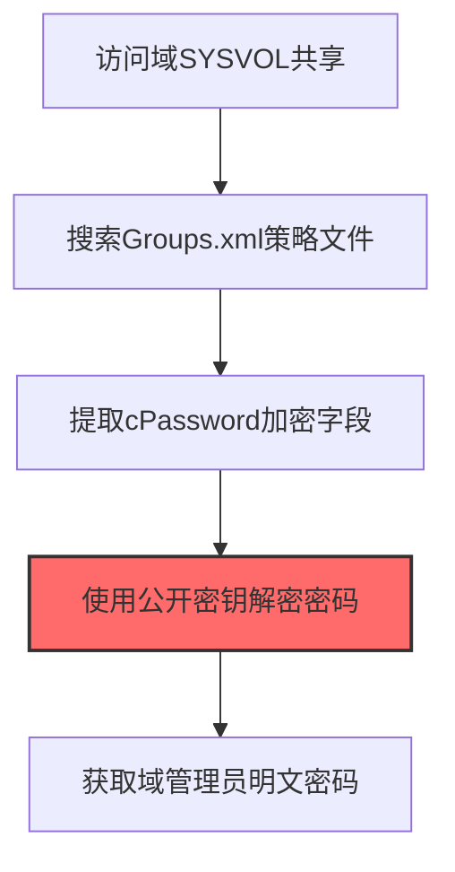

# Group Policy Preferences (T1552.006)

## 一句话通俗理解

> **从域策略文件中解密管理员密码**

## 30秒速查卡

| 维度 | 你需要知道的 |
|------|-------------|
| 这是什么？ | 从域策略文件中解密管理员密码 |
| 为什么危险？ | 组策略偏好设置中可能包含用已知密钥加密的密码，任何人都能解密，相当于把密码放在了公开的保险箱里 |
| 谁需要关心？ | 域管理员、Active Directory安全工程师、SOC分析师 |
| 你的第一步防御 | 删除组策略偏好中的密码设置，使用LAPS管理本地管理员密码 |
| 如果只做一件事 | 扫描SYSVOL共享中的Groups.xml等GPP文件，检查是否包含cpassword字段 |

## 难度等级

⭐ 初级 - 入门级技术，基础操作

## 前置知识检查

**读这个文件需要什么？**

- [ ] Windows认证体系（NTLM/Kerberos/LSASS）
- [ ] 哈希基础（NTLM Hash/SHA）
- [ ] 网络认证协议（SMB/LDAP/Kerberos）

## 技术描述

**组策略首选项**（T1552.006）是 **不安全的凭证**（T1552）的一个具体变体，属于 **凭证访问** 阶段的攻击技术。

> 🏛️ **打个比方**：就像从公司的制度文件里翻到了门禁密码——攻击者从组策略首选项中提取存储的账号密码。

### 具体怎么理解？

从域策略文件中解密管理员密码

攻击者使用这种技术时，通常是在凭证访问阶段，想要达到特定的攻击目标。与父技术 T1552 相比，T1552.006 有自己独特的特点和使用场景。

### 为什么有效？

这种技术之所以有效，是因为：
1. **隐蔽性**：利用了正常系统功能或常见协议，不容易被发现
2. **技术门槛适中**：不需要特别高深的技术知识就能实施

**过渡段：** 不要误解凭证访问只是'窃取密码'——在现代企业中，凭证存在于内存、磁盘、网络流量等多个位置。
3. **广泛适用**：可以在多种环境和系统中使用

## 真实攻击流程

### 典型场景

攻击者在 **凭证访问** 阶段使用 组策略首选项 技术，以下是典型的攻击步骤：



**步骤详解：**

1. **访问域SYSVOL共享** - 任何域用户都可读取\\domain.com\SYSVOL共享，其中存储了所有组策略文件
2. **搜索Groups.xml策略文件** - 在SYSVOL中搜索Groups.xml、Services.xml、Scheduledtasks.xml等包含cPassword的策略文件
3. **提取cPassword加密字段** - 从XML文件中提取cPassword属性值，这是AES加密的密码（微软已公开密钥）
4. **使用公开密钥解密密码** - 使用Get-GPPPassword工具或PowerShell脚本，用微软公开的AES密钥解密cPassword
5. **获取域管理员明文密码** - 解密后得到明文密码，通常是本地管理员密码或服务账户密码

## 攻击流程

```
访问域SYSVOL共享 --> 搜索Groups.xml文件 --> 提取cPassword字段 --> AES密钥解密密码 --> 获取管理员明文密码
```


**步骤详解：**

1. **访问域SYSVOL共享**
   - 通俗描述：任何域用户都可读取 SYSVOL 共享，里面存了所有组策略文件
   - 技术细节：通过 SMB 访问 `\\<domain>\SYSVOL\<domain>\Policies\`，无需特殊权限
   - 常用工具：net use、smbclient、CrackMapExec、PowerShell

2. **搜索Groups.xml文件**
   - 通俗描述：在 SYSVOL 里翻找含 cPassword 的策略 XML
   - 技术细节：搜索 `Groups.xml`、`Services.xml`、`Scheduledtasks.xml`、`Drives.xml`、`DataSources.xml`，定位含 `cPassword=` 属性的文件
   - 常用工具：findstr、PowerShell Get-ChildItem、Get-GPPPassword

3. **提取cPassword字段**
   - 通俗描述：从 XML 中复制 cPassword 属性的值
   - 技术细节：解析 XML，提取 `cPassword` 属性值（AES-256-CBC 加密，Base64 编码）
   - 常用工具：PowerShell、Python xml.etree、grep

4. **AES密钥解密密码**
   - 通俗描述：用微软公开的 AES 密钥解密 cPassword 字段
   - 技术细节：微软在 MSDN 公开了 GPP 使用的 AES-256 密钥（`4e 99 07 e0 6f ...`），用该密钥解密即可还原明文
   - 常用工具：Get-GPPPassword、gpp-decrypt、Python pycryptodome

5. **获取管理员明文密码**
   - 通俗描述：解密后得到明文密码，通常是本地管理员或服务账户密码
   - 技术细节：拿到明文密码后，可用 PtH 或直接登录的方式横向移动到域内其他主机
   - 常用工具：CrackMapExec、Impacket、Hydra、RDP

## 真实案例

### 案例1：FIN7针对零售业的GPP密码利用

- **时间**: 2017-2018年
- **目标**: 美国和欧洲大型零售连锁企业（含餐饮集团）
- **攻击组织**: FIN7（Carbanak Group）
- **手法**: FIN7通过钓鱼邮件入侵员工主机后，获取域用户权限访问\\domain\SYSVOL共享，使用Get-GPPPassword解析Groups.xml中的cPassword字段（微软已公开AES密钥），解密出本地管理员统一密码，进而横跨数百台服务器部署Carbanak后门
- **影响**: 入侵数十家零售企业，窃取数百万张信用卡数据
- **参考链接**: [FIN7起诉书 - DOJ](https://www.justice.gov/)

### 案例2：Conti勒索软件的GPP批量密码利用

- **时间**: 2021-2022年
- **目标**: 全球各类企业（医疗机构、制造商、政府机构）
- **攻击组织**: Conti勒索软件团伙
- **手法**: Conti通过初始访问 broker购买VPN凭证或利用Exchange漏洞进入内网后，第一步就是执行`Get-GPPPassword`扫描所有域控SYSVOL中的XML策略文件（Groups.xml/Services.xml/Scheduledtasks.xml），批量解密cPassword获得本地管理员和服务账户密码，用于自动化横向到所有未打补丁的旧服务器
- **影响**: 数百个组织被勒索，累计赎金超过1亿美元
- **参考链接**: [Conti泄露分析 - Mandiant](https://www.mandiant.com/)

### 案例3：LockBit勒索软件的GPP凭证扫描与解密

- **时间**: 2020-2023年
- **目标**: 全球关键基础设施组织（1000+次攻击，美国地区勒索赎金超9100万美元）
- **攻击组织**: LockBit勒索软件团伙（LockBit供应商及其附属成员）
- **手法**: LockBit附属成员使用PowerShell和批处理脚本执行"密码/凭证搜寻"，扫描域控SYSVOL共享中的Groups.xml、Services.xml等GPP策略文件，使用微软已公开的AES密钥解密cPassword字段获取本地管理员和服务账户明文密码，配合Mimikatz、LaZagne、ExtPassword等工具进行横向移动
- **影响**: LockBit成为2020-2023年全球最活跃的勒索软件家族，发动超过1000次攻击，在美国造成约9100万美元赎金损失
- **参考链接**: [LockBit威胁行为者分析 - CISA Advisory AA23-165A](https://www.cisa.gov/news-events/cybersecurity-advisories/aa23-165a)

## 红队视角

> ⚠️ **免责声明**：以下内容仅用于合法的安全测试、渗透测试和教育目的。未经授权对他人系统进行测试是违法行为。

### 实战技巧

1. **深入理解原理**：在实战应用前，充分理解Group Policy Preferences的技术原理和适用场景
2. **环境适配**：根据目标系统的操作系统版本、安全配置等因素调整攻击策略
3. **组合使用**：将该技术与其他技术组合使用，构建完整的攻击链
4. **隐蔽性考虑**：注意操作痕迹的清理，避免被安全设备检测

### 常用工具

| 工具名称 | 用途 | 平台 | 链接 |
| -------- | ---- | ---- | ---- |
| Get-GPPPassword | PowerSploit模块，自动扫描SYSVOL并解密所有cPassword | Windows | [PowerSploit](https://github.com/PowerShellMafia/PowerSploit) |
| gpp_decrypt | Python脚本，用微软公开AES密钥离线解密cPassword字段 | 跨平台 | [gpp_decrypt](https://github.com/PowerShellMafia/PowerSploit) |
| PowerView | 枚举GPO并定位含cPassword的XML文件 | Windows | [PowerView](https://github.com/PowerShellMafia/PowerSploit) |
| CrackMapExec | 内网横向工具，内置gpp_password模块批量扫描 | 跨平台 | [CrackMapExec](https://github.com/byt3bl33d3r/CrackMapExec) |

### 注意事项

- 在授权的测试环境中使用这些技术
- 注意操作安全（OPSEC），避免被检测系统发现
- 使用匿名化技术和代理隐藏真实身份

## 蓝队视角

### 检测要点

1. **系统日志监控**：关注与Group Policy Preferences相关的系统日志和审计记录
2. **异常行为检测**：监控系统中与该技术相关的异常进程、网络连接和文件操作
3. **工具特征识别**：识别攻击者可能使用的工具在系统中的运行特征

### 监控建议

- 部署端点检测和响应（EDR）系统，监控与Group Policy Preferences相关的异常行为
- 配置SIEM规则，关联分析来自多个来源的告警
- 定期进行安全评估和渗透测试，验证检测规则的有效性

## 避坑指南

组织中最危险盲区：认为强密码就足够安全。

## 检测建议

### 检测思路

检测 组策略首选项 的关键是识别异常行为模式。以下是三个层面的检测方法：

### 网络层检测

**方法**：监控网络流量中的异常模式

```bash
# 检测异常的网络连接和数据传输
# 根据具体协议和端口设置检测规则
```

### 主机层检测

**Windows事件ID**：
- 事件ID 4688：进程创建（监控可疑进程）
- 事件ID 4104：PowerShell执行（监控可疑脚本）

**Linux日志**：
- /var/log/auth.log：认证日志
- /var/log/syslog：系统日志

```bash
# 检测异常进程和命令执行
grep -i "suspicious" /var/log/auth.log
```

### 应用层检测

**用人话说：** 这条规则在扫描域控制器的SYSVOL共享中是否包含GPP密码。组策略偏好设置（GPP）允许管理员通过域策略分发密码，但这个密码是用微软公开的密钥加密的，任何人都能解密。如果你发现GPP文件中有cpassword字段，那就是攻击者可以轻松解密获取的管理员密码。

**Sigma规则示例**：

```yaml
title: 检测组策略首选项
status: experimental
description: 检测可能的组策略首选项活动
logsource:
    category: process_creation
    product: windows
detection:
    selection:
        EventID: 4688
    condition: selection
level: medium
tags:
    - attack.T1552006
```

## 缓解措施

### 优先级1：关键措施

**限制攻击面**：减少暴露的服务和端口，降低被利用的风险

```bash
# 防火墙规则示例：只允许必要的出站连接
iptables -A OUTPUT -p tcp --dport 443 -j ACCEPT  # 允许HTTPS
iptables -A OUTPUT -p tcp --dport 80 -j ACCEPT   # 允许HTTP
iptables -A OUTPUT -p tcp -j DROP                 # 阻止其他TCP
```

### 优先级2：重要措施

**加强监控**：部署EDR和SIEM系统，实时监控异常行为

### 优先级3：建议措施

**安全意识培训**：教育员工识别相关攻击手法

## 动手实验

> ⚠️ **所有实验必须在隔离的实验室环境中进行**

### 实验1：理解基本原理（初级）

**目标**：理解 组策略首选项 的工作原理

**步骤**：
1. 在隔离环境中搭建测试系统
2. 使用基础工具模拟攻击行为
3. 观察系统日志和网络流量

**学习要点**：理解该技术的核心机制

### 实验2：实际操作（中级）

**目标**：掌握 组策略首选项 的实际使用方法

**步骤**：
1. 使用专业工具进行攻击模拟
2. 尝试不同的绕过技术
3. 分析检测日志的特征

**学习要点**：掌握工具使用和日志分析

### 实验3：防御验证（高级）

**目标**：验证检测规则的有效性

**步骤**：
1. 部署检测规则
2. 执行攻击模拟
3. 验证检测告警是否触发

**学习要点**：理解攻防对抗的实际效果

## 术语解释

| 术语 | 通俗解释 |
|------|---------|
| **ATT&CK** | MITRE公司维护的攻击技术知识库，像一本"黑客手法百科全书" |
| **组策略首选项** | T1552.006，ATT&CK框架中定义的一种具体攻击技术 |
| **不安全的凭证** | T1552，组策略首选项所属的父技术类别 |
| **凭证访问** | 攻击链中的一个阶段，攻击者在这个阶段的目标 |
| **C2** | 命令与控制，攻击者用来远程控制被入侵系统的"遥控器" |
| **EDR** | 端点检测与响应，部署在电脑上的安全监控软件 |

## 被引用情况

以下父技术文档引用了本子技术：

- [T1552 - 不安全的凭证](../T1552-Unsecured-Credentials.md)

## 参考资料

### 📚 官方文档（深入了解）

- [MITRE ATT&CK - Group Policy Preferences (T1552.006)](https://attack.mitre.org/techniques/T1552/006/)
- [MITRE ATT&CK - 不安全的凭证 (T1552)](https://attack.mitre.org/techniques/T1552/)

### 📰 安全报告（真实攻击）

- [MITRE ATT&CK 官方文档](https://attack.mitre.org/) - ATT&CK 框架官方资源

### 🔧 工具与资源（动手试试）

- [Atomic Red Team](https://github.com/redcanaryco/atomic-red-team) - 检测规则测试框架
- [MITRE ATT&CK Navigator](https://mitre-attack.github.io/attack-navigator/) - ATT&CK 可视化工具

### 📚 学习资料（深入了解）

- [MITRE ATT&CK 知识库](https://attack.mitre.org/resources/) - ATT&CK 官方资源中心
