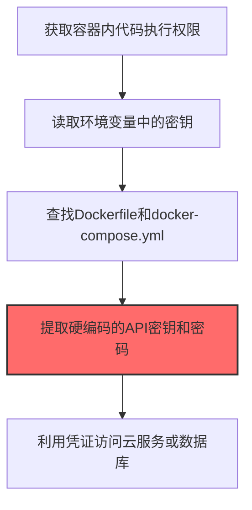
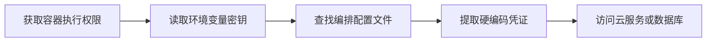

# Container Credentials (T1552.007)

## 一句话通俗理解

> **从容器环境中提取硬编码密钥**

## 30秒速查卡

| 维度 | 你需要知道的 |
|------|-------------|
| 这是什么？ | 从容器环境（Kubernetes、Docker）中提取硬编码的密钥和凭证 |
| 为什么危险？ | 容器镜像和配置文件中经常包含硬编码的密钥，攻击者只需要读取这些文件就能获得云服务和数据库的访问权限 |
| 谁需要关心？ | DevOps工程师、容器安全工程师、SOC分析师 |
| 你的第一步防御 | 使用Secret管理工具（如Vault、K8s Secrets），定期扫描镜像中的硬编码密钥 |
| 如果只做一件事 | 使用trivy或grype扫描容器镜像中的硬编码密钥和敏感信息 |

## 难度等级

⭐ 初级 - 入门级技术，基础操作

## 前置知识检查

**读这个文件需要什么？**

- [ ] Windows认证体系（NTLM/Kerberos/LSASS）
- [ ] 哈希基础（NTLM Hash/SHA）
- [ ] 网络认证协议（SMB/LDAP/Kerberos）

## 技术描述

**容器凭证**（T1552.007）是 **不安全的凭证**（T1552）的一个具体变体，属于 **凭证访问** 阶段的攻击技术。

> 🐳 **打个比方**：就像在集装箱码头的管理室翻到仓库钥匙——攻击者从容器环境中提取凭证，获得云服务或内部系统的访问权限。

### 具体怎么理解？

从容器环境中提取硬编码密钥

攻击者使用这种技术时，通常是在凭证访问阶段，想要达到特定的攻击目标。与父技术 T1552 相比，T1552.007 有自己独特的特点和使用场景。

### 为什么有效？

这种技术之所以有效，是因为：
1. **隐蔽性**：利用了正常系统功能或常见协议，不容易被发现
2. **技术门槛适中**：不需要特别高深的技术知识就能实施

**过渡段：** 不要误解凭证访问只是'窃取密码'——在现代企业中，凭证存在于内存、磁盘、网络流量等多个位置。
3. **广泛适用**：可以在多种环境和系统中使用

## 真实攻击流程

### 典型场景

攻击者在 **凭证访问** 阶段使用 容器凭证 技术，以下是典型的攻击步骤：



**步骤详解：**

1. **获取容器内代码执行权限** - 通过容器逃逸或已有的Shell进入目标容器内部执行命令
2. **读取环境变量中的密钥** - 使用env或printenv命令查看容器环境变量，其中常包含数据库密码、API密钥等
3. **查找Dockerfile和docker-compose.yml** - 在代码仓库中搜索容器编排文件，其中可能硬编码了敏感凭证
4. **提取硬编码的API密钥和密码** - 从Kubernetes Secrets、ConfigMap或CI/CD配置中提取明文凭证
5. **利用凭证访问云服务或数据库** - 使用提取的凭证尝试访问AWS RDS、Redis缓存或外部API

## 攻击流程

```
获取容器执行权限 --> 读取环境变量密钥 --> 查找编排配置文件 --> 提取硬编码凭证 --> 访问云服务或数据库
```



**步骤详解：**

1. **获取容器执行权限**
   - 通俗描述：通过容器逃逸或已有 shell 进入目标容器内部
   - 技术细节：利用容器运行时漏洞（如 CVE-2019-5736 runc）、特权容器逃逸、或通过已入侵的 Pod 拿到 exec 权限
   - 常用工具：kubectl、docker、cdk、kube-hunter

2. **读取环境变量密钥**
   - 通俗描述：查看容器环境变量，里面常存数据库密码、API 密钥
   - 技术细节：执行 `env`、`printenv`、`cat /proc/1/environ`，提取 `DB_PASSWORD`、`AWS_SECRET_ACCESS_KEY`、`API_TOKEN` 等变量
   - 常用工具：env、printenv、cat、strings

3. **查找编排配置文件**
   - 通俗描述：在代码仓库或镜像中找 Dockerfile、docker-compose.yml、K8s manifest
   - 技术细节：搜索 `Dockerfile`、`docker-compose.yml`、`kustomization.yaml`、Helm `values.yaml`，识别硬编码凭证或 Secrets 引用
   - 常用工具：find、grep、TruffleHog、GitLeaks

4. **提取硬编码凭证**
   - 通俗描述：从 K8s Secrets、ConfigMap、CI/CD 配置中提取明文凭证
   - 技术细节：执行 `kubectl get secrets -o yaml`、解析 `.dockerconfigjson`、读取 CI/CD 变量（GitLab CI、GitHub Actions secrets）
   - 常用工具：kubectl、helm、PEtAbuse、TruffleHog

5. **访问云服务或数据库**
   - 通俗描述：用提取的凭证访问 AWS RDS、Redis、外部 API
   - 技术细节：使用凭证连接 PostgreSQL、Redis、MongoDB，或调用 AWS/Azure API，横向到云资源
   - 常用工具：psql、redis-cli、aws-cli、Pacu

## 真实案例

### 案例1：TeamTNT针对Docker容器的凭证窃取

- **时间**: 2021-2022年
- **目标**: 全球云上暴露Docker API（2375/2376端口）的容器主机
- **攻击组织**: TeamTNT（云原生威胁组织）
- **手法**: TeamTNT通过未授权的Docker API拉起恶意容器并挂载宿主机根目录（`-v /:/host`），在容器内执行`cat /host/proc/*/environ`读取宿主机所有进程的环境变量，从中提取AWS_ACCESS_KEY_ID、AWS_SECRET_ACCESS_KEY等云凭证，再用这些凭证横向访问S3、EC2等云资源部署挖矿容器
- **影响**: 数千台云主机被入侵，云账号被滥用产生大量算力费用
- **参考链接**: [TeamTNT容器攻击分析 - Aqua Security](https://blog.aquasec.com/)

### 案例2：ThreatX报告的Kubernetes Secrets窃取

- **时间**: 2020-2021年
- **目标**: 暴露kubelet API（10250端口）的Kubernetes集群
- **攻击组织**: 多个云攻击团伙（含自动化扫描机器人）
- **手法**: 攻击者利用未授权的kubelet API执行`kubectl get secrets --all-namespaces -o yaml`或直接通过kubelet /run端点在Pod内执行命令，读取挂载到Pod的Kubernetes Secrets卷（/var/run/secrets/kubernetes.io/serviceaccount/token），获取Service Account JWT令牌后用于访问Kubernetes API Server和云元数据服务
- **影响**: 集群被完全接管，窃取的Service Account令牌可用于横向到云控制平面
- **参考链接**: [Kubernetes攻击面报告 - ThreatX](https://www.threatx.com/)

### 案例3：Kinsing通过恶意容器挂载窃取宿主机云凭证

- **时间**: 2019-2024年
- **目标**: 75+个云原生应用环境（Docker、Kubernetes、Jenkins、Redis等）
- **攻击组织**: Kinsing（云挖矿恶意软件团伙）
- **手法**: Kinsing利用配置错误的Docker API拉起Ubuntu容器并挂载宿主机文件系统，在容器内执行恶意命令下载并运行d.sh载荷，读取/proc/*/environ提取宿主机所有进程环境变量中的AWS_ACCESS_KEY_ID和AWS_SECRET_ACCESS_KEY等云凭证，用于横向访问云资源部署挖矿容器
- **影响**: 75+个云原生应用环境被入侵，云凭证被窃取后用于大规模挖矿和进一步横向攻击
- **参考链接**: [Kinsing容器环境攻击分析 - Aqua Security](https://www.aquasec.com/blog/threat-alert-kinsing-malware-container-vulnerability/)

## 红队视角

> ⚠️ **免责声明**：以下内容仅用于合法的安全测试、渗透测试和教育目的。未经授权对他人系统进行测试是违法行为。

### 实战技巧

1. **深入理解原理**：在实战应用前，充分理解Container Credentials的技术原理和适用场景
2. **环境适配**：根据目标系统的操作系统版本、安全配置等因素调整攻击策略
3. **组合使用**：将该技术与其他技术组合使用，构建完整的攻击链
4. **隐蔽性考虑**：注意操作痕迹的清理，避免被安全设备检测

### 常用工具

| 工具名称 | 用途 | 平台 | 链接 |
| -------- | ---- | ---- | ---- |
| Kubesploit | 专门针对Kubernetes集群的后渗透框架，含Secrets窃取模块 | 跨平台 | [Kubesploit](https://github.com/cyberark/Kubesploit) |
| Peirates | Kubernetes攻击工具，自动化枚举Service Account令牌和Secrets | Linux | [Peirates](https://github.com/inguardians/peirates) |
| kube-hunter | Kubernetes安全扫描器，可发现暴露的kubelet API和Secrets | 跨平台 | [kube-hunter](https://github.com/aquasecurity/kube-hunter) |
| kubectl | 官方CLI，配合未授权API可执行`kubectl get secrets`窃取凭证 | 跨平台 | [kubectl](https://kubernetes.io/) |

### 注意事项

- 在授权的测试环境中使用这些技术
- 注意操作安全（OPSEC），避免被检测系统发现
- 使用匿名化技术和代理隐藏真实身份

## 蓝队视角

### 检测要点

1. **系统日志监控**：关注与Container Credentials相关的系统日志和审计记录
2. **异常行为检测**：监控系统中与该技术相关的异常进程、网络连接和文件操作
3. **工具特征识别**：识别攻击者可能使用的工具在系统中的运行特征

### 监控建议

- 部署端点检测和响应（EDR）系统，监控与Container Credentials相关的异常行为
- 配置SIEM规则，关联分析来自多个来源的告警
- 定期进行安全评估和渗透测试，验证检测规则的有效性

## 避坑指南

组织中最危险盲区：认为强密码就足够安全。

## 检测建议

### 检测思路

检测 容器凭证 的关键是识别异常行为模式。以下是三个层面的检测方法：

### 网络层检测

**方法**：监控网络流量中的异常模式

```bash
# 检测异常的网络连接和数据传输
# 根据具体协议和端口设置检测规则
```

### 主机层检测

**Windows事件ID**：
- 事件ID 4688：进程创建（监控可疑进程）
- 事件ID 4104：PowerShell执行（监控可疑脚本）

**Linux日志**：
- /var/log/auth.log：认证日志
- /var/log/syslog：系统日志

```bash
# 检测异常进程和命令执行
grep -i "suspicious" /var/log/auth.log
```

### 应用层检测

**用人话说：** 这条规则在扫描容器镜像和配置文件中是否包含硬编码的密钥。很多开发者为了方便，会把数据库密码、API密钥直接写在Dockerfile或Kubernetes配置文件中。如果这些镜像被推送到公共仓库，密钥就暴露了。定期扫描镜像中的敏感信息，能提前发现这些'密码泄露点'。

**Sigma规则示例**：

```yaml
title: 检测容器凭证
status: experimental
description: 检测可能的容器凭证活动
logsource:
    category: process_creation
    product: windows
detection:
    selection:
        EventID: 4688
    condition: selection
level: medium
tags:
    - attack.T1552007
```

## 缓解措施

### 优先级1：关键措施

**限制攻击面**：减少暴露的服务和端口，降低被利用的风险

```bash
# 防火墙规则示例：只允许必要的出站连接
iptables -A OUTPUT -p tcp --dport 443 -j ACCEPT  # 允许HTTPS
iptables -A OUTPUT -p tcp --dport 80 -j ACCEPT   # 允许HTTP
iptables -A OUTPUT -p tcp -j DROP                 # 阻止其他TCP
```

### 优先级2：重要措施

**加强监控**：部署EDR和SIEM系统，实时监控异常行为

### 优先级3：建议措施

**安全意识培训**：教育员工识别相关攻击手法

## 动手实验

> ⚠️ **所有实验必须在隔离的实验室环境中进行**

### 实验1：理解基本原理（初级）

**目标**：理解 容器凭证 的工作原理

**步骤**：
1. 在隔离环境中搭建测试系统
2. 使用基础工具模拟攻击行为
3. 观察系统日志和网络流量

**学习要点**：理解该技术的核心机制

### 实验2：实际操作（中级）

**目标**：掌握 容器凭证 的实际使用方法

**步骤**：
1. 使用专业工具进行攻击模拟
2. 尝试不同的绕过技术
3. 分析检测日志的特征

**学习要点**：掌握工具使用和日志分析

### 实验3：防御验证（高级）

**目标**：验证检测规则的有效性

**步骤**：
1. 部署检测规则
2. 执行攻击模拟
3. 验证检测告警是否触发

**学习要点**：理解攻防对抗的实际效果

## 术语解释

| 术语 | 通俗解释 |
|------|---------|
| **ATT&CK** | MITRE公司维护的攻击技术知识库，像一本"黑客手法百科全书" |
| **容器凭证** | T1552.007，ATT&CK框架中定义的一种具体攻击技术 |
| **不安全的凭证** | T1552，容器凭证所属的父技术类别 |
| **凭证访问** | 攻击链中的一个阶段，攻击者在这个阶段的目标 |
| **C2** | 命令与控制，攻击者用来远程控制被入侵系统的"遥控器" |
| **EDR** | 端点检测与响应，部署在电脑上的安全监控软件 |

## 被引用情况

以下父技术文档引用了本子技术：

- [T1552 - 不安全的凭证](../T1552-Unsecured-Credentials.md)

## 参考资料

### 📚 官方文档（深入了解）

- [MITRE ATT&CK - Container Credentials (T1552.007)](https://attack.mitre.org/techniques/T1552/007/)
- [MITRE ATT&CK - 不安全的凭证 (T1552)](https://attack.mitre.org/techniques/T1552/)

### 📰 安全报告（真实攻击）

- [MITRE ATT&CK 官方文档](https://attack.mitre.org/) - ATT&CK 框架官方资源

### 🔧 工具与资源（动手试试）

- [Atomic Red Team](https://github.com/redcanaryco/atomic-red-team) - 检测规则测试框架
- [MITRE ATT&CK Navigator](https://mitre-attack.github.io/attack-navigator/) - ATT&CK 可视化工具

### 📚 学习资料（深入了解）

- [MITRE ATT&CK 知识库](https://attack.mitre.org/resources/) - ATT&CK 官方资源中心
