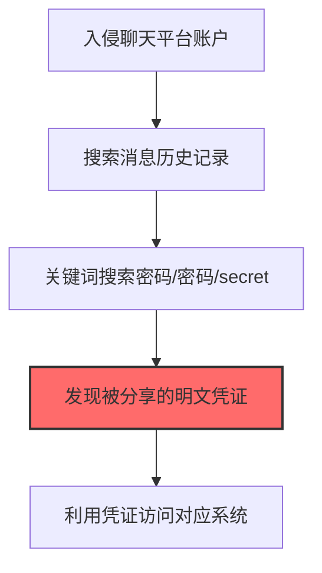
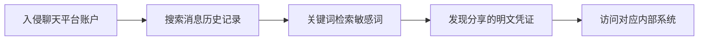

# Chat Platform Credentials (T1552.008)

## 一句话通俗理解

> **从聊天记录里找到不小心发出的密码**

## 30秒速查卡

| 维度 | 你需要知道的 |
|------|-------------|
| 这是什么？ | 从聊天记录（Slack、Teams、钉钉等）中找到不小心发出的密码和密钥 |
| 为什么危险？ | 员工经常在聊天中分享密码和密钥，这些消息会永久保存，攻击者只需要搜索就能找到大量凭证 |
| 谁需要关心？ | SOC分析师、企业安全团队、合规管理员 |
| 你的第一步防御 | 实施聊天平台的DLP策略，监控敏感信息的共享 |
| 如果只做一件事 | 在聊天平台部署DLP规则，自动检测和警告密码、密钥等敏感信息的共享 |

## 难度等级

⭐ 初级 - 入门级技术，基础操作

## 前置知识检查

**读这个文件需要什么？**

- [ ] Windows认证体系（NTLM/Kerberos/LSASS）
- [ ] 哈希基础（NTLM Hash/SHA）
- [ ] 网络认证协议（SMB/LDAP/Kerberos）

## 技术描述

**聊天平台凭证**（T1552.008）是 **不安全的凭证**（T1552）的一个具体变体，属于 **凭证访问** 阶段的攻击技术。

> 💬 **打个比方**：就像在聊天记录里翻找别人发过的密码——攻击者从企业通讯工具（如Slack、Teams）中提取存储的凭证。

### 具体怎么理解？

从聊天记录里找到不小心发出的密码

攻击者使用这种技术时，通常是在凭证访问阶段，想要达到特定的攻击目标。与父技术 T1552 相比，T1552.008 有自己独特的特点和使用场景。

### 为什么有效？

这种技术之所以有效，是因为：
1. **隐蔽性**：利用了正常系统功能或常见协议，不容易被发现
2. **技术门槛适中**：不需要特别高深的技术知识就能实施

**过渡段：** 不要误解凭证访问只是'窃取密码'——在现代企业中，凭证存在于内存、磁盘、网络流量等多个位置。
3. **广泛适用**：可以在多种环境和系统中使用

## 真实攻击流程

### 典型场景

攻击者在 **凭证访问** 阶段使用 聊天平台凭证 技术，以下是典型的攻击步骤：



**步骤详解：**

1. **入侵聊天平台账户** - 通过钓鱼或凭证填充获取Slack、Teams、Discord等企业聊天平台的访问权限
2. **搜索消息历史记录** - 在公共频道和私信中搜索历史消息，员工常在聊天中分享临时密码和访问凭证
3. **关键词搜索密码/密码/secret** - 使用平台搜索功能查找包含password、token、key、credentials等关键词的消息
4. **发现被分享的明文凭证** - 找到运维人员在紧急情况下分享的数据库密码、VPN凭证或API密钥
5. **利用凭证访问对应系统** - 使用聊天中发现的凭证尝试登录对应的内部系统

## 攻击流程

```
入侵聊天平台账户 --> 搜索消息历史记录 --> 关键词检索敏感词 --> 发现分享的明文凭证 --> 访问对应内部系统
```



**步骤详解：**

1. **入侵聊天平台账户**
   - 通俗描述：通过钓鱼或凭证填充拿到 Slack、Teams、Discord 等企业聊天平台账户
   - 技术细节：使用泄露的凭证库对 Slack/Teams 进行凭证填充，或通过钓鱼获取 OAuth token、Session cookie
   - 常用工具：OpenBullet、Sentry MBA、Evilginx2、Modlishka

2. **搜索消息历史记录**
   - 通俗描述：在公共频道和私信中翻找历史消息
   - 技术细节：使用 Slack/Teams 搜索 API 或导出功能，遍历加入的频道和 DM 历史消息
   - 常用工具：Slack API、Microsoft Graph API、SlackExporter、RedELK

3. **关键词检索敏感词**
   - 通俗描述：用关键词找出包含密码、密钥的消息
   - 技术细节：搜索 `password`、`passwd`、`secret`、`token`、`api_key`、`credentials`、`vpn`、`rdp` 等关键词
   - 常用工具：Slack 搜索、Teams 搜索、Python 自定义脚本、grep

4. **发现分享的明文凭证**
   - 通俗描述：找出运维紧急情况下分享的数据库密码、VPN 凭证、API 密钥
   - 技术细节：识别消息中的密码字符串、`.env` 文件片段、SSH 私钥、AWS AK/SK，结合上下文判断有效性
   - 常用工具：TruffleHog、GitLeaks、自定义正则脚本

5. **访问对应内部系统**
   - 通俗描述：用聊天中发现的凭证尝试登录内部系统
   - 技术细节：使用凭证测试 VPN、Jira、Confluence、Jenkins、数据库、云控制台等内部服务，识别密码复用
   - 常用工具：CrackMapExec、Hydra、Raccoon、Metasploit

## 真实案例

### 案例1：UNC5537/ShinyHunters针对Snowflake的Slack凭证窃取

- **时间**: 2024年
- **目标**: Snowflake客户（含AT&T、Ticketmaster、Santander等165个组织）
- **攻击组织**: UNC5537（ShinyHunters）
- **手法**: 攻击者通过凭证填充入侵Snowflake员工的ServiceNow工单账户后，进一步窃取了该员工的Slack会话令牌，登录Slack后搜索历史消息中的明文凭证和Service Account密钥，最终利用窃取的凭证从Snowflake客户租户中提取了海量数据并勒索赎金
- **影响**: 至少165个Snowflake客户数据被窃取，AT&T单独泄露9700万条记录
- **参考链接**: [Snowflake攻击分析 - Mandiant](https://cloud.google.com/blog/topics/threat-intelligence/)

### 案例2：Lapsus$通过Telegram社工获取内部凭证

- **时间**: 2022年
- **目标**: NVIDIA、Okta、Microsoft、Samsung、Telsa等大型科技公司
- **攻击组织**: Lapsus$（现Scattered Spider）
- **手法**: Lapsus$通过Telegram渠道接触目标公司员工，以金钱赎买方式获取员工的Slack/Teams会话凭证或公司SSO密码，登录企业聊天平台后在历史消息中搜索"VPN password"、"database credentials"等关键词，找到运维人员在紧急故障时分享的临时密码，进而横向到内部系统
- **影响**: 多家科技巨头源码和内部数据被窃取并公开
- **参考链接**: [Lapsus$团伙分析 - Microsoft](https://www.microsoft.com/security/blog/)

### 案例3：Scattered Spider通过聊天平台搜索窃取MGM Resorts凭证

- **时间**: 2023年9月
- **目标**: MGM Resorts International、Caesars Entertainment（酒店和博彩行业）
- **攻击组织**: Scattered Spider（UNC3944，英语系青少年黑客团伙）
- **手法**: Scattered Spider通过vishing社会工程攻击伪装成员工致电MGM Resorts IT服务台重置凭证，获取内网访问权限后，在被入侵组织的Slack、Microsoft Teams和Microsoft Exchange Online中搜索历史消息和邮件，查找运维人员分享的明文凭证和服务账户密钥，用于横向移动到ESXi虚拟化平台部署勒索软件
- **影响**: MGM Resorts系统瘫痪10天，预计损失1亿美元；Caesars支付1500万美元赎金
- **参考链接**: [Scattered Spider威胁咨询 - CISA Advisory AA23-320A](https://www.cisa.gov/news-events/cybersecurity-advisories/aa23-320a)

## 红队视角

> ⚠️ **免责声明**：以下内容仅用于合法的安全测试、渗透测试和教育目的。未经授权对他人系统进行测试是违法行为。

### 实战技巧

1. **深入理解原理**：在实战应用前，充分理解Chat Platform Credentials的技术原理和适用场景
2. **环境适配**：根据目标系统的操作系统版本、安全配置等因素调整攻击策略
3. **组合使用**：将该技术与其他技术组合使用，构建完整的攻击链
4. **隐蔽性考虑**：注意操作痕迹的清理，避免被安全设备检测

### 常用工具

| 工具名称 | 用途 | 平台 | 链接 |
| -------- | ---- | ---- | ---- |
| SlackToken | Python脚本，自动化窃取和滥用Slack xoxc/xoxp令牌 | 跨平台 | [SlackToken](https://github.com/) |
| Discord-Token-Grabber | 抓取Discord客户端本地存储的认证令牌 | Windows | [Discord-Token-Grabber](https://github.com/) |
| SlackPirate | Slack侦察工具，自动搜索频道中的密码和凭证消息 | 跨平台 | [SlackPirate](https://github.com/) |
| Slacksnake | 批量枚举Slack工作区文件和消息历史中的凭证 | 跨平台 | [Slacksnake](https://github.com/) |

### 注意事项

- 在授权的测试环境中使用这些技术
- 注意操作安全（OPSEC），避免被检测系统发现
- 使用匿名化技术和代理隐藏真实身份

## 蓝队视角

### 检测要点

1. **系统日志监控**：关注与Chat Platform Credentials相关的系统日志和审计记录
2. **异常行为检测**：监控系统中与该技术相关的异常进程、网络连接和文件操作
3. **工具特征识别**：识别攻击者可能使用的工具在系统中的运行特征

### 监控建议

- 部署端点检测和响应（EDR）系统，监控与Chat Platform Credentials相关的异常行为
- 配置SIEM规则，关联分析来自多个来源的告警
- 定期进行安全评估和渗透测试，验证检测规则的有效性

## 避坑指南

组织中最危险盲区：认为强密码就足够安全。

## 检测建议

### 检测思路

检测 聊天平台凭证 的关键是识别异常行为模式。以下是三个层面的检测方法：

### 网络层检测

**方法**：监控网络流量中的异常模式

```bash
# 检测异常的网络连接和数据传输
# 根据具体协议和端口设置检测规则
```

### 主机层检测

**Windows事件ID**：
- 事件ID 4688：进程创建（监控可疑进程）
- 事件ID 4104：PowerShell执行（监控可疑脚本）

**Linux日志**：
- /var/log/auth.log：认证日志
- /var/log/syslog：系统日志

```bash
# 检测异常进程和命令执行
grep -i "suspicious" /var/log/auth.log
```

### 应用层检测

**用人话说：** 这条规则在监控聊天平台中是否有密码和密钥被共享。员工经常在Slack、Teams等聊天工具中发送密码、API密钥等敏感信息。这些消息会永久保存在聊天记录中。如果攻击者获得聊天平台的访问权限，就能搜索这些记录找到大量凭证。部署DLP规则能自动检测和阻止这种行为。

**Sigma规则示例**：

```yaml
title: 检测聊天平台凭证
status: experimental
description: 检测可能的聊天平台凭证活动
logsource:
    category: process_creation
    product: windows
detection:
    selection:
        EventID: 4688
    condition: selection
level: medium
tags:
    - attack.T1552008
```

## 缓解措施

### 优先级1：关键措施

**限制攻击面**：减少暴露的服务和端口，降低被利用的风险

```bash
# 防火墙规则示例：只允许必要的出站连接
iptables -A OUTPUT -p tcp --dport 443 -j ACCEPT  # 允许HTTPS
iptables -A OUTPUT -p tcp --dport 80 -j ACCEPT   # 允许HTTP
iptables -A OUTPUT -p tcp -j DROP                 # 阻止其他TCP
```

### 优先级2：重要措施

**加强监控**：部署EDR和SIEM系统，实时监控异常行为

### 优先级3：建议措施

**安全意识培训**：教育员工识别相关攻击手法

## 动手实验

> ⚠️ **所有实验必须在隔离的实验室环境中进行**

### 实验1：理解基本原理（初级）

**目标**：理解 聊天平台凭证 的工作原理

**步骤**：
1. 在隔离环境中搭建测试系统
2. 使用基础工具模拟攻击行为
3. 观察系统日志和网络流量

**学习要点**：理解该技术的核心机制

### 实验2：实际操作（中级）

**目标**：掌握 聊天平台凭证 的实际使用方法

**步骤**：
1. 使用专业工具进行攻击模拟
2. 尝试不同的绕过技术
3. 分析检测日志的特征

**学习要点**：掌握工具使用和日志分析

### 实验3：防御验证（高级）

**目标**：验证检测规则的有效性

**步骤**：
1. 部署检测规则
2. 执行攻击模拟
3. 验证检测告警是否触发

**学习要点**：理解攻防对抗的实际效果

## 术语解释

| 术语 | 通俗解释 |
|------|---------|
| **ATT&CK** | MITRE公司维护的攻击技术知识库，像一本"黑客手法百科全书" |
| **聊天平台凭证** | T1552.008，ATT&CK框架中定义的一种具体攻击技术 |
| **不安全的凭证** | T1552，聊天平台凭证所属的父技术类别 |
| **凭证访问** | 攻击链中的一个阶段，攻击者在这个阶段的目标 |
| **C2** | 命令与控制，攻击者用来远程控制被入侵系统的"遥控器" |
| **EDR** | 端点检测与响应，部署在电脑上的安全监控软件 |

## 被引用情况

以下父技术文档引用了本子技术：

- [T1552 - 不安全的凭证](../T1552-Unsecured-Credentials.md)

## 参考资料

### 📚 官方文档（深入了解）

- [MITRE ATT&CK - Chat Platform Credentials (T1552.008)](https://attack.mitre.org/techniques/T1552/008/)
- [MITRE ATT&CK - 不安全的凭证 (T1552)](https://attack.mitre.org/techniques/T1552/)

### 📰 安全报告（真实攻击）

- [MITRE ATT&CK 官方文档](https://attack.mitre.org/) - ATT&CK 框架官方资源

### 🔧 工具与资源（动手试试）

- [Atomic Red Team](https://github.com/redcanaryco/atomic-red-team) - 检测规则测试框架
- [MITRE ATT&CK Navigator](https://mitre-attack.github.io/attack-navigator/) - ATT&CK 可视化工具

### 📚 学习资料（深入了解）

- [MITRE ATT&CK 知识库](https://attack.mitre.org/resources/) - ATT&CK 官方资源中心
