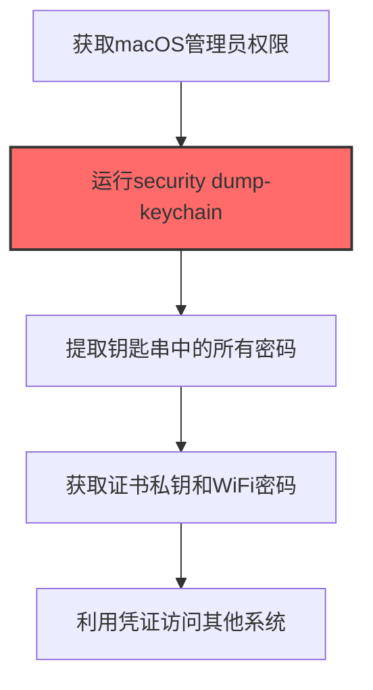

# Keychain (T1555.001)

## 一句话通俗理解

> **Keychain就是窃取macOS系统钥匙串中的所有密码。**

## 30秒速查卡

| 维度 | 你需要知道的 |
|------|-------------|
| 这是什么？ | 窃取macOS系统钥匙串中的所有保存的密码和密钥 |
| 为什么危险？ | 钥匙串是macOS的密码保险箱，拿到它就等于拿到了用户保存的所有网站、WiFi、证书的密码 |
| 谁需要关心？ | macOS安全工程师、SOC分析师 |
| 你的第一步防御 | 启用钥匙串锁定策略，监控异常的钥匙串访问 |
| 如果只做一件事 | 监控security命令的异常调用，特别是导出钥匙串中的私钥和密码 |

## 难度等级

⭐⭐ 中级 - 需要一定的技术基础和实践经验

## 前置知识检查

**读这个文件需要什么？**

- [ ] Windows认证体系（NTLM/Kerberos/LSASS）
- [ ] 哈希基础（NTLM Hash/SHA）
- [ ] 网络认证协议（SMB/LDAP/Kerberos）

## 技术描述

**通俗解释：**

**过渡段：** 不要误解凭证访问只是'窃取密码'——在现代企业中，凭证存在于内存、磁盘、网络流量和云API等多个位置。攻击者关注的不是密码本身，而是'能用它做什么'：一个服务账号的哈希就能横向移动到数十台服务器，OAuth令牌可以访问整个SaaS租户的数据。
窃取macOS系统钥匙串中的所有密码

> 🗝️ **打个比方**：就像找到别人藏钥匙的地方——攻击者从macOS Keychain（钥匙串）中提取存储的所有密码。

**技术原理：**
T1555.001 是 密码存储凭证提取（T1555）的子技术，专注于Keychain这一特定方面。攻击者在凭证访问阶段，通过Keychain来获取目标系统或组织的相关信息，为后续攻击步骤做准备。

**用途与影响：**
- 为后续攻击提供关键信息支撑
- 提高攻击的成功率和精准度
- 降低攻击被发现的概率

## 真实攻击流程



**步骤详解：**

1. **获取macOS管理员权限** - 需要管理员权限和用户密码才能导出钥匙串中的受保护项目
2. **运行security dump-keychain** - 使用macOS原生security命令行工具导出login.keychain-db中的所有条目
3. **提取钥匙串中的所有密码** - 从导出的数据中解析出网站密码、应用密码、证书和密钥
4. **获取证书私钥和WiFi密码** - 钥匙串中还存储了代码签名证书、S/MIME证书和已连接的WiFi密码
5. **利用凭证访问其他系统** - 使用提取的凭证登录用户的邮箱、GitHub、VPN等各类服务

## 攻击流程

```
获取macOS访问权限 --> 运行security命令导出钥匙串 --> 提取密码和证书私钥 --> 离线解密敏感条目 --> 横向访问用户其他服务
```


**步骤详解：**
1. **获取macOS访问权限**
   - 通俗描述：先要在目标Mac上获得执行权限，通常通过恶意文档或盗版软件植入后门
   - 技术细节：通过恶意Doc文件投放Mach-O后门，或利用盗版软件捆绑恶意载荷，获得当前用户进程权限
   - 常用工具：Cobalt Strike、custom Mach-O backdoor、ThiefQuest、Mach-O Man
2. **运行security命令导出钥匙串**
   - 通俗描述：调用macOS自带的security命令把钥匙串数据库导出成文件
   - 技术细节：执行`security dump-keychain -d`遍历login.keychain-db，或使用`security export-keychain`整体导出，绕过GUI授权弹窗
   - 常用工具：security（系统自带）、keychain-dumper、ChainBreaker
3. **提取密码和证书私钥**
   - 通俗描述：从导出的数据中解析出网站密码、应用密码、证书和密钥
   - 技术细节：解析钥匙串条目，提取Safari密码、Mail账户、VPN凭证、代码签名证书私钥、S/MIME证书和已连接的WiFi密码
   - 常用工具：security、keychain-dumper、iLEAPP、ChainBreaker
4. **离线解密敏感条目**
   - 通俗描述：把加密的钥匙串数据库拷贝到攻击者机器上离线解密
   - 技术细节：使用用户密码或系统密钥解密.keychain-db文件，获取无法在在线模式下导出的高敏感条目
   - 常用工具：ChainBreaker、keychain-dumper、Python脚本
5. **横向访问用户其他服务**
   - 通俗描述：用偷来的凭证登录用户的邮箱、GitHub、VPN等各类服务
   - 技术细节：使用提取的凭证访问iCloud账户、企业VPN、SSH密钥、GitHub token、加密货币钱包，进行二次入侵和数据外传
   - 常用工具：浏览器自动化、SSH客户端、Git客户端、Telegram Bot API

## 真实案例

### 案例1：OceanLotus (APT32) 针对东南亚的macOS钥匙串窃取

- **时间**: 2019-2020年
- **目标**: 东南亚国家政府、企业和异见人士的macOS设备
- **攻击组织**: OceanLotus (APT32 / SeaLotus)
- **手法**: 通过恶意Doc文件投放macOS后门，使用`security dump-keychain -d`命令批量导出login.keychain-db中的Safari密码、Mail账户、VPN凭证和代码签名证书私钥，外传至C2服务器用于横向渗透
- **影响**: 受害者存储在钥匙串中的所有凭证被窃取，包括iCloud账户、企业VPN和S/MIME加密私钥，导致后续多起二次入侵
- **参考链接**: [MITRE ATT&CK - T1555.001](https://attack.mitre.org/techniques/T1555/001/)

### 案例2：ThiefQuest macOS恶意软件的钥匙串批量窃取

- **时间**: 2020年
- **目标**: 通过 pirated macOS 软件分发的全球用户
- **攻击组织**: ThiefQuest开发者（疑似俄罗斯背景）
- **手法**: ThiefQuest (EvilQuest) 通过盗版软件感染macOS后，调用`security find-generic-password -ga`遍历所有钥匙串条目，并使用`security export-keychain`整体导出login.keychain-db，配合keychain-dumper绕过GUI授权弹窗直接读取加密的钥匙串数据库
- **影响**: 受害者所有macOS应用密码、SSH密钥、GitHub token和WiFi密码被窃取，被用于勒索和数据外传
- **参考链接**: [Kaspersky ThiefQuest分析报告](https://securelist.com/thiefquest-mac-malware/97779/)

### 案例3：Lazarus Group Mach-O Man恶意软件的macOS钥匙串窃取

- **时间**: 2026年4月
- **目标**: 加密货币和金融科技领域的macOS用户（包括KelpDAO、Drift等Web3平台员工）
- **攻击组织**: Lazarus Group（朝鲜背景）
- **手法**: Lazarus Group通过虚假会议邀请诱导目标下载名为"Mach-O Man"的Go编译Mach-O恶意软件套件，执行4阶段攻击链，最终阶段macrasv2模块收集Keychain条目、Chrome浏览器Login Data数据库和加密货币钱包文件，通过Telegram Bot API外传至攻击者控制的服务器
- **影响**: 多个Web3和金融科技组织的macOS设备凭证被窃取，包括加密货币交易所账户私钥和SSH密钥，导致后续连锁入侵
- **参考链接**: [Bitcoin.com - Lazarus Mach-O Man分析](https://news.bitcoin.com/mach-o-man-malware-steals-macos-keychain-data-in-lazarus-group-crypto-campaign/)

## 红队视角

> ⚠️ **免责声明**：以下内容仅用于合法的安全测试、渗透测试和教育目的。未经授权对他人系统进行测试是违法行为。

### 实战技巧

1. **隐蔽优先**：在凭证访问阶段使用被动方式收集信息，避免触发安全告警
2. **信息验证**：对收集到的信息进行交叉验证，确保准确性和时效性
3. **工具选择**：根据目标环境选择合适的工具，避免使用已被广泛检测的工具
4. **OPSEC意识**：使用匿名网络、临时环境进行操作，防止溯源

### 常用工具

| 工具名称 | 用途 | 平台 | 链接 |
| -------- | ---- | ---- | ---- |
| security (系统自带) | macOS原生命令，dump-keychain/export-keychain导出钥匙串 | macOS | [Apple security man page](https://ss64.com/mac/security.html) |
| keychain-dumper | 绕过GUI弹窗直接读取login.keychain-db明文 | macOS | [keychain-dumper GitHub](https://github.com/juuso/keychaindumper) |
| ChainBreaker | 离线解析加密的.keychain-db文件提取密码 | macOS | [ChainBreaker GitHub](https://github.com/n0fate/chainbreaker) |
| iLEAPP | 数字取证工具，自动提取macOS钥匙串条目和iOS keychain | macOS/iOS | [iLEAPP GitHub](https://github.com/abrignoni/iLEAPP) |

### 注意事项

- 仅在授权范围内使用Keychain技术
- 注意操作的隐蔽性，避免被蓝队发现
- 记录操作日志，用于后续分析和报告编写

## 蓝队视角

### 检测要点

1. **异常信息收集行为**：监控来自内部系统的异常数据查询和收集行为
2. **可疑工具使用**：检测与Keychain相关的工具在内部网络中的使用
3. **异常网络流量**：监控对外部信息收集平台的可疑网络连接
4. **权限异常**：关注非授权用户的信息收集和查询行为

### 监控建议

- 部署信息收集行为的检测规则
- 建立基准行为模型，及时发现异常
- 定期审计敏感信息的访问记录

## 避坑指南

组织中最危险盲区：认为强密码就足够安全。

## 检测建议

### 网络层检测

**检测方法：** 监控与Keychain相关的网络流量特征

**具体规则/命令示例：**

```bash
# 监控异常DNS查询
tcpdump -i eth0 port 53 | grep -E "可疑域名"
```

### 主机层检测

**Windows事件ID：**

- 事件ID 4688：可疑进程创建
- 事件ID 4104：PowerShell脚本块日志

**Linux日志：**

- 日志文件：`/var/log/syslog`
- 关键字段：可疑命令执行

**用人话说：** 这条规则在监控是否有进程在读取macOS的钥匙串。钥匙串是macOS存储所有密码和密钥的地方。正常情况下只有用户手动授权的应用才能访问钥匙串中的密码。如果有陌生进程试图导出钥匙串内容，那就是攻击者在偷macOS保存的所有密码。

### 应用层检测

**Sigma规则示例：**

```yaml
title: Suspicious Keychain Activity
status: experimental
description: Detects potential Keychain behavior
logsource:
  category: process_creation
  product: windows
detection:
  selection:
    Image|endswith: '\\可疑工具.exe'
  condition: selection
level: medium
tags:
  - attack.T1555/001
```

## 缓解措施

### 优先级1：关键措施

**措施名称：** 敏感信息保护

**具体实施步骤：**

1. 识别和分类组织内的敏感信息
2. 对敏感信息实施访问控制和加密
3. 部署信息泄露防护（DLP）解决方案

### 优先级2：重要措施

**措施名称：** 员工安全意识培训

**具体实施步骤：**

1. 定期开展信息安全意识培训
2. 教育员工识别社交工程攻击
3. 建立信息报告和响应机制

### 优先级3：建议措施

**措施名称：** 安全配置加固

**具体实施步骤：**

1. 限制公开可访问的系统信息
2. 配置合适的日志记录和告警策略
3. 定期进行安全评估和渗透测试

## 动手实验

> ⚠️ **重要提示**：所有实验必须在隔离的实验室环境中进行，禁止对未授权的真实系统进行测试。

### 实验环境准备

**推荐靶场/实验平台：**

| 平台名称 | 类型 | 难度 | 链接 |
|---------|------|:----:|------|
| 本地虚拟机 | 虚拟环境 | 初级 | 本机搭建 |
| TryHackMe | 在线靶场 | 初级 | https://tryhackme.com |

**所需工具：**

- 根据具体技术需求准备相应工具

**环境搭建：**

```bash
# 准备隔离的实验环境
# 具体命令根据实验内容而定
```

### 实验1：基础实践（初级）

**实验目标：** 理解和练习Keychain的基本操作

**实验步骤：**

1. 在隔离环境中搭建实验系统
2. 按照技术描述执行基本操作
3. 观察和记录实验现象

**预期结果：** 成功完成Keychain的基本操作

**学习要点：** 理解Keychain的原理和操作方法

## 术语解释

| 术语 | 英文原名 | 通俗解释 |
|-----|---------|---------|
| Keychain | Keychain | Keychain的基本概念和操作方法 |
| 侦察 | Reconnaissance | 收集目标信息的过程，为后续攻击做准备 |
| OPSEC | Operational Security | 操作安全，保护行动信息不被对手发现 |

## 被引用情况

以下父技术文档引用了本子技术：

- [T1555 - 密码存储凭证提取](../T1555-Credentials-from-Password-Stores.md)

## 参考资料

### 📚 官方文档（深入了解）

- [MITRE ATT&CK - T1555](https://attack.mitre.org/techniques/T1555/)
- [MITRE ATT&CK - T1555.001](https://attack.mitre.org/techniques/T1555/001/)
- [MITRE ATT&CK - T1555.001 检测](https://attack.mitre.org/techniques/T1555/001/detections/)

### 📰 安全报告（真实攻击）

- [CISA Known Exploited Vulnerabilities](https://www.cisa.gov/known-exploited-vulnerabilities-catalog)
- [Microsoft Security Blog](https://www.microsoft.com/en-us/security/blog/)

### 学习资源

- [MITRE ATT&CK 官方文档](https://attack.mitre.org/)
- [ATT&CK STIX Data](https://github.com/mitre-attack/attack-stix-data)

