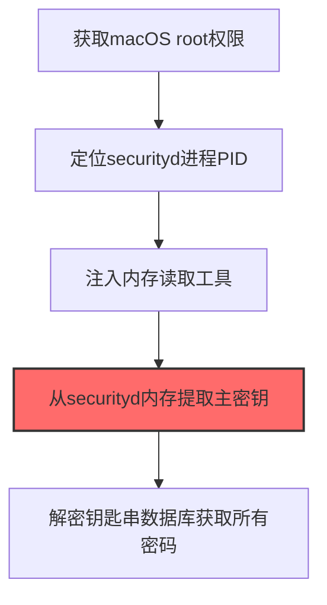

# Securityd (T1555.002)

## 一句话通俗理解

> **Securityd就是直接从macOS安全服务进程内存中提取密码。**

## 30秒速查卡

| 维度 | 你需要知道的 |
|------|-------------|
| 这是什么？ | 直接从macOS安全服务进程（securityd）的内存中提取密码 |
| 为什么危险？ | securityd进程在内存中持有解密后的密码，直接读取内存比破解钥匙串更快更直接 |
| 谁需要关心？ | macOS安全工程师、SOC分析师 |
| 你的第一步防御 | 启用macOS系统完整性保护（SIP），监控securityd进程的异常内存访问 |
| 如果只做一件事 | 启用SIP保护securityd进程内存，监控对securityd进程的调试和内存读取 |

## 难度等级

⭐⭐ 中级 - 需要一定的技术基础和实践经验

## 前置知识检查

**读这个文件需要什么？**

- [ ] Windows认证体系（NTLM/Kerberos/LSASS）
- [ ] 哈希基础（NTLM Hash/SHA）
- [ ] 网络认证协议（SMB/LDAP/Kerberos）

## 技术描述

**通俗解释：**

**过渡段：** 不要误解凭证访问只是'窃取密码'——在现代企业中，凭证存在于内存、磁盘、网络流量和云API等多个位置。攻击者关注的不是密码本身，而是'能用它做什么'：一个服务账号的哈希就能横向移动到数十台服务器，OAuth令牌可以访问整个SaaS租户的数据。
直接从macOS安全服务进程内存中提取密码

> 🔓 **打个比方**：就像破解了保险柜的主密码——攻击者绕过macOS的securityd进程保护，直接读取凭据数据。

**技术原理：**
T1555.002 是 密码存储凭证提取（T1555）的子技术，专注于Securityd这一特定方面。攻击者在凭证访问阶段，通过Securityd来获取目标系统或组织的相关信息，为后续攻击步骤做准备。

**用途与影响：**
- 为后续攻击提供关键信息支撑
- 提高攻击的成功率和精准度
- 降低攻击被发现的概率

## 真实攻击流程



**步骤详解：**

1. **获取macOS root权限** - 需要root权限才能读取其他进程的内存空间并注入代码
2. **定位securityd进程PID** - securityd是macOS的安全守护进程，负责管理钥匙串加解密，通过ps命令找到其PID
3. **注入内存读取工具** - 使用自定义工具或lldb调试器附加到securityd进程，准备读取其内存空间
4. **从securityd内存提取主密钥** - securityd在运行时将钥匙串的解密主密钥保留在内存中，直接从内存dump中提取
5. **解密钥匙串数据库获取所有密码** - 使用提取的主密钥离线解密keychain-db文件，无需用户密码即可获取所有存储的凭证

## 攻击流程

```
获取macOS root权限 --> 定位securityd进程PID --> 附加调试器读取内存 --> 提取钥匙串主密钥 --> 离线解密获取全部凭证
```


**步骤详解：**
1. **获取macOS root权限**
   - 通俗描述：先要拿到Mac的最高权限，才能读取其他进程的内存
   - 技术细节：通过恶意软件投放、本地提权漏洞或盗版软件捆绑获取root权限，为后续ptrace/task_for_pid操作做准备
   - 常用工具：ThiefQuest、OSX/Proton、XCSSET、本地提权漏洞利用
2. **定位securityd进程PID**
   - 通俗描述：找到负责管理钥匙串加密的守护进程
   - 技术细节：通过`ps aux | grep securityd`找到securityd进程PID，securityd是macOS的安全守护进程，负责管理钥匙串加解密
   - 常用工具：ps、pgrep、launchctl
3. **附加调试器读取内存**
   - 通俗描述：把调试器挂到securityd进程上读取它的内存
   - 技术细节：使用ptrace或task_for_pid获取securityd进程句柄，通过mach_vm_read API远程读取securityd内存空间，绕过用户密码和GUI弹窗
   - 常用工具：lldb、ptrace、task_for_pid、mach_vm_read
4. **提取钥匙串主密钥**
   - 通俗描述：从securityd内存里把解密钥匙串的主密钥找出来
   - 技术细节：securityd运行时将钥匙串的class key保留在内存中，从内存dump中定位并提取class key，用于离线解密keychain-db
   - 常用工具：lldb、自定义内存扫描脚本、KnockKnock
5. **离线解密获取全部凭证**
   - 通俗描述：用主密钥解开整个钥匙串数据库拿到所有密码
   - 技术细节：使用提取的class key离线解密login.keychain-db，无需用户密码即可获取Safari/SSH/GitHub/iCloud等所有存储凭证
   - 常用工具：ChainBreaker、keychain-dumper、Python解密脚本

## 真实案例

### 案例1：ThiefQuest (EvilQuest) macOS勒索软件的securityd内存提取

- **时间**: 2020年
- **目标**: 通过盗版macOS软件分发的全球用户
- **攻击组织**: ThiefQuest开发组织（疑似俄罗斯背景）
- **手法**: ThiefQuest通过ptrace附加到securityd进程，使用mach_vm_read API读取securityd内存空间，直接提取keychain解密主密钥（class key），随后用主密钥离线解密login.keychain-db获取Safari/SSH/GitHub凭证，整个过程绕过用户密码和GUI弹窗
- **影响**: 受害者在无任何告警情况下丢失所有macOS钥匙串凭证，并被用于勒索和数据外传
- **参考链接**: [MITRE ATT&CK - T1555.002](https://attack.mitre.org/techniques/T1555/002/)

### 案例2：OSX/Proton macOS后门的securityd注入攻击

- **时间**: 2017年
- **目标**: 通过仿冒Symantec、Malwarebytes等安全软件官网分发的macOS用户
- **攻击组织**: OSX/Proton开发组织（疑似伊朗背景）
- **手法**: OSX/Proton通过task_for_pid获取securityd进程句柄，注入恶意dylib到securityd进程地址空间，hook SecItemCopyMatching API实时拦截所有钥匙串查询请求，明文截获用户的iCloud、Keychain、1Password等密码管理器主密码
- **影响**: 数千名macOS用户的高价值凭证（含密码管理器主密码）被实时窃取，导致连锁账户入侵
- **参考链接**: [Malwarebytes OSX/Proton分析](https://www.malwarebytes.com/blog/news/2017/03/proton-mac-malware-discovered-behind-arbitrage-software-bundle)

### 案例3：XCSSET恶意软件通过Xcode项目感染窃取securityd凭证

- **时间**: 2020-2021年
- **目标**: macOS开发者，通过感染GitHub上的Xcode项目传播
- **攻击组织**: XCSSET开发组织（背景未明确）
- **手法**: XCSSET通过执行`security find-generic-password -wa 'Chrome'`命令查询securityd管理的Keychain，提取Chrome Safe Storage密钥，解密Chrome浏览器保存的所有密码；同时利用CVE-2021-30713零日漏洞绕过TCC框架，访问受保护的应用数据
- **影响**: 大量macOS开发者的Apple ID、Google、PayPal、Telegram、WeChat等应用凭证被窃取，并通过感染Xcode项目实现开发者间横向传播
- **参考链接**: [Trend Micro XCSSET分析](https://www.trendmicro.com/en_us/research/21/g/updated-xcsset-malware-targets-telegram--other-apps.html)

## 红队视角

> ⚠️ **免责声明**：以下内容仅用于合法的安全测试、渗透测试和教育目的。未经授权对他人系统进行测试是违法行为。

### 实战技巧

1. **隐蔽优先**：在凭证访问阶段使用被动方式收集信息，避免触发安全告警
2. **信息验证**：对收集到的信息进行交叉验证，确保准确性和时效性
3. **工具选择**：根据目标环境选择合适的工具，避免使用已被广泛检测的工具
4. **OPSEC意识**：使用匿名网络、临时环境进行操作，防止溯源

### 常用工具

| 工具名称 | 用途 | 平台 | 链接 |
| -------- | ---- | ---- | ---- |
| lldb | 苹果官方调试器，附加securityd进程读取内存提取class key | macOS | [LLDB Documentation](https://lldb.llvm.org/) |
| KnockKnock | Objective-See工具，扫描持久化和安全代理包括securityd钩子 | macOS | [KnockKnock](https://objective-see.com/products/knockknock.html) |
| task_for_pid | macOS Mach API，获取securityd进程句柄用于注入 | macOS | [Apple Developer task_for_pid](https://developer.apple.com/documentation/kernel/1462839-task_for_pid) |
| mach_vm_read | macOS Mach VM API，远程读取securityd内存空间 | macOS | [Apple mach_vm_read man page](https://developer.apple.com/documentation/kernel/1452573-mach_vm_read) |

### 注意事项

- 仅在授权范围内使用Securityd技术
- 注意操作的隐蔽性，避免被蓝队发现
- 记录操作日志，用于后续分析和报告编写

## 蓝队视角

### 检测要点

1. **异常信息收集行为**：监控来自内部系统的异常数据查询和收集行为
2. **可疑工具使用**：检测与Securityd相关的工具在内部网络中的使用
3. **异常网络流量**：监控对外部信息收集平台的可疑网络连接
4. **权限异常**：关注非授权用户的信息收集和查询行为

### 监控建议

- 部署信息收集行为的检测规则
- 建立基准行为模型，及时发现异常
- 定期审计敏感信息的访问记录

## 避坑指南

组织中最危险盲区：认为强密码就足够安全。

## 检测建议

### 网络层检测

**检测方法：** 监控与Securityd相关的网络流量特征

**具体规则/命令示例：**

```bash
# 监控异常DNS查询
tcpdump -i eth0 port 53 | grep -E "可疑域名"
```

### 主机层检测

**Windows事件ID：**

- 事件ID 4688：可疑进程创建
- 事件ID 4104：PowerShell脚本块日志

**Linux日志：**

- 日志文件：`/var/log/syslog`
- 关键字段：可疑命令执行

**用人话说：** 这条规则在监控是否有进程在读取macOS securityd进程的内存。securityd是macOS的安全服务守护进程，在内存中处理密码的加解密。正常情况下只有系统自己会访问这个进程的内存。如果有陌生进程试图读取securityd的内存，那就是攻击者在直接从内存中偷密码。

### 应用层检测

**Sigma规则示例：**

```yaml
title: Suspicious Securityd Activity
status: experimental
description: Detects potential Securityd behavior
logsource:
  category: process_creation
  product: windows
detection:
  selection:
    Image|endswith: '\\可疑工具.exe'
  condition: selection
level: medium
tags:
  - attack.T1555/002
```

## 缓解措施

### 优先级1：关键措施

**措施名称：** 敏感信息保护

**具体实施步骤：**

1. 识别和分类组织内的敏感信息
2. 对敏感信息实施访问控制和加密
3. 部署信息泄露防护（DLP）解决方案

### 优先级2：重要措施

**措施名称：** 员工安全意识培训

**具体实施步骤：**

1. 定期开展信息安全意识培训
2. 教育员工识别社交工程攻击
3. 建立信息报告和响应机制

### 优先级3：建议措施

**措施名称：** 安全配置加固

**具体实施步骤：**

1. 限制公开可访问的系统信息
2. 配置合适的日志记录和告警策略
3. 定期进行安全评估和渗透测试

## 动手实验

> ⚠️ **重要提示**：所有实验必须在隔离的实验室环境中进行，禁止对未授权的真实系统进行测试。

### 实验环境准备

**推荐靶场/实验平台：**

| 平台名称 | 类型 | 难度 | 链接 |
|---------|------|:----:|------|
| 本地虚拟机 | 虚拟环境 | 初级 | 本机搭建 |
| TryHackMe | 在线靶场 | 初级 | https://tryhackme.com |

**所需工具：**

- 根据具体技术需求准备相应工具

**环境搭建：**

```bash
# 准备隔离的实验环境
# 具体命令根据实验内容而定
```

### 实验1：基础实践（初级）

**实验目标：** 理解和练习Securityd的基本操作

**实验步骤：**

1. 在隔离环境中搭建实验系统
2. 按照技术描述执行基本操作
3. 观察和记录实验现象

**预期结果：** 成功完成Securityd的基本操作

**学习要点：** 理解Securityd的原理和操作方法

## 术语解释

| 术语 | 英文原名 | 通俗解释 |
|-----|---------|---------|
| Securityd | Securityd | Securityd的基本概念和操作方法 |
| 侦察 | Reconnaissance | 收集目标信息的过程，为后续攻击做准备 |
| OPSEC | Operational Security | 操作安全，保护行动信息不被对手发现 |

## 被引用情况

以下父技术文档引用了本子技术：

- [T1555 - 密码存储凭证提取](../T1555-Credentials-from-Password-Stores.md)

## 参考资料

### 📚 官方文档（深入了解）

- [MITRE ATT&CK - T1555](https://attack.mitre.org/techniques/T1555/)
- [MITRE ATT&CK - T1555.002](https://attack.mitre.org/techniques/T1555/002/)
- [MITRE ATT&CK - T1555.002 检测](https://attack.mitre.org/techniques/T1555/002/detections/)

### 📰 安全报告（真实攻击）

- [CISA Known Exploited Vulnerabilities](https://www.cisa.gov/known-exploited-vulnerabilities-catalog)
- [Microsoft Security Blog](https://www.microsoft.com/en-us/security/blog/)

### 学习资源

- [MITRE ATT&CK 官方文档](https://attack.mitre.org/)
- [ATT&CK STIX Data](https://github.com/mitre-attack/attack-stix-data)

