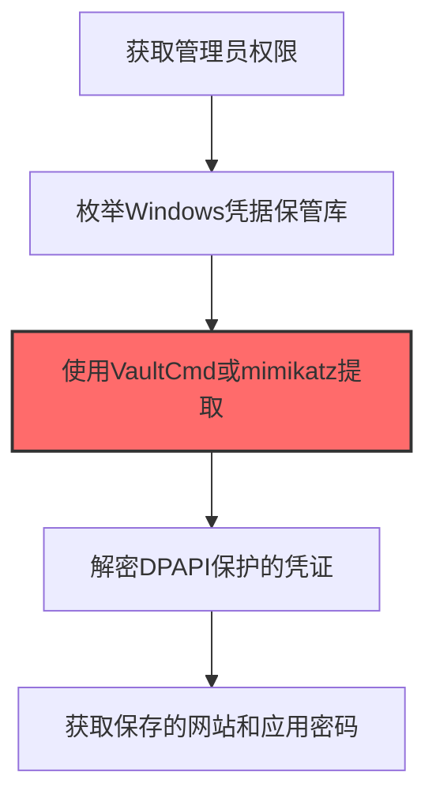
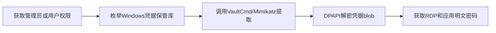

# Windows Credential Manager (T1555.004)

## 一句话通俗理解

> **Windows Credential Manager就是提取Windows凭据管理器中保存的登录信息。**

## 30秒速查卡

| 维度 | 你需要知道的 |
|------|-------------|
| 这是什么？ | 提取Windows凭据管理器中保存的登录信息 |
| 为什么危险？ | Windows凭据管理器存储了RDP、VPN、网站等多种登录凭证，拿到它就能访问用户保存的所有服务 |
| 谁需要关心？ | Windows安全工程师、SOC分析师 |
| 你的第一步防御 | 限制凭据管理器的访问权限，监控异常的凭证读取 |
| 如果只做一件事 | 监控vaultcli.dll和keymgr.dll的异常调用，特别是导出Windows凭据管理器中的凭证 |

## 难度等级

⭐⭐ 中级 - 需要一定的技术基础和实践经验

## 前置知识检查

**读这个文件需要什么？**

- [ ] Windows认证体系（NTLM/Kerberos/LSASS）
- [ ] 哈希基础（NTLM Hash/SHA）
- [ ] 网络认证协议（SMB/LDAP/Kerberos）

## 技术描述

**通俗解释：**

**过渡段：** 不要误解凭证访问只是'窃取密码'——在现代企业中，凭证存在于内存、磁盘、网络流量和云API等多个位置。攻击者关注的不是密码本身，而是'能用它做什么'：一个服务账号的哈希就能横向移动到数十台服务器，OAuth令牌可以访问整个SaaS租户的数据。
提取Windows凭据管理器中保存的登录信息

> 🗂️ **打个比方**：就像翻看Windows的"密码保险箱"——攻击者从Windows凭据管理器中提取存储的网络密码和Windows凭据。

**技术原理：**
T1555.004 是 密码存储凭证提取（T1555）的子技术，专注于Windows Credential Manager这一特定方面。攻击者在凭证访问阶段，通过Windows Credential Manager来获取目标系统或组织的相关信息，为后续攻击步骤做准备。

**用途与影响：**
- 为后续攻击提供关键信息支撑
- 提高攻击的成功率和精准度
- 降低攻击被发现的概率

## 真实攻击流程



**步骤详解：**

1. **获取管理员权限** - 需要管理员权限才能完整访问Windows Credential Manager中的所有凭证条目
2. **枚举Windows凭据保管库** - 使用vaultcmd /list命令列出所有凭据保管库（Web凭据、Windows凭据等）
3. **使用VaultCmd或mimikatz提取** - 通过vaultcmd /listcreds或mimikatz的vault::list命令提取存储的凭证数据
4. **解密DPAPI保护的凭证** - Windows Credential Manager使用DPAPI加密存储，需要当前用户上下文才能解密
5. **获取保存的网站和应用密码** - 提取浏览器保存的网站登录、远程桌面连接和网络共享的明文密码

## 攻击流程

```
获取管理员或用户权限 --> 枚举Windows凭据保管库 --> 调用VaultCmd/Mimikatz提取 --> DPAPI解密凭据blob --> 获取RDP和应用明文密码
```



**步骤详解：**
1. **获取管理员或用户权限**
   - 通俗描述：先要拿到管理员或目标用户权限，才能访问凭据保管库
   - 技术细节：通过钓鱼、横向移动或本地提权获取管理员权限，访问完整凭据条目；用户权限可访问当前用户的Web凭据
   - 常用工具：Cobalt Strike、Mimikatz、Carbanak后门、LockBit
2. **枚举Windows凭据保管库**
   - 通俗描述：列出系统中保存了哪些凭据，看看有什么值得偷的
   - 技术细节：使用`vaultcmd /list`列出所有凭据保管库（Web凭据、Windows凭据等），或使用`cmdkey /list`枚举已保存的通用凭证和目标地址
   - 常用工具：vaultcmd.exe、cmdkey.exe、CredEnumerateW API
3. **调用VaultCmd/Mimikatz提取**
   - 通俗描述：把凭据保管库里的内容导出来
   - 技术细节：通过`vaultcmd /listcreds:"Web Credentials"`或Mimikatz的`vault::list`和`vault::cred`模块读取并解析存储的凭证blob，也可调用CredReadW API直接读取
   - 常用工具：VaultCmd、Mimikatz vault::cred、SharpVault、CredMan
4. **DPAPI解密凭据blob**
   - 通俗描述：用Windows的DPAPI把加密的凭据解成明文
   - 技术细节：Windows Credential Manager使用DPAPI加密存储，需要在当前用户上下文中调用CryptUnprotectData解密，或提取DPAPI主密钥后离线解密
   - 常用工具：Mimikatz dpapi::、SharpDPAPI、CryptUnprotectData API
5. **获取RDP和应用明文密码**
   - 通俗描述：拿到RDP、SSH、VPN等各类明文密码，用于横向移动
   - 技术细节：提取保存的RDP凭证、SSH密钥、Azure CLI token、SharePoint凭据、VPN连接密码，用于跨系统横向移动和云资源访问
   - 常用工具：Mimikatz、SharpVault、自定义解析脚本

## 真实案例

### 案例1：APT29 (Nobelium) SolarWinds攻击中的Windows Credential Manager凭证窃取

- **时间**: 2020-2021年
- **目标**: SolarWinds Orion客户（美国财政部、国务院等联邦机构）
- **攻击组织**: APT29 (Nobelium / Midnight Blizzard)
- **手法**: APT29在获得初始访问后，通过调用Windows CredEnumerateW API或执行`cmdkey /list`枚举Windows Credential Manager中保存的通用凭证和Windows凭证，窃取用户保存的RDP凭证、SSH密钥、Azure CLI token和SharePoint凭据，用于跨系统横向移动和云资源访问
- **影响**: 攻击者获取了大量保存的RDP和云服务凭证，实现了从本地工作站到云环境的横向渗透，持续访问长达9个月未被发现
- **参考链接**: [MITRE ATT&CK - T1555.004](https://attack.mitre.org/techniques/T1555/004/)

### 案例2：FIN7 (Carbanak) 零售业攻击中的Credential Manager利用

- **时间**: 2017-2019年
- **目标**: 美国和欧洲的餐饮、零售和酒店业（如Arby's、Chili's、Red Robin等连锁企业）
- **攻击组织**: FIN7 (Carbanak / ANUNAK)
- **手法**: FIN7通过带有恶意宏的Excel钓鱼附件感染POS终端，使用Carbanak后门执行`rundll32.exe keymgr.dll,KRShowKeyMgr`或调用CredReadW API读取Credential Manager中保存的域管理员RDP凭证和数据库管理员密码，用于横向移动到支付处理系统和域控
- **影响**: 攻击导致超过1500家门店的支付卡数据泄露，受害企业损失累计超过10亿美元
- **参考链接**: [US DOJ FIN7 Indictment](https://www.justice.gov/opa/pr/five-members-charges-cybercrime-ring-fin7)

### 案例3：LockBit勒索软件中的Windows Credential Manager凭证提取

- **时间**: 2022-2023年
- **目标**: 全球数千家企业网络
- **攻击组织**: LockBit勒索软件组织（俄罗斯背景）
- **手法**: LockBit附属成员使用Mimikatz等凭证转储工具提取系统凭证，Mimikatz的`vault::cred`和`vault::list`模块专门用于枚举并提取Windows Credential Manager中保存的RDP凭证、VPN连接和通用凭据，配合`cmdkey /list`命令批量列举已保存凭据，用于跨系统横向移动和域内权限提升
- **影响**: 2022年LockBit成为全球部署最广泛的勒索软件变种，大量企业RDP和VPN凭证泄露导致连锁入侵
- **参考链接**: [CISA LockBit Advisory AA23-165A](https://www.cisa.gov/news-events/cybersecurity-advisories/aa23-165a)

## 红队视角

> ⚠️ **免责声明**：以下内容仅用于合法的安全测试、渗透测试和教育目的。未经授权对他人系统进行测试是违法行为。

### 实战技巧

1. **隐蔽优先**：在凭证访问阶段使用被动方式收集信息，避免触发安全告警
2. **信息验证**：对收集到的信息进行交叉验证，确保准确性和时效性
3. **工具选择**：根据目标环境选择合适的工具，避免使用已被广泛检测的工具
4. **OPSEC意识**：使用匿名网络、临时环境进行操作，防止溯源

### 常用工具

| 工具名称 | 用途 | 平台 | 链接 |
| -------- | ---- | ---- | ---- |
| cmdkey.exe | Windows原生命令，/list枚举/list:target查看已保存凭证 | Windows | [Microsoft cmdkey](https://learn.microsoft.com/windows-server/administration/windows-commands/cmdkey) |
| SharpVault | C#编写的Credential Manager凭证提取工具，支持DPAPI解密 | Windows | [SharpVault GitHub](https://github.com/Orange-Cyberdefense/arsenal/tree/master/SharpVault) |
| Mimikatz vault::cred | Mimikatz模块，读取和解析Credential Manager中的凭证blob | Windows | [Mimikatz vault](https://github.com/gentilkiwi/mimikatz) |
| CredMan (Sysinternals) | Sysinternals工具，枚举和管理Credential Manager条目 | Windows | [CredMan - Windows Sysinternals](https://learn.microsoft.com/sysinternals/) |

### 注意事项

- 仅在授权范围内使用Windows Credential Manager技术
- 注意操作的隐蔽性，避免被蓝队发现
- 记录操作日志，用于后续分析和报告编写

## 蓝队视角

### 检测要点

1. **异常信息收集行为**：监控来自内部系统的异常数据查询和收集行为
2. **可疑工具使用**：检测与Windows Credential Manager相关的工具在内部网络中的使用
3. **异常网络流量**：监控对外部信息收集平台的可疑网络连接
4. **权限异常**：关注非授权用户的信息收集和查询行为

### 监控建议

- 部署信息收集行为的检测规则
- 建立基准行为模型，及时发现异常
- 定期审计敏感信息的访问记录

## 避坑指南

组织中最危险盲区：认为强密码就足够安全。

## 检测建议

### 网络层检测

**检测方法：** 监控与Windows Credential Manager相关的网络流量特征

**具体规则/命令示例：**

```bash
# 监控异常DNS查询
tcpdump -i eth0 port 53 | grep -E "可疑域名"
```

### 主机层检测

**Windows事件ID：**

- 事件ID 4688：可疑进程创建
- 事件ID 4104：PowerShell脚本块日志

**Linux日志：**

- 日志文件：`/var/log/syslog`
- 关键字段：可疑命令执行

**用人话说：** 这条规则在监控是否有进程在读取Windows凭据管理器。Windows凭据管理器就像一个'密码抽屉'，里面存着用户保存的RDP、VPN、网站等登录凭证。正常情况下只有对应的应用程序会读取这些凭证。如果有陌生进程试图导出凭据管理器中的内容，那就是攻击者在偷用户保存的所有登录信息。

### 应用层检测

**Sigma规则示例：**

```yaml
title: Suspicious Windows Credential Manager Activity
status: experimental
description: Detects potential Windows Credential Manager behavior
logsource:
  category: process_creation
  product: windows
detection:
  selection:
    Image|endswith: '\\可疑工具.exe'
  condition: selection
level: medium
tags:
  - attack.T1555/004
```

## 缓解措施

### 优先级1：关键措施

**措施名称：** 敏感信息保护

**具体实施步骤：**

1. 识别和分类组织内的敏感信息
2. 对敏感信息实施访问控制和加密
3. 部署信息泄露防护（DLP）解决方案

### 优先级2：重要措施

**措施名称：** 员工安全意识培训

**具体实施步骤：**

1. 定期开展信息安全意识培训
2. 教育员工识别社交工程攻击
3. 建立信息报告和响应机制

### 优先级3：建议措施

**措施名称：** 安全配置加固

**具体实施步骤：**

1. 限制公开可访问的系统信息
2. 配置合适的日志记录和告警策略
3. 定期进行安全评估和渗透测试

## 动手实验

> ⚠️ **重要提示**：所有实验必须在隔离的实验室环境中进行，禁止对未授权的真实系统进行测试。

### 实验环境准备

**推荐靶场/实验平台：**

| 平台名称 | 类型 | 难度 | 链接 |
|---------|------|:----:|------|
| 本地虚拟机 | 虚拟环境 | 初级 | 本机搭建 |
| TryHackMe | 在线靶场 | 初级 | https://tryhackme.com |

**所需工具：**

- 根据具体技术需求准备相应工具

**环境搭建：**

```bash
# 准备隔离的实验环境
# 具体命令根据实验内容而定
```

### 实验1：基础实践（初级）

**实验目标：** 理解和练习Windows Credential Manager的基本操作

**实验步骤：**

1. 在隔离环境中搭建实验系统
2. 按照技术描述执行基本操作
3. 观察和记录实验现象

**预期结果：** 成功完成Windows Credential Manager的基本操作

**学习要点：** 理解Windows Credential Manager的原理和操作方法

## 术语解释

| 术语 | 英文原名 | 通俗解释 |
|-----|---------|---------|
| Windows Credential Manager | Windows Credential Manager | Windows Credential Manager的基本概念和操作方法 |
| 侦察 | Reconnaissance | 收集目标信息的过程，为后续攻击做准备 |
| OPSEC | Operational Security | 操作安全，保护行动信息不被对手发现 |

## 被引用情况

以下父技术文档引用了本子技术：

- [T1555 - 密码存储凭证提取](../T1555-Credentials-from-Password-Stores.md)

## 参考资料

### 📚 官方文档（深入了解）

- [MITRE ATT&CK - T1555](https://attack.mitre.org/techniques/T1555/)
- [MITRE ATT&CK - T1555.004](https://attack.mitre.org/techniques/T1555/004/)
- [MITRE ATT&CK - T1555.004 检测](https://attack.mitre.org/techniques/T1555/004/detections/)

### 📰 安全报告（真实攻击）

- [CISA Known Exploited Vulnerabilities](https://www.cisa.gov/known-exploited-vulnerabilities-catalog)
- [Microsoft Security Blog](https://www.microsoft.com/en-us/security/blog/)

### 学习资源

- [MITRE ATT&CK 官方文档](https://attack.mitre.org/)
- [ATT&CK STIX Data](https://github.com/mitre-attack/attack-stix-data)

