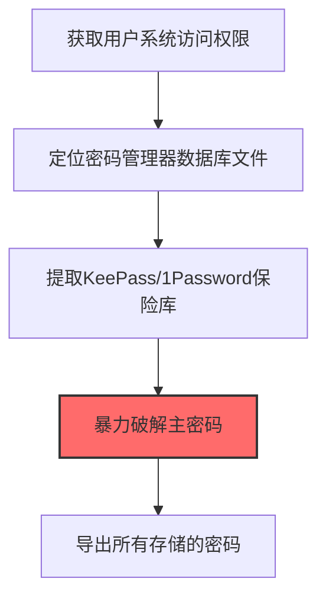
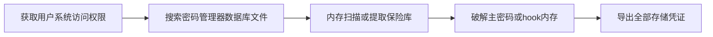

# Password Managers (T1555.005)

## 一句话通俗理解

> **从1Password/LastPass/KeePass等工具中提取密码**

## 30秒速查卡

| 维度 | 你需要知道的 |
|------|-------------|
| 这是什么？ | 从1Password、LastPass、KeePass等密码管理器中提取保存的密码 |
| 为什么危险？ | 密码管理器是密码的'终极保险箱'，如果被攻破，用户保存的所有密码都会泄露 |
| 谁需要关心？ | 终端安全工程师、SOC分析师 |
| 你的第一步防御 | 启用密码管理器的主密码保护，监控异常的密码管理器数据库访问 |
| 如果只做一件事 | 监控KeePass数据库文件（.kdbx）和密码管理器进程的异常内存访问 |

## 难度等级

⭐⭐ 中级 - 需要一定的技术基础和经验

## 前置知识检查

**读这个文件需要什么？**

- [ ] Windows认证体系（NTLM/Kerberos/LSASS）
- [ ] 哈希基础（NTLM Hash/SHA）
- [ ] 网络认证协议（SMB/LDAP/Kerberos）

## 技术描述

**密码管理器**（T1555.005）是 **密码存储凭证提取**（T1555）的一个具体变体，属于 **凭证访问** 阶段的攻击技术。

> 🔐 **打个比方**：就像破解了别人密码保险箱的主密码——攻击者从第三方密码管理器（如LastPass、1Password）提取凭据。

### 具体怎么理解？

从1Password/LastPass/KeePass等工具中提取密码

攻击者使用这种技术时，通常是在凭证访问阶段，想要达到特定的攻击目标。与父技术 T1555 相比，T1555.005 有自己独特的特点和使用场景。

### 为什么有效？

这种技术之所以有效，是因为：
1. **隐蔽性**：利用了正常系统功能或常见协议，不容易被发现
2. **技术门槛适中**：不需要特别高深的技术知识就能实施

**过渡段：** 不要误解凭证访问只是'窃取密码'——在现代企业中，凭证存在于内存、磁盘、网络流量等多个位置。
3. **广泛适用**：可以在多种环境和系统中使用

## 真实攻击流程

### 典型场景

攻击者在 **凭证访问** 阶段使用 密码管理器 技术，以下是典型的攻击步骤：



**步骤详解：**

1. **获取用户系统访问权限** - 需要在用户环境中执行代码，以便访问密码管理器的本地数据文件
2. **定位密码管理器数据库文件** - KeePass的.kdbx文件通常在文档目录，1Password数据在AppData\Local\1Password\
3. **提取KeePass/1Password保险库** - 复制数据库文件到攻击者系统，KeePass还可能通过内存转储获取已解锁的数据库
4. **暴力破解主密码** - 对KeePass数据库使用hashcat或keepass2john进行离线暴力破解，恢复主密码
5. **导出所有存储的密码** - 主密码解锁后可导出所有保存的网站密码、安全笔记和SSH密钥

## 攻击流程

```
获取用户系统访问权限 --> 搜索密码管理器数据库文件 --> 内存扫描或提取保险库 --> 破解主密码或hook内存 --> 导出全部存储凭证
```



**步骤详解：**
1. **获取用户系统访问权限**
   - 通俗描述：先要在用户机器上运行恶意程序，才能访问密码管理器的本地数据
   - 技术细节：通过钓鱼邮件、破解软件或信息窃取器感染用户系统，在用户上下文中执行代码以便访问密码管理器的本地数据文件
   - 常用工具：RedLine Stealer、Vidar Stealer、Cobalt Strike、Raccoon Stealer
2. **搜索密码管理器数据库文件**
   - 通俗描述：找到KeePass或1Password存储密码的数据库文件
   - 技术细节：搜索特定文件扩展名（.kdbx、.opvault等），KeePass的.kdbx文件通常在文档目录，1Password数据在AppData\Local\1Password\，同时检查KeePass.exe是否正在运行
   - 常用工具：dir/Get-ChildItem、LaZagne、Vidar Stealer
3. **内存扫描或提取保险库**
   - 通俗描述：直接从运行中的密码管理器内存里提取已解锁的数据库，或者把数据库文件拷出来
   - 技术细节：使用ReadProcessMemory读取KeePass进程内存中的已解密数据库结构，或使用KeeThief hook KeePassLib.dll提取主密钥，同时复制.kdbx文件用于离线破解
   - 常用工具：KeeThief、ReadProcessMemory API、keepass2john
4. **破解主密码或hook内存**
   - 通俗描述：如果只拿到加密文件，就暴力破解主密码；如果KeePass在运行，就直接从内存里偷主密钥
   - 技术细节：对KeePass数据库使用keepass2john转换为hashcat可破解的哈希格式，再用hashcat离线暴力破解主密码；或hook KeePass的KeePassLib.dll从内存中提取已解锁的数据库主密钥
   - 常用工具：keepass2john、hashcat、KeeThief、John the Ripper
5. **导出全部存储凭证**
   - 通俗描述：用主密码或主密钥解锁数据库，把所有密码都导出来
   - 技术细节：主密码解锁后导出所有保存的网站密码、安全笔记、SSH密钥、API token和Snowflake等服务账户凭证，外传至C2服务器
   - 常用工具：KeePass、1Password Decrypt、LaZagne、自定义导出脚本

## 真实案例

### 案例1：UNC5537/ShinyHunters针对Snowflake客户的密码管理器凭证窃取

- **时间**: 2024年4-7月
- **目标**: Snowflake客户（含AT&T、LiveNation、Ticketmaster、Santander等165个组织）
- **攻击组织**: UNC5537 (ShinyHunters / Scattered Spider)
- **手法**: 攻击者通过信息窃取器日志获取受害企业员工凭证后，从受害者的1Password和KeePass本地保险库中提取Snowflake服务账户凭证和API token，使用KeeThief工具hook KeePass的KeePassLib.dll从内存中提取已解锁的数据库主密钥，进而导出所有Snowflake凭证
- **影响**: 导致AT&T等165个Snowflake客户的数据泄露，涉及超过9700万条用户记录，AT&T支付3.2亿美元赎金
- **参考链接**: [Mandiant UNC5537报告](https://cloud.google.com/blog/topics/threat-intelligence/unc5537-snowflake-data-theft-extortion)

### 案例2：RedLine Stealer针对KeePass的凭证提取

- **时间**: 2022-2024年
- **目标**: 通过钓鱼邮件和破解软件感染全球用户
- **攻击组织**: RedLine Stealer运营组织（据信位于俄罗斯）
- **手法**: RedLine Stealer通过搜索%USERPROFILE%\Documents目录下的.kdbx文件，配合进程内存扫描定位已运行的KeePass.exe，使用ReadProcessMemory读取KeePass进程内存中的已解密数据库结构，或使用keepass2john提取哈希后用hashcat离线暴力破解主密码
- **影响**: 大量企业员工的KeePass保险库被窃取，导致连锁的企业VPN、RDP、SSH和云服务账户泄露
- **参考链接**: [MITRE ATT&CK官方](https://attack.mitre.org/)

### 案例3：Vidar Stealer针对密码管理器文件的窃取

- **时间**: 2023-2024年
- **目标**: 通过钓鱼邮件、恶意广告和破解软件下载站感染的全球用户
- **攻击组织**: Vidar Stealer运营组织（MaaS模式）
- **手法**: Vidar Stealer作为可配置的MaaS信息窃取器，通过搜索特定文件扩展名（包括.kdbx等密码管理器数据库文件）窃取密码管理器数据，同时收集浏览器凭证、加密货币钱包、FTP客户端和邮件客户端凭证，通过Telegram和Steam作为dead drop resolver定位C2服务器外传数据
- **影响**: 大量用户的密码管理器保险库被窃取，导致企业VPN、RDP、SSH和云服务账户连锁泄露
- **参考链接**: [HHS Vidar Malware Analyst Note](https://www.hhs.gov/sites/default/files/vidar-malware-analyst-note-tlpclear.pdf)

## 红队视角

> ⚠️ **免责声明**：以下内容仅用于合法的安全测试、渗透测试和教育目的。未经授权对他人系统进行测试是违法行为。

### 实战技巧

1. **深入理解原理**：在实战应用前，充分理解Password Managers的技术原理和适用场景
2. **环境适配**：根据目标系统的操作系统版本、安全配置等因素调整攻击策略
3. **组合使用**：将该技术与其他技术组合使用，构建完整的攻击链
4. **隐蔽性考虑**：注意操作痕迹的清理，避免被安全设备检测

### 常用工具

| 工具名称 | 用途 | 平台 | 链接 |
| -------- | ---- | ---- | ---- |
| KeeThief | 从KeePass进程内存提取主密钥和解锁数据库 | Windows | [KeeThief GitHub](https://github.com/HarmJ0y/KeeThief) |
| keepass2john | 将KeePass .kdbx转换为hashcat可破解的哈希格式 | 全平台 | [John the Ripper](https://github.com/openwall/john) |
| LaZagne | 自动化凭证提取，覆盖KeePass/1Password/LastPass/Dashlane | 全平台 | [LaZagne GitHub](https://github.com/AlessandroZ/LaZagne) |
| 1Password Decrypt | 离线解密1Password .opvault数据包的工具 | Windows | [1Password-decrypt GitHub](https://github.com/CGentili/1Password-decrypt) |

### 注意事项

- 在授权的测试环境中使用这些技术
- 注意操作安全（OPSEC），避免被检测系统发现
- 使用匿名化技术和代理隐藏真实身份

## 蓝队视角

### 检测要点

1. **系统日志监控**：关注与Password Managers相关的系统日志和审计记录
2. **异常行为检测**：监控系统中与该技术相关的异常进程、网络连接和文件操作
3. **工具特征识别**：识别攻击者可能使用的工具在系统中的运行特征

### 监控建议

- 部署端点检测和响应（EDR）系统，监控与Password Managers相关的异常行为
- 配置SIEM规则，关联分析来自多个来源的告警
- 定期进行安全评估和渗透测试，验证检测规则的有效性

## 避坑指南

组织中最危险盲区：认为强密码就足够安全。

## 检测建议

### 检测思路

检测 密码管理器 的关键是识别异常行为模式。以下是三个层面的检测方法：

### 网络层检测

**方法**：监控网络流量中的异常模式

```bash
# 检测异常的网络连接和数据传输
# 根据具体协议和端口设置检测规则
```

### 主机层检测

**Windows事件ID**：
- 事件ID 4688：进程创建（监控可疑进程）
- 事件ID 4104：PowerShell执行（监控可疑脚本）

**Linux日志**：
- /var/log/auth.log：认证日志
- /var/log/syslog：系统日志

```bash
# 检测异常进程和命令执行
grep -i "suspicious" /var/log/auth.log
```

### 应用层检测

**用人话说：** 这条规则在监控是否有进程在读取密码管理器的数据库文件。密码管理器（如KeePass、1Password）把用户的所有密码存在加密数据库中。正常情况下只有密码管理器应用会访问这个数据库。如果有陌生进程试图读取数据库文件或内存，那就是攻击者在偷密码管理器中的所有密码。

**Sigma规则示例**：

```yaml
title: 检测密码管理器
status: experimental
description: 检测可能的密码管理器活动
logsource:
    category: process_creation
    product: windows
detection:
    selection:
        EventID: 4688
    condition: selection
level: medium
tags:
    - attack.T1555005
```

## 缓解措施

### 优先级1：关键措施

**限制攻击面**：减少暴露的服务和端口，降低被利用的风险

```bash
# 防火墙规则示例：只允许必要的出站连接
iptables -A OUTPUT -p tcp --dport 443 -j ACCEPT  # 允许HTTPS
iptables -A OUTPUT -p tcp --dport 80 -j ACCEPT   # 允许HTTP
iptables -A OUTPUT -p tcp -j DROP                 # 阻止其他TCP
```

### 优先级2：重要措施

**加强监控**：部署EDR和SIEM系统，实时监控异常行为

### 优先级3：建议措施

**安全意识培训**：教育员工识别相关攻击手法

## 动手实验

> ⚠️ **所有实验必须在隔离的实验室环境中进行**

### 实验1：理解基本原理（初级）

**目标**：理解 密码管理器 的工作原理

**步骤**：
1. 在隔离环境中搭建测试系统
2. 使用基础工具模拟攻击行为
3. 观察系统日志和网络流量

**学习要点**：理解该技术的核心机制

### 实验2：实际操作（中级）

**目标**：掌握 密码管理器 的实际使用方法

**步骤**：
1. 使用专业工具进行攻击模拟
2. 尝试不同的绕过技术
3. 分析检测日志的特征

**学习要点**：掌握工具使用和日志分析

### 实验3：防御验证（高级）

**目标**：验证检测规则的有效性

**步骤**：
1. 部署检测规则
2. 执行攻击模拟
3. 验证检测告警是否触发

**学习要点**：理解攻防对抗的实际效果

## 术语解释

| 术语 | 通俗解释 |
|------|---------|
| **ATT&CK** | MITRE公司维护的攻击技术知识库，像一本"黑客手法百科全书" |
| **密码管理器** | T1555.005，ATT&CK框架中定义的一种具体攻击技术 |
| **密码存储凭证提取** | T1555，密码管理器所属的父技术类别 |
| **凭证访问** | 攻击链中的一个阶段，攻击者在这个阶段的目标 |
| **C2** | 命令与控制，攻击者用来远程控制被入侵系统的"遥控器" |
| **EDR** | 端点检测与响应，部署在电脑上的安全监控软件 |

## 被引用情况

以下父技术文档引用了本子技术：

- [T1555 - 密码存储凭证提取](../T1555-Credentials-from-Password-Stores.md)

## 参考资料

### 📚 官方文档（深入了解）

- [MITRE ATT&CK - Password Managers (T1555.005)](https://attack.mitre.org/techniques/T1555/005/)
- [MITRE ATT&CK - 密码存储凭证提取 (T1555)](https://attack.mitre.org/techniques/T1555/)

### 📰 安全报告（真实攻击）

- [MITRE ATT&CK 官方文档](https://attack.mitre.org/) - ATT&CK 框架官方资源

### 🔧 工具与资源（动手试试）

- [Atomic Red Team](https://github.com/redcanaryco/atomic-red-team) - 检测规则测试框架
- [MITRE ATT&CK Navigator](https://mitre-attack.github.io/attack-navigator/) - ATT&CK 可视化工具

### 📚 学习资料（深入了解）

- [MITRE ATT&CK 知识库](https://attack.mitre.org/resources/) - ATT&CK 官方资源中心
