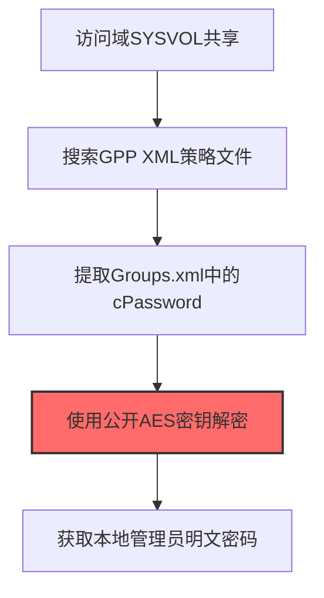
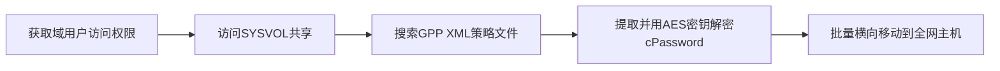

# Group Policies (T1555.006)

## 一句话通俗理解

> **解密域策略中嵌入的管理员密码**

## 30秒速查卡

| 维度 | 你需要知道的 |
|------|-------------|
| 这是什么？ | 解密域策略中嵌入的管理员密码 |
| 为什么危险？ | 组策略中可能包含用已知密钥加密的密码，任何人都能解密，等于把密码放在了公开的保险箱里 |
| 谁需要关心？ | 域管理员、Active Directory安全工程师、SOC分析师 |
| 你的第一步防御 | 删除组策略中的嵌入密码，使用LAPS管理本地管理员密码 |
| 如果只做一件事 | 扫描SYSVOL共享中的组策略文件，检查是否包含cpassword字段 |

## 难度等级

⭐⭐ 中级 - 需要一定的技术基础和经验

## 前置知识检查

**读这个文件需要什么？**

- [ ] Windows认证体系（NTLM/Kerberos/LSASS）
- [ ] 哈希基础（NTLM Hash/SHA）
- [ ] 网络认证协议（SMB/LDAP/Kerberos）

## 技术描述

**组策略**（T1555.006）是 **密码存储凭证提取**（T1555）的一个具体变体，属于 **凭证访问** 阶段的攻击技术。

> 📋 **打个比方**：就像从公司的管理手册里翻到所有系统的默认密码——攻击者从组策略中提取配置的凭据信息。

### 具体怎么理解？

解密域策略中嵌入的管理员密码

攻击者使用这种技术时，通常是在凭证访问阶段，想要达到特定的攻击目标。与父技术 T1555 相比，T1555.006 有自己独特的特点和使用场景。

### 为什么有效？

这种技术之所以有效，是因为：
1. **隐蔽性**：利用了正常系统功能或常见协议，不容易被发现
2. **技术门槛适中**：不需要特别高深的技术知识就能实施

**过渡段：** 不要误解凭证访问只是'窃取密码'——在现代企业中，凭证存在于内存、磁盘、网络流量等多个位置。
3. **广泛适用**：可以在多种环境和系统中使用

## 真实攻击流程

### 典型场景

攻击者在 **凭证访问** 阶段使用 组策略 技术，以下是典型的攻击步骤：



**步骤详解：**

1. **访问域SYSVOL共享** - 任何域用户都有读取\\domain.com\SYSVOL的权限，组策略文件存储在此共享中
2. **搜索GPP XML策略文件** - 在Policies子目录中搜索Groups.xml、Services.xml、Scheduledtasks.xml等包含密码字段的XML文件
3. **提取Groups.xml中的cPassword** - 从XML的cPassword属性中提取AES加密的密码字符串
4. **使用公开AES密钥解密** - 微软在MS14-025中公开了GPP加密使用的AES密钥，任何人都可以解密cPassword
5. **获取本地管理员明文密码** - 解密后得到本地管理员账户的明文密码，可用于Pass-the-Hash横向移动

## 攻击流程

```
获取域用户访问权限 --> 访问SYSVOL共享 --> 搜索GPP XML策略文件 --> 提取并用AES密钥解密cPassword --> 批量横向移动到全网主机
```



**步骤详解：**
1. **获取域用户访问权限**
   - 通俗描述：先要拿到任意域账户，才能访问域控的SYSVOL共享
   - 技术细节：通过钓鱼、凭据窃取或密码喷洒获取任意域用户账户，任何域用户都有读取`\\domain.com\SYSVOL`的权限
   - 常用工具：Cobalt Strike、CrackMapExec、Hydra、Impacket
2. **访问SYSVOL共享**
   - 通俗描述：连上域控的SYSVOL共享文件夹，组策略文件就存在里面
   - 技术细节：通过SMB协议访问`\\DC\SYSVOL\domain.com\Policies\`目录，浏览所有GPO策略文件夹
   - 常用工具：smbclient、CrackMapExec、Impacket smbclient
3. **搜索GPP XML策略文件**
   - 通俗描述：在策略目录里找包含密码字段的XML文件
   - 技术细节：在Policies子目录中搜索Groups.xml、Services.xml、Scheduledtasks.xml、Drives.xml、DataSources.xml等包含cPassword字段的XML文件
   - 常用工具：Get-GPPPassword、dir/Get-ChildItem、findstr
4. **提取并用AES密钥解密cPassword**
   - 通俗描述：从XML里拿出加密的密码字段，用微软公开的AES密钥解开
   - 技术细节：从XML的cPassword属性中提取AES加密的密码字符串，使用微软在MS14-025中公开的AES密钥解密，得到本地管理员或服务账户的明文密码
   - 常用工具：gpp_decrypt、Get-GPPPassword、Impacket Get-GPPPassword.py
5. **批量横向移动到全网主机**
   - 通俗描述：用拿到的本地管理员密码批量登录全网机器
   - 技术细节：使用解密得到的本地管理员密码，配合CrackMapExec批量执行`--local-auth`横向到全网Windows主机，实现勒索软件快速部署
   - 常用工具：CrackMapExec、Impacket psexec.py、Cobalt Strike

## 真实案例

### 案例1：FIN7零售业攻击中利用GPP密码横向移动

- **时间**: 2017-2018年
- **目标**: 美国连锁餐饮和零售企业（含Arby's、Chili's、Red Robin等）
- **攻击组织**: FIN7 (Carbanak / ANUNAK)
- **手法**: FIN7在获得域内任意账户后，访问\\domain.com\SYSVOL共享，使用Get-GPPPassword.ps1批量扫描Policies目录下所有Groups.xml、Services.xml和ScheduledTasks.xml文件，提取cPassword字段并用微软公开的AES密钥解密，获取本地管理员和服务账户明文密码，实现全网横向到POS终端
- **影响**: 导致超过1500家门店支付卡数据泄露，损失超过10亿美元
- **参考链接**: [MITRE ATT&CK官方](https://attack.mitre.org/)

### 案例2：Conti勒索软件的GPP密码自动化利用

- **时间**: 2021-2022年
- **目标**: 全球数千家企业网络
- **攻击组织**: Conti勒索软件组织
- **手法**: Conti勒索软件在获得域内初始访问后，通过VBS脚本自动化扫描\\DC\SYSVOL\domain\Policies\*\*\*.xml，使用gpp_decrypt解密所有cPassword字段，提取本地管理员密码后用CrackMapExec批量执行`--local-auth`横向到全网Windows主机，实现勒索软件快速部署
- **影响**: 850多个组织被勒索，HSE医疗系统等关键基础设施瘫痪，赎金总收入超过1.5亿美元
- **参考链接**: [CISA Conti Advisory](https://www.cisa.gov/news-events/cybersecurity-advisories/aa21-265a)

### 案例3：BlackCat (ALPHV) 勒索软件利用组策略部署勒索软件

- **时间**: 2022-2024年
- **目标**: 全球多个关键基础设施部门的企业网络
- **攻击组织**: BlackCat (ALPHV) 勒索软件组织（俄罗斯背景）
- **手法**: ALPHV Blackcat附属成员从域控、本地网络和删除的备份服务器获取密码后，通过恶意组策略对象（GPO）在域内批量部署勒索软件，同时利用GPO获取Active Directory中的用户和管理员账户，实现大规模横向移动和快速加密
- **影响**: 攻击影响多个关键基础设施部门，导致大量企业网络瘫痪和敏感数据泄露
- **参考链接**: [CISA BlackCat Advisory AA23-353A](https://www.cisa.gov/news-events/cybersecurity-advisories/aa23-353a)

## 红队视角

> ⚠️ **免责声明**：以下内容仅用于合法的安全测试、渗透测试和教育目的。未经授权对他人系统进行测试是违法行为。

### 实战技巧

1. **深入理解原理**：在实战应用前，充分理解Group Policies的技术原理和适用场景
2. **环境适配**：根据目标系统的操作系统版本、安全配置等因素调整攻击策略
3. **组合使用**：将该技术与其他技术组合使用，构建完整的攻击链
4. **隐蔽性考虑**：注意操作痕迹的清理，避免被安全设备检测

### 常用工具

| 工具名称 | 用途 | 平台 | 链接 |
| -------- | ---- | ---- | ---- |
| Get-GPPPassword | PowerSploit/PowerView模块，批量扫描SYSVOL提取cPassword | Windows | [PowerSploit GitHub](https://github.com/PowerShellMafia/PowerSploit) |
| gpp_decrypt | Python脚本，使用微软公开AES密钥解密cPassword字段 | 全平台 | [gpp_decrypt GitHub](https://github.com/PowerShellMafia/PowerSploit) |
| CrackMapExec | 网络渗透工具，可批量扫描GPP并自动解密 | 全平台 | [CrackMapExec GitHub](https://github.com/byt3bl33d3r/CrackMapExec) |
| Impacket | 含Get-GPPPassword.py脚本，可离线解析SYSVOL策略文件 | 全平台 | [Impacket GitHub](https://github.com/fortra/impacket) |

### 注意事项

- 在授权的测试环境中使用这些技术
- 注意操作安全（OPSEC），避免被检测系统发现
- 使用匿名化技术和代理隐藏真实身份

## 蓝队视角

### 检测要点

1. **系统日志监控**：关注与Group Policies相关的系统日志和审计记录
2. **异常行为检测**：监控系统中与该技术相关的异常进程、网络连接和文件操作
3. **工具特征识别**：识别攻击者可能使用的工具在系统中的运行特征

### 监控建议

- 部署端点检测和响应（EDR）系统，监控与Group Policies相关的异常行为
- 配置SIEM规则，关联分析来自多个来源的告警
- 定期进行安全评估和渗透测试，验证检测规则的有效性

## 避坑指南

组织中最危险盲区：认为强密码就足够安全。

## 检测建议

### 检测思路

检测 组策略 的关键是识别异常行为模式。以下是三个层面的检测方法：

### 网络层检测

**方法**：监控网络流量中的异常模式

```bash
# 检测异常的网络连接和数据传输
# 根据具体协议和端口设置检测规则
```

### 主机层检测

**Windows事件ID**：
- 事件ID 4688：进程创建（监控可疑进程）
- 事件ID 4104：PowerShell执行（监控可疑脚本）

**Linux日志**：
- /var/log/auth.log：认证日志
- /var/log/syslog：系统日志

```bash
# 检测异常进程和命令执行
grep -i "suspicious" /var/log/auth.log
```

### 应用层检测

**用人话说：** 这条规则在扫描域控制器的SYSVOL共享中是否包含组策略嵌入的密码。域管理员有时会通过组策略分发密码，但这个密码是用微软公开的密钥加密的，任何人都能解密。如果你发现组策略文件中有cpassword字段，那就是攻击者可以轻松解密获取的管理员密码。

**Sigma规则示例**：

```yaml
title: 检测组策略
status: experimental
description: 检测可能的组策略活动
logsource:
    category: process_creation
    product: windows
detection:
    selection:
        EventID: 4688
    condition: selection
level: medium
tags:
    - attack.T1555006
```

## 缓解措施

### 优先级1：关键措施

**限制攻击面**：减少暴露的服务和端口，降低被利用的风险

```bash
# 防火墙规则示例：只允许必要的出站连接
iptables -A OUTPUT -p tcp --dport 443 -j ACCEPT  # 允许HTTPS
iptables -A OUTPUT -p tcp --dport 80 -j ACCEPT   # 允许HTTP
iptables -A OUTPUT -p tcp -j DROP                 # 阻止其他TCP
```

### 优先级2：重要措施

**加强监控**：部署EDR和SIEM系统，实时监控异常行为

### 优先级3：建议措施

**安全意识培训**：教育员工识别相关攻击手法

## 动手实验

> ⚠️ **所有实验必须在隔离的实验室环境中进行**

### 实验1：理解基本原理（初级）

**目标**：理解 组策略 的工作原理

**步骤**：
1. 在隔离环境中搭建测试系统
2. 使用基础工具模拟攻击行为
3. 观察系统日志和网络流量

**学习要点**：理解该技术的核心机制

### 实验2：实际操作（中级）

**目标**：掌握 组策略 的实际使用方法

**步骤**：
1. 使用专业工具进行攻击模拟
2. 尝试不同的绕过技术
3. 分析检测日志的特征

**学习要点**：掌握工具使用和日志分析

### 实验3：防御验证（高级）

**目标**：验证检测规则的有效性

**步骤**：
1. 部署检测规则
2. 执行攻击模拟
3. 验证检测告警是否触发

**学习要点**：理解攻防对抗的实际效果

## 术语解释

| 术语 | 通俗解释 |
|------|---------|
| **ATT&CK** | MITRE公司维护的攻击技术知识库，像一本"黑客手法百科全书" |
| **组策略** | T1555.006，ATT&CK框架中定义的一种具体攻击技术 |
| **密码存储凭证提取** | T1555，组策略所属的父技术类别 |
| **凭证访问** | 攻击链中的一个阶段，攻击者在这个阶段的目标 |
| **C2** | 命令与控制，攻击者用来远程控制被入侵系统的"遥控器" |
| **EDR** | 端点检测与响应，部署在电脑上的安全监控软件 |

## 被引用情况

以下父技术文档引用了本子技术：

- [T1555 - 密码存储凭证提取](../T1555-Credentials-from-Password-Stores.md)

## 参考资料

### 📚 官方文档（深入了解）

- [MITRE ATT&CK - Group Policies (T1555.006)](https://attack.mitre.org/techniques/T1555/006/)
- [MITRE ATT&CK - 密码存储凭证提取 (T1555)](https://attack.mitre.org/techniques/T1555/)

### 📰 安全报告（真实攻击）

- [MITRE ATT&CK 官方文档](https://attack.mitre.org/) - ATT&CK 框架官方资源

### 🔧 工具与资源（动手试试）

- [Atomic Red Team](https://github.com/redcanaryco/atomic-red-team) - 检测规则测试框架
- [MITRE ATT&CK Navigator](https://mitre-attack.github.io/attack-navigator/) - ATT&CK 可视化工具

### 📚 学习资料（深入了解）

- [MITRE ATT&CK 知识库](https://attack.mitre.org/resources/) - ATT&CK 官方资源中心
