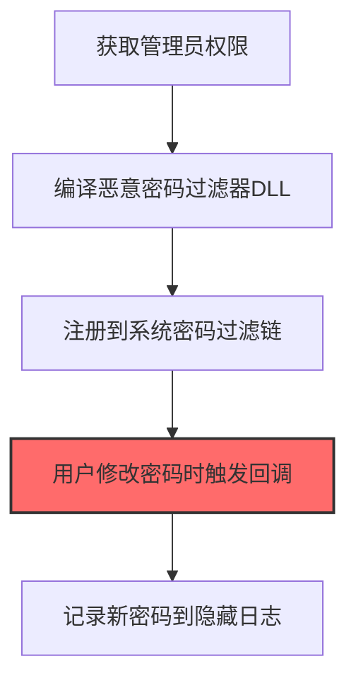
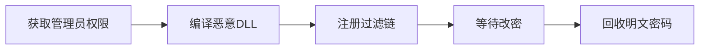

# Password Filter DLL (T1556.002)

## 一句话通俗理解

> **安装密码过滤器，在用户改密码时记录新密码**

## 30秒速查卡

| 维度 | 你需要知道的 |
|------|-------------|
| 这是什么？ | 安装密码过滤器DLL，在用户修改密码时记录新密码 |
| 为什么危险？ | 密码过滤器是Windows的合法功能，安装后会在每次密码变更时被调用，能捕获所有新密码 |
| 谁需要关心？ | Windows安全工程师、域管理员、SOC分析师 |
| 你的第一步防御 | 监控HKLM\SYSTEM\CurrentControlSet\Control\Lsa\Notification Packages注册表键的变更 |
| 如果只做一件事 | 监控注册表中密码过滤器DLL的新增，任何非预期的DLL添加立即告警 |

## 难度等级

⭐⭐⭐ 高级 - 需要深入的技术知识和实践

## 前置知识检查

**读这个文件需要什么？**

- [ ] Windows认证体系（NTLM/Kerberos/LSASS）
- [ ] 哈希基础（NTLM Hash/SHA）
- [ ] 网络认证协议（SMB/LDAP/Kerberos）

## 技术描述

**密码过滤器DLL**（T1556.002）是 **修改认证流程**（T1556）的一个具体变体，属于 **凭证访问** 阶段的攻击技术。

> 🔧 **打个比方**：就像在锁芯里加装一个复制钥匙的装置——攻击者安装恶意的密码过滤器DLL，在系统处理密码时窃取一份副本。

### 具体怎么理解？

安装密码过滤器，在用户改密码时记录新密码

攻击者使用这种技术时，通常是在凭证访问阶段，想要达到特定的攻击目标。与父技术 T1556 相比，T1556.002 有自己独特的特点和使用场景。

### 为什么有效？

这种技术之所以有效，是因为：
1. **隐蔽性**：利用了正常系统功能或常见协议，不容易被发现
2. **技术门槛适中**：不需要特别高深的技术知识就能实施

**过渡段：** 不要误解凭证访问只是'窃取密码'——在现代企业中，凭证存在于内存、磁盘、网络流量等多个位置。
3. **广泛适用**：可以在多种环境和系统中使用

## 真实攻击流程

### 典型场景

攻击者在 **凭证访问** 阶段使用 密码过滤器DLL 技术，以下是典型的攻击步骤：



**步骤详解：**

1. **获取管理员权限** - 需要管理员权限才能将DLL注册到Windows密码过滤器链中
2. **编译恶意密码过滤器DLL** - 实现PasswordFilter导出函数的恶意DLL，该函数在每次密码变更时被lsass.exe调用
3. **注册到系统密码过滤链** - 将DLL路径添加到HKLM\SYSTEM\CurrentControlSet\Control\Lsa\Notification Packages注册表项
4. **用户修改密码时触发回调** - 当用户按Ctrl+Alt+Del改密码或管理员重置密码时，lsass.exe自动加载并调用恶意DLL
5. **记录新密码到隐藏日志** - DLL在回调函数中将明文新密码写入隐蔽文件，攻击者定期回收

## 攻击流程

```
获取管理员权限 --> 编译恶意DLL --> 注册过滤链 --> 等待改密 --> 回收明文密码
```



**步骤详解：**
1. **获取管理员权限**
   - 通俗描述：先拿到机器的管理员账户，因为修改密码过滤链需要特权
   - 技术细节：通过横向移动、漏洞利用（如PrintNightmare）或令牌窃取获取本地SYSTEM/Administrator权限
   - 常用工具：Mimikatz、PrintSpoofer、JuicyPotato、Cobalt Strike
2. **编译恶意DLL**
   - 通俗描述：做一个假的"密码检查员"程序，表面合规实际偷密码
   - 技术细节：实现`InitializeChangeNotify`和`PasswordFilter`导出函数，编译为x64/x86 DLL，需匹配目标系统位数
   - 常用工具：Visual Studio C++、MinGW、DLL模板项目
3. **注册过滤链**
   - 通俗描述：把这个假检查员登记到Windows系统里，让它每次改密码都能插一脚
   - 技术细节：修改`HKLM\SYSTEM\CurrentControlSet\Control\Lsa\Notification Packages`注册表项，将DLL名（不含扩展名）追加到多字符串值中
   - 常用工具：reg add、PowerShell Set-ItemProperty、PowerShell Reflective DLL加载
4. **等待改密**
   - 通俗描述：躲起来等用户主动改密码，触发密码过滤器回调
   - 技术细节：用户通过Ctrl+Alt+Del改密码、管理员重置密码或密码过期策略触发时，lsass.exe自动加载DLL并调用`PasswordFilter`
   - 常用工具：无需主动操作，被动等待
5. **回收明文密码**
   - 通俗描述：定期回去把偷到的密码取走
   - 技术细节：将明文密码以加密或编码形式写入隐藏文件（如系统目录、备用数据流），通过计划任务或C2定期外传
   - 常用工具：schtasks、Cobalt Strike Beacon、PowerShell Empire

## 真实案例

### 案例1：MuddyWater 针对中东政府部署密码过滤器窃取密码

- **时间**: 2018-2021年
- **目标**: 中东多国政府机构、电信运营商和科技企业
- **攻击组织**: MuddyWater（MERCURY / Seedworm，伊朗APT组织）
- **手法**: 攻击者获得域管权限后，编译了实现 `InitializeChangeNotify` 和 `PasswordFilter` 导出函数的恶意DLL，通过修改 `HKLM\SYSTEM\CurrentControlSet\Control\Lsa\Notification Packages` 注册表项加载到lsass.exe中，每当域用户通过Ctrl+Alt+Del修改密码时，新密码就被明文记录到隐蔽文件
- **影响**: 攻击者在长达数月的潜伏期内收集了数百个用户的新密码，包括高权限服务账户和域管理员密码，为后续横向移动提供了持续的凭证来源
- **参考链接**: [MuddyWater 分析报告 - Trend Micro](https://www.trendmicro.com/en_us/research/18/e/muddywater-apt-deploys-new-powershell-backdoor.html) | [MITRE ATT&CK - T1556.002](https://attack.mitre.org/techniques/T1556/002/)

### 案例2：APT33 (Elfin) 针对航空航天业部署密码过滤器

- **时间**: 2017-2018年
- **目标**: 沙特阿拉伯、美国和韩国的航空航天与能源企业
- **攻击组织**: APT33（Elfin / Refined Kitten，伊朗APT组织）
- **手法**: 攻击者通过鱼叉钓鱼植入 `TurnedUp` 后门获得初始访问后，使用 `Invoke-NinjaCopy` 等工具在域控制器上部署自定义密码过滤器DLL，每次用户密码变更时自动调用 `PasswordFilter` 函数记录新密码到本地日志文件
- **影响**: 攻击者通过持续捕获密码变更，获得了对 victim 组织的持久化凭证访问权限，便于长期维持潜伏并扩散至关联组织
- **参考链接**: [APT33 分析 - FireEye](https://www.fireeye.com/blog/threat-research/2017/09/apt33-insights-into-iranian-cyber-espionage.html) | [MITRE ATT&CK - T1556.002](https://attack.mitre.org/techniques/T1556/002/)

### 案例3：APT29 (Cozy Bear) 部署密码过滤器DLL捕获域内密码变更

- **时间**: 2016-2019年
- **目标**: 欧美多国政府机构、智库、外交机构和非政府组织
- **攻击组织**: APT29（Cozy Bear / NOBELIUM / The Dukes，俄罗斯SVR）
- **手法**: 攻击者通过鱼叉钓鱼植入后门获得初始访问后，使用Mimikatz提取域管凭证，随后在域控上部署自定义密码过滤器DLL（实现 `InitializeChangeNotify` 和 `PasswordFilter` 导出函数），将DLL路径添加到 `HKLM\SYSTEM\CurrentControlSet\Control\Lsa\Notification Packages` 注册表项中。每当域内用户通过Ctrl+Alt+Del修改密码或域管重置密码时，新密码被明文记录到隐蔽文件，攻击者通过定期回传获取凭证
- **影响**: 攻击者通过持续的密码捕获，获得了对目标组织网络的长期凭证访问权限，绕过了密码轮换和强密码策略的防御效果，便于长期潜伏和横向移动至关联组织
- **参考链接**: [CrowdStrike - Who Is Cozy Bear?](https://www.crowdstrike.com/blog/who-is-cozy-bear/) | [MITRE ATT&CK - T1556.002](https://attack.mitre.org/techniques/T1556/002/)

## 红队视角

> ⚠️ **免责声明**：以下内容仅用于合法的安全测试、渗透测试和教育目的。未经授权对他人系统进行测试是违法行为。

### 实战技巧

1. **深入理解原理**：在实战应用前，充分理解Password Filter DLL的技术原理和适用场景
2. **环境适配**：根据目标系统的操作系统版本、安全配置等因素调整攻击策略
3. **组合使用**：将该技术与其他技术组合使用，构建完整的攻击链
4. **隐蔽性考虑**：注意操作痕迹的清理，避免被安全设备检测

### 常用工具

| 工具名称 | 用途 | 平台 | 链接 |
| -------- | ---- | ---- | ---- |
| Mimikatz | `misc::memssp` 将密码过滤器直接注入LSASS内存（无需DLL文件），重启后失效 | Windows | [Mimikatz](https://github.com/gentilkiwi/mimikatz) |
| Invoke-NinjaCopy | PowerSploit模块，绕过文件锁定从NTDS.dit和SYSVOL中复制文件，常用于部署过滤器DLL | Windows | [PowerSploit](https://github.com/PowerShellMafia/PowerSploit) |
| 自定义PasswordFilter DLL模板 | GitHub上多个开源项目实现了 `InitializeChangeNotify` 和 `PasswordFilter` 导出函数的模板 | Windows | [PasswordFilter Template](https://github.com/kacos2000/PasswordFilter) |
| PowerSploit PowerView | 用于枚举域用户、计算机、组策略等信息，辅助定位部署过滤器的最佳位置 | Windows | [PowerView](https://github.com/PowerShellMafia/PowerSploit/blob/master/Recon/PowerView.ps1) |

### 注意事项

- 在授权的测试环境中使用这些技术
- 注意操作安全（OPSEC），避免被检测系统发现
- 使用匿名化技术和代理隐藏真实身份

## 蓝队视角

### 检测要点

1. **系统日志监控**：关注与Password Filter DLL相关的系统日志和审计记录
2. **异常行为检测**：监控系统中与该技术相关的异常进程、网络连接和文件操作
3. **工具特征识别**：识别攻击者可能使用的工具在系统中的运行特征

### 监控建议

- 部署端点检测和响应（EDR）系统，监控与Password Filter DLL相关的异常行为
- 配置SIEM规则，关联分析来自多个来源的告警
- 定期进行安全评估和渗透测试，验证检测规则的有效性

## 避坑指南

组织中最危险盲区：认为强密码就足够安全。

## 检测建议

### 检测思路

检测 密码过滤器DLL 的关键是识别异常行为模式。以下是三个层面的检测方法：

### 网络层检测

**方法**：监控网络流量中的异常模式

```bash
# 检测异常的网络连接和数据传输
# 根据具体协议和端口设置检测规则
```

### 主机层检测

**Windows事件ID**：
- 事件ID 4688：进程创建（监控可疑进程）
- 事件ID 4104：PowerShell执行（监控可疑脚本）

**Linux日志**：
- /var/log/auth.log：认证日志
- /var/log/syslog：系统日志

```bash
# 检测异常进程和命令执行
grep -i "suspicious" /var/log/auth.log
```

### 应用层检测

**用人话说：** 这条规则在监控是否有新的密码过滤器DLL被安装。Windows的密码过滤器功能会在用户改密码时被系统调用。正常情况下这个列表不会变化。如果发现有新的DLL被添加到密码过滤器列表中，那就是攻击者在安装'密码窃听器'，会在每个用户改密码时记录新密码。

**Sigma规则示例**：

```yaml
title: 检测密码过滤器DLL
status: experimental
description: 检测可能的密码过滤器DLL活动
logsource:
    category: process_creation
    product: windows
detection:
    selection:
        EventID: 4688
    condition: selection
level: medium
tags:
    - attack.T1556002
```

## 缓解措施

### 优先级1：关键措施

**限制攻击面**：减少暴露的服务和端口，降低被利用的风险

```bash
# 防火墙规则示例：只允许必要的出站连接
iptables -A OUTPUT -p tcp --dport 443 -j ACCEPT  # 允许HTTPS
iptables -A OUTPUT -p tcp --dport 80 -j ACCEPT   # 允许HTTP
iptables -A OUTPUT -p tcp -j DROP                 # 阻止其他TCP
```

### 优先级2：重要措施

**加强监控**：部署EDR和SIEM系统，实时监控异常行为

### 优先级3：建议措施

**安全意识培训**：教育员工识别相关攻击手法

## 动手实验

> ⚠️ **所有实验必须在隔离的实验室环境中进行**

### 实验1：理解基本原理（初级）

**目标**：理解 密码过滤器DLL 的工作原理

**步骤**：
1. 在隔离环境中搭建测试系统
2. 使用基础工具模拟攻击行为
3. 观察系统日志和网络流量

**学习要点**：理解该技术的核心机制

### 实验2：实际操作（中级）

**目标**：掌握 密码过滤器DLL 的实际使用方法

**步骤**：
1. 使用专业工具进行攻击模拟
2. 尝试不同的绕过技术
3. 分析检测日志的特征

**学习要点**：掌握工具使用和日志分析

### 实验3：防御验证（高级）

**目标**：验证检测规则的有效性

**步骤**：
1. 部署检测规则
2. 执行攻击模拟
3. 验证检测告警是否触发

**学习要点**：理解攻防对抗的实际效果

## 术语解释

| 术语 | 通俗解释 |
|------|---------|
| **ATT&CK** | MITRE公司维护的攻击技术知识库，像一本"黑客手法百科全书" |
| **密码过滤器DLL** | T1556.002，ATT&CK框架中定义的一种具体攻击技术 |
| **修改认证流程** | T1556，密码过滤器DLL所属的父技术类别 |
| **凭证访问** | 攻击链中的一个阶段，攻击者在这个阶段的目标 |
| **C2** | 命令与控制，攻击者用来远程控制被入侵系统的"遥控器" |
| **EDR** | 端点检测与响应，部署在电脑上的安全监控软件 |

## 被引用情况

以下父技术文档引用了本子技术：

- [T1556 - 修改认证流程](../../05-Persistence/T1556-Modify-Authentication-Process.md)
- [T1556 - 修改认证流程](../../07-Stealth/T1556-Modify-Authentication-Process.md)
- [T1556 - 修改认证流程](../../08-Defense-Impairment/T1556-Modify-Authentication-Process.md)
- [T1556 - 修改认证流程](../T1556-Modify-Authentication-Process.md)

## 参考资料

### 官方文档

- [MITRE ATT&CK - Password Filter DLL (T1556.002)](https://attack.mitre.org/techniques/T1556/002/)
- [MITRE ATT&CK - 修改认证流程 (T1556)](https://attack.mitre.org/techniques/T1556/)

### 安全报告

- [MITRE ATT&CK 官方文档](https://attack.mitre.org/) - ATT&CK 框架官方资源

### 工具与资源

- [Atomic Red Team](https://github.com/redcanaryco/atomic-red-team) - 检测规则测试框架
- [MITRE ATT&CK Navigator](https://mitre-attack.github.io/attack-navigator/) - ATT&CK 可视化工具

### 学习资料

- [MITRE ATT&CK 知识库](https://attack.mitre.org/resources/) - ATT&CK 官方资源中心
