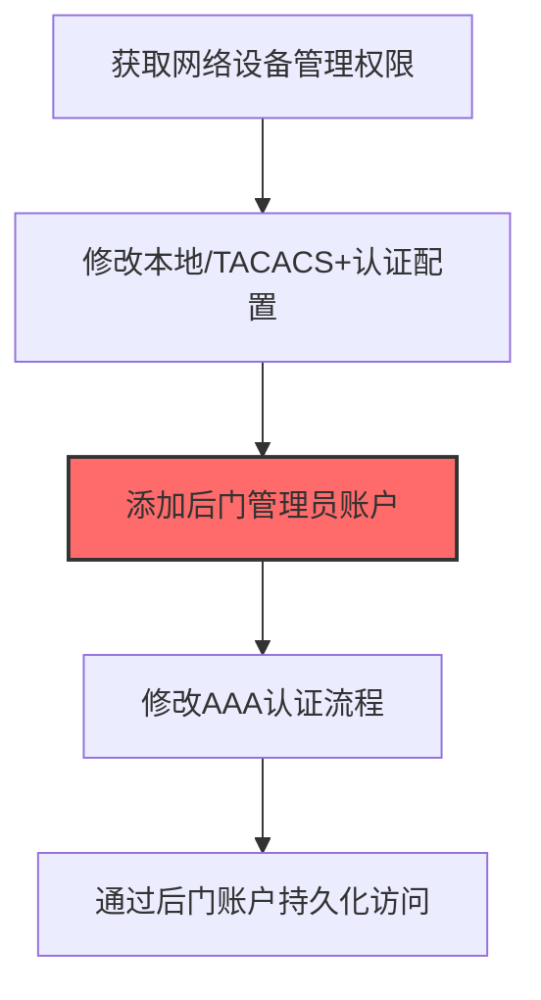

# Network Device Authentication (T1556.004)

## 一句话通俗理解

> **在路由器/交换机上添加后门用户或改认证配置**

## 30秒速查卡

| 维度 | 你需要知道的 |
|------|-------------|
| 这是什么？ | 在路由器、交换机等网络设备上添加后门用户或修改认证配置 |
| 为什么危险？ | 网络设备是企业的'交通要道'，控制它就能监控所有流量，而且网络设备的审计日志通常不完善 |
| 谁需要关心？ | 网络管理员、SOC分析师、安全运营团队 |
| 你的第一步防御 | 实施网络设备的配置变更审计，使用TACACS+集中认证 |
| 如果只做一件事 | 监控网络设备配置的任何变更，特别是新用户添加和认证方式修改 |

## 难度等级

⭐⭐⭐ 高级 - 需要深入的技术知识和实践

## 前置知识检查

**读这个文件需要什么？**

- [ ] Windows认证体系（NTLM/Kerberos/LSASS）
- [ ] 哈希基础（NTLM Hash/SHA）
- [ ] 网络认证协议（SMB/LDAP/Kerberos）

## 技术描述

**网络设备认证**（T1556.004）是 **修改认证流程**（T1556）的一个具体变体，属于 **凭证访问** 阶段的攻击技术。

> 🌐 **打个比方**：就像在路由器的管理员登录页面加装键盘记录器——攻击者修改网络设备的认证流程，收集管理员的登录凭证。

### 具体怎么理解？

在路由器/交换机上添加后门用户或改认证配置

攻击者使用这种技术时，通常是在凭证访问阶段，想要达到特定的攻击目标。与父技术 T1556 相比，T1556.004 有自己独特的特点和使用场景。

### 为什么有效？

这种技术之所以有效，是因为：
1. **隐蔽性**：利用了正常系统功能或常见协议，不容易被发现
2. **技术门槛适中**：不需要特别高深的技术知识就能实施

**过渡段：** 不要误解凭证访问只是'窃取密码'——在现代企业中，凭证存在于内存、磁盘、网络流量等多个位置。
3. **广泛适用**：可以在多种环境和系统中使用

## 真实攻击流程

### 典型场景

攻击者在 **凭证访问** 阶段使用 网络设备认证 技术，以下是典型的攻击步骤：



**步骤详解：**

1. **获取网络设备管理权限** - 通过已知漏洞或默认凭证获得路由器/交换机的enable模式访问
2. **修改本地/TACACS+认证配置** - 修改running-config中的认证源，将认证请求导向攻击者控制的服务器
3. **添加后门管理员账户** - 使用username命令创建隐藏的管理员账户，设置高权限和不易发现的密码
4. **修改AAA认证流程** - 配置TACACS+或RADIUS服务器指向攻击者控制的认证服务器，记录所有认证尝试
5. **通过后门账户持久化访问** - 即使修复了初始漏洞，后门账户仍可提供持续的设备访问权限

## 攻击流程

```
入侵网络设备 --> 修改AAA配置 --> 添加后门账户 --> 劫持认证流程 --> 持久化访问
```


**步骤详解：**
1. **入侵网络设备**
   - 通俗描述：先想办法进入路由器或交换机的管理模式
   - 技术细节：利用设备CVE漏洞（如Cisco RV110W、Fortinet SSL VPN）、默认凭证（admin/admin、cisco/cisco）或SNMP弱团体字获取enable模式权限
   - 常用工具：Metasploit、RouterSploit、Hydra SNMP、思科CVE PoC
2. **修改AAA配置**
   - 通俗描述：把设备的"身份验证系统"改向攻击者控制的服务器
   - 技术细节：修改`aaa new-model`配置，将TACACS+/RADIUS服务器指向攻击者控制的认证服务器，捕获所有登录凭证
   - 常用工具：Cisco IOS CLI、tac_plus、FreeRADIUS
3. **添加后门账户**
   - 通俗描述：在设备里偷偷加一个管理员账户，方便以后进出
   - 技术细节：使用`username backdoor privilege 15 secret 0 <pwd>`创建高权限隐藏账户，配置时关闭日志记录避免审计
   - 常用工具：Cisco IOS CLI、HUAWEI VRP CLI
4. **劫持认证流程**
   - 通俗描述：让设备把所有人的登录请求都送到攻击者那里验证，顺便记录密码
   - 技术细节：配置`aaa authentication login default group tacacs+ local`，所有用户认证先走攻击者TACACS+服务器，明文或可逆加密记录密码
   - 常用工具：Multi-Tacacs+ Server、自定义TACACS+服务器
5. **持久化访问**
   - 通俗描述：即使被发现清理了，后门账户还能继续用
   - 技术细节：将后门配置写入NVRAM（`write memory`），同时配置NTP时间同步和SNMP社区字符串作为备用通道
   - 常用工具：write memory、copy run start、SNMP社区字符串

## 真实案例

### 案例1：APT28 VPNFilter 大规模路由器后门

- **时间**: 2018年
- **目标**: 乌克兰及全球50万台路由器（Linksys、Netgear、TP-Link、华硕等）
- **攻击组织**: APT28（Fancy Bear/Sofacy）
- **手法**: 通过VPNFilter多阶段恶意软件感染路由器，使用ssler模块劫持HTTP流量并注入凭证收集脚本，用dstr模块在退出时销毁证据，并通过修改running-config添加后门账户实现持久化
- **影响**: 乌克兰基础设施遭受大规模网络设备失陷，FBI紧急接管攻击者控制域名 c[.]vpnfilter-router[.]com，攻击者可监控所有经过路由器的流量
- **参考链接**: [Cisco Talos VPNFilter报告](https://blog.talosintelligence.com/2018/05/VPNFilter.html)

### 案例2：Sandworm 入侵乌克兰电网网络设备

- **时间**: 2015-2016年
- **目标**: 乌克兰电力公司网络设备
- **攻击组织**: Sandworm（IRIDIUM）
- **手法**: 通过窃取的VPN凭证进入工业控制网络，在思科串口控制台服务器上植入Echotracks后门固件，修改串口认证配置捕获运维人员登录凭证，并下发断路器指令造成大规模停电
- **影响**: 乌克兰电网两次大停电（2015年12月BlackEnergy、2016年12月CrashOverride），近25万居民受影响
- **参考链接**: [Dragos CrashOverride分析](https://www.dragos.com/blog/crashoverride/)

### 案例3：Turla (Snake) 长期潜伏网络设备修改认证配置持久化

- **时间**: 2015-2023年
- **目标**: 全球多国政府、外交、教育、科研机构的边界路由器、防火墙和VPN网关
- **攻击组织**: Turla（Snake / Venomous Bear / Krypton，俄罗斯FSB 16局）
- **手法**: 攻击者通过零日漏洞或弱口令入侵边界网络设备（如思科路由器、Juniper防火墙），在设备上植入Snake后门并修改 `running-config` 添加后门账户（如 `backup`），同时将本地认证数据库替换为攻击者控制的版本，使后门账户在任何配置重载后依然有效；在认证模块中插入凭证记录逻辑，将所有通过SSH/Telnet登录的运维账号密码转发到Turla控制的C2服务器
- **影响**: 攻击者在受害者网络设备上维持了长达8年以上的持久化访问，期间持续捕获运维人员凭证并用于横向移动到内部Windows/Linux服务器；FBI在2023年5月通过 "MEDUSA" 行动接管了部分被感染设备并推送清除指令
- **参考链接**: [FBI/CISA - Snake Malware Cybersecurity Advisory](https://www.ic3.gov/CSA/2023/230509.pdf) | [MITRE ATT&CK - T1556.004](https://attack.mitre.org/techniques/T1556/004/)

## 红队视角

> ⚠️ **免责声明**：以下内容仅用于合法的安全测试、渗透测试和教育目的。未经授权对他人系统进行测试是违法行为。

### 实战技巧

1. **深入理解原理**：在实战应用前，充分理解Network Device Authentication的技术原理和适用场景
2. **环境适配**：根据目标系统的操作系统版本、安全配置等因素调整攻击策略
3. **组合使用**：将该技术与其他技术组合使用，构建完整的攻击链
4. **隐蔽性考虑**：注意操作痕迹的清理，避免被安全设备检测

### 常用工具

| 工具名称 | 用途 | 平台 | 链接 |
| -------- | ---- | ---- | ---- |
| Cisco IOS CLI | enable模式下直接使用`username`、`aaa new-model`命令添加后门账户或修改认证源 | Cisco IOS | [Cisco官方命令参考](https://www.cisco.com/c/en/us/td/docs/ios-xml/ios/sec_usr_aaa/configuration/xe-16/asr-920/sec-usr-aaa-xe-16-asr-920-book/sec-cfg-tacacs.html) |
| Metasploit cisco_config | 通过SNMP/TFTP协议远程导出running-config并修改配置回写 | 跨平台 | [Rapid7 Module cisco_config](https://www.rapid7.com/db/modules/auxiliary/scanner/snmp/cisco_config/) |
| SNMP SET脚本 | 利用SNMP写权限（community=private）直接通过OID修改设备配置 | 跨平台 | [snmpset文档](https://net-snmp.sourceforge.io/docs/man/snmpset.html) |
| 网络设备固件修改工具 | 对固件镜像进行解包、植入后门模块（如VPNFilter ssler）、重新打包刷写 | 跨平台 | [Binwalk固件分析](https://github.com/ReFirmLabs/binwalk) |

### 注意事项

- 在授权的测试环境中使用这些技术
- 注意操作安全（OPSEC），避免被检测系统发现
- 使用匿名化技术和代理隐藏真实身份

## 蓝队视角

### 检测要点

1. **系统日志监控**：关注与Network Device Authentication相关的系统日志和审计记录
2. **异常行为检测**：监控系统中与该技术相关的异常进程、网络连接和文件操作
3. **工具特征识别**：识别攻击者可能使用的工具在系统中的运行特征

### 监控建议

- 部署端点检测和响应（EDR）系统，监控与Network Device Authentication相关的异常行为
- 配置SIEM规则，关联分析来自多个来源的告警
- 定期进行安全评估和渗透测试，验证检测规则的有效性

## 避坑指南

组织中最危险盲区：认为强密码就足够安全。

## 检测建议

### 检测思路

检测 网络设备认证 的关键是识别异常行为模式。以下是三个层面的检测方法：

### 网络层检测

**方法**：监控网络流量中的异常模式

```bash
# 检测异常的网络连接和数据传输
# 根据具体协议和端口设置检测规则
```

### 主机层检测

**Windows事件ID**：
- 事件ID 4688：进程创建（监控可疑进程）
- 事件ID 4104：PowerShell执行（监控可疑脚本）

**Linux日志**：
- /var/log/auth.log：认证日志
- /var/log/syslog：系统日志

```bash
# 检测异常进程和命令执行
grep -i "suspicious" /var/log/auth.log
```

### 应用层检测

**用人话说：** 这条规则在监控网络设备（路由器、交换机）的认证配置是否被修改。网络设备是企业网络的'交通要道'。正常情况下设备配置不会频繁变更。如果发现有新用户被添加、认证方式被修改、或者配置被导出，那就是攻击者在控制网络设备，准备监控或劫持网络流量。

**Sigma规则示例**：

```yaml
title: 检测网络设备认证
status: experimental
description: 检测可能的网络设备认证活动
logsource:
    category: process_creation
    product: windows
detection:
    selection:
        EventID: 4688
    condition: selection
level: medium
tags:
    - attack.T1556004
```

## 缓解措施

### 优先级1：关键措施

**限制攻击面**：减少暴露的服务和端口，降低被利用的风险

```bash
# 防火墙规则示例：只允许必要的出站连接
iptables -A OUTPUT -p tcp --dport 443 -j ACCEPT  # 允许HTTPS
iptables -A OUTPUT -p tcp --dport 80 -j ACCEPT   # 允许HTTP
iptables -A OUTPUT -p tcp -j DROP                 # 阻止其他TCP
```

### 优先级2：重要措施

**加强监控**：部署EDR和SIEM系统，实时监控异常行为

### 优先级3：建议措施

**安全意识培训**：教育员工识别相关攻击手法

## 动手实验

> ⚠️ **所有实验必须在隔离的实验室环境中进行**

### 实验1：理解基本原理（初级）

**目标**：理解 网络设备认证 的工作原理

**步骤**：
1. 在隔离环境中搭建测试系统
2. 使用基础工具模拟攻击行为
3. 观察系统日志和网络流量

**学习要点**：理解该技术的核心机制

### 实验2：实际操作（中级）

**目标**：掌握 网络设备认证 的实际使用方法

**步骤**：
1. 使用专业工具进行攻击模拟
2. 尝试不同的绕过技术
3. 分析检测日志的特征

**学习要点**：掌握工具使用和日志分析

### 实验3：防御验证（高级）

**目标**：验证检测规则的有效性

**步骤**：
1. 部署检测规则
2. 执行攻击模拟
3. 验证检测告警是否触发

**学习要点**：理解攻防对抗的实际效果

## 术语解释

| 术语 | 通俗解释 |
|------|---------|
| **ATT&CK** | MITRE公司维护的攻击技术知识库，像一本"黑客手法百科全书" |
| **网络设备认证** | T1556.004，ATT&CK框架中定义的一种具体攻击技术 |
| **修改认证流程** | T1556，网络设备认证所属的父技术类别 |
| **凭证访问** | 攻击链中的一个阶段，攻击者在这个阶段的目标 |
| **C2** | 命令与控制，攻击者用来远程控制被入侵系统的"遥控器" |
| **EDR** | 端点检测与响应，部署在电脑上的安全监控软件 |

## 被引用情况

以下父技术文档引用了本子技术：

- [T1556 - 修改认证流程](../../05-Persistence/T1556-Modify-Authentication-Process.md)
- [T1556 - 修改认证流程](../../07-Stealth/T1556-Modify-Authentication-Process.md)
- [T1556 - 修改认证流程](../../08-Defense-Impairment/T1556-Modify-Authentication-Process.md)
- [T1556 - 修改认证流程](../T1556-Modify-Authentication-Process.md)

## 参考资料

### 📚 官方文档（深入了解）

- [MITRE ATT&CK - Network Device Authentication (T1556.004)](https://attack.mitre.org/techniques/T1556/004/)
- [MITRE ATT&CK - 修改认证流程 (T1556)](https://attack.mitre.org/techniques/T1556/)

### 📰 安全报告（真实攻击）

- [MITRE ATT&CK 官方文档](https://attack.mitre.org/) - ATT&CK 框架官方资源

### 🔧 工具与资源（动手试试）

- [Atomic Red Team](https://github.com/redcanaryco/atomic-red-team) - 检测规则测试框架
- [MITRE ATT&CK Navigator](https://mitre-attack.github.io/attack-navigator/) - ATT&CK 可视化工具

### 📚 学习资料（深入了解）

- [MITRE ATT&CK 知识库](https://attack.mitre.org/resources/) - ATT&CK 官方资源中心
