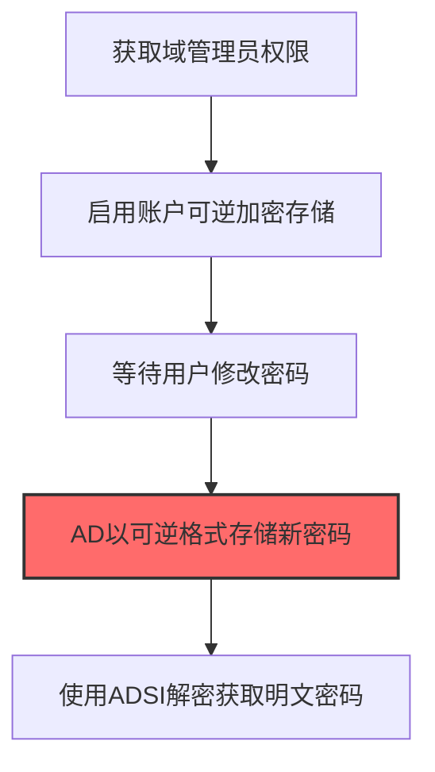
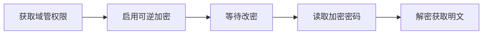

# Reversible Encryption (T1556.005)

## 一句话通俗理解

> **将域账户密码改为可解密格式存储在AD中**

## 30秒速查卡

| 维度 | 你需要知道的 |
|------|-------------|
| 这是什么？ | 将域账户密码改为可解密格式存储在Active Directory中 |
| 为什么危险？ | 可逆加密的密码可以被还原成明文，攻击者只需要读取AD就能拿到所有设置了可逆加密的用户的明文密码 |
| 谁需要关心？ | 域管理员、Active Directory安全工程师、SOC分析师 |
| 你的第一步防御 | 禁用可逆加密策略，监控域账户密码存储格式的变更 |
| 如果只做一件事 | 监控Active Directory中用户账户的'存储密码用可逆加密'属性是否被启用 |

## 难度等级

⭐⭐⭐ 高级 - 需要深入的技术知识和实践

## 前置知识检查

**读这个文件需要什么？**

- [ ] Windows认证体系（NTLM/Kerberos/LSASS）
- [ ] 哈希基础（NTLM Hash/SHA）
- [ ] 网络认证协议（SMB/LDAP/Kerberos）

## 技术描述

**可逆加密**（T1556.005）是 **修改认证流程**（T1556）的一个具体变体，属于 **凭证访问** 阶段的攻击技术。

> 🔓 **打个比方**：就像用一把可以"还原"的加密锁——攻击者强制系统使用可逆加密存储密码，然后从存储中提取明文密码。

### 具体怎么理解？

将域账户密码改为可解密格式存储在AD中

攻击者使用这种技术时，通常是在凭证访问阶段，想要达到特定的攻击目标。与父技术 T1556 相比，T1556.005 有自己独特的特点和使用场景。

### 为什么有效？

这种技术之所以有效，是因为：
1. **隐蔽性**：利用了正常系统功能或常见协议，不容易被发现
2. **技术门槛适中**：不需要特别高深的技术知识就能实施

**过渡段：** 不要误解凭证访问只是'窃取密码'——在现代企业中，凭证存在于内存、磁盘、网络流量等多个位置。
3. **广泛适用**：可以在多种环境和系统中使用

## 真实攻击流程

### 典型场景

攻击者在 **凭证访问** 阶段使用 可逆加密 技术，以下是典型的攻击步骤：



**步骤详解：**

1. **获取域管理员权限** - 需要Domain Admin权限才能修改域账户的密码存储属性
2. **启用账户可逆加密存储** - 通过ADUC或PowerShell为目标账户启用"可逆加密"密码存储选项
3. **等待用户修改密码** - 用户下次修改密码时，域控制器会以可逆加密格式（而非单向哈希）存储新密码
4. **AD以可逆格式存储新密码** - 密码存储在用户对象的unicodePwd属性中，使用RC4加密而非NTLM哈希
5. **使用ADSI解密获取明文密码** - 通过LDAP查询读取加密密码并使用域控制器的机器密钥解密还原明文

## 攻击流程

```
获取域管权限 --> 启用可逆加密 --> 等待改密 --> 读取加密密码 --> 解密获取明文
```



**步骤详解：**
1. **获取域管权限**
   - 通俗描述：先拿下域管理员账户，才能改其他用户的密码存储方式
   - 技术细节：通过DCSync、Pass-the-Hash或Kerberoasting获取Domain Admin权限，需可修改目标用户属性的权限
   - 常用工具：Mimikatz lsadump::dcsync、Impacket secretsdump、BloodHound
2. **启用可逆加密**
   - 通俗描述：把目标用户的密码存储方式从"单向哈希"改成"可解密的加密"
   - 技术细节：通过ADUC勾选"Store password using reversible encryption"或PowerShell `Set-ADUser -AllowReversiblePasswordEncryption $true`修改userAccountControl
   - 常用工具：Active Directory Users and Computers、PowerShell ActiveDirectory模块、ldifde
3. **等待改密**
   - 通俗描述：等用户下次改密码时，新密码就会用可逆方式存起来
   - 技术细节：可设置`pwdLastSet=0`强制用户下次登录改密，或静默等待密码过期策略触发
   - 常用工具：Set-ADUser -ChangePasswordAtLogon $true、组策略密码策略
4. **读取加密密码**
   - 通俗描述：从域控数据库里把那个"可解密的密码"拿出来
   - 技术细节：通过LDAP查询用户对象的`unicodePwd`属性，该属性在启用可逆加密后存储RC4加密的明文密码（而非NTLM哈希）
   - 常用工具：ldp.exe、ADSI Edit、PowerShell DirectorySearcher、ldapsearch
5. **解密获取明文**
   - 通俗描述：用域控的密钥把密码解出来，得到原始明文
   - 技术细节：可逆加密使用域控的GMSA或机器账户密钥进行RC4加密，需在域控上执行解密操作或导出LSASS内存提取
   - 常用工具：Mimikatz lsadump::secrets、Impacket secretsdump、Custom ADSI脚本

## 真实案例

### 案例1：APT29 SolarWinds 供应链攻击后启用可逆加密

- **时间**: 2020-2021年
- **目标**: 美国政府机构及企业（通过SolarWinds Orion平台）
- **攻击组织**: APT29（Nobelium/Cozy Bear）
- **手法**: 攻击者在攻陷域控后，使用Set-DomainUserPassword -ReversibleEncryption $true命令为高价值服务账户（如SQL Service、MIM Service）启用可逆加密，再通过LDAP查询读取unicodePwd属性并用域控机器密钥解密还原明文密码，用于跨域横向移动至云资源
- **影响**: 攻击者获取到明文服务账户密码后绕过MFA访问Azure AD和Office 365，影响9个联邦机构和100家私企
- **参考链接**: [CISA SolarWinds分析报告](https://www.cisa.gov/news-events/cybersecurity-advisories/aa21-148a)

### 案例2：Sandworm 入侵乌克兰政府启用可逆加密收集凭证

- **时间**: 2017-2018年
- **目标**: 乌克兰财政部和部委系统
- **攻击组织**: Sandworm
- **手法**: 通过CVE-2017-0144（EternalBlue）入侵Windows域后，用PowerView修改关键用户对象的UserAccountControl标志位加入ENCRYPTED_TEXT_PASSWORD_ALLOWED（0x80），等待密码轮换策略触发后通过secretsdump.py -just-dc读取明文unicodePwd属性，将明文密码用于Outlook Web Access和VPN登录绕过二次认证
- **影响**: 乌克兰多部委邮件系统和文件服务器长期被监控，攻击者获取大量政府通信明文
- **参考链接**: [ESET Sandworm报告](https://www.welivesecurity.com/2020/03/12/two-thirds-ukraine-attacks-sandworm/)

### 案例3：FIN7 (Carbanak) 针对金融机构启用可逆加密提取域内密码

- **时间**: 2015-2019年
- **目标**: 美国、欧洲、亚洲的银行、赌场和餐饮连锁企业
- **攻击组织**: FIN7（Carbanak / Anunak，俄罗斯背景金融犯罪组织）
- **手法**: 攻击者通过鱼叉钓鱼携带恶意的Microsoft Office宏文档（含BOOTRASH/Carbanak后门）获得初始访问，横向移动到域控后使用PowerShell调用 `Set-ADAccountPassword -AllowReversiblePasswordEncryption $true` 为高价值服务账户（如POS终端登录账户、ATM运维账户）启用可逆加密；同时修改域策略中 "Store passwords using reversible encryption" 选项，等待密码轮换周期触发后通过LDAP查询读取 `unicodePwd` 属性，使用域控机器账户的RC4密钥解密还原明文密码，用于横向移动到POS终端网络
- **影响**: 攻击者从全球超过100家金融机构和POS系统中窃取了超过12亿美元，可逆加密使攻击者无需离线破解哈希就能直接获得明文密码，加速了向支付处理网络的横向移动
- **参考链接**: [Mandiant - FIN7 持续追踪报告](https://cloud.google.com/blog/topics/threat-intelligence/fin7-pursuing-an-enigmatic-and-evasive-global-criminal-operation) | [MITRE ATT&CK - T1556.005](https://attack.mitre.org/techniques/T1556/005/)

## 红队视角

> ⚠️ **免责声明**：以下内容仅用于合法的安全测试、渗透测试和教育目的。未经授权对他人系统进行测试是违法行为。

### 实战技巧

1. **深入理解原理**：在实战应用前，充分理解Reversible Encryption的技术原理和适用场景
2. **环境适配**：根据目标系统的操作系统版本、安全配置等因素调整攻击策略
3. **组合使用**：将该技术与其他技术组合使用，构建完整的攻击链
4. **隐蔽性考虑**：注意操作痕迹的清理，避免被检测系统发现

### 常用工具

| 工具名称 | 用途 | 平台 | 链接 |
| -------- | ---- | ---- | ---- |
| PowerView Set-DomainUserPassword | 修改UserAccountControl标志位启用ENCRYPTED_TEXT_PASSWORD_ALLOWED (0x80) | Windows | [PowerSploit PowerView](https://github.com/PowerShellMafia/PowerSploit) |
| Impacket secretsdump.py | 通过LDAP读取unicodePwd属性并用域控机器密钥解密还原明文密码 | 跨平台 | [Impacket](https://github.com/fortra/impacket) |
| Mimikatz lsadump::dcsync | 拉取用户对象的unicodePwd属性，支持明文密码提取 | Windows | [Mimikatz](https://github.com/gentilkiwi/mimikatz) |
| ldp.exe / ADExplorer | 通过LDAP查询过滤userAccountControl:1.2.840.113556.1.4.803:=128查找已启用可逆加密的账户 | Windows | [Sysinternals ADExplorer](https://learn.microsoft.com/sysinternals/downloads/adexplorer) |

### 注意事项

- 在授权的测试环境中使用这些技术
- 注意操作安全（OPSEC），避免被检测系统发现
- 使用匿名化技术和代理隐藏真实身份

## 蓝队视角

### 检测要点

1. **系统日志监控**：关注与Reversible Encryption相关的系统日志和审计记录
2. **异常行为检测**：监控系统中与该技术相关的异常进程、网络连接和文件操作
3. **工具特征识别**：识别攻击者可能使用的工具在系统中的运行特征

### 监控建议

- 部署端点检测和响应（EDR）系统，监控与Reversible Encryption相关的异常行为
- 配置SIEM规则，关联分析来自多个来源的告警
- 定期进行安全评估和渗透测试，验证检测规则的有效性

## 避坑指南

组织中最危险盲区：认为强密码就足够安全。

## 检测建议

### 检测思路

检测 可逆加密 的关键是识别异常行为模式。以下是三个层面的检测方法：

### 网络层检测

**方法**：监控网络流量中的异常模式

```bash
# 检测异常的网络连接和数据传输
# 根据具体协议和端口设置检测规则
```

### 主机层检测

**Windows事件ID**：
- 事件ID 4688：进程创建（监控可疑进程）
- 事件ID 4104：PowerShell执行（监控可疑脚本）

**Linux日志**：
- /var/log/auth.log：认证日志
- /var/log/syslog：系统日志

```bash
# 检测异常进程和命令执行
grep -i "suspicious" /var/log/auth.log
```

### 应用层检测

**用人话说：** 这条规则在监控是否有域账户被设置为可逆加密存储密码。Windows允许管理员启用可逆加密来存储密码，这样密码可以被还原成明文。正常情况下这个策略不会被启用。如果发现有账户启用了可逆加密，那就是攻击者在为后续偷取明文密码做准备。

**Sigma规则示例**：

```yaml
title: 检测可逆加密
status: experimental
description: 检测可能的可逆加密活动
logsource:
    category: process_creation
    product: windows
detection:
    selection:
        EventID: 4688
    condition: selection
level: medium
tags:
    - attack.T1556005
```

## 缓解措施

### 优先级1：关键措施

**限制攻击面**：减少暴露的服务和端口，降低被利用的风险

```bash
# 防火墙规则示例：只允许必要的出站连接
iptables -A OUTPUT -p tcp --dport 443 -j ACCEPT  # 允许HTTPS
iptables -A OUTPUT -p tcp --dport 80 -j ACCEPT   # 允许HTTP
iptables -A OUTPUT -p tcp -j DROP                 # 阻止其他TCP
```

### 优先级2：重要措施

**加强监控**：部署EDR和SIEM系统，实时监控异常行为

### 优先级3：建议措施

**安全意识培训**：教育员工识别相关攻击手法

## 动手实验

> ⚠️ **所有实验必须在隔离的实验室环境中进行**

### 实验1：理解基本原理（初级）

**目标**：理解 可逆加密 的工作原理

**步骤**：
1. 在隔离环境中搭建测试系统
2. 使用基础工具模拟攻击行为
3. 观察系统日志和网络流量

**学习要点**：理解该技术的核心机制

### 实验2：实际操作（中级）

**目标**：掌握 可逆加密 的实际使用方法

**步骤**：
1. 使用专业工具进行攻击模拟
2. 尝试不同的绕过技术
3. 分析检测日志的特征

**学习要点**：掌握工具使用和日志分析

### 实验3：防御验证（高级）

**目标**：验证检测规则的有效性

**步骤**：
1. 部署检测规则
2. 执行攻击模拟
3. 验证检测告警是否触发

**学习要点**：理解攻防对抗的实际效果

## 术语解释

| 术语 | 通俗解释 |
|------|---------|
| **ATT&CK** | MITRE公司维护的攻击技术知识库，像一本"黑客手法百科全书" |
| **可逆加密** | T1556.005，ATT&CK框架中定义的一种具体攻击技术 |
| **修改认证流程** | T1556，可逆加密所属的父技术类别 |
| **凭证访问** | 攻击链中的一个阶段，攻击者在这个阶段的目标 |
| **C2** | 命令与控制，攻击者用来远程控制被入侵系统的"遥控器" |
| **EDR** | 端点检测与响应，部署在电脑上的安全监控软件 |

## 被引用情况

以下父技术文档引用了本子技术：

- [T1556 - 修改认证流程](../../05-Persistence/T1556-Modify-Authentication-Process.md)
- [T1556 - 修改认证流程](../../07-Stealth/T1556-Modify-Authentication-Process.md)
- [T1556 - 修改认证流程](../../08-Defense-Impairment/T1556-Modify-Authentication-Process.md)
- [T1556 - 修改认证流程](../T1556-Modify-Authentication-Process.md)

## 参考资料

### 📚 官方文档（深入了解）

- [MITRE ATT&CK - Reversible Encryption (T1556.005)](https://attack.mitre.org/techniques/T1556/005/)
- [MITRE ATT&CK - 修改认证流程 (T1556)](https://attack.mitre.org/techniques/T1556/)

### 📰 安全报告（真实攻击）

- [MITRE ATT&CK 官方文档](https://attack.mitre.org/) - ATT&CK 框架官方资源

### 🔧 工具与资源（动手试试）

- [Atomic Red Team](https://github.com/redcanaryco/atomic-red-team) - 检测规则测试框架
- [MITRE ATT&CK Navigator](https://mitre-attack.github.io/attack-navigator/) - ATT&CK 可视化工具

### 📚 学习资料（深入了解）

- [MITRE ATT&CK 知识库](https://attack.mitre.org/resources/) - ATT&CK 官方资源中心
