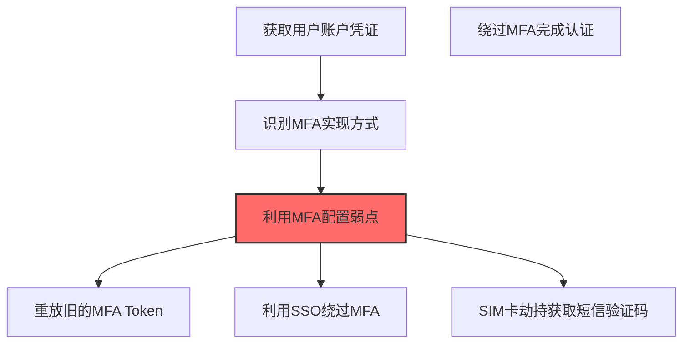
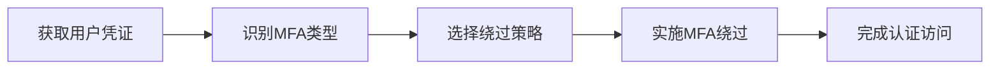

# Multi-Factor Authentication (T1556.006)

## 一句话通俗理解

> **修改或绕过多因素认证配置**

## 30秒速查卡

| 维度 | 你需要知道的 |
|------|-------------|
| 这是什么？ | 修改或绕过多因素认证（MFA）配置，使攻击者可以跳过MFA验证 |
| 为什么危险？ | MFA是现代安全的'最后一道防线'，如果被绕过，攻击者就能畅通无阻地访问所有资源 |
| 谁需要关心？ | 身份安全工程师、SOC分析师、安全运营团队 |
| 你的第一步防御 | 监控MFA配置的变更，实施MFA注册的二次审批 |
| 如果只做一件事 | 监控MFA注册和配置的任何变更，特别是新设备的MFA注册请求 |

## 难度等级

⭐⭐⭐ 高级 - 需要深入的技术知识和实践

## 前置知识检查

**读这个文件需要什么？**

- [ ] Windows认证体系（NTLM/Kerberos/LSASS）
- [ ] 哈希基础（NTLM Hash/SHA）
- [ ] 网络认证协议（SMB/LDAP/Kerberos）

## 技术描述

**多因素认证**（T1556.006）是 **修改认证流程**（T1556）的一个具体变体，属于 **凭证访问** 阶段的攻击技术。

> 📱 **打个比方**：就像拦截了短信验证码来登录别人的账号——攻击者绕过或篡改多因素认证（MFA）过程，突破二次认证保护。

### 具体怎么理解？

修改或绕过多因素认证配置

攻击者使用这种技术时，通常是在凭证访问阶段，想要达到特定的攻击目标。与父技术 T1556 相比，T1556.006 有自己独特的特点和使用场景。

### 为什么有效？

这种技术之所以有效，是因为：
1. **隐蔽性**：利用了正常系统功能或常见协议，不容易被发现
2. **技术门槛适中**：不需要特别高深的技术知识就能实施

**过渡段：** 不要误解凭证访问只是'窃取密码'——在现代企业中，凭证存在于内存、磁盘、网络流量等多个位置。
3. **广泛适用**：可以在多种环境和系统中使用

## 真实攻击流程

### 典型场景

攻击者在 **凭证访问** 阶段使用 多因素认证 技术，以下是典型的攻击步骤：



**步骤详解：**

1. **获取用户账户凭证** - 通过钓鱼或凭证泄露获取用户的用户名和密码
2. **识别MFA实现方式** - 判断目标使用的是TOTP、短信验证码、硬件密钥还是推送通知
3. **利用MFA配置弱点** - 针对不同MFA类型选择绕过策略：重放Token、利用SSO信任链或SIM卡劫持
4. **绕过MFA完成认证** - 使用获取的第二因素或绕过手段完成双重认证流程
5. **获得完整账户访问权限** - 绕过MFA后以合法用户身份访问所有受保护的系统和数据

## 攻击流程

```
获取用户凭证 --> 识别MFA类型 --> 选择绕过策略 --> 实施MFA绕过 --> 完成认证访问
```



**步骤详解：**
1. **获取用户凭证**
   - 通俗描述：先搞到用户名密码这一道防线，再考虑怎么过MFA这道关卡
   - 技术细节：通过钓鱼邮件、凭证泄露数据库或暴力破解获取用户名密码对
   - 常用工具：GoPhish、Evilginx2、OpenBullet、DeHashed查询
2. **识别MFA类型**
   - 通俗描述：搞清楚目标用的是哪种二次验证——短信、APP扫码还是硬件令牌
   - 技术细节：通过登录页面观察、JS代码分析或API响应识别MFA实现：TOTP（Google Authenticator）、PUSH（Duo/Okta）、SMS、U2F/FIDO2
   - 常用工具：Burp Suite、浏览器开发者工具、Wappalyzer
3. **选择绕过策略**
   - 通俗描述：根据MFA类型选合适的破解方法——钓鱼、重放、SIM劫持或疲劳轰炸
   - 技术细节：PUSH用MFA疲劳攻击（连续推送直到用户点同意）；SMS用SIM劫持或SS7攻击；TOTP用实时钓鱼代理；U2F基本无法绕过只能社工
   - 常用工具：Evilginx2、Modlishka、SS7攻击框架、SIM克隆工具
4. **实施MFA绕过**
   - 通俗描述：实际动手绕过MFA，把第二因素骗到手或绕开
   - 技术细节：钓鱼代理实时转发MFA输入、PUSH疲劳攻击批量推送、SSO信任令牌窃取（如Azure Primary Refresh Token）
   - 常用工具：Evilginx2、MFA Fatigue脚本、ROADtools、TokenTactics
5. **完成认证访问**
   - 通俗描述：拿到完整登录态后，以合法身份进入系统
   - 技术细节：使用绕过MFA后的会话Cookie或Token访问OWA、VPN、SaaS应用，刷新令牌维持长期访问
   - 常用工具：浏览器Cookie注入、AzureHound、ROADtools token刷新

## 真实案例

### 案例1：Lapsus$ MFA疲劳攻击入侵大型科技公司

- **时间**: 2022年
- **目标**: NVIDIA、Microsoft、Okta、三星、Uber、Rockstar Games
- **攻击组织**: Lapsus$（DEV-0537）
- **手法**: 获取目标员工VPN凭证后，利用Azure MFA推送通知机制持续发送MFA验证请求（每隔几秒一次），直到员工因疲惫或干扰在凌晨点击"批准"，从而绕过MFA完成登录。针对Uber则通过Slack消息冒充IT部门诱导员工批准MFA请求
- **影响**: 攻陷多家科技巨头，窃取NVIDIA 1TB数据、Microsoft源代码、Uber内部系统，造成数十亿美元市值波动
- **参考链接**: [微软Lapsus$威胁情报报告](https://www.microsoft.com/en-us/security/blog/2022/03/22/dev-0537-criminal-actor-targeting-organizations-for-data-exfiltration-and-destruction/)

### 案例2：APT29 Golden SAML 绕过MFA访问云资源

- **时间**: 2020-2021年
- **目标**: 美国政府机构、技术公司（通过SolarWinds供应链）
- **攻击组织**: APT29（Nobelium/Cozy Bear）
- **手法**: 攻陷本地ADFS服务器后用Mimikatz提取ADFS服务账户令牌签名证书私钥，使用ADFSDump+ADFSpoof伪造Golden SAML令牌，直接以任意用户身份登录O365/Office 365/Azure，完全绕过MFA认证流程（SAML断言不触发O365的MFA提示）
- **影响**: 9个联邦机构和100家私企长期被监控，攻击者以合法用户身份访问邮件和文件长达9个月未被发现
- **参考链接**: [CISA AA21-148A SolarWinds分析](https://www.cisa.gov/news-events/cybersecurity-advisories/aa21-148a)

### 案例3：Scattered Spider 通过SIM交换与MFA疲劳组合攻击绕过云MFA

- **时间**: 2022-2023年
- **目标**: Twilio、Cloudflare、Cisco、Mailchimp、MGM Resorts、Caesars Entertainment等大型科技与博彩企业
- **攻击组织**: Scattered Spider（UNC3944 / 0ktapus / Storm-1283，英语系黑客组织）
- **手法**: 攻击者通过两阶段绕过MFA：第一阶段针对目标员工发起0ktapus钓鱼攻击（伪装Okta单点登录页面收集用户名密码），随后联系员工所在移动运营商客服，使用社会工程学+身份证件伪造完成SIM交换，将受害者手机号转接到攻击者控制的SIM卡上，从而接收SMS OTP验证码完成登录；第二阶段针对已启用推送式MFA的目标（如MGM），持续向员工手机推送MFA Approval请求实施"疲劳攻击"（MFA Fatigue），并配合冒充IT部门的电话诱导员工按"批准"
- **影响**: 0ktapus战役窃取了136家公司超过10000名员工的凭证；MGM攻击导致其赌场酒店系统瘫痪10天，损失约1亿美元；Caesars支付了1500万美元赎金
- **参考链接**: [Mandiant - Scattered Spider/UNC3944 报告](https://cloud.google.com/blog/topics/threat-intelligence/unc3944-targets-saas-applications) | [MITRE ATT&CK - T1556.006](https://attack.mitre.org/techniques/T1556/006/)

## 红队视角

> ⚠️ **免责声明**：以下内容仅用于合法的安全测试、渗透测试和教育目的。未经授权对他人系统进行测试是违法行为。

### 实战技巧

1. **深入理解原理**：在实战应用前，充分理解Multi-Factor Authentication的技术原理和适用场景
2. **环境适配**：根据目标系统的操作系统版本、安全配置等因素调整攻击策略
3. **组合使用**：将该技术与其他技术组合使用，构建完整的攻击链
4. **隐蔽性考虑**：注意操作痕迹的清理，避免被安全设备检测

### 常用工具

| 工具名称 | 用途 | 平台 | 链接 |
| -------- | ---- | ---- | ---- |
| ADFSpoof | 使用从ADFS服务账户窃取的令牌签名证书私钥伪造Golden SAML令牌，直接绕过O365 MFA | Linux | [ADFSDump/ADFSpoof](https://github.com/fireeye/ADFSpoof) |
| Modus / Diavol | 自动化MFA疲劳攻击工具，循环发送MFA推送通知直至目标批准 | 跨平台 | [Mandiant Diavol分析](https://www.mandiant.com/resources/blog/diavol-new-ransomware) |
| Evilginx2 | 反向代理钓鱼，实时拦截并转发用户输入的主密码和MFA Token，窃取可重放的会话Cookie | 跨平台 | [Evilginx2](https://github.com/kgretzky/evilginx2) |
| AzureHound | 通过Graph API枚举Azure AD中MFA配置弱点（未注册MFA的特权账户、可绕过条件访问策略） | Windows | [BloodHound AzureHound](https://github.com/BloodHoundAD/AzureHound) |

### 注意事项

- 在授权的测试环境中使用这些技术
- 注意操作安全（OPSEC），避免被检测系统发现
- 使用匿名化技术和代理隐藏真实身份

## 蓝队视角

### 检测要点

1. **系统日志监控**：关注与Multi-Factor Authentication相关的系统日志和审计记录
2. **异常行为检测**：监控系统中与该技术相关的异常进程、网络连接和文件操作
3. **工具特征识别**：识别攻击者可能使用的工具在系统中的运行特征

### 监控建议

- 部署端点检测和响应（EDR）系统，监控与Multi-Factor Authentication相关的异常行为
- 配置SIEM规则，关联分析来自多个来源的告警
- 定期进行安全评估和渗透测试，验证检测规则的有效性

## 避坑指南

组织中最危险盲区：认为强密码就足够安全。

## 检测建议

### 检测思路

检测 多因素认证 的关键是识别异常行为模式。以下是三个层面的检测方法：

### 网络层检测

**方法**：监控网络流量中的异常模式

```bash
# 检测异常的网络连接和数据传输
# 根据具体协议和端口设置检测规则
```

### 主机层检测

**Windows事件ID**：
- 事件ID 4688：进程创建（监控可疑进程）
- 事件ID 4104：PowerShell执行（监控可疑脚本）

**Linux日志**：
- /var/log/auth.log：认证日志
- /var/log/syslog：系统日志

```bash
# 检测异常进程和命令执行
grep -i "suspicious" /var/log/auth.log
```

### 应用层检测

**用人话说：** 这条规则在监控多因素认证（MFA）配置是否被篡改。MFA是防止账户被盗用的'最后一道防线'。正常情况下MFA配置不会被频繁修改。如果发现有新的MFA设备被注册、MFA被禁用、或者认证策略被修改，那就是攻击者在试图绕过MFA保护。

**Sigma规则示例**：

```yaml
title: 检测多因素认证
status: experimental
description: 检测可能的多因素认证活动
logsource:
    category: process_creation
    product: windows
detection:
    selection:
        EventID: 4688
    condition: selection
level: medium
tags:
    - attack.T1556006
```

## 缓解措施

### 优先级1：关键措施

**限制攻击面**：减少暴露的服务和端口，降低被利用的风险

```bash
# 防火墙规则示例：只允许必要的出站连接
iptables -A OUTPUT -p tcp --dport 443 -j ACCEPT  # 允许HTTPS
iptables -A OUTPUT -p tcp --dport 80 -j ACCEPT   # 允许HTTP
iptables -A OUTPUT -p tcp -j DROP                 # 阻止其他TCP
```

### 优先级2：重要措施

**加强监控**：部署EDR和SIEM系统，实时监控异常行为

### 优先级3：建议措施

**安全意识培训**：教育员工识别相关攻击手法

## 动手实验

> ⚠️ **所有实验必须在隔离的实验室环境中进行**

### 实验1：理解基本原理（初级）

**目标**：理解 多因素认证 的工作原理

**步骤**：
1. 在隔离环境中搭建测试系统
2. 使用基础工具模拟攻击行为
3. 观察系统日志和网络流量

**学习要点**：理解该技术的核心机制

### 实验2：实际操作（中级）

**目标**：掌握 多因素认证 的实际使用方法

**步骤**：
1. 使用专业工具进行攻击模拟
2. 尝试不同的绕过技术
3. 分析检测日志的特征

**学习要点**：掌握工具使用和日志分析

### 实验3：防御验证（高级）

**目标**：验证检测规则的有效性

**步骤**：
1. 部署检测规则
2. 执行攻击模拟
3. 验证检测告警是否触发

**学习要点**：理解攻防对抗的实际效果

## 术语解释

| 术语 | 通俗解释 |
|------|---------|
| **ATT&CK** | MITRE公司维护的攻击技术知识库，像一本"黑客手法百科全书" |
| **多因素认证** | T1556.006，ATT&CK框架中定义的一种具体攻击技术 |
| **修改认证流程** | T1556，多因素认证所属的父技术类别 |
| **凭证访问** | 攻击链中的一个阶段，攻击者在这个阶段的目标 |
| **C2** | 命令与控制，攻击者用来远程控制被入侵系统的"遥控器" |
| **EDR** | 端点检测与响应，部署在电脑上的安全监控软件 |

## 被引用情况

以下父技术文档引用了本子技术：

- [T1556 - 修改认证流程](../../05-Persistence/T1556-Modify-Authentication-Process.md)
- [T1556 - 修改认证流程](../../08-Defense-Impairment/T1556-Modify-Authentication-Process.md)
- [T1556 - 修改认证流程](../T1556-Modify-Authentication-Process.md)

## 参考资料

### 📚 官方文档（深入了解）

- [MITRE ATT&CK - Multi-Factor Authentication (T1556.006)](https://attack.mitre.org/techniques/T1556/006/)
- [MITRE ATT&CK - 修改认证流程 (T1556)](https://attack.mitre.org/techniques/T1556/)

### 📰 安全报告（真实攻击）

- [MITRE ATT&CK 官方文档](https://attack.mitre.org/) - ATT&CK 框架官方资源

### 🔧 工具与资源（动手试试）

- [Atomic Red Team](https://github.com/redcanaryco/atomic-red-team) - 检测规则测试框架
- [MITRE ATT&CK Navigator](https://mitre-attack.github.io/attack-navigator/) - ATT&CK 可视化工具

### 📚 学习资料（深入了解）

- [MITRE ATT&CK 知识库](https://attack.mitre.org/resources/) - ATT&CK 官方资源中心
