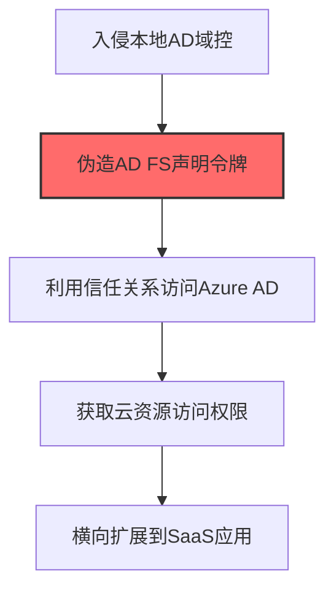
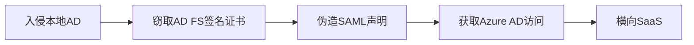

# Hybrid Identity (T1556.007)

## 一句话通俗理解

> **在混合云身份环境中添加受控的信任关系**

## 30秒速查卡

| 维度 | 你需要知道的 |
|------|-------------|
| 这是什么？ | 在混合云身份环境（如Azure AD Connect）中添加受控的信任关系 |
| 为什么危险？ | 混合身份环境连接了本地AD和云AD，控制它就能同时访问本地和云端的所有资源 |
| 谁需要关心？ | 云安全工程师、身份安全工程师、SOC分析师 |
| 你的第一步防御 | 监控Azure AD Connect配置的变更，实施身份同步的审计 |
| 如果只做一件事 | 监控Azure AD Connect同步规则的任何修改，特别是添加新的同步规则或修改现有规则 |

## 难度等级

⭐⭐⭐ 高级 - 需要深入的技术知识和实践

## 前置知识检查

**读这个文件需要什么？**

- [ ] Windows认证体系（NTLM/Kerberos/LSASS）
- [ ] 哈希基础（NTLM Hash/SHA）
- [ ] 网络认证协议（SMB/LDAP/Kerberos）

## 技术描述

**混合身份**（T1556.007）是 **修改认证流程**（T1556）的一个具体变体，属于 **凭证访问** 阶段的攻击技术。

> 🔗 **打个比方**：就像找到了一座连接两个独立小区的秘密通道——攻击者利用混合身份系统中的信任关系，从本地AD扩展到云端的Azure AD。

### 具体怎么理解？

在混合云身份环境中添加受控的信任关系

攻击者使用这种技术时，通常是在凭证访问阶段，想要达到特定的攻击目标。与父技术 T1556 相比，T1556.007 有自己独特的特点和使用场景。

### 为什么有效？

这种技术之所以有效，是因为：
1. **隐蔽性**：利用了正常系统功能或常见协议，不容易被发现
2. **技术门槛适中**：不需要特别高深的技术知识就能实施

**过渡段：** 不要误解凭证访问只是'窃取密码'——在现代企业中，凭证存在于内存、磁盘、网络流量等多个位置。
3. **广泛适用**：可以在多种环境和系统中使用

## 真实攻击流程

### 典型场景

攻击者在 **凭证访问** 阶段使用 混合身份 技术，以下是典型的攻击步骤：



**步骤详解：**

1. **入侵本地AD域控** - 通过DCSync或Golden Ticket获取本地Active Directory的完全控制权
2. **伪造AD FS声明令牌** - 窃取AD FS签名证书（Token Signing Certificate），伪造SAML/OAuth声明令牌
3. **利用信任关系访问Azure AD** - 使用伪造的令牌通过AD FS联合身份验证，获取Azure AD的访问令牌
4. **获取云资源访问权限** - 使用Azure AD令牌访问Exchange Online、SharePoint、Teams等云服务
5. **横向扩展到SaaS应用** - 利用SSO信任链访问所有通过Azure AD联合认证的第三方SaaS应用

## 攻击流程

```
入侵本地AD --> 窃取AD FS令牌签名证书 --> 伪造SAML声明 --> 获取Azure AD访问 --> 横向SaaS
```



**步骤详解：**
1. **入侵本地AD**
   - 通俗描述：先拿下本地的Active Directory域控，拿到"钥匙串总管"权限
   - 技术细节：通过DCSync、Golden Ticket或利用Azure AD Connect账户权限获取本地AD的Domain Admin权限，特别是AD FS服务器的本地管理员权限
   - 常用工具：Mimikatz lsadump::dcsync、Impacket secretsdump、AzureADConnect Sync账户
2. **窃取AD FS令牌签名证书**
   - 通俗描述：把AD FS用来"盖章"身份证明的那个章偷出来
   - 技术细节：登录AD FS服务器，从`AD FS Configuration`数据库或DKM容器中导出Token Signing Certificate私钥，该证书用于签署SAML令牌
   - 常用工具：ADFSDump、ADFSpoof、Mimikatz crypto::export、PowerShell ADFS模块
3. **伪造SAML声明**
   - 通俗描述：用偷来的章给自己盖一个"我是某某管理员"的证明
   - 技术细节：使用私钥签署自定义SAML Response，声明为高权限用户（如Global Admin），设置合适的audience、issuer和NotOnOrAfter时间
   - 常用工具：ADFSpoof、SAML Raider、Forge-SAML脚本
4. **获取Azure AD访问**
   - 通俗描述：拿这个假证明去Azure AD那里换取真正的访问令牌
   - 技术细节：将伪造SAML令牌提交到Azure AD的`https://login.microsoftonline.com/<tenant>/saml2`端点，换取Azure AD Session Token
   - 常用工具：ROADtools、AzureHound、浏览器SAML注入插件
5. **横向SaaS**
   - 通俗描述：用Azure AD的访问权限，去访问所有挂在它下面的云应用
   - 技术细节：使用Azure AD Session Token访问Exchange Online、SharePoint、Teams、第三方SaaS应用，刷新令牌维持长期持久化
   - 常用工具：Microsoft Graph API、Azure CLI、ROADtools token刷新

## 真实案例

### 案例1：APT29 SolarWinds 滥用Azure AD Connect同步链

- **时间**: 2020-2021年
- **目标**: 美国政府机构（通过SolarWinds供应链）
- **攻击组织**: APT29（Nobelium/Cozy Bear）
- **手法**: 攻陷本地AD后，入侵运行Azure AD Connect的服务器，从ADSync数据库中提取存储的同步账户凭证明文（用Microsoft Entra ID Connect中的DataService加密保护但可被本地管理员解密），使用该账户向Azure AD注入新的Sync对象并修改云租户全局管理员密码，从而绕过本地MFA实现纯云横向
- **影响**: 攻击者从本地AD跃迁到Azure AD租户，控制云管理权限，影响9个联邦机构的云邮箱和SharePoint
- **参考链接**: [Mandiant SolarWinds报告](https://www.mandiant.com/resources/blog/sunshuttle-sets-stage-for-hands-on-keyboard-activity)

### 案例2：Volt Typhoon 滥用混合身份维持关基设施长期潜伏

- **时间**: 2021-2023年
- **目标**: 美国关基设施（电力、水务、交通）的IT网络
- **攻击组织**: Volt Typhoon（INSIDIOUS
- **手法**: 通过窃取的员工凭证登录VPN后，使用AADInternals工具提取Azure AD Connect同步账户的MSOL凭证，在本地AD和Azure AD之间建立隐蔽的"后门同步关系"，将攻击者控制的本地账户同步至云租户并赋予GlobalAdmin角色，实现从本地到云的双向持久化访问
- **影响**: 长期潜伏美国关基设施IT网络，CISA发布AA24-038A警报要求关键基础设施立即排查
- **参考链接**: [CISA Volt Typhoon警报](https://www.cisa.gov/news-events/cybersecurity-advisories/aa24-038a)

### 案例3：Scattered Spider (UNC3944) 篡改Azure AD混合身份配置实现云租户接管

- **时间**: 2022-2024年
- **目标**: 财富500强企业、航空业、博彩业的Azure AD和Okta混合身份环境
- **攻击组织**: Scattered Spider（UNC3944 / Storm-1283 / 0ktapus，英语系黑客组织）
- **手法**: 攻击者通过SIM交换+0ktapus钓鱼获取目标IT管理员凭证后，登录Azure Admin Center或Microsoft 365 Admin Center，篡改Hybrid Identity配置：1) 修改Pass-Through Authentication (PTA) Agent配置，将本地认证代理指向攻击者控制的端点以拦截所有云登录凭证；2) 在Azure AD Connect同步规则中插入自定义出站同步规则，将攻击者控制的本地AD账户自动同步到Azure AD并赋予Conditional Access Exclusion组和Global Admin角色；3) 修改SSPR（自助密码重置）配置，使攻击者可绕过本地AD策略重置云用户密码
- **影响**: 攻击者实现了从本地到云的持久化后门，可在受害者完全重置本地AD密码后仍维持云租户的Global Admin访问权限；MGM和Caesars遭受数千万美元损失，多家航空公司发生数据泄露
- **参考链接**: [Mandiant - UNC3944 针对 SaaS 应用的攻击](https://cloud.google.com/blog/topics/threat-intelligence/unc3944-targets-saas-applications) | [MITRE ATT&CK - T1556.007](https://attack.mitre.org/techniques/T1556/007/)

## 红队视角

> ⚠️ **免责声明**：以下内容仅用于合法的安全测试、渗透测试和教育目的。未经授权对他人系统进行测试是违法行为。

### 实战技巧

1. **深入理解原理**：在实战应用前，充分理解Hybrid Identity的技术原理和适用场景
2. **环境适配**：根据目标系统的操作系统版本、安全配置等因素调整攻击策略
3. **组合使用**：将该技术与其他技术组合使用，构建完整的攻击链
4. **隐蔽性考虑**：注意操作痕迹的清理，避免被安全设备检测

### 常用工具

| 工具名称 | 用途 | 平台 | 链接 |
| -------- | ---- | ---- | ---- |
| AADInternals | 从Azure AD Connect服务器提取MSOL同步账户明文凭证，可向云租户注入同步对象、修改全局管理员密码 | Windows | [AADInternals](https://github.com/Gerenios/AADInternals) |
| Azure AD Connect ADSync数据库 | 直接读取ADSync.mdf数据库中的mms_management_agent表，提取存储的同步账户凭证密文 | Windows | [Azure AD Connect文档](https://learn.microsoft.com/azure/active-directory/hybrid/whatis-hybrid-identity) |
| ROADtools | 获取Azure AD主刷新令牌（PRT）后向Graph API发起认证，访问所有云资源 | 跨平台 | [ROADtools](https://github.com/dirkjanm/ROADtools) |
| AzureHound | 通过Graph API枚举混合身份同步关系、Azure AD角色分配、条件访问策略弱点 | Windows | [BloodHound AzureHound](https://github.com/BloodHoundAD/AzureHound) |

### 注意事项

- 在授权的测试环境中使用这些技术
- 注意操作安全（OPSEC），避免被检测系统发现
- 使用匿名化技术和代理隐藏真实身份

## 蓝队视角

### 检测要点

1. **系统日志监控**：关注与Hybrid Identity相关的系统日志和审计记录
2. **异常行为检测**：监控系统中与该技术相关的异常进程、网络连接和文件操作
3. **工具特征识别**：识别攻击者可能使用的工具在系统中的运行特征

### 监控建议

- 部署端点检测和响应（EDR）系统，监控与Hybrid Identity相关的异常行为
- 配置SIEM规则，关联分析来自多个来源的告警
- 定期进行安全评估和渗透测试，验证检测规则的有效性

## 避坑指南

组织中最危险盲区：认为强密码就足够安全。

## 检测建议

### 检测思路

检测 混合身份 的关键是识别异常行为模式。以下是三个层面的检测方法：

### 网络层检测

**方法**：监控网络流量中的异常模式

```bash
# 检测异常的网络连接和数据传输
# 根据具体协议和端口设置检测规则
```

### 主机层检测

**Windows事件ID**：
- 事件ID 4688：进程创建（监控可疑进程）
- 事件ID 4104：PowerShell执行（监控可疑脚本）

**Linux日志**：
- /var/log/auth.log：认证日志
- /var/log/syslog：系统日志

```bash
# 检测异常进程和命令执行
grep -i "suspicious" /var/log/auth.log
```

### 应用层检测

**用人话说：** 这条规则在监控混合身份环境（如Azure AD Connect）的配置是否被修改。Azure AD Connect是连接本地Active Directory和Azure AD的'桥梁'。正常情况下同步规则不会被频繁修改。如果发现有新的同步规则被添加或现有规则被修改，那就是攻击者在篡改身份同步流程，准备添加后门账户。

**Sigma规则示例**：

```yaml
title: 检测混合身份
status: experimental
description: 检测可能的混合身份活动
logsource:
    category: process_creation
    product: windows
detection:
    selection:
        EventID: 4688
    condition: selection
level: medium
tags:
    - attack.T1556007
```

## 缓解措施

### 优先级1：关键措施

**限制攻击面**：减少暴露的服务和端口，降低被利用的风险

```bash
# 防火墙规则示例：只允许必要的出站连接
iptables -A OUTPUT -p tcp --dport 443 -j ACCEPT  # 允许HTTPS
iptables -A OUTPUT -p tcp --dport 80 -j ACCEPT   # 允许HTTP
iptables -A OUTPUT -p tcp -j DROP                 # 阻止其他TCP
```

### 优先级2：重要措施

**加强监控**：部署EDR和SIEM系统，实时监控异常行为

### 优先级3：建议措施

**安全意识培训**：教育员工识别相关攻击手法

## 动手实验

> ⚠️ **所有实验必须在隔离的实验室环境中进行**

### 实验1：理解基本原理（初级）

**目标**：理解 混合身份 的工作原理

**步骤**：
1. 在隔离环境中搭建测试系统
2. 使用基础工具模拟攻击行为
3. 观察系统日志和网络流量

**学习要点**：理解该技术的核心机制

### 实验2：实际操作（中级）

**目标**：掌握 混合身份 的实际使用方法

**步骤**：
1. 使用专业工具进行攻击模拟
2. 尝试不同的绕过技术
3. 分析检测日志的特征

**学习要点**：掌握工具使用和日志分析

### 实验3：防御验证（高级）

**目标**：验证检测规则的有效性

**步骤**：
1. 部署检测规则
2. 执行攻击模拟
3. 验证检测告警是否触发

**学习要点**：理解攻防对抗的实际效果

## 术语解释

| 术语 | 通俗解释 |
|------|---------|
| **ATT&CK** | MITRE公司维护的攻击技术知识库，像一本"黑客手法百科全书" |
| **混合身份** | T1556.007，ATT&CK框架中定义的一种具体攻击技术 |
| **修改认证流程** | T1556，混合身份所属的父技术类别 |
| **凭证访问** | 攻击链中的一个阶段，攻击者在这个阶段的目标 |
| **C2** | 命令与控制，攻击者用来远程控制被入侵系统的"遥控器" |
| **EDR** | 端点检测与响应，部署在电脑上的安全监控软件 |

## 被引用情况

以下父技术文档引用了本子技术：

- [T1556 - 修改认证流程](../../05-Persistence/T1556-Modify-Authentication-Process.md)
- [T1556 - 修改认证流程](../T1556-Modify-Authentication-Process.md)

## 参考资料

### 📚 官方文档（深入了解）

- [MITRE ATT&CK - Hybrid Identity (T1556.007)](https://attack.mitre.org/techniques/T1556/007/)
- [MITRE ATT&CK - 修改认证流程 (T1556)](https://attack.mitre.org/techniques/T1556/)

### 📰 安全报告（真实攻击）

- [MITRE ATT&CK 官方文档](https://attack.mitre.org/) - ATT&CK 框架官方资源

### 🔧 工具与资源（动手试试）

- [Atomic Red Team](https://github.com/redcanaryco/atomic-red-team) - 检测规则测试框架
- [MITRE ATT&CK Navigator](https://mitre-attack.github.io/attack-navigator/) - ATT&CK 可视化工具

### 📚 学习资料（深入了解）

- [MITRE ATT&CK 知识库](https://attack.mitre.org/resources/) - ATT&CK 官方资源中心
