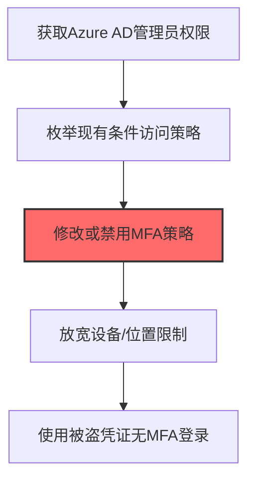
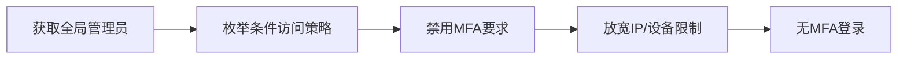

# Conditional Access Policy (T1556.009)

## 一句话通俗理解

> **Conditional Access Policy就是修改云端的条件访问策略绕过安全限制。**

## 30秒速查卡

| 维度 | 你需要知道的 |
|------|-------------|
| 这是什么？ | 修改云端的条件访问策略，绕过安全限制 |
| 为什么危险？ | 条件访问策略控制谁能从哪里访问什么资源，修改它就能绕过IP限制、设备要求等安全控制 |
| 谁需要关心？ | 云安全工程师、身份安全工程师、SOC分析师 |
| 你的第一步防御 | 监控条件访问策略的变更，实施策略修改的多因素审批 |
| 如果只做一件事 | 监控Azure AD条件访问策略的任何修改，特别是排除条件的添加和策略的禁用 |

## 难度等级

⭐⭐⭐ 高级 - 需要一定的技术基础和实践经验

## 前置知识检查

**读这个文件需要什么？**

- [ ] Windows认证体系（NTLM/Kerberos/LSASS）
- [ ] 哈希基础（NTLM Hash/SHA）
- [ ] 网络认证协议（SMB/LDAP/Kerberos）

## 技术描述

**通俗解释：**

**过渡段：** 不要误解凭证访问只是'窃取密码'——在现代企业中，凭证存在于内存、磁盘、网络流量和云API等多个位置。攻击者关注的不是密码本身，而是'能用它做什么'：一个服务账号的哈希就能横向移动到数十台服务器，OAuth令牌可以访问整个SaaS租户的数据。
修改云端的条件访问策略绕过安全限制

> 🚧 **打个比方**：就像修改了写字楼的门禁规则，让所有人都能进VIP区——攻击者篡改条件访问策略，降低云环境的安全控制。

**技术原理：**
T1556.009 是 修改认证流程（T1556）的子技术，专注于Conditional Access Policy这一特定方面。攻击者在凭证访问阶段，通过Conditional Access Policy来获取目标系统或组织的相关信息，为后续攻击步骤做准备。

**用途与影响：**
- 为后续攻击提供关键信息支撑
- 提高攻击的成功率和精准度
- 降低攻击被发现的概率

## 真实攻击流程



**步骤详解：**

1. **获取Azure AD管理员权限** - 需要Global Admin或Conditional Access Admin权限来修改云环境的条件访问策略
2. **枚举现有条件访问策略** - 使用Azure Portal或Graph API查看所有条件访问策略，识别MFA和设备合规要求
3. **修改或禁用MFA策略** - 将MFA策略设为"仅报告"模式或直接禁用，使攻击者可用单一密码登录
4. **放宽设备/位置限制** - 修改IP范围允许条件（如将攻击者IP加入可信范围），绕过地理围栏限制
5. **使用被盗凭证无MFA登录** - 绕过MFA保护后，使用窃取的凭证直接登录Azure AD和关联的SaaS应用

## 攻击流程

```
获取全局管理员 --> 枚举条件访问策略 --> 禁用MFA要求 --> 放宽IP/设备限制 --> 无MFA登录
```



**步骤详解：**
1. **获取全局管理员**
   - 通俗描述：先拿到Azure AD的最高权限账户，才能改云环境的安全规则
   - 技术细节：通过供应链攻击（如SolarWinds）、令牌窃取或暴力破解获取Global Admin或Conditional Access Administrator角色权限
   - 常用工具：ROADtools、AzureHound、TokenTactics、SolarWinds供应链漏洞
2. **枚举条件访问策略**
   - 通俗描述：先看看现有安全规则有哪些——哪里要MFA、哪里限制了IP
   - 技术细节：通过Microsoft Graph API查询`/policies/conditionalAccessPolicies`端点，识别MFA、设备合规性、IP位置等控制策略
   - 常用工具：Azure Portal、Microsoft Graph Explorer、Azure AD PowerShell、ROADtools
3. **禁用MFA要求**
   - 通俗描述：把要求二次验证的规则关掉，让一个密码就能登录
   - 技术细节：将条件访问策略的`state`从`enabled`改为`disabled`，或将`grantControls`从`mfa`改为`block`/无要求；隐蔽操作可设为`enabledForReporting`仅报告模式
   - 常用工具：Microsoft Graph API PATCH、Azure Portal、PowerShell MgGraph模块
4. **放宽IP/设备限制**
   - 通俗描述：把限制访问地区的规则放开，让攻击者IP也能进
   - 技术细节：修改策略的`conditions.locations`将攻击者IP加入`trusted`范围，或移除`devices.filter`合规要求
   - 常用工具：Microsoft Graph API、Azure Portal条件访问编辑器
5. **无MFA登录**
   - 通俗描述：用偷来的账户密码直接登录，不再需要二次验证
   - 技术细节：使用窃取的凭据通过OAuth2 password grant流程或浏览器登录Azure AD，访问Exchange Online、SharePoint、Teams等云资源
   - 常用工具：Azure CLI、ROADtools、浏览器直接登录、PowerShell MgGraph

## 真实案例

### 案例1：APT29 SolarWinds 后修改 Azure AD 条件访问策略

- **时间**: 2020-2021年
- **目标**: 美国政府机构（通过SolarWinds供应链）
- **攻击组织**: APT29（Nobelium/Cozy Bear）
- **手法**: 攻陷Azure AD全局管理员后，通过Microsoft Graph API修改条件访问策略，将攻击者C2 IP段加入"可信位置"白名单并豁免MFA要求，同时在策略中排除"外围用户"组让窃取的服务账户不受地理围栏和设备合规性限制，使后续从俄罗斯VPS发起的登录不被阻断也不触发MFA提示
- **影响**: 攻击者从俄罗斯IP登录9个联邦机构的O365邮箱持续9个月，Azure AD Sign-in日志显示"Conditional Access: Pass-through"，安全团队完全无感知
- **参考链接**: [CISA AA21-148A SolarWinds分析](https://www.cisa.gov/news-events/cybersecurity-advisories/aa21-148a)

### 案例2：UNC2452 NobleBaron 后门修改条件访问策略维持持久化

- **时间**: 2021-2022年
- **目标**: 多个Microsoft 365租户
- **攻击组织**: UNC2452（NOBELIUM关联）
- **手法**: 通过窃取的Service Principal凭证调用Graph API修改条件访问策略的"includeUsers"和"excludeUsers"字段，将攻击者控制的宾客账户加入排除列表（不受MFA和合规设备检查），同时新建一条名为"Emergency Break Glass"的弱策略，将所有Azure AD联合应用豁免MFA，伪装成应急访问通道
- **影响**: 即使受害者组织发现并修复初始入侵点，条件访问策略后门仍持续提供无MFA访问，多家受害组织在3-6个月后才发现异常策略
- **参考链接**: [Mandiant UNC2452报告](https://www.mandiant.com/resources/blog/detection-response-to-nobelium-unc2452)

### 案例3：Scattered Spider 修改 Azure AD 条件访问策略植入云后门

- **时间**: 2023年
- **目标**: 美国大型航空公司、酒店集团和零售连锁企业的Azure AD租户（含MGM Resorts、Caesars等）
- **攻击组织**: Scattered Spider（UNC3944 / Storm-1283）
- **手法**: 攻击者通过0ktapus钓鱼获取IT管理员凭证并绕过MFA后，使用Microsoft Graph API（通过PowerShell AzureAD模块）修改条件访问策略：(1) 新建"Trusted Networks - Maintenance"位置对象，将攻击者控制的VPS出口IP段加入可信位置列表；(2) 修改现有"MFA for All Users"策略的`excludeLocations`字段，将攻击者VPS段豁免MFA；(3) 创建名为"Service Account Break Glass"的新策略，将攻击者新建的伪装服务账户（命名模仿合法IT服务如"svc-azure-sync"）豁免登录风险检测与设备合规检查；(4) 修改报告模式（report-only）为开启，使异常策略在前台安全中心不触发告警
- **影响**: 攻击者建立持续无MFA的云后门访问通道，即使受害者组织重置所有用户密码和撤销活动会话，攻击者仍可通过豁免IP段和伪装服务账户无障碍登录Azure AD与Microsoft 365管理后台；MGM Resorts中断运营10天，估计损失约1亿美元；Caesars支付1500万美元赎金
- **参考链接**: [Mandiant UNC3944 SaaS攻击综合分析](https://cloud.google.com/blog/topics/threat-intelligence/unc3944-targets-saas-applications) | [MITRE ATT&CK - T1556.009](https://attack.mitre.org/techniques/T1556/009/)

## 红队视角

> ⚠️ **免责声明**：以下内容仅用于合法的安全测试、渗透测试和教育目的。未经授权对他人系统进行测试是违法行为。

### 实战技巧

1. **隐蔽优先**：在凭证访问阶段使用被动方式收集信息，避免触发安全告警
2. **信息验证**：对收集到的信息进行交叉验证，确保准确性和时效性
3. **工具选择**：根据目标环境选择合适的工具，避免使用已被广泛检测的工具
4. **OPSEC意识**：使用匿名网络、临时环境进行操作，防止溯源

### 常用工具

| 工具名称 | 用途 | 平台 | 链接 |
|---------|------|------|------|
| Microsoft Graph PowerShell SDK | 调用Update-MgIdentityConditionalAccessPolicy修改条件访问策略，将攻击者IP加入可信位置、豁免MFA | 跨平台 | [Microsoft Graph PowerShell](https://learn.microsoft.com/powershell/microsoftgraph/) |
| Azure Portal | 通过Web GUI直接修改条件访问策略、新建"应急"弱策略、修改可信位置命名策略 | 跨平台 | [Azure Portal](https://portal.azure.com/) |
| AADInternals Set-ConditionalAccessPolicy | 一键导出、修改、回写条件访问策略JSON，支持批量排除攻击者账户 | Windows | [AADInternals](https://github.com/Gerenios/AADInternals) |
| AzureHound | 枚举现有条件访问策略、可信位置命名策略、排除用户组，识别可绕过的策略弱点 | Windows | [BloodHound AzureHound](https://github.com/BloodHoundAD/AzureHound) |

### 注意事项

- 仅在授权范围内使用Conditional Access Policy技术
- 注意操作的隐蔽性，避免被蓝队发现
- 记录操作日志，用于后续分析和报告编写

## 蓝队视角

### 检测要点

1. **异常信息收集行为**：监控来自内部系统的异常数据查询和收集行为
2. **可疑工具使用**：检测与Conditional Access Policy相关的工具在内部网络中的使用
3. **异常网络流量**：监控对外部信息收集平台的可疑网络连接
4. **权限异常**：关注非授权用户的信息收集和查询行为

### 监控建议

- 部署信息收集行为的检测规则
- 建立基准行为模型，及时发现异常
- 定期审计敏感信息的访问记录

## 避坑指南

组织中最危险盲区：认为强密码就足够安全。

## 检测建议

### 网络层检测

**检测方法：** 监控与Conditional Access Policy相关的网络流量特征

**具体规则/命令示例：**

```bash
# 监控异常DNS查询
tcpdump -i eth0 port 53 | grep -E "可疑域名"
```

### 主机层检测

**Windows事件ID：**

- 事件ID 4688：可疑进程创建
- 事件ID 4104：PowerShell脚本块日志

**Linux日志：**

- 日志文件：`/var/log/syslog`
- 关键字段：可疑命令执行

**用人话说：** 这条规则在监控Azure AD条件访问策略是否被修改。条件访问策略是云环境的'门卫规则'，控制谁能从哪里访问什么资源。正常情况下策略不会被频繁修改。如果发现有策略被禁用、排除条件被添加、或者策略被修改，那就是攻击者在试图绕过云环境的安全限制。

### 应用层检测

**Sigma规则示例：**

```yaml
title: Suspicious Conditional Access Policy Activity
status: experimental
description: Detects potential Conditional Access Policy behavior
logsource:
  category: process_creation
  product: windows
detection:
  selection:
    Image|endswith: '\\可疑工具.exe'
  condition: selection
level: medium
tags:
  - attack.T1556/009
```

## 缓解措施

### 优先级1：关键措施

**措施名称：** 敏感信息保护

**具体实施步骤：**

1. 识别和分类组织内的敏感信息
2. 对敏感信息实施访问控制和加密
3. 部署信息泄露防护（DLP）解决方案

### 优先级2：重要措施

**措施名称：** 员工安全意识培训

**具体实施步骤：**

1. 定期开展信息安全意识培训
2. 教育员工识别社交工程攻击
3. 建立信息报告和响应机制

### 优先级3：建议措施

**措施名称：** 安全配置加固

**具体实施步骤：**

1. 限制公开可访问的系统信息
2. 配置合适的日志记录和告警策略
3. 定期进行安全评估和渗透测试

## 动手实验

> ⚠️ **重要提示**：所有实验必须在隔离的实验室环境中进行，禁止对未授权的真实系统进行测试。

### 实验环境准备

**推荐靶场/实验平台：**

| 平台名称 | 类型 | 难度 | 链接 |
|---------|------|:----:|------|
| 本地虚拟机 | 虚拟环境 | 初级 | 本机搭建 |
| TryHackMe | 在线靶场 | 初级 | https://tryhackme.com |

**所需工具：**

- 根据具体技术需求准备相应工具

**环境搭建：**

```bash
# 准备隔离的实验环境
# 具体命令根据实验内容而定
```

### 实验1：基础实践（初级）

**实验目标：** 理解和练习Conditional Access Policy的基本操作

**实验步骤：**

1. 在隔离环境中搭建实验系统
2. 按照技术描述执行基本操作
3. 观察和记录实验现象

**预期结果：** 成功完成Conditional Access Policy的基本操作

**学习要点：** 理解Conditional Access Policy的原理和操作方法

## 术语解释

| 术语 | 英文原名 | 通俗解释 |
|-----|---------|---------|
| Conditional Access Policy | Conditional Access Policy | Conditional Access Policy的基本概念和操作方法 |
| 侦察 | Reconnaissance | 收集目标信息的过程，为后续攻击做准备 |
| OPSEC | Operational Security | 操作安全，保护行动信息不被对手发现 |

## 被引用情况

以下父技术文档引用了本子技术：

- [T1556 - 修改认证流程](../../05-Persistence/T1556-Modify-Authentication-Process.md)
- [T1556 - 修改认证流程](../T1556-Modify-Authentication-Process.md)

## 参考资料

### 📚 官方文档（深入了解）

- [MITRE ATT&CK - T1556](https://attack.mitre.org/techniques/T1556/)
- [MITRE ATT&CK - T1556.009](https://attack.mitre.org/techniques/T1556/009/)
- [MITRE ATT&CK - T1556.009 检测](https://attack.mitre.org/techniques/T1556/009/detections/)

### 📰 安全报告（真实攻击）

- [CISA Known Exploited Vulnerabilities](https://www.cisa.gov/known-exploited-vulnerabilities-catalog)
- [Microsoft Security Blog](https://www.microsoft.com/en-us/security/blog/)

### 学习资源

- [MITRE ATT&CK 官方文档](https://attack.mitre.org/)
- [ATT&CK STIX Data](https://github.com/mitre-attack/attack-stix-data)

