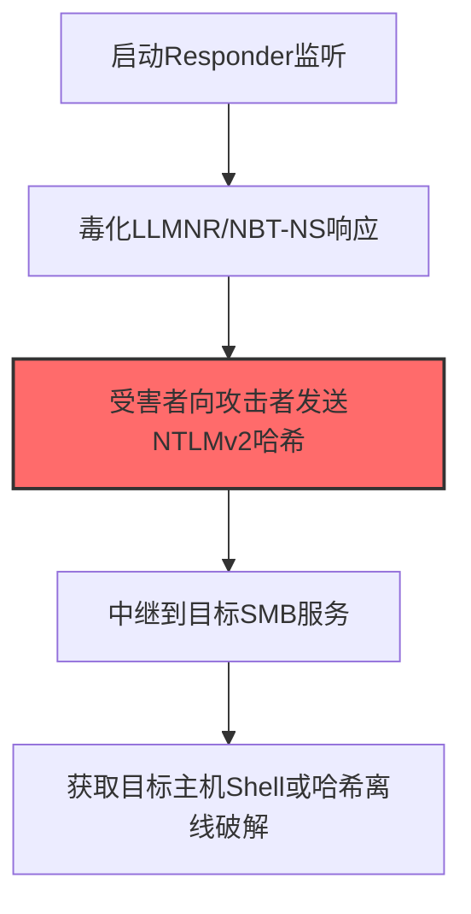
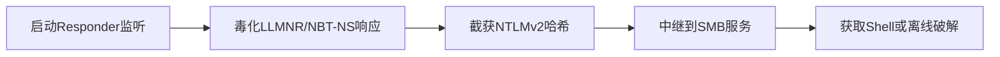

# LLMNR/NBT-NS Poisoning and SMB Relay (T1557.001)

## 一句话通俗理解

> **LLMNR/NBT-NS Poisoning and SMB Relay就是毒化名称解析。**

## 30秒速查卡

| 维度 | 你需要知道的 |
|------|-------------|
| 这是什么？ | 毒化局域网名称解析协议，骗你的电脑把密码哈希发给攻击者的机器 |
| 为什么危险？ | LLMNR/NBT-NS是Windows的'广播找人'机制，攻击者只要回复就能冒充目标服务，截获密码哈希 |
| 谁需要关心？ | 网络管理员、SOC分析师、安全运营团队 |
| 你的第一步防御 | 禁用LLMNR和NBT-NS协议，部署SMB签名 |
| 如果只做一件事 | 通过组策略禁用LLMNR和NBT-NS，部署SMB签名防止中继攻击 |

## 难度等级

⭐⭐ 中级 - 需要一定的技术基础和实践经验

## 前置知识检查

**读这个文件需要什么？**

- [ ] Windows认证体系（NTLM/Kerberos/LSASS）
- [ ] 哈希基础（NTLM Hash/SHA）
- [ ] 网络认证协议（SMB/LDAP/Kerberos）

## 技术描述

**通俗解释：**

**过渡段：** 不要误解凭证访问只是'窃取密码'——在现代企业中，凭证存在于内存、磁盘、网络流量和云API等多个位置。攻击者关注的不是密码本身，而是'能用它做什么'：一个服务账号的哈希就能横向移动到数十台服务器，OAuth令牌可以访问整个SaaS租户的数据。
毒化名称解析，骗你的电脑把密码发给攻击者的机器

> 🎭 **打个比方**：就像冒充快递员混进小区，然后在楼门口假装自己是保安——攻击者在网络中冒充其他主机，拦截和篡改通信。

**技术原理：**
T1557.001 是 中间人攻击（T1557）的子技术，专注于LLMNR/NBT-NS Poisoning and SMB Relay这一特定方面。攻击者在凭证访问阶段，通过LLMNR/NBT-NS Poisoning and SMB Relay来获取目标系统或组织的相关信息，为后续攻击步骤做准备。

**用途与影响：**
- 为后续攻击提供关键信息支撑
- 提高攻击的成功率和精准度
- 降低攻击被发现的概率

## 真实攻击流程



**步骤详解：**

1. **启动Responder监听** - 在同网段部署Responder工具，监听LLMNR、NBT-NS和mDNS名称解析请求
2. **毒化LLMNR/NBT-NS响应** - 当目标主机解析不存在的主机名时，Responder抢先回复恶意响应将流量导向攻击者
3. **受害者向攻击者发送NTLMv2哈希** - 受害者的SMB/HTTP认证请求被重定向到攻击者，NTLMv2哈希被截获
4. **中继到目标SMB服务** - 使用ntlmrelayx将截获的NTLMv2哈希直接中继到目标主机的SMB服务进行认证
5. **获取目标主机Shell或哈希离线破解** - 中继成功后获得远程命令执行权限，或使用Hashcat离线破解NTLMv2哈希

## 攻击流程

```
启动Responder监听 --> 毒化LLMNR/NBT-NS响应 --> 截获NTLMv2哈希 --> 中继到SMB服务 --> 获取Shell或离线破解
```



**步骤详解：**
1. **启动Responder监听**
   - 通俗描述：在同网段开启监听，等待受害者发起名称解析请求
   - 技术细节：Responder监听LLMNR(UDP 5355)、NBT-NS(UDP 137)和mDNS协议，响应广播查询
   - 常用工具：Responder、Inveigh、MultiRelay
2. **毒化LLMNR/NBT-NS响应**
   - 通俗描述：当受害者查询不存在主机名时抢先回复，将流量引向攻击者
   - 技术细节：利用协议无认证机制，伪造源IP和TID回复，将主机名解析为攻击者IP
   - 常用工具：Responder、Inveigh、BetterCap
3. **截获NTLMv2哈希**
   - 通俗描述：受害者发起SMB/HTTP认证时被重定向，哈希被攻击者截获
   - 技术细节：SMB默认启用NTLM认证，挑战-响应中包含NTLMv2哈希可用于中继或离线破解
   - 常用工具：Responder、Mimikatz、Metasploit capture
4. **中继到SMB服务**
   - 通俗描述：将截获的哈希直接转发到目标SMB服务完成认证
   - 技术细节：ntlmrelayx解析NTLM类型2消息，转发至目标SMB/HTTP/LDAP服务，需要SMB签名未启用
   - 常用工具：Impacket ntlmrelayx、MultiRelay、Coercer
5. **获取Shell或离线破解**
   - 通俗描述：中继成功后获取远程命令执行权限，或离线破解哈希还原明文
   - 技术细节：中继SMB后通过psexec执行命令；离线破解使用NTLMv2 challenge-response，需要字典或掩码攻击
   - 常用工具：Impacket psexec.py、Hashcat、John the Ripper

## 真实案例

### 案例1：FIN7使用Responder毒化LLMNR/NBT-NS窃取凭证（2017-2018）

- **时间**: 2017-2018年
- **目标**: 美国餐饮零售连锁店（Steak 'n Shake、Jimmy John's等）
- **攻击组织**: FIN7（也称为Carbanak Group）
- **手法**: FIN7在POS网络中部署Responder监听LLMNR/NBT-NS广播请求，当员工访问不存在的共享名时毒化响应截获NTLMv2哈希，再用ntlmrelayx中继到域控SMB服务获取POS终端管理权限
- **影响**: 攻陷超过3600家门店POS系统，窃取数百万张信用卡数据，FIN7因此被美国司法部起诉
- **参考链接**: [Mandiant FIN7 Report](https://www.mandiant.com/resources/fin7-techniques-and-procedures)

### 案例2：APT29在SolarWinds供应链攻击后利用LLMNR投毒横向移动（2020-2021）

- **时间**: 2020-2021年
- **目标**: SolarWinds供应链攻击的下游美国政府机构和企业
- **攻击组织**: APT29（Nobelium/Cozy Bear）
- **手法**: APT29在受害者内网通过Inveigh毒化LLMNR/NBT-NS响应，捕获受害主机NTLMv2哈希，使用ntlmrelayx中继到Exchange和SMB服务，绕过MFA完成横向移动到云管理控制台
- **影响**: 攻陷9个联邦机构和100家企业，导致大规模数据泄露，事件被CISA列为重大国家安全事件
- **参考链接**: [CISA AA21-148A SolarWinds Advisory](https://www.cisa.gov/news-events/cybersecurity-advisories/aa21-148a)

### 案例3：Conti勒索软件团伙利用Responder实施LLMNR/NBT-NS投毒横向移动（2021）

- **时间**: 2021年
- **目标**: 全球医疗、制造、政府等关键基础设施组织（美国、欧洲为主）
- **攻击组织**: Conti（也称为Wizard Spider/Ryuk运营方，俄罗斯背景）
- **手法**: 根据泄露的Conti内部操作手册，该团伙在内网横向移动阶段明确要求操作者使用Responder工具监听LLMNR/NBT-NS广播请求，对受害者访问不存在主机名或共享时发起毒化响应截获NTLMv2哈希，随后使用ntlmrelayx将哈希中继到未启用SMB签名的域控或文件服务器，绕过认证直接获取SYSTEM权限，为部署Ryuk勒索软件铺路
- **影响**: 至少攻陷1000+组织，包括爱尔兰医疗服务机构（HSE）和哥斯达黎加政府系统，造成累计超1亿美元赎金，CISA将其列为重大威胁并发布AA21-265A联合警报
- **参考链接**: [CISA Alert AA21-265A: Conti Ransomware](https://www.cisa.gov/news-events/cybersecurity-advisories/aa21-265a) | [Talos Conti Leaked Manual Translation](https://blog.talosintelligence.com/conti-leak-translation/)

## 红队视角

> ⚠️ **免责声明**：以下内容仅用于合法的安全测试、渗透测试和教育目的。未经授权对他人系统进行测试是违法行为。

### 实战技巧

1. **隐蔽优先**：在凭证访问阶段使用被动方式收集信息，避免触发安全告警
2. **信息验证**：对收集到的信息进行交叉验证，确保准确性和时效性
3. **工具选择**：根据目标环境选择合适的工具，避免使用已被广泛检测的工具
4. **OPSEC意识**：使用匿名网络、临时环境进行操作，防止溯源

### 常用工具

| 工具名称 | 用途 | 平台 | 链接 |
| -------- | ---- | ---- | ---- |
| Responder | LLMNR/NBT-NS/mDNS投毒截获NTLMv2哈希 | Linux | [Responder](https://github.com/lgandx/Responder) |
| Inveigh | Windows版LLMNR/NBT-NS投毒工具（PowerShell/C#） | Windows | [Inveigh](https://github.com/Kevin-Robertson/Inveigh) |
| ntlmrelayx | NTLM中继到SMB/LDAP/MSSQL等目标 | Linux | [Impacket ntlmrelayx](https://github.com/fortra/impacket) |
| MultiRelay | Responder配套SMB中继执行模块 | Linux | [MultiRelay](https://github.com/lgandx/Responder/tree/master/tools) |

### 注意事项

- 仅在授权范围内使用LLMNR/NBT-NS Poisoning and SMB Relay技术
- 注意操作的隐蔽性，避免被蓝队发现
- 记录操作日志，用于后续分析和报告编写

## 蓝队视角

### 检测要点

1. **异常信息收集行为**：监控来自内部系统的异常数据查询和收集行为
2. **可疑工具使用**：检测与LLMNR/NBT-NS Poisoning and SMB Relay相关的工具在内部网络中的使用
3. **异常网络流量**：监控对外部信息收集平台的可疑网络连接
4. **权限异常**：关注非授权用户的信息收集和查询行为

### 监控建议

- 部署信息收集行为的检测规则
- 建立基准行为模型，及时发现异常
- 定期审计敏感信息的访问记录

## 避坑指南

组织中最危险盲区：认为强密码就足够安全。

## 检测建议

### 网络层检测

**检测方法：** 监控与LLMNR/NBT-NS Poisoning and SMB Relay相关的网络流量特征

**具体规则/命令示例：**

```bash
# 监控异常DNS查询
tcpdump -i eth0 port 53 | grep -E "可疑域名"
```

### 主机层检测

**Windows事件ID：**

- 事件ID 4688：可疑进程创建
- 事件ID 4104：PowerShell脚本块日志

**Linux日志：**

- 日志文件：`/var/log/syslog`
- 关键字段：可疑命令执行

**用人话说：** 这条规则在监控网络中是否有LLMNR/NBT-NS投毒活动。LLMNR和NBT-NS是Windows的本地名称解析协议，当DNS查询失败时会使用。攻击者用Responder等工具回复这些广播请求，冒充目标服务器，诱骗用户电脑发送密码哈希。禁用这些协议是最有效的防御。

### 应用层检测

**Sigma规则示例：**

```yaml
title: Suspicious LLMNR/NBT-NS Poisoning and SMB Relay Activity
status: experimental
description: Detects potential LLMNR/NBT-NS Poisoning and SMB Relay behavior
logsource:
  category: process_creation
  product: windows
detection:
  selection:
    Image|endswith: '\\可疑工具.exe'
  condition: selection
level: medium
tags:
  - attack.T1557/001
```

## 缓解措施

### 优先级1：关键措施

**措施名称：** 敏感信息保护

**具体实施步骤：**

1. 识别和分类组织内的敏感信息
2. 对敏感信息实施访问控制和加密
3. 部署信息泄露防护（DLP）解决方案

### 优先级2：重要措施

**措施名称：** 员工安全意识培训

**具体实施步骤：**

1. 定期开展信息安全意识培训
2. 教育员工识别社交工程攻击
3. 建立信息报告和响应机制

### 优先级3：建议措施

**措施名称：** 安全配置加固

**具体实施步骤：**

1. 限制公开可访问的系统信息
2. 配置合适的日志记录和告警策略
3. 定期进行安全评估和渗透测试

## 动手实验

> ⚠️ **重要提示**：所有实验必须在隔离的实验室环境中进行，禁止对未授权的真实系统进行测试。

### 实验环境准备

**推荐靶场/实验平台：**

| 平台名称 | 类型 | 难度 | 链接 |
|---------|------|:----:|------|
| 本地虚拟机 | 虚拟环境 | 初级 | 本机搭建 |
| TryHackMe | 在线靶场 | 初级 | https://tryhackme.com |

**所需工具：**

- 根据具体技术需求准备相应工具

**环境搭建：**

```bash
# 准备隔离的实验环境
# 具体命令根据实验内容而定
```

### 实验1：基础实践（初级）

**实验目标：** 理解和练习LLMNR/NBT-NS Poisoning and SMB Relay的基本操作

**实验步骤：**

1. 在隔离环境中搭建实验系统
2. 按照技术描述执行基本操作
3. 观察和记录实验现象

**预期结果：** 成功完成LLMNR/NBT-NS Poisoning and SMB Relay的基本操作

**学习要点：** 理解LLMNR/NBT-NS Poisoning and SMB Relay的原理和操作方法

## 术语解释

| 术语 | 英文原名 | 通俗解释 |
|-----|---------|---------|
| LLMNR/NBT-NS Poisoning and SMB Relay | LLMNR NBT NS Poisoning and SMB Relay | LLMNR/NBT-NS Poisoning and SMB Relay的基本概念和操作方法 |
| 侦察 | Reconnaissance | 收集目标信息的过程，为后续攻击做准备 |
| OPSEC | Operational Security | 操作安全，保护行动信息不被对手发现 |

## 被引用情况

以下父技术文档引用了本子技术：

- [T1557 - 中间人攻击](../T1557-Adversary-in-the-Middle.md)
- [T1557 - 中间人攻击](../../12-Collection/T1557-Adversary-in-the-Middle.md)

## 参考资料

### 📚 官方文档（深入了解）

- [MITRE ATT&CK - T1557](https://attack.mitre.org/techniques/T1557/)
- [MITRE ATT&CK - T1557.001](https://attack.mitre.org/techniques/T1557/001/)
- [MITRE ATT&CK - T1557.001 检测](https://attack.mitre.org/techniques/T1557/001/detections/)

### 📰 安全报告（真实攻击）

- [CISA Known Exploited Vulnerabilities](https://www.cisa.gov/known-exploited-vulnerabilities-catalog)
- [Microsoft Security Blog](https://www.microsoft.com/en-us/security/blog/)

### 学习资源

- [MITRE ATT&CK 官方文档](https://attack.mitre.org/)
- [ATT&CK STIX Data](https://github.com/mitre-attack/attack-stix-data)

