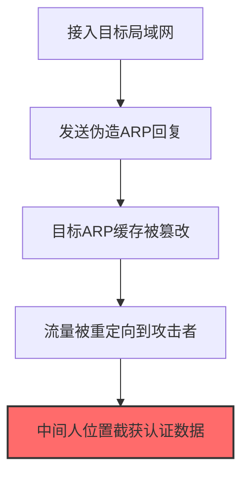

# ARP Cache Poisoning (T1557.002)

## 一句话通俗理解

> **伪造IP和MAC地址的对应关系，让流量走攻击者的机器**

## 30秒速查卡

| 维度 | 你需要知道的 |
|------|-------------|
| 这是什么？ | 伪造IP和MAC地址的对应关系，让网络流量经过攻击者的机器 |
| 为什么危险？ | ARP是局域网的'电话簿'，篡改它就能让所有流量走攻击者的机器，完全控制通信 |
| 谁需要关心？ | 网络管理员、SOC分析师 |
| 你的第一步防御 | 部署动态ARP检测（DAI），使用静态ARP绑定关键设备 |
| 如果只做一件事 | 在交换机上启用DAI（动态ARP检测），监控ARP表的异常变更 |

## 难度等级

⭐⭐ 中级 - 需要一定的技术基础和经验

## 前置知识检查

**读这个文件需要什么？**

- [ ] Windows认证体系（NTLM/Kerberos/LSASS）
- [ ] 哈希基础（NTLM Hash/SHA）
- [ ] 网络认证协议（SMB/LDAP/Kerberos）

## 技术描述

**ARP缓存中毒**（T1557.002）是 **中间人攻击**（T1557）的一个具体变体，属于 **凭证访问** 阶段的攻击技术。

> 🕸️ **打个比方**：就像篡改了公司的内部电话簿，让打给财务的电话都转到骗子那里——ARP缓存投毒让网络流量改道经过攻击者的设备。

### 具体怎么理解？

伪造IP和MAC地址的对应关系，让流量走攻击者的机器

攻击者使用这种技术时，通常是在凭证访问阶段，想要达到特定的攻击目标。与父技术 T1557 相比，T1557.002 有自己独特的特点和使用场景。

### 为什么有效？

这种技术之所以有效，是因为：
1. **隐蔽性**：利用了正常系统功能或常见协议，不容易被发现
2. **技术门槛适中**：不需要特别高深的技术知识就能实施

**过渡段：** 不要误解凭证访问只是'窃取密码'——在现代企业中，凭证存在于内存、磁盘、网络流量等多个位置。
3. **广泛适用**：可以在多种环境和系统中使用

## 真实攻击流程

### 典型场景

攻击者在 **凭证访问** 阶段使用 ARP缓存中毒 技术，以下是典型的攻击步骤：



**步骤详解：**

1. **接入目标局域网** - 攻击者需要在目标同一局域网或VLAN内才能发送ARP欺骗报文
2. **发送伪造ARP回复** - 使用arpspoof或Ettercap向目标主机发送伪造的ARP应答包，声称网关MAC地址是攻击者
3. **目标ARP缓存被篡改** - 目标主机的ARP缓存表中网关IP对应的MAC地址被替换为攻击者的MAC地址
4. **流量被重定向到攻击者** - 目标发往网关的所有流量先经过攻击者主机，攻击者可选择转发或截获
5. **中间人位置截获认证数据** - 在中间人位置分析HTTP/FTP等明文协议流量，提取用户登录凭证

## 攻击流程

```
接入目标局域网 --> 发送伪造ARP回复 --> 篡改目标ARP缓存 --> 重定向流量到攻击者 --> 中间人截获凭证
```


**步骤详解：**
1. **接入目标局域网**
   - 通俗描述：攻击者需要进入目标所在的二层网络才能发起ARP欺骗
   - 技术细节：通过物理接入、Wi-Fi关联或已入侵主机获得局域网访问，ARP协议仅在二层广播域内有效
   - 常用工具：Kali Linux、Wi-Fi Pineapple、桥接虚拟机
2. **发送伪造ARP回复**
   - 通俗描述：向目标主机发送伪造的ARP应答，声称自己是网关
   - 技术细节：构造ARP Reply包，源IP填网关IP，源MAC填攻击者MAC，持续高频发送以覆盖真实条目
   - 常用工具：arpspoof、Ettercap、BetterCAP、NetScout
3. **篡改目标ARP缓存**
   - 通俗描述：目标主机的ARP表被污染，将网关IP指向攻击者MAC
   - 技术细节：ARP协议无状态，主机收到Reply即更新缓存，无需先发Request；动态条目默认缓存2-20分钟
   - 常用工具：arpwatch（蓝队）、arping、scapy
4. **重定向流量到攻击者**
   - 通俗描述：目标发往网关的所有流量被引到攻击者主机
   - 技术细节：开启IP转发(sysctl net.ipv4.ip_forward=1)维持通信，否则目标断网会被察觉；可对HTTPS降级或SSL剥离
   - 常用工具：sslstrip、mitmproxy、BetterCAP
5. **中间人截获凭证**
   - 通俗描述：在中间人位置监听并解析明文协议流量，提取登录凭证
   - 技术细节：HTTP/FTP/TELNET/POP3等明文协议直接抓包解析；HTTPS需配合SSL剥离或伪造证书；可注入JS键盘记录
   - 常用工具：Wireshark、tcpdump、mitmproxy、dsniff、BetterCAP

## 真实案例

### 案例1：APT28通过ARP欺骗劫持酒店Wi-Fi截获外交官凭证（2017）

- **时间**: 2017年
- **目标**: 欧洲外交官下榻的酒店网络
- **攻击组织**: APT28（Fancy Bear/Sofacy）
- **手法**: APT28入侵酒店Wi-Fi路由器后使用arpspoof对目标房间内的外交官设备发起ARP欺骗，将流量重定向到攻击者控制的中间人主机，截获明文SMTP/IMAP登录凭证和Web表单密码
- **影响**: 多国外交部官员的邮箱账户被攻陷，攻击者据此获取后续鱼叉钓鱼的精准目标列表
- **参考链接**: [FireEye APT28 Report](https://www.fireeye.com/blog/threat-research/2017/03/fin7-attack-methods.html)

### 案例2：DarkHotel通过ARP欺骗结合恶意AP攻击高价值目标（2018-2019）

- **时间**: 2018-2019年
- **目标**: 亚洲多地酒店入住的高管和政府官员
- **攻击组织**: DarkHotel
- **手法**: DarkHotel在酒店网络部署恶意接入点并使用Bettercap的ARP欺骗模块毒化同网段受害者ARP缓存，结合SSL Strip降级HTTPS到HTTP截获企业VPN登录凭证
- **影响**: 多家跨国企业高管邮箱和企业账户被攻陷，攻击者据此获取商业谈判机密
- **参考链接**: [Kaspersky DarkHotel Report](https://securelist.com/darkhotel-apt/82939/)

### 案例3：LuminousMoth利用ARP欺骗重定向受害者至恶意更新服务器投递PlugX（2021）

- **时间**: 2021年6月起
- **目标**: 东南亚（缅甸、菲律宾、泰国、新加坡等）政府、外交、教育领域Windows和macOS用户
- **攻击组织**: LuminousMoth（中文背景APT，亦被部分厂商关联至APT41/Winnti集群）
- **手法**: LuminousMoth在入侵目标局域网内一台主机后，使用自研工具向同网段其他主机发送伪造ARP应答，将网关IP对应的MAC地址篡改为攻击者控制的主机，使受害者流量经攻击者中转；随后劫持HTTP请求将受害者重定向至攻击者控制的虚假软件更新站点，诱导下载并执行伪装成合法应用的PlugX（Windows）和ShadowPad（macOS）后门
- **影响**: Bitdefender telemetry显示至少100+受害者被植入PlugX，攻击者据此窃取文档、键盘记录和浏览器凭证，并横向扩散至同网段多台主机
- **参考链接**: [Bitdefender Labs: LuminousMoth – PlugX, file exfiltration and persistence revisited](https://www.bitdefender.com/blog/labs/luminousmoth-plugx-file-exfiltration-and-persistence-revisited)

## 红队视角

> ⚠️ **免责声明**：以下内容仅用于合法的安全测试、渗透测试和教育目的。未经授权对他人系统进行测试是违法行为。

### 实战技巧

1. **深入理解原理**：在实战应用前，充分理解ARP Cache Poisoning的技术原理和适用场景
2. **环境适配**：根据目标系统的操作系统版本、安全配置等因素调整攻击策略
3. **组合使用**：将该技术与其他技术组合使用，构建完整的攻击链
4. **隐蔽性考虑**：注意操作痕迹的清理，避免被安全设备检测

### 常用工具

| 工具名称 | 用途 | 平台 | 链接 |
| -------- | ---- | ---- | ---- |
| arpspoof | 单向ARP欺骗将目标流量重定向到攻击者 | Linux | [dsniff/arpspoof](https://su2.info/doc/arpspoof.php) |
| Bettercap | 一体化MITM框架（ARP/DNS/DHCP欺骗+SSL剥离） | Linux/macOS | [Bettercap](https://www.bettercap.org/) |
| Ettercap | 综合MITM工具支持ARP欺骗和插件扩展 | Linux/Windows | [Ettercap](https://www.ettercap-project.org/) |
| Driftnet | 配合ARP欺骗抓取受害者浏览的图片和Cookie | Linux | [Driftnet](https://github.com/deiv/driftnet) |

### 注意事项

- 在授权的测试环境中使用这些技术
- 注意操作安全（OPSEC），避免被检测系统发现
- 使用匿名化技术和代理隐藏真实身份

## 蓝队视角

### 检测要点

1. **系统日志监控**：关注与ARP Cache Poisoning相关的系统日志和审计记录
2. **异常行为检测**：监控系统中与该技术相关的异常进程、网络连接和文件操作
3. **工具特征识别**：识别攻击者可能使用的工具在系统中的运行特征

### 监控建议

- 部署端点检测和响应（EDR）系统，监控与ARP Cache Poisoning相关的异常行为
- 配置SIEM规则，关联分析来自多个来源的告警
- 定期进行安全评估和渗透测试，验证检测规则的有效性

## 避坑指南

组织中最危险盲区：认为强密码就足够安全。

## 检测建议

### 检测思路

检测 ARP缓存中毒 的关键是识别异常行为模式。以下是三个层面的检测方法：

### 网络层检测

**方法**：监控网络流量中的异常模式

```bash
# 检测异常的网络连接和数据传输
# 根据具体协议和端口设置检测规则
```

### 主机层检测

**Windows事件ID**：
- 事件ID 4688：进程创建（监控可疑进程）
- 事件ID 4104：PowerShell执行（监控可疑脚本）

**Linux日志**：
- /var/log/auth.log：认证日志
- /var/log/syslog：系统日志

```bash
# 检测异常进程和命令执行
grep -i "suspicious" /var/log/auth.log
```

### 应用层检测

**用人话说：** 这条规则在监控网络中是否有ARP缓存投毒活动。ARP是局域网设备用来'找人'的协议。攻击者发送伪造的ARP响应，告诉其他设备'我就是你要找的那个人'，这样所有流量就会经过攻击者的机器。启用动态ARP检测（DAI）可以防止这种攻击。

**Sigma规则示例**：

```yaml
title: 检测ARP缓存中毒
status: experimental
description: 检测可能的ARP缓存中毒活动
logsource:
    category: process_creation
    product: windows
detection:
    selection:
        EventID: 4688
    condition: selection
level: medium
tags:
    - attack.T1557002
```

## 缓解措施

### 优先级1：关键措施

**限制攻击面**：减少暴露的服务和端口，降低被利用的风险

```bash
# 防火墙规则示例：只允许必要的出站连接
iptables -A OUTPUT -p tcp --dport 443 -j ACCEPT  # 允许HTTPS
iptables -A OUTPUT -p tcp --dport 80 -j ACCEPT   # 允许HTTP
iptables -A OUTPUT -p tcp -j DROP                 # 阻止其他TCP
```

### 优先级2：重要措施

**加强监控**：部署EDR和SIEM系统，实时监控异常行为

### 优先级3：建议措施

**安全意识培训**：教育员工识别相关攻击手法

## 动手实验

> ⚠️ **所有实验必须在隔离的实验室环境中进行**

### 实验1：理解基本原理（初级）

**目标**：理解 ARP缓存中毒 的工作原理

**步骤**：
1. 在隔离环境中搭建测试系统
2. 使用基础工具模拟攻击行为
3. 观察系统日志和网络流量

**学习要点**：理解该技术的核心机制

### 实验2：实际操作（中级）

**目标**：掌握 ARP缓存中毒 的实际使用方法

**步骤**：
1. 使用专业工具进行攻击模拟
2. 尝试不同的绕过技术
3. 分析检测日志的特征

**学习要点**：掌握工具使用和日志分析

### 实验3：防御验证（高级）

**目标**：验证检测规则的有效性

**步骤**：
1. 部署检测规则
2. 执行攻击模拟
3. 验证检测告警是否触发

**学习要点**：理解攻防对抗的实际效果

## 术语解释

| 术语 | 通俗解释 |
|------|---------|
| **ATT&CK** | MITRE公司维护的攻击技术知识库，像一本"黑客手法百科全书" |
| **ARP缓存中毒** | T1557.002，ATT&CK框架中定义的一种具体攻击技术 |
| **中间人攻击** | T1557，ARP缓存中毒所属的父技术类别 |
| **凭证访问** | 攻击链中的一个阶段，攻击者在这个阶段的目标 |
| **C2** | 命令与控制，攻击者用来远程控制被入侵系统的"遥控器" |
| **EDR** | 端点检测与响应，部署在电脑上的安全监控软件 |

## 被引用情况

以下父技术文档引用了本子技术：

- [T1557 - 中间人攻击](../T1557-Adversary-in-the-Middle.md)
- [T1557 - 中间人攻击](../../12-Collection/T1557-Adversary-in-the-Middle.md)

## 参考资料

### 📚 官方文档（深入了解）

- [MITRE ATT&CK - ARP Cache Poisoning (T1557.002)](https://attack.mitre.org/techniques/T1557/002/)
- [MITRE ATT&CK - 中间人攻击 (T1557)](https://attack.mitre.org/techniques/T1557/)

### 📰 安全报告（真实攻击）

- [MITRE ATT&CK 官方文档](https://attack.mitre.org/) - ATT&CK 框架官方资源

### 🔧 工具与资源（动手试试）

- [Atomic Red Team](https://github.com/redcanaryco/atomic-red-team) - 检测规则测试框架
- [MITRE ATT&CK Navigator](https://mitre-attack.github.io/attack-navigator/) - ATT&CK 可视化工具

### 📚 学习资料（深入了解）

- [MITRE ATT&CK 知识库](https://attack.mitre.org/resources/) - ATT&CK 官方资源中心
