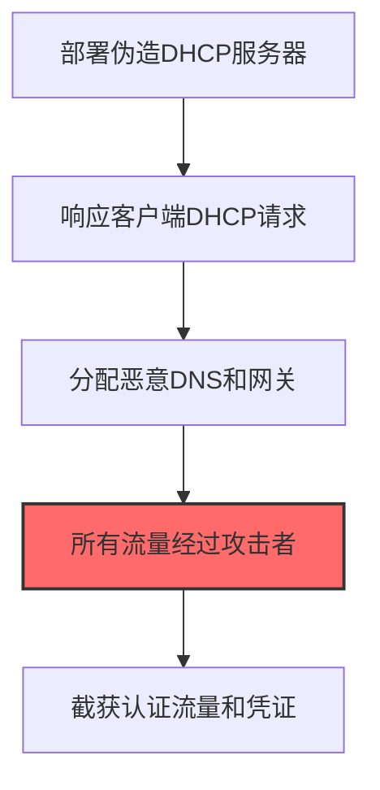

# DHCP Spoofing (T1557.003)

## 一句话通俗理解

> **用假的DHCP服务器分配恶意网络配置**

## 30秒速查卡

| 维度 | 你需要知道的 |
|------|-------------|
| 这是什么？ | 用假的DHCP服务器分配恶意网络配置，劫持网络流量 |
| 为什么危险？ | DHCP是网络的'自动配网'机制，攻击者只要抢先回复就能控制你的DNS和网关 |
| 谁需要关心？ | 网络管理员、SOC分析师 |
| 你的第一步防御 | 在交换机上启用DHCP Snooping，只信任授权的DHCP服务器 |
| 如果只做一件事 | 在交换机上启用DHCP Snooping，监控网络中出现的未授权DHCP服务器 |

## 难度等级

⭐⭐ 中级 - 需要一定的技术基础和经验

## 前置知识检查

**读这个文件需要什么？**

- [ ] Windows认证体系（NTLM/Kerberos/LSASS）
- [ ] 哈希基础（NTLM Hash/SHA）
- [ ] 网络认证协议（SMB/LDAP/Kerberos）

## 技术描述

**DHCP欺骗**（T1557.003）是 **中间人攻击**（T1557）的一个具体变体，属于 **凭证访问** 阶段的攻击技术。

> 📡 **打个比方**：就像设置了一个假的WiFi热点等别人连接——DHCP欺骗让受害者的网络请求被重定向到攻击者控制的服务器。

### 具体怎么理解？

用假的DHCP服务器分配恶意网络配置

攻击者使用这种技术时，通常是在凭证访问阶段，想要达到特定的攻击目标。与父技术 T1557 相比，T1557.003 有自己独特的特点和使用场景。

### 为什么有效？

这种技术之所以有效，是因为：
1. **隐蔽性**：利用了正常系统功能或常见协议，不容易被发现
2. **技术门槛适中**：不需要特别高深的技术知识就能实施

**过渡段：** 不要误解凭证访问只是'窃取密码'——在现代企业中，凭证存在于内存、磁盘、网络流量等多个位置。
3. **广泛适用**：可以在多种环境和系统中使用

## 真实攻击流程

### 典型场景

攻击者在 **凭证访问** 阶段使用 DHCP欺骗 技术，以下是典型的攻击步骤：



**步骤详解：**

1. **部署伪造DHCP服务器** - 在目标网络中搭建 rogue DHCP 服务，配置与真实DHCP相同的IP地址池
2. **响应客户端DHCP请求** - 当客户端发起DHCP Discover时，攻击者的伪造服务器抢先响应分配IP配置
3. **分配恶意DNS和网关** - 在DHCP响应中设置攻击者控制的DNS服务器和默认网关地址
4. **所有流量经过攻击者** - 客户端的所有网络流量通过攻击者的网关转发，攻击者处于中间人位置
5. **截获认证流量和凭证** - 分析经过的DNS查询和HTTP流量，提取用户的登录凭证和敏感信息

## 攻击流程

```
部署伪造DHCP服务器 --> 抢先响应客户端请求 --> 分配恶意DNS和网关 --> 流量经过攻击者 --> 截获认证凭证
```


**步骤详解：**
1. **部署伪造DHCP服务器**
   - 通俗描述：在目标网络中搭建恶意DHCP服务，准备分配伪造配置
   - 技术细节：rogue DHCP监听UDP 67端口，配置IP池、网关、DNS、租约时间；需在二层网络可达且先于真实服务器响应
   - 常用工具：Yersinia、DHCPig、scapy、dnsmasq
2. **抢先响应客户端请求**
   - 通俗描述：当客户端请求IP时，伪造服务器比真实服务器更快回复
   - 技术细节：DHCP Discover广播后，最先到达的Offer会被客户端接受；攻击者持续监听并立即响应
   - 常用工具：Yersinia、BetterCAP、DHCPig
3. **分配恶意DNS和网关**
   - 通俗描述：在DHCP响应中设置攻击者控制的DNS和网关地址
   - 技术细节：DHCP Option 3设置默认网关，Option 6设置DNS服务器，Option 15设置域名，引导流量经过攻击者
   - 常用工具：dnsmasq、isc-dhcp-server、BetterCAP
4. **流量经过攻击者**
   - 通俗描述：客户端的所有网络流量通过攻击者控制的网关转发
   - 技术细节：开启IP转发维持通信；DNS查询被解析到钓鱼站点；可对HTTPS实施SSL剥离或伪造证书
   - 常用工具：iptables、sslstrip、mitmproxy、dnschef
5. **截获认证凭证**
   - 通俗描述：分析经过的流量，提取登录凭证和敏感信息
   - 技术细节：明文协议直接解析；HTTPS通过伪造证书或降级攻击获取；可注入JS或重定向到钓鱼页
   - 常用工具：Wireshark、mitmproxy、BetterCAP、BeEF

## 真实案例

### 案例1：APT33通过DHCP欺骗劫持沙特航空工业网络凭证（2017-2018）

- **时间**: 2017-2018年
- **目标**: 沙特阿拉伯航空航天与航空运输企业
- **攻击组织**: APT33（Elfin/Refined Kitten）
- **手法**: APT33入侵企业内网后使用Yersinia部署伪造DHCP服务器响应新接入设备的DHCP Discover，分配攻击者控制的DNS和网关地址，将所有流量导向中间人主机截获员工VPN和Outlook Web Access凭证
- **影响**: 多家航空供应商员工凭证被窃取，攻击者据此向供应链合作伙伴发起鱼叉钓鱼扩大攻击面
- **参考链接**: [FireEye APT33 Report](https://www.fireeye.com/blog/threat-research/2017/09/apt33-insights-into-iranian-cyber-espionage.html)

### 案例2：Turla通过DHCP欺骗劫持欧洲外交部分支办公室（2019-2020）

- **时间**: 2019-2020年
- **目标**: 欧洲某外交部驻外使领馆分支办公室
- **攻击组织**: Turla（Snake/Krypton）
- **手法**: Turla在分支办公室入侵边缘交换机后通过Bettercap的DHCP欺骗模块劫持新设备的DHCP请求，分配恶意DNS服务器解析内网共享名为攻击者主机，配合LLMNR投毒截获NTLMv2哈希
- **影响**: 多名外交官的域账户哈希被截获并离线破解，攻击者据此横向移动到外交部总部邮件服务器
- **参考链接**: [Kaspersky Turla Report](https://securelist.com/turla-apt-trends-2019/90530/)

### 案例3：APT28（FrostArmada行动）大规模篡改SOHO路由器DHCP设置劫持DNS实施AiTM凭证窃取（2025-2026）

- **时间**: 2025年5月-2026年4月（2025年12月达峰）
- **目标**: 全球120+国家的SOHO路由器用户，重点为北非、中美洲、东南亚和欧洲的外交部、执法机构和第三方云服务提供商
- **攻击组织**: APT28（Forest Blizzard/Fancy Bear/Sofacy，俄罗斯GRU Unit 26165）
- **手法**: APT28利用CVE-2023-50224等漏洞攻陷TP-Link WR841N和MikroTik SOHO路由器后，通过精心构造的HTTP GET请求修改路由器DHCP设置，将主DNS服务器替换为攻击者控制的VPS（运行dnsmasq），原合法DNS降级为备用；下游设备自动继承恶意DNS配置，当用户查询Microsoft Outlook/Office 365等认证服务域名时，恶意DNS返回虚假IP将流量导向攻击者的实时AiTM代理，代理代为完成MFA挑战并捕获OAuth访问令牌和会话Cookie
- **影响**: 峰值期间18,000+独立IP与攻击者DNS基础设施通信，200+组织和5,000+消费设备受影响，大量Microsoft 365账户凭证和令牌被窃；2026年4月美国DOJ/FBI和英国NCSC发布联合警报，FBI执行"Operation Masquerade"技术清除行动
- **参考链接**: [NCSC Advisory: APT28 exploit routers to enable DNS hijacking operations](https://www.ncsc.gov.uk/sites/default/files/2026-05/APT28-exploit-routers-to-enable-DNS-hijacking-operations.pdf) | [CSA Research Note: Forest Blizzard SOHO Router OAuth Token Harvest](https://labs.cloudsecurityalliance.org/research/csa-research-note-apt28-soho-router-oauth-token-harvest-2026/)

## 红队视角

> ⚠️ **免责声明**：以下内容仅用于合法的安全测试、渗透测试和教育目的。未经授权对他人系统进行测试是违法行为。

### 实战技巧

1. **深入理解原理**：在实战应用前，充分理解DHCP Spoofing的技术原理和适用场景
2. **环境适配**：根据目标系统的操作系统版本、安全配置等因素调整攻击策略
3. **组合使用**：将该技术与其他技术组合使用，构建完整的攻击链
4. **隐蔽性考虑**：注意操作痕迹的清理，避免被安全设备检测

### 常用工具

| 工具名称 | 用途 | 平台 | 链接 |
| -------- | ---- | ---- | ---- |
| Yersinia | 第二层协议攻击框架（DHCP/STP/CDP欺骗） | Linux | [Yersinia](https://github.com/tomacr/yersinia) |
| Bettercap | 一体化MITM框架含DHCP欺骗模块 | Linux/macOS | [Bettercap](https://www.bettercap.org/) |
| Ettercap | 综合MITM工具支持DHCP欺骗插件 | Linux/Windows | [Ettercap](https://www.ettercap-project.org/) |
| DHCPig | 专用DHCP耗尽与欺骗工具 | Linux | [DHCPig](https://github.com/kamorin/DHCPig) |

### 注意事项

- 在授权的测试环境中使用这些技术
- 注意操作安全（OPSEC），避免被检测系统发现
- 使用匿名化技术和代理隐藏真实身份

## 蓝队视角

### 检测要点

1. **系统日志监控**：关注与DHCP Spoofing相关的系统日志和审计记录
2. **异常行为检测**：监控系统中与该技术相关的异常进程、网络连接和文件操作
3. **工具特征识别**：识别攻击者可能使用的工具在系统中的运行特征

### 监控建议

- 部署端点检测和响应（EDR）系统，监控与DHCP Spoofing相关的异常行为
- 配置SIEM规则，关联分析来自多个来源的告警
- 定期进行安全评估和渗透测试，验证检测规则的有效性

## 避坑指南

组织中最危险盲区：认为强密码就足够安全。

## 检测建议

### 检测思路

检测 DHCP欺骗 的关键是识别异常行为模式。以下是三个层面的检测方法：

### 网络层检测

**方法**：监控网络流量中的异常模式

```bash
# 检测异常的网络连接和数据传输
# 根据具体协议和端口设置检测规则
```

### 主机层检测

**Windows事件ID**：
- 事件ID 4688：进程创建（监控可疑进程）
- 事件ID 4104：PowerShell执行（监控可疑脚本）

**Linux日志**：
- /var/log/auth.log：认证日志
- /var/log/syslog：系统日志

```bash
# 检测异常进程和命令执行
grep -i "suspicious" /var/log/auth.log
```

### 应用层检测

**用人话说：** 这条规则在监控网络中是否有伪造的DHCP服务器。DHCP是网络设备自动获取IP地址的协议。攻击者启动假的DHCP服务器，抢先回复设备的DHCP请求，分配恶意的DNS和网关地址，这样设备的所有流量就会经过攻击者。启用DHCP Snooping可以防止这种攻击。

**Sigma规则示例**：

```yaml
title: 检测DHCP欺骗
status: experimental
description: 检测可能的DHCP欺骗活动
logsource:
    category: process_creation
    product: windows
detection:
    selection:
        EventID: 4688
    condition: selection
level: medium
tags:
    - attack.T1557003
```

## 缓解措施

### 优先级1：关键措施

**限制攻击面**：减少暴露的服务和端口，降低被利用的风险

```bash
# 防火墙规则示例：只允许必要的出站连接
iptables -A OUTPUT -p tcp --dport 443 -j ACCEPT  # 允许HTTPS
iptables -A OUTPUT -p tcp --dport 80 -j ACCEPT   # 允许HTTP
iptables -A OUTPUT -p tcp -j DROP                 # 阻止其他TCP
```

### 优先级2：重要措施

**加强监控**：部署EDR和SIEM系统，实时监控异常行为

### 优先级3：建议措施

**安全意识培训**：教育员工识别相关攻击手法

## 动手实验

> ⚠️ **所有实验必须在隔离的实验室环境中进行**

### 实验1：理解基本原理（初级）

**目标**：理解 DHCP欺骗 的工作原理

**步骤**：
1. 在隔离环境中搭建测试系统
2. 使用基础工具模拟攻击行为
3. 观察系统日志和网络流量

**学习要点**：理解该技术的核心机制

### 实验2：实际操作（中级）

**目标**：掌握 DHCP欺骗 的实际使用方法

**步骤**：
1. 使用专业工具进行攻击模拟
2. 尝试不同的绕过技术
3. 分析检测日志的特征

**学习要点**：掌握工具使用和日志分析

### 实验3：防御验证（高级）

**目标**：验证检测规则的有效性

**步骤**：
1. 部署检测规则
2. 执行攻击模拟
3. 验证检测告警是否触发

**学习要点**：理解攻防对抗的实际效果

## 术语解释

| 术语 | 通俗解释 |
|------|---------|
| **ATT&CK** | MITRE公司维护的攻击技术知识库，像一本"黑客手法百科全书" |
| **DHCP欺骗** | T1557.003，ATT&CK框架中定义的一种具体攻击技术 |
| **中间人攻击** | T1557，DHCP欺骗所属的父技术类别 |
| **凭证访问** | 攻击链中的一个阶段，攻击者在这个阶段的目标 |
| **C2** | 命令与控制，攻击者用来远程控制被入侵系统的"遥控器" |
| **EDR** | 端点检测与响应，部署在电脑上的安全监控软件 |

## 被引用情况

以下父技术文档引用了本子技术：

- [T1557 - 中间人攻击](../T1557-Adversary-in-the-Middle.md)
- [T1557 - 中间人攻击](../../12-Collection/T1557-Adversary-in-the-Middle.md)

## 参考资料

### 📚 官方文档（深入了解）

- [MITRE ATT&CK - DHCP Spoofing (T1557.003)](https://attack.mitre.org/techniques/T1557/003/)
- [MITRE ATT&CK - 中间人攻击 (T1557)](https://attack.mitre.org/techniques/T1557/)

### 📰 安全报告（真实攻击）

- [MITRE ATT&CK 官方文档](https://attack.mitre.org/) - ATT&CK 框架官方资源

### 🔧 工具与资源（动手试试）

- [Atomic Red Team](https://github.com/redcanaryco/atomic-red-team) - 检测规则测试框架
- [MITRE ATT&CK Navigator](https://mitre-attack.github.io/attack-navigator/) - ATT&CK 可视化工具

### 📚 学习资料（深入了解）

- [MITRE ATT&CK 知识库](https://attack.mitre.org/resources/) - ATT&CK 官方资源中心
