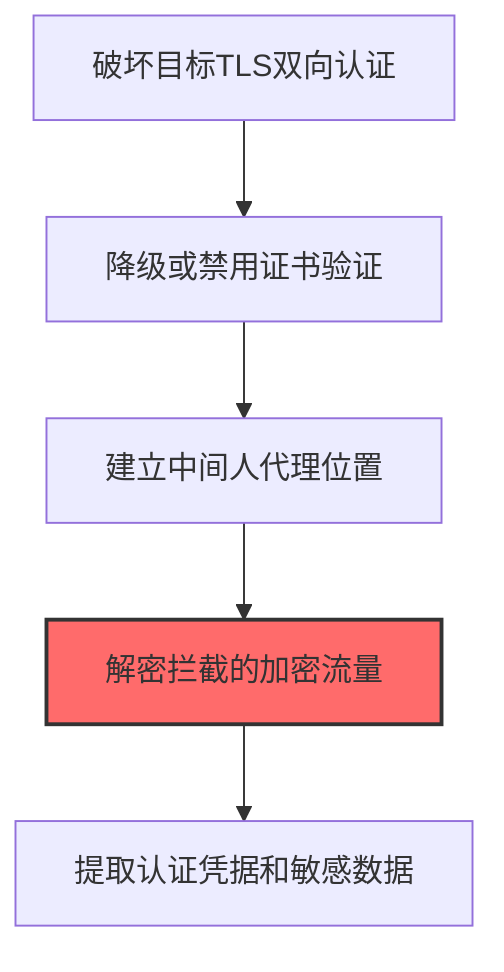
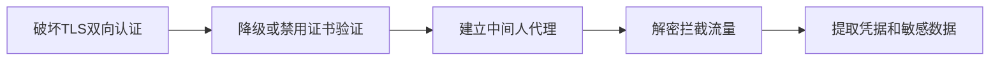

# Mutual Authentication Impairment (T1557.004)

## 一句话通俗理解

> **Mutual Authentication Impairment就是破坏双向证书验证。**

## 30秒速查卡

| 维度 | 你需要知道的 |
|------|-------------|
| 这是什么？ | 破坏双向证书验证，让攻击者能解密和篡改加密通信 |
| 为什么危险？ | 双向认证是加密通信的'信任基础'，破坏它就能中间人攻击所有加密流量 |
| 谁需要关心？ | 网络安全工程师、SOC分析师 |
| 你的第一步防御 | 实施证书固定（Certificate Pinning），监控证书链的异常变更 |
| 如果只做一件事 | 监控TLS证书链的任何异常变更，特别是自签名证书的引入 |

## 难度等级

⭐⭐ 中级 - 需要一定的技术基础和实践经验

## 前置知识检查

**读这个文件需要什么？**

- [ ] Windows认证体系（NTLM/Kerberos/LSASS）
- [ ] 哈希基础（NTLM Hash/SHA）
- [ ] 网络认证协议（SMB/LDAP/Kerberos）

## 技术描述

**通俗解释：**

**过渡段：** 不要误解凭证访问只是'窃取密码'——在现代企业中，凭证存在于内存、磁盘、网络流量和云API等多个位置。攻击者关注的不是密码本身，而是'能用它做什么'：一个服务账号的哈希就能横向移动到数十台服务器，OAuth令牌可以访问整个SaaS租户的数据。
破坏双向证书验证，让攻击者能解密加密流量

> 🔓 **打个比方**：就像拆掉了门禁系统的双向验证功能——攻击者削弱或绕过了双向认证，让中间人攻击顺利实施。

**技术原理：**
T1557.004 是 中间人攻击（T1557）的子技术，专注于Mutual Authentication Impairment这一特定方面。攻击者在凭证访问阶段，通过Mutual Authentication Impairment来获取目标系统或组织的相关信息，为后续攻击步骤做准备。

**用途与影响：**
- 为后续攻击提供关键信息支撑
- 提高攻击的成功率和精准度
- 降低攻击被发现的概率

## 真实攻击流程



**步骤详解：**

1. **破坏目标TLS双向认证** - 通过篡改配置或注入恶意证书，破坏客户端与服务器之间的双向证书验证
2. **降级或禁用证书验证** - 修改客户端或服务器配置跳过mTLS验证，或注入伪造的CA证书到信任链
3. **建立中间人代理位置** - 在客户端和服务器之间部署代理服务器，劫持所有加密通信流量
4. **解密拦截的加密流量** - 由于证书验证被破坏，攻击者的伪造证书被接受，可以解密所有TLS流量
5. **提取认证凭据和敏感数据** - 从解密的流量中提取登录凭证、API密钥和业务数据

## 攻击流程

```
破坏TLS双向认证 --> 降级或禁用证书验证 --> 建立中间人代理 --> 解密拦截流量 --> 提取凭据和敏感数据
```



**步骤详解：**
1. **破坏TLS双向认证**
   - 通俗描述：通过篡改配置或注入恶意证书，破坏客户端与服务器间的双向认证机制
   - 技术细节：mTLS要求双方验证证书，攻击者通过修改客户端配置忽略证书校验，或注入伪造CA到系统信任链
   - 常用工具：mitmproxy、Burp Suite、Frida、Xposed
2. **降级或禁用证书验证**
   - 通俗描述：让客户端跳过证书校验，接受伪造证书
   - 技术细节：修改`SSLContext`参数、Hook证书校验API、注入伪造根证书；TLS降级攻击强制使用弱算法
   - 常用工具：SSL Kill Switch、Frida、JustTrustMe、objection
3. **建立中间人代理**
   - 通俗描述：在客户端和服务器之间部署代理，劫持所有加密通信
   - 技术细节：通过ARP欺骗、DNS劫持或反向代理部署；透明代理监听443端口并转发流量
   - 常用工具：mitmproxy、Burp Suite、Charles、BetterCAP
4. **解密拦截流量**
   - 通俗描述：由于证书验证被破坏，攻击者的伪造证书被接受，可解密所有TLS流量
   - 技术细节：mitmproxy动态生成伪造证书；对TLS 1.3需配合降级；HSTS会阻止浏览器接受伪造证书需绕过
   - 常用工具：mitmproxy、sslstrip、Bypass
5. **提取凭据和敏感数据**
   - 通俗描述：从解密流量中提取登录凭证、API密钥和业务数据
   - 技术细节：通过正则匹配或协议解析提取Authorization头、Cookie、表单字段；可重放或修改请求
   - 常用工具：Wireshark、mitmproxy脚本、Burp Intruder、自定义脚本

## 真实案例

### 案例1：APT29通过Golden SAML伪造破坏双向认证绕过O365 MFA（2020-2021）

- **时间**: 2020-2021年
- **目标**: SolarWinds供应链攻击下游的美国政府机构和企业
- **攻击组织**: APT29（Nobelium/Cozy Bear）
- **手法**: APT29入侵ADFS服务器后提取SAML签名证书私钥，用ADFSpoof伪造SAML令牌破坏SP与IdP之间的双向认证，绕过O365的MFA访问受害者邮箱和管理控制台
- **影响**: 攻陷9个联邦机构约100家企业的O365租户，邮件和数据被大规模窃取
- **参考链接**: [CISA AA21-148A SolarWinds Advisory](https://www.cisa.gov/news-events/cybersecurity-advisories/aa21-148a)

### 案例2：WIRTE通过SSL剥离破坏TLS双向认证劫持中东律师凭证（2019-2020）

- **时间**: 2019-2020年
- **目标**: 中东律师事务所和咨询公司
- **攻击组织**: WIRTE
- **手法**: WIRTE入侵企业内部网络后使用mitmproxy对内网HTTPS服务发起SSL剥离，将客户端证书双向认证降级为单向HTTP认证，截获律师的Web邮箱和文档管理平台凭证
- **影响**: 多家律所敏感案件文档被窃取，被用于商业勒索和定向二次攻击
- **参考链接**: [Trustwave WIRTE Research](https://www.trustwave.com/en-us/resources/blogs/spiderlabs-blog/wirte-mideast-apt-group-goes-dark/)

### 案例3：Secret Blizzard通过AiTM代理并安装受信任根证书破坏TLS双向认证劫持外交官凭证（2025）

- **时间**: 2025年
- **目标**: 欧洲和中亚国家的外交官及政府官员
- **攻击组织**: Secret Blizzard（Microsoft对APT28/Fancy Bear的命名，俄罗斯GRU Unit 26165）
- **手法**: Secret Blizzard在入侵目标外交官所住酒店网络或ISP边界后部署AiTM代理基础设施，通过向受害者终端推送并安装受信任根证书的方式破坏客户端对服务器证书的校验，同时利用代理在客户端与服务端之间转发流量并降级双向TLS认证，使得受害者的Outlook Web Access和Microsoft 365登录流量可被实时解密，捕获明文密码和MFA会话令牌
- **影响**: 多国外交官的Microsoft 365邮箱和管理控制台被入侵，攻击者据此获取后续鱼叉钓鱼的精准目标和外交敏感通信内容
- **参考链接**: [Microsoft Security Blog: Frozen in Transit — Secret Blizzard's AiTM campaign against diplomats](https://www.microsoft.com/en-us/security/blog/2025/07/31/frozen-in-transit-secret-blizzards-aitm-campaign-against-diplomats/)

## 红队视角

> ⚠️ **免责声明**：以下内容仅用于合法的安全测试、渗透测试和教育目的。未经授权对他人系统进行测试是违法行为。

### 实战技巧

1. **隐蔽优先**：在凭证访问阶段使用被动方式收集信息，避免触发安全告警
2. **信息验证**：对收集到的信息进行交叉验证，确保准确性和时效性
3. **工具选择**：根据目标环境选择合适的工具，避免使用已被广泛检测的工具
4. **OPSEC意识**：使用匿名网络、临时环境进行操作，防止溯源

### 常用工具

| 工具名称 | 用途 | 平台 | 链接 |
| -------- | ---- | ---- | ---- |
| ADFSpoof | 用窃取的ADFS私钥伪造SAML令牌破坏双向认证 | Linux | [ADFSpoof](https://github.com/fireeye/ADFSpoof) |
| mitmproxy | 中间人代理支持SSL剥离和双向认证降级 | Linux/macOS/Windows | [mitmproxy](https://mitmproxy.org/) |
| Bettercap | 一体化MITM框架含SSL Strip模块 | Linux/macOS | [Bettercap](https://www.bettercap.org/) |
| SSLSplit | 针对TLS和SSL连接的透明MITM代理 | Linux | [SSLSplit](https://github.com/droe/sslsplit) |

### 注意事项

- 仅在授权范围内使用Mutual Authentication Impairment技术
- 注意操作的隐蔽性，避免被蓝队发现
- 记录操作日志，用于后续分析和报告编写

## 蓝队视角

### 检测要点

1. **异常信息收集行为**：监控来自内部系统的异常数据查询和收集行为
2. **可疑工具使用**：检测与Mutual Authentication Impairment相关的工具在内部网络中的使用
3. **异常网络流量**：监控对外部信息收集平台的可疑网络连接
4. **权限异常**：关注非授权用户的信息收集和查询行为

### 监控建议

- 部署信息收集行为的检测规则
- 建立基准行为模型，及时发现异常
- 定期审计敏感信息的访问记录

## 避坑指南

组织中最危险盲区：认为强密码就足够安全。

## 检测建议

### 网络层检测

**检测方法：** 监控与Mutual Authentication Impairment相关的网络流量特征

**具体规则/命令示例：**

```bash
# 监控异常DNS查询
tcpdump -i eth0 port 53 | grep -E "可疑域名"
```

### 主机层检测

**Windows事件ID：**

- 事件ID 4688：可疑进程创建
- 事件ID 4104：PowerShell脚本块日志

**Linux日志：**

- 日志文件：`/var/log/syslog`
- 关键字段：可疑命令执行

**用人话说：** 这条规则在监控TLS/SSL证书链是否被篡改。双向认证要求客户端和服务器都验证对方的证书，确保通信安全。攻击者通过破坏这个验证过程，可以解密和篡改所有加密流量。监控证书链的异常变更，能及时发现这种攻击。

### 应用层检测

**Sigma规则示例：**

```yaml
title: Suspicious Mutual Authentication Impairment Activity
status: experimental
description: Detects potential Mutual Authentication Impairment behavior
logsource:
  category: process_creation
  product: windows
detection:
  selection:
    Image|endswith: '\\可疑工具.exe'
  condition: selection
level: medium
tags:
  - attack.T1557/004
```

## 缓解措施

### 优先级1：关键措施

**措施名称：** 敏感信息保护

**具体实施步骤：**

1. 识别和分类组织内的敏感信息
2. 对敏感信息实施访问控制和加密
3. 部署信息泄露防护（DLP）解决方案

### 优先级2：重要措施

**措施名称：** 员工安全意识培训

**具体实施步骤：**

1. 定期开展信息安全意识培训
2. 教育员工识别社交工程攻击
3. 建立信息报告和响应机制

### 优先级3：建议措施

**措施名称：** 安全配置加固

**具体实施步骤：**

1. 限制公开可访问的系统信息
2. 配置合适的日志记录和告警策略
3. 定期进行安全评估和渗透测试

## 动手实验

> ⚠️ **重要提示**：所有实验必须在隔离的实验室环境中进行，禁止对未授权的真实系统进行测试。

### 实验环境准备

**推荐靶场/实验平台：**

| 平台名称 | 类型 | 难度 | 链接 |
|---------|------|:----:|------|
| 本地虚拟机 | 虚拟环境 | 初级 | 本机搭建 |
| TryHackMe | 在线靶场 | 初级 | https://tryhackme.com |

**所需工具：**

- 根据具体技术需求准备相应工具

**环境搭建：**

```bash
# 准备隔离的实验环境
# 具体命令根据实验内容而定
```

### 实验1：基础实践（初级）

**实验目标：** 理解和练习Mutual Authentication Impairment的基本操作

**实验步骤：**

1. 在隔离环境中搭建实验系统
2. 按照技术描述执行基本操作
3. 观察和记录实验现象

**预期结果：** 成功完成Mutual Authentication Impairment的基本操作

**学习要点：** 理解Mutual Authentication Impairment的原理和操作方法

## 术语解释

| 术语 | 英文原名 | 通俗解释 |
|-----|---------|---------|
| Mutual Authentication Impairment | Mutual Authentication Impairment | Mutual Authentication Impairment的基本概念和操作方法 |
| 侦察 | Reconnaissance | 收集目标信息的过程，为后续攻击做准备 |
| OPSEC | Operational Security | 操作安全，保护行动信息不被对手发现 |

## 被引用情况

以下父技术文档引用了本子技术：

- [T1557 - 中间人攻击](../T1557-Adversary-in-the-Middle.md)

## 参考资料

### 📚 官方文档（深入了解）

- [MITRE ATT&CK - T1557](https://attack.mitre.org/techniques/T1557/)
- [MITRE ATT&CK - T1557.004](https://attack.mitre.org/techniques/T1557/004/)
- [MITRE ATT&CK - T1557.004 检测](https://attack.mitre.org/techniques/T1557/004/detections/)

### 📰 安全报告（真实攻击）

- [CISA Known Exploited Vulnerabilities](https://www.cisa.gov/known-exploited-vulnerabilities-catalog)
- [Microsoft Security Blog](https://www.microsoft.com/en-us/security/blog/)

### 学习资源

- [MITRE ATT&CK 官方文档](https://attack.mitre.org/)
- [ATT&CK STIX Data](https://github.com/mitre-attack/attack-stix-data)

