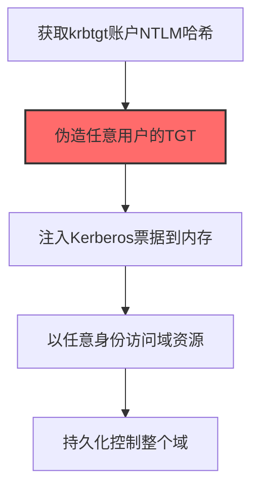
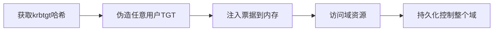

# Golden Ticket (T1558.001)

## 一句话通俗理解

> **伪造Kerberos通票，可以冒充任何域用户**

## 30秒速查卡

| 维度 | 你需要知道的 |
|------|-------------|
| 这是什么？ | 执行黄金票据攻击技术 |
| 为什么危险？ | 这是黄金票据的典型应用场景，攻击者可以利用它获取系统凭证 |
| 谁需要关心？ | SOC分析师、安全运营团队 |
| 你的第一步防御 | 部署针对黄金票据的检测规则和防御措施 |
| 如果只做一件事 | 监控与黄金票据相关的系统日志和异常行为 |

## 难度等级

⭐⭐⭐ 高级 - 需要深入的技术知识和实践

## 前置知识检查

**读这个文件需要什么？**

- [ ] Windows认证体系（NTLM/Kerberos/LSASS）
- [ ] 哈希基础（NTLM Hash/SHA）
- [ ] 网络认证协议（SMB/LDAP/Kerberos）

## 技术描述

**黄金票据**（T1558.001）是 **窃取或伪造Kerberos票据**（T1558）的一个具体变体，属于 **凭证访问** 阶段的攻击技术。

> 🏆 **打个比方**：就像伪造了一张万能通行证，可以去公司的任何地方——Golden Ticket伪造域管理员权限的Kerberos票据，获得最高权限。

### 具体怎么理解？

伪造Kerberos通票，可以冒充任何域用户

攻击者使用这种技术时，通常是在凭证访问阶段，想要达到特定的攻击目标。与父技术 T1558 相比，T1558.001 有自己独特的特点和使用场景。

### 为什么有效？

这种技术之所以有效，是因为：
1. **隐蔽性**：利用了正常系统功能或常见协议，不容易被发现
2. **技术门槛适中**：不需要特别高深的技术知识就能实施

**过渡段：** 不要误解凭证访问只是'窃取密码'——在现代企业中，凭证存在于内存、磁盘、网络流量等多个位置。
3. **广泛适用**：可以在多种环境和系统中使用

## 真实攻击流程

### 典型场景

攻击者在 **凭证访问** 阶段使用 黄金票据 技术，以下是典型的攻击步骤：



**步骤详解：**

1. **获取krbtgt账户NTLM哈希** - 通过DCSync或NTDS转储获取krbtgt账户的NTLM哈希，这是Kerberos票据的签名密钥
2. **伪造任意用户的TGT** - 使用Mimikatz的kerberos::golden命令，用krbtgt哈希签名伪造任意用户（包括Domain Admin）的TGT
3. **注入Kerberos票据到内存** - 使用ptt命令将伪造的TGT注入当前会话的内存中，KDC不会验证票据内容
4. **以任意身份访问域资源** - 伪造的TGT可访问域内任何服务，无需知道目标用户的密码
5. **持久化控制整个域** - 只要krbtgt密码不重置两次，黄金票据永远有效，即使其他凭证全部更改

## 攻击流程

```
获取krbtgt哈希 --> 伪造任意用户TGT --> 注入票据到内存 --> 访问域资源 --> 持久化控制整个域
```



**步骤详解：**
1. **获取krbtgt哈希**
   - 通俗描述：通过DCSync或转储NTDS获取krbtgt账户哈希，这是签发TGT的密钥
   - 技术细节：krbtgt是域控内置账户，其NTLM哈希用于加密签名TGT；通过DRSUAPI复制协议或导出NTDS.dit获取
   - 常用工具：Mimikatz lsadump::dcsync、Impacket secretsdump、ntdsutil
2. **伪造任意用户TGT**
   - 通俗描述：用krbtgt哈希签发任意用户（含域管）的TGT票据
   - 技术细节：构造PAC包含高权限组SID(512/519)；指定用户名、域、SID、有效期10年；用krbtgt哈希加密
   - 常用工具：Mimikatz kerberos::golden、kekeo、Rubeus hashall
3. **注入票据到内存**
   - 通俗描述：将伪造的TGT加载到当前会话，KDC不验证内容直接接受
   - 技术细节：调用LsaCallAuthenticationPackage写入Kerberos票据缓存；ptt(pass-the-ticket)无需密码即可生效
   - 常用工具：Mimikatz kerberos::ptt、Rubeus ptt、kekeo
4. **访问域资源**
   - 通俗描述：以伪造的高权限身份访问域内任何服务，无需知道目标用户密码
   - 技术细节：基于TGT向KDC请求TGS；CIFS/SMB/HOST服务票直接获取管理员权限；可横向访问所有域主机
   - 常用工具：Impacket psexec.py、CrackMapExec、wmiexec.py
5. **持久化控制整个域**
   - 通俗描述：黄金票据长期有效，即使其他密码全部更改仍可访问
   - 技术细节：krbtgt密码重置两次后旧哈希失效；默认10年有效期；可伪装任意用户绕过审计
   - 常用工具：Mimikatz、cobalt Strike、Empire

## 真实案例

### 案例1：APT29 SolarWinds供应链攻击中的黄金票据

- **时间**: 2020-2021年
- **目标**: 美国多个联邦机构及FireEye安全公司
- **攻击组织**: APT29（Nobelium/Cozy Bear）
- **手法**: 攻击者通过SolarWinds Orion后门入侵域控，使用Mimikatz的`kerberos::golden /user:Administrator /krbtgt:<NTLM哈希> /domain:corp.local`命令伪造域管理员TGT，在重置krbtgt密码后仍能维持长达9个月的隐蔽访问
- **影响**: 即使发现后重置所有用户密码，攻击者仍可通过黄金票据持久化，最终被迫两次重置krbtgt账户密码才彻底清除后门
- **参考链接**: [CISA Alert AA21-148A](https://www.cisa.gov/news-events/cybersecurity-advisories/aa21-148a)

### 案例2：FIN6零售业攻击中的黄金票据

- **时间**: 2019-2020年
- **目标**: 美国及欧洲大型零售商POS网络
- **攻击组织**: FIN6
- **手法**: 攻击者通过钓鱼+横向移动攻陷域控，使用kekeo的`kerberos::golden`模块伪造企业管理员TGT，绕过智能卡认证直接访问POS管理服务器，最终投放Griffon后门窃取信用卡数据
- **影响**: 导致数百万张信用卡信息泄露，造成的欺诈损失超过1000万美元
- **参考链接**: [FireEye FIN6报告](https://www.fireeye.com/blog/threat-research/2019/03/pickpocket-is-there-a-better-word-than-steganography.html)

### 案例3：Conti勒索软件团伙伪造黄金票据维持域控持久化部署Ryuk（2021）

- **时间**: 2021年
- **目标**: 全球医疗、制造、政府等关键基础设施组织（爱尔兰HSE、哥斯达黎加政府等）
- **攻击组织**: Conti（Wizard Spider/Ryuk运营方，俄罗斯背景）
- **手法**: Conti在通过Cobalt Strike和Zerologon（CVE-2020-1472）攻陷域控后，使用Mimikatz导出krbtgt账户的NTLM哈希，伪造域管理员黄金票据（TGT），即使 defenders 重置所有用户密码仍可维持域控访问权限；凭借黄金票据在域内自由横向移动至vCenter、备份服务器等高价值目标，最终投放Ryuk勒索软件加密整个域
- **影响**: 攻陷1000+组织，爱尔兰HSE系统瘫痪导致多家医院取消手术，哥斯达黎加政府多个部门停摆，累计赎金超1亿美元；CISA发布AA21-265A联合警报明确将黄金票据列为Conti关键技术
- **参考链接**: [CISA Advisory AA21-265A: Conti Ransomware](https://www.cisa.gov/news-events/cybersecurity-advisories/aa21-265a) | [Talos Conti Leaked Manual Translation](https://blog.talosintelligence.com/conti-leak-translation/)

## 红队视角

> ⚠️ **免责声明**：以下内容仅用于合法的安全测试、渗透测试和教育目的。未经授权对他人系统进行测试是违法行为。

### 实战技巧

1. **深入理解原理**：在实战应用前，充分理解Golden Ticket的技术原理和适用场景
2. **环境适配**：根据目标系统的操作系统版本、安全配置等因素调整攻击策略
3. **组合使用**：将该技术与其他技术组合使用，构建完整的攻击链
4. **隐蔽性考虑**：注意操作痕迹的清理，避免被安全设备检测

### 常用工具

| 工具名称 | 用途 | 平台 | 链接 |
| -------- | ---- | ---- | ---- |
| Mimikatz | `kerberos::golden`命令用krbtgt哈希伪造TGT | Windows | [Mimikatz](https://github.com/gentilkiwi/mimikatz) |
| kekeo | `kerberos::golden`模块的替代实现，支持多种票据类型 | Windows | [kekeo](https://github.com/gentilkiwi/kekeo) |
| Rubeus | C#实现的Kerberos攻击工具，`golden`命令伪造TGT | Windows | [Rubeus](https://github.com/GhostPack/Rubeus) |
| Impacket ticketer.py | Python实现的TGT伪造工具，适合跨平台 | Linux/Python | [Impacket](https://github.com/fortra/impacket) |

### 注意事项

- 在授权的测试环境中使用这些技术
- 注意操作安全（OPSEC），避免被检测系统发现
- 使用匿名化技术和代理隐藏真实身份

## 蓝队视角

### 检测要点

1. **系统日志监控**：关注与Golden Ticket相关的系统日志和审计记录
2. **异常行为检测**：监控系统中与该技术相关的异常进程、网络连接和文件操作
3. **工具特征识别**：识别攻击者可能使用的工具在系统中的运行特征

### 监控建议

- 部署端点检测和响应（EDR）系统，监控与Golden Ticket相关的异常行为
- 配置SIEM规则，关联分析来自多个来源的告警
- 定期进行安全评估和渗透测试，验证检测规则的有效性

## 避坑指南

组织中最危险盲区：认为强密码就足够安全。

## 检测建议

### 检测思路

检测 黄金票据 的关键是识别异常行为模式。以下是三个层面的检测方法：

### 网络层检测

**方法**：监控网络流量中的异常模式

```bash
# 检测异常的网络连接和数据传输
# 根据具体协议和端口设置检测规则
```

### 主机层检测

**Windows事件ID**：
- 事件ID 4688：进程创建（监控可疑进程）
- 事件ID 4104：PowerShell执行（监控可疑脚本）

**Linux日志**：
- /var/log/auth.log：认证日志
- /var/log/syslog：系统日志

```bash
# 检测异常进程和命令执行
grep -i "suspicious" /var/log/auth.log
```

### 应用层检测

**用人话说：** 这条规则在监控Kerberos域认证中是否有异常的票据授予票据（TGT）出现。黄金票据是攻击者偷到了域控的KRBTGT账户密码哈希后，用Mimikatz的`kerberos::golden`命令伪造一张永不过期的TGT。打个比方：KRBTGT就像是Windows域的'印钞机'，攻击者把印钞机偷到手，就能自己印任何面额的'钞票'——随意假装成域管理员或任何用户访问域内任意资源，连域控自己都分辨不出真假。正常的TGT有效期只有10小时，如果发现TGT的有效期长达数年甚至显示永不过期，那100%是伪造的黄金票据。攻击者拿到域控权限后第一步往往就是导出KRBTGT哈希创建黄金票据，作为持久化后门。

**Sigma规则示例**：

```yaml
title: 检测黄金票据
status: experimental
description: 检测可能的黄金票据活动
logsource:
    category: process_creation
    product: windows
detection:
    selection:
        EventID: 4688
    condition: selection
level: medium
tags:
    - attack.T1558001
```

## 缓解措施

### 优先级1：关键措施

**限制攻击面**：减少暴露的服务和端口，降低被利用的风险

```bash
# 防火墙规则示例：只允许必要的出站连接
iptables -A OUTPUT -p tcp --dport 443 -j ACCEPT  # 允许HTTPS
iptables -A OUTPUT -p tcp --dport 80 -j ACCEPT   # 允许HTTP
iptables -A OUTPUT -p tcp -j DROP                 # 阻止其他TCP
```

### 优先级2：重要措施

**加强监控**：部署EDR和SIEM系统，实时监控异常行为

### 优先级3：建议措施

**安全意识培训**：教育员工识别相关攻击手法

## 动手实验

> ⚠️ **所有实验必须在隔离的实验室环境中进行**

### 实验1：理解基本原理（初级）

**目标**：理解 黄金票据 的工作原理

**步骤**：
1. 在隔离环境中搭建测试系统
2. 使用基础工具模拟攻击行为
3. 观察系统日志和网络流量

**学习要点**：理解该技术的核心机制

### 实验2：实际操作（中级）

**目标**：掌握 黄金票据 的实际使用方法

**步骤**：
1. 使用专业工具进行攻击模拟
2. 尝试不同的绕过技术
3. 分析检测日志的特征

**学习要点**：掌握工具使用和日志分析

### 实验3：防御验证（高级）

**目标**：验证检测规则的有效性

**步骤**：
1. 部署检测规则
2. 执行攻击模拟
3. 验证检测告警是否触发

**学习要点**：理解攻防对抗的实际效果

## 术语解释

| 术语 | 通俗解释 |
|------|---------|
| **ATT&CK** | MITRE公司维护的攻击技术知识库，像一本"黑客手法百科全书" |
| **黄金票据** | T1558.001，ATT&CK框架中定义的一种具体攻击技术 |
| **窃取或伪造Kerberos票据** | T1558，黄金票据所属的父技术类别 |
| **凭证访问** | 攻击链中的一个阶段，攻击者在这个阶段的目标 |
| **C2** | 命令与控制，攻击者用来远程控制被入侵系统的"遥控器" |
| **EDR** | 端点检测与响应，部署在电脑上的安全监控软件 |

## 被引用情况

以下父技术文档引用了本子技术：

- [T1558 - 窃取或伪造Kerberos票据](../T1558-Steal-or-Forge-Kerberos-Tickets.md)

## 参考资料

### 📚 官方文档（深入了解）

- [MITRE ATT&CK - Golden Ticket (T1558.001)](https://attack.mitre.org/techniques/T1558/001/)
- [MITRE ATT&CK - 窃取或伪造Kerberos票据 (T1558)](https://attack.mitre.org/techniques/T1558/)

### 📰 安全报告（真实攻击）

- [MITRE ATT&CK 官方文档](https://attack.mitre.org/) - ATT&CK 框架官方资源

### 🔧 工具与资源（动手试试）

- [Atomic Red Team](https://github.com/redcanaryco/atomic-red-team) - 检测规则测试框架
- [MITRE ATT&CK Navigator](https://mitre-attack.github.io/attack-navigator/) - ATT&CK 可视化工具

### 📚 学习资料（深入了解）

- [MITRE ATT&CK 知识库](https://attack.mitre.org/resources/) - ATT&CK 官方资源中心
