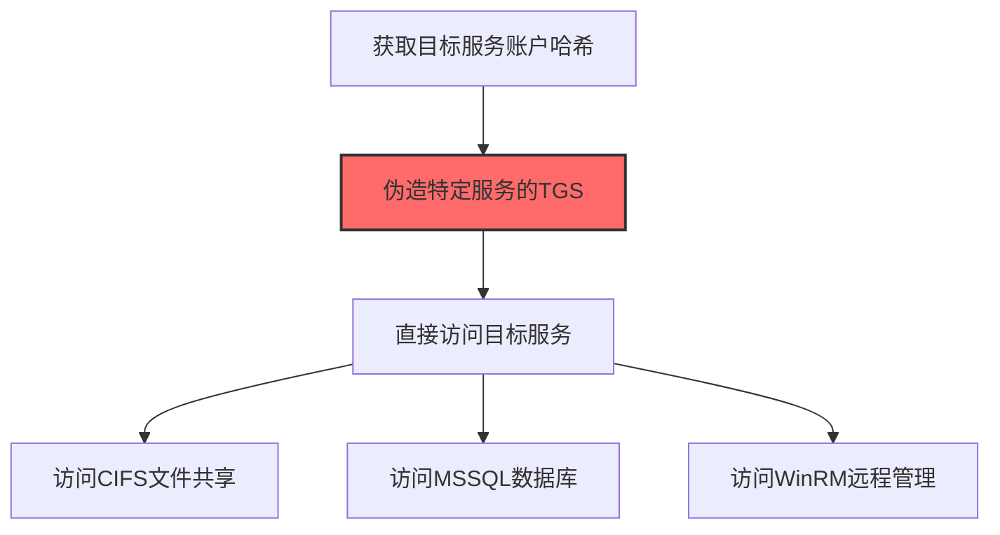
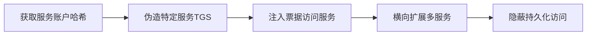

# Silver Ticket (T1558.002)

## 一句话通俗理解

> **伪造服务票，不用联系域控也能访问特定服务**

## 30秒速查卡

| 维度 | 你需要知道的 |
|------|-------------|
| 这是什么？ | 伪造服务票据，不用联系域控就能访问特定服务 |
| 为什么危险？ | Silver Ticket只伪造特定服务的票据，比Golden Ticket更隐蔽，而且不需要联系域控 |
| 谁需要关心？ | 域管理员、Active Directory安全工程师、SOC分析师 |
| 你的第一步防御 | 监控异常的服务票据使用，启用PAC验证 |
| 如果只做一件事 | 监控Windows事件ID 4769，关注没有对应TGT请求的服务票据使用 |

## 难度等级

⭐⭐⭐ 高级 - 需要深入的技术知识和实践

## 前置知识检查

**读这个文件需要什么？**

- [ ] Windows认证体系（NTLM/Kerberos/LSASS）
- [ ] 哈希基础（NTLM Hash/SHA）
- [ ] 网络认证协议（SMB/LDAP/Kerberos）

## 技术描述

**白银票据**（T1558.002）是 **窃取或伪造Kerberos票据**（T1558）的一个具体变体，属于 **凭证访问** 阶段的攻击技术。

> 🎫 **打个比方**：就像伪造了一张只能去特定楼层的通行证——Silver Ticket伪造针对特定服务（如SQL Server）的访问票据。

### 具体怎么理解？

伪造服务票，不用联系域控也能访问特定服务

攻击者使用这种技术时，通常是在凭证访问阶段，想要达到特定的攻击目标。与父技术 T1558 相比，T1558.002 有自己独特的特点和使用场景。

### 为什么有效？

这种技术之所以有效，是因为：
1. **隐蔽性**：利用了正常系统功能或常见协议，不容易被发现
2. **技术门槛适中**：不需要特别高深的技术知识就能实施

**过渡段：** 不要误解凭证访问只是'窃取密码'——在现代企业中，凭证存在于内存、磁盘、网络流量等多个位置。
3. **广泛适用**：可以在多种环境和系统中使用

## 真实攻击流程

### 典型场景

攻击者在 **凭证访问** 阶段使用 白银票据 技术，以下是典型的攻击步骤：



**步骤详解：**

1. **获取目标服务账户哈希** - 通过Kerberoasting或DCSync获取特定服务账户（如MSSQLSvc）的NTLM哈希
2. **伪造特定服务的TGS** - 使用Mimikatz的kerberos::golden /service参数为特定服务伪造TGS票据
3. **直接访问目标服务** - 白银票据不需要联系KDC验证，直接发送伪造的TGS到目标服务即可认证
4. **访问多种域服务** - 利用不同服务账户的哈希分别伪造CIFS、HTTP、MSSQL等服务的访问票据
5. **隐蔽横向移动** - 白银票据只影响特定服务，不像黄金票据那样在日志中留下KDC验证记录

## 攻击流程

```
获取服务账户哈希 --> 伪造特定服务TGS --> 注入票据访问服务 --> 横向扩展多服务 --> 隐蔽持久化访问
```



**步骤详解：**
1. **获取服务账户哈希**
   - 通俗描述：通过Kerberoasting或DCSync提取特定服务账户的NTLM哈希
   - 技术细节：服务账户哈希用于签名TGS；Kerberoasting请求TGS后离线破解；DCSync直接获取域内所有账户哈希
   - 常用工具：Rubeus kerberoast、Impacket GetUserSPNs、Mimikatz lsadump::dcsync
2. **伪造特定服务TGS**
   - 通俗描述：用服务账户哈希签发特定服务（如CIFS/MSSQL）的TGS票据
   - 技术细节：构造PAC指定权限组；用服务账户NTLM哈希加密TGS；指定SPN、用户、域、SID等参数
   - 常用工具：Mimikatz kerberos::golden /service、kekeo
3. **注入票据访问服务**
   - 通俗描述：将伪造TGS注入会话，直接访问目标服务无需KDC验证
   - 技术细节：白银票据不与KDC交互，目标服务自行验证TGS签名；通过ptt加载到Kerberos缓存
   - 常用工具：Mimikatz kerberos::ptt、Rubeus ptt
4. **横向扩展多服务**
   - 通俗描述：利用不同服务账户哈希伪造多种服务票据，横向访问多类资源
   - 技术细节：CIFS访问文件共享、HTTP访问Web服务、MSSQL访问数据库、HOST/WSMAN访问WinRM；每种服务需对应账户哈希
   - 常用工具：Impacket psexec.py、mssqlclient.py、CrackMapExec
5. **隐蔽持久化访问**
   - 通俗描述：白银票据只在目标服务日志留痕，不在KDC日志中暴露
   - 技术细节：无KDC交互，DC日志无4768/4769事件；目标服务日志4769可被检测；服务账户密码不更改即长期有效
   - 常用工具：Cobalt Strike、Empire、自定义脚本

## 真实案例

### 案例1：APT29 SolarWinds攻击中的白银票据

- **时间**: 2020-2021年
- **目标**: 美国司法部、财政部等多个联邦机构
- **攻击组织**: APT29（Nobelium/Cozy Bear）
- **手法**: 攻击者从ADFS服务器导出服务账户哈希，使用Mimikatz的`kerberos::golden /user:user1 /service:HTTP /rc4:<服务账户哈希> /target:adfs.contoso.com`命令伪造HTTP服务的TGS票据，绕过KDC直接以合法用户身份访问Exchange和SharePoint
- **影响**: 白银票据不触发KDC审计日志，攻击者隐蔽访问O365资源长达6个月才被发现
- **参考链接**: [CISA SolarWinds 分析报告](https://www.cisa.gov/news-events/cybersecurity-advisories/aa21-148a)

### 案例2：FIN6零售业横向移动中的白银票据

- **时间**: 2019-2020年
- **目标**: 北美大型零售商和 hospitality 行业
- **攻击组织**: FIN6
- **手法**: 攻击者通过Cobalt Strike Beacon横向到SQL Server，使用Mimikatz提取MSSQL服务账户哈希，伪造CIFS服务的白银票据直接访问POS管理共享`\\posserver\c$`，绕过域控审计投放FrameworkPOS恶意软件
- **影响**: 成功感染超过300家门店的POS终端，窃取约2000万张信用卡数据
- **参考链接**: [Visa FIN6威胁报告](https://usa.visa.com/dam/VCOM/global/support-legal/documents/fin6-cyberthreat-alert.pdf)

### 案例3：BRONZE BUTLER伪造Kerberos TGS白银票据维持日本企业内网管理权限（2017）

- **时间**: 2017年起（活动可追溯至2008年）
- **目标**: 日本政府、生物技术、电子制造和工业化学企业
- **攻击组织**: BRONZE BUTLER（REDBALDKNIGHT/Tick，中国背景APT）
- **手法**: BRONZE BUTLER通过鱼叉钓鱼投递Daserf后门入侵日本企业后，使用Mimikatz、gsecdump和Windows Credential Editor等工具转储LSASS内存获取服务账户NTLM哈希，随后伪造Kerberos TGS白银票据（服务票据），绕过域控KDC直接以管理员身份访问文件共享和内网服务，在不触发域控审计日志的情况下维持长期持久化访问
- **影响**: 长期潜伏于多家日本企业与政府机构内网，窃取大量敏感技术文档和政府机密；Secureworks CTU研究团队确认其使用伪造TGT/TGS票据作为核心持久化机制
- **参考链接**: [Secureworks CTU: BRONZE BUTLER Targets Japanese Enterprises](https://www.secureworks.com/research/bronze-butler-targets-japanese-businesses) | [MITRE ATT&CK G0060](https://attack.mitre.org/groups/G0060/)

## 红队视角

> ⚠️ **免责声明**：以下内容仅用于合法的安全测试、渗透测试和教育目的。未经授权对他人系统进行测试是违法行为。

### 实战技巧

1. **深入理解原理**：在实战应用前，充分理解Silver Ticket的技术原理和适用场景
2. **环境适配**：根据目标系统的操作系统版本、安全配置等因素调整攻击策略
3. **组合使用**：将该技术与其他技术组合使用，构建完整的攻击链
4. **隐蔽性考虑**：注意操作痕迹的清理，避免被安全设备检测

### 常用工具

| 工具名称 | 用途 | 平台 | 链接 |
| -------- | ---- | ---- | ---- |
| Mimikatz | `kerberos::golden /service:`命令用服务账户哈希伪造TGS | Windows | [Mimikatz](https://github.com/gentilkiwi/mimikatz) |
| kekeo | 支持多种服务类型(CIFS/HTTP/MSSQL)的白银票据生成 | Windows | [kekeo](https://github.com/gentilkiwi/kekeo) |
| Rubeus | C#实现的`golden /service:`白银票据生成 | Windows | [Rubeus](https://github.com/GhostPack/Rubeus) |
| Impacket ticketer.py | Python实现的TGS伪造，支持跨平台 | Linux/Python | [Impacket](https://github.com/fortra/impacket) |

### 注意事项

- 在授权的测试环境中使用这些技术
- 注意操作安全（OPSEC），避免被检测系统发现
- 使用匿名化技术和代理隐藏真实身份

## 蓝队视角

### 检测要点

1. **系统日志监控**：关注与Silver Ticket相关的系统日志和审计记录
2. **异常行为检测**：监控系统中与该技术相关的异常进程、网络连接和文件操作
3. **工具特征识别**：识别攻击者可能使用的工具在系统中的运行特征

### 监控建议

- 部署端点检测和响应（EDR）系统，监控与Silver Ticket相关的异常行为
- 配置SIEM规则，关联分析来自多个来源的告警
- 定期进行安全评估和渗透测试，验证检测规则的有效性

## 避坑指南

组织中最危险盲区：认为强密码就足够安全。

## 检测建议

### 检测思路

检测 白银票据 的关键是识别异常行为模式。以下是三个层面的检测方法：

### 网络层检测

**方法**：监控网络流量中的异常模式

```bash
# 检测异常的网络连接和数据传输
# 根据具体协议和端口设置检测规则
```

### 主机层检测

**Windows事件ID**：
- 事件ID 4688：进程创建（监控可疑进程）
- 事件ID 4104：PowerShell执行（监控可疑脚本）

**Linux日志**：
- /var/log/auth.log：认证日志
- /var/log/syslog：系统日志

```bash
# 检测异常进程和命令执行
grep -i "suspicious" /var/log/auth.log
```

### 应用层检测

**用人话说：** 这条规则在监控是否有使用伪造的服务票据访问服务。Silver Ticket是攻击者伪造的Kerberos服务票据，不需要联系域控就能访问特定服务。正常情况下服务票据会关联到TGT请求。如果发现有服务票据使用但没有对应的TGT请求，那很可能是攻击者在使用伪造的Silver Ticket。

**Sigma规则示例**：

```yaml
title: 检测白银票据
status: experimental
description: 检测可能的白银票据活动
logsource:
    category: process_creation
    product: windows
detection:
    selection:
        EventID: 4688
    condition: selection
level: medium
tags:
    - attack.T1558002
```

## 缓解措施

### 优先级1：关键措施

**限制攻击面**：减少暴露的服务和端口，降低被利用的风险

```bash
# 防火墙规则示例：只允许必要的出站连接
iptables -A OUTPUT -p tcp --dport 443 -j ACCEPT  # 允许HTTPS
iptables -A OUTPUT -p tcp --dport 80 -j ACCEPT   # 允许HTTP
iptables -A OUTPUT -p tcp -j DROP                 # 阻止其他TCP
```

### 优先级2：重要措施

**加强监控**：部署EDR和SIEM系统，实时监控异常行为

### 优先级3：建议措施

**安全意识培训**：教育员工识别相关攻击手法

## 动手实验

> ⚠️ **所有实验必须在隔离的实验室环境中进行**

### 实验1：理解基本原理（初级）

**目标**：理解 白银票据 的工作原理

**步骤**：
1. 在隔离环境中搭建测试系统
2. 使用基础工具模拟攻击行为
3. 观察系统日志和网络流量

**学习要点**：理解该技术的核心机制

### 实验2：实际操作（中级）

**目标**：掌握 白银票据 的实际使用方法

**步骤**：
1. 使用专业工具进行攻击模拟
2. 尝试不同的绕过技术
3. 分析检测日志的特征

**学习要点**：掌握工具使用和日志分析

### 实验3：防御验证（高级）

**目标**：验证检测规则的有效性

**步骤**：
1. 部署检测规则
2. 执行攻击模拟
3. 验证检测告警是否触发

**学习要点**：理解攻防对抗的实际效果

## 术语解释

| 术语 | 通俗解释 |
|------|---------|
| **ATT&CK** | MITRE公司维护的攻击技术知识库，像一本"黑客手法百科全书" |
| **白银票据** | T1558.002，ATT&CK框架中定义的一种具体攻击技术 |
| **窃取或伪造Kerberos票据** | T1558，白银票据所属的父技术类别 |
| **凭证访问** | 攻击链中的一个阶段，攻击者在这个阶段的目标 |
| **C2** | 命令与控制，攻击者用来远程控制被入侵系统的"遥控器" |
| **EDR** | 端点检测与响应，部署在电脑上的安全监控软件 |

## 被引用情况

以下父技术文档引用了本子技术：

- [T1558 - 窃取或伪造Kerberos票据](../T1558-Steal-or-Forge-Kerberos-Tickets.md)

## 参考资料

### 📚 官方文档（深入了解）

- [MITRE ATT&CK - Silver Ticket (T1558.002)](https://attack.mitre.org/techniques/T1558/002/)
- [MITRE ATT&CK - 窃取或伪造Kerberos票据 (T1558)](https://attack.mitre.org/techniques/T1558/)

### 📰 安全报告（真实攻击）

- [MITRE ATT&CK 官方文档](https://attack.mitre.org/) - ATT&CK 框架官方资源

### 🔧 工具与资源（动手试试）

- [Atomic Red Team](https://github.com/redcanaryco/atomic-red-team) - 检测规则测试框架
- [MITRE ATT&CK Navigator](https://mitre-attack.github.io/attack-navigator/) - ATT&CK 可视化工具

### 📚 学习资料（深入了解）

- [MITRE ATT&CK 知识库](https://attack.mitre.org/resources/) - ATT&CK 官方资源中心
