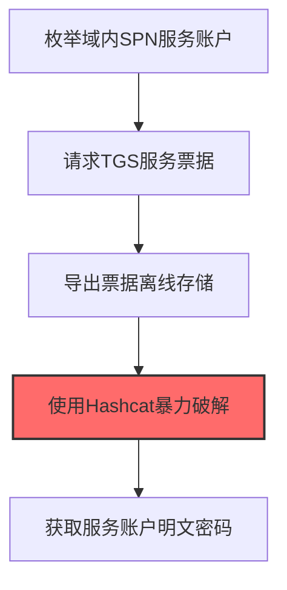
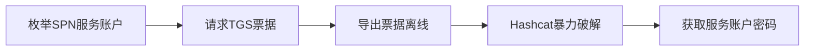

# Kerberoasting (T1558.003)

## 一句话通俗理解

> **Kerberoasting就是申请服务票据离线破解服务账户密码。**

## 30秒速查卡

| 维度 | 你需要知道的 |
|------|-------------|
| 这是什么？ | 申请服务票据并离线破解服务账户的密码哈希 |
| 为什么危险？ | 任何域用户都能申请服务票据，而服务账户密码很少更改，离线破解成功率很高 |
| 谁需要关心？ | 域管理员、Active Directory安全工程师、SOC分析师 |
| 你的第一步防御 | 使用强密码策略保护服务账户，启用组托管服务账户（gMSA） |
| 如果只做一件事 | 监控Windows事件ID 4769，关注短时间内大量服务票据请求（RC4加密类型） |

## 难度等级

⭐⭐⭐ 高级 - 需要一定的技术基础和实践经验

## 前置知识检查

**读这个文件需要什么？**

- [ ] Windows认证体系（NTLM/Kerberos/LSASS）
- [ ] 哈希基础（NTLM Hash/SHA）
- [ ] 网络认证协议（SMB/LDAP/Kerberos）

## 技术描述

**通俗解释：**

**过渡段：** 不要误解凭证访问只是'窃取密码'——在现代企业中，凭证存在于内存、磁盘、网络流量和云API等多个位置。攻击者关注的不是密码本身，而是'能用它做什么'：一个服务账号的哈希就能横向移动到数十台服务器，OAuth令牌可以访问整个SaaS租户的数据。
申请服务票据离线破解服务账户密码

> 🎣 **打个比方**：就像在鱼塘里撒网，钓到一条算一条——Kerberoasting攻击请求服务票据并离线破解，试图获取服务账号密码。

**技术原理：**
T1558.003 是 窃取或伪造Kerberos票据（T1558）的子技术，专注于Kerberoasting这一特定方面。攻击者在凭证访问阶段，通过Kerberoasting来获取目标系统或组织的相关信息，为后续攻击步骤做准备。

**用途与影响：**
- 为后续攻击提供关键信息支撑
- 提高攻击的成功率和精准度
- 降低攻击被发现的概率

## 真实攻击流程



**步骤详解：**

1. **枚举域内SPN服务账户** - 使用LDAP查询或GetUserSPNs.py枚举所有注册了SPN（Service Principal Name）的服务账户
2. **请求TGS服务票据** - 以任意域用户身份向KDC请求目标服务账户的TGS票据，无需知道服务账户密码
3. **导出票据离线存储** - 使用Mimikatz的kerberos::list/export或Invoke-Kerberoast导出TGS票据为hashcat可破解格式
4. **使用Hashcat暴力破解** - 使用Hashcat模式13100（RC4）对TGS票据中的加密部分进行离线暴力破解
5. **获取服务账户明文密码** - 破解成功后获得服务账户的NTLM哈希或明文密码，可用于访问对应服务

## 攻击流程

```
枚举SPN服务账户 --> 请求TGS票据 --> 导出票据离线 --> Hashcat暴力破解 --> 获取服务账户密码
```



**步骤详解：**
1. **枚举SPN服务账户**
   - 通俗描述：查询Active Directory中所有注册了SPN的服务账户
   - 技术细节：通过LDAP查询`servicePrincipalName`属性；重点关注用户账户(非计算机账户)，因其密码通常较弱且长期不变
   - 常用工具：Impacket GetUserSPNs.py、PowerView Get-NetUser、Rubeus
2. **请求TGS票据**
   - 通俗描述：以普通域用户身份向KDC请求目标服务的TGS，无需知道服务账户密码
   - 技术细节：Kerberos协议允许任何域用户请求任何SPN的TGS；KDC用服务账户哈希加密TGS的PAC部分
   - 常用工具：Rubeus kerberoast、Mimikatz kerberos::ask、.NET KerberosRequestorSecurityToken
3. **导出票据离线**
   - 通俗描述：将TGS从内存导出为可破解的格式
   - 技术细节：TGS的enc-part用服务账户NTLM哈希加密，提取该部分转Hashcat格式(mode 13100 RC4 / 19700 AES)
   - 常用工具：Mimikatz kerberos::list /export、Invoke-Kerberoast、Rubeus
4. **Hashcat暴力破解**
   - 通俗描述：离线暴力破解TGS的加密部分还原服务账户密码
   - 技术细节：RC4-HMAC模式(mode 13100)破解速度快；AES-256模式更慢；使用rockyou.txt等字典+规则组合
   - 常用工具：Hashcat、John the Ripper、字典rockyou.txt
5. **获取服务账户密码**
   - 通俗描述：破解成功获得明文密码或哈希，用于访问对应服务
   - 技术细节：服务账户通常高权限(如SQL Server服务账户)；获取密码后可伪造Silver Ticket或直接登录服务
   - 常用工具：Mimikatz kerberos::golden、Impacket psexec.py、CrackMapExec

## 真实案例

### 案例1：FIN6零售业大规模Kerberoasting攻击

- **时间**: 2018-2020年
- **目标**: 北美和欧洲大型零售商、酒店、餐饮连锁店
- **攻击组织**: FIN6
- **手法**: 攻击者使用Invoke-Kerberoast脚本批量请求域内所有SPN关联的服务账户TGS票据，导出为Hashcat可破解格式，离线使用Hashcat模式13100在GPU集群上24小时内破解出MSSQLsvc和IIS服务账户弱密码，进而横向到POS管理服务器
- **影响**: 通过破解的服务账户密码成功入侵超过100家零售商的支付系统，窃取超过2000万张信用卡数据
- **参考链接**: [CrowdStrike FIN6分析报告](https://www.crowdstrike.com/blog/big-game-hunting-the-evolution-of-industrious-alligator/)

### 案例2：APT29 SolarWinds攻击中的Kerberoasting

- **时间**: 2020-2021年
- **目标**: 美国多个联邦机构和私营企业
- **攻击组织**: APT29（Nobelium/Cozy Bear）
- **手法**: 攻击者通过SolarWinds后门进入目标网络后，使用Rubeus的`kerberoast`命令静默请求目标域中所有高权限服务账户的TGS票据，通过Azure AD Connect同步通道将票据哈希外传到俄罗斯C2服务器，离线用Hashcat破解出Exchange和ADFS服务账户密码
- **影响**: 利用破解的服务账户密码横向到邮件服务器和身份提供商，为后续Golden SAML攻击奠定基础
- **参考链接**: [Microsoft SolarWinds 深度分析](https://www.microsoft.com/en-us/security/blog/2021/01/20/deep-dive-into-the-solorigate-second-stage-attack-from-nobelium/)

### 案例3：Turla组织针对欧洲政府机构Kerberoasting（2017-2020）

- **时间**: 2017-2020年
- **目标**: 欧洲多国外交部和政府机构的Active Directory环境
- **攻击组织**: Turla（又称Snake、Waterbug，俄罗斯FSB背景）
- **手法**: Turla在入侵目标外交机构网络后，使用PowerShell版的Invoke-Kerberoast脚本静默请求域内所有SPN关联服务账户的TGS票据，重点针对Microsoft Exchange和SQL Server服务账户。提取的RC4-HMAC加密票据被外传至C2服务器后，使用定制版hashcat配合GPU集群离线破解，破解出的服务账户密码被用于横向移动至邮件服务器和内部文档管理系统
- **影响**: 长期潜伏窃取多国外交通信内容，据ESET报告Turla利用此手法维持对至少3个欧洲政府机构网络超过2年的持续访问
- **参考链接**: [ESET Turla报告](https://www.welivesecurity.com/2020/12/10/turla-powershell-usage/)

## 红队视角

> ⚠️ **免责声明**：以下内容仅用于合法的安全测试、渗透测试和教育目的。未经授权对他人系统进行测试是违法行为。

### 实战技巧

1. **隐蔽优先**：在凭证访问阶段使用被动方式收集信息，避免触发安全告警
2. **信息验证**：对收集到的信息进行交叉验证，确保准确性和时效性
3. **工具选择**：根据目标环境选择合适的工具，避免使用已被广泛检测的工具
4. **OPSEC意识**：使用匿名网络、临时环境进行操作，防止溯源

### 常用工具

| 工具名称 | 用途 | 平台 | 链接 |
| -------- | ---- | ---- | ---- |
| Rubeus | C#实现的`kerberoast`命令批量请求TGS票据 | Windows | [Rubeus](https://github.com/GhostPack/Rubeus) |
| Invoke-Kerberoast | PowerShell脚本，导出Hashcat兼容格式 | Windows | [Empire](https://github.com/EmpireProject/Empire) |
| Impacket GetUserSPNs.py | Python实现，跨平台Kerberoasting | Linux/Python | [Impacket](https://github.com/fortra/impacket) |
| kekeo | `kerberos::ask /target:`请求TGS并导出 | Windows | [kekeo](https://github.com/gentilkiwi/kekeo) |

### 注意事项

- 仅在授权范围内使用Kerberoasting技术
- 注意操作的隐蔽性，避免被蓝队发现
- 记录操作日志，用于后续分析和报告编写

## 蓝队视角

### 检测要点

1. **异常信息收集行为**：监控来自内部系统的异常数据查询和收集行为
2. **可疑工具使用**：检测与Kerberoasting相关的工具在内部网络中的使用
3. **异常网络流量**：监控对外部信息收集平台的可疑网络连接
4. **权限异常**：关注非授权用户的信息收集和查询行为

### 监控建议

- 部署信息收集行为的检测规则
- 建立基准行为模型，及时发现异常
- 定期审计敏感信息的访问记录

## 避坑指南

组织中最危险盲区：认为强密码就足够安全。

## 检测建议

### 网络层检测

**检测方法：** 监控与Kerberoasting相关的网络流量特征

**具体规则/命令示例：**

```bash
# 监控异常DNS查询
tcpdump -i eth0 port 53 | grep -E "可疑域名"
```

### 主机层检测

**Windows事件ID：**

- 事件ID 4688：可疑进程创建
- 事件ID 4104：PowerShell脚本块日志

**Linux日志：**

- 日志文件：`/var/log/syslog`
- 关键字段：可疑命令执行

**用人话说：** 这条规则在监控是否有用户在短时间内请求大量服务票据。Kerberoasting是攻击者用普通域用户身份申请服务账户的票据，然后离线破解密码。正常情况下用户只会申请自己需要的服务票据。如果发现有用户在短时间内请求了大量不同服务的票据，而且使用RC4加密，那就是攻击者在进行Kerberoasting。

### 应用层检测

**Sigma规则示例：**

```yaml
title: Suspicious Kerberoasting Activity
status: experimental
description: Detects potential Kerberoasting behavior
logsource:
  category: process_creation
  product: windows
detection:
  selection:
    Image|endswith: '\\可疑工具.exe'
  condition: selection
level: medium
tags:
  - attack.T1558/003
```

## 缓解措施

### 优先级1：关键措施

**措施名称：** 敏感信息保护

**具体实施步骤：**

1. 识别和分类组织内的敏感信息
2. 对敏感信息实施访问控制和加密
3. 部署信息泄露防护（DLP）解决方案

### 优先级2：重要措施

**措施名称：** 员工安全意识培训

**具体实施步骤：**

1. 定期开展信息安全意识培训
2. 教育员工识别社交工程攻击
3. 建立信息报告和响应机制

### 优先级3：建议措施

**措施名称：** 安全配置加固

**具体实施步骤：**

1. 限制公开可访问的系统信息
2. 配置合适的日志记录和告警策略
3. 定期进行安全评估和渗透测试

## 动手实验

> ⚠️ **重要提示**：所有实验必须在隔离的实验室环境中进行，禁止对未授权的真实系统进行测试。

### 实验环境准备

**推荐靶场/实验平台：**

| 平台名称 | 类型 | 难度 | 链接 |
|---------|------|:----:|------|
| 本地虚拟机 | 虚拟环境 | 初级 | 本机搭建 |
| TryHackMe | 在线靶场 | 初级 | https://tryhackme.com |

**所需工具：**

- 根据具体技术需求准备相应工具

**环境搭建：**

```bash
# 准备隔离的实验环境
# 具体命令根据实验内容而定
```

### 实验1：基础实践（初级）

**实验目标：** 理解和练习Kerberoasting的基本操作

**实验步骤：**

1. 在隔离环境中搭建实验系统
2. 按照技术描述执行基本操作
3. 观察和记录实验现象

**预期结果：** 成功完成Kerberoasting的基本操作

**学习要点：** 理解Kerberoasting的原理和操作方法

## 术语解释

| 术语 | 英文原名 | 通俗解释 |
|-----|---------|---------|
| Kerberoasting | Kerberoasting | Kerberoasting的基本概念和操作方法 |
| 侦察 | Reconnaissance | 收集目标信息的过程，为后续攻击做准备 |
| OPSEC | Operational Security | 操作安全，保护行动信息不被对手发现 |

## 被引用情况

以下父技术文档引用了本子技术：

- [T1558 - 窃取或伪造Kerberos票据](../T1558-Steal-or-Forge-Kerberos-Tickets.md)

## 参考资料

### 📚 官方文档（深入了解）

- [MITRE ATT&CK - T1558](https://attack.mitre.org/techniques/T1558/)
- [MITRE ATT&CK - T1558.003](https://attack.mitre.org/techniques/T1558/003/)
- [MITRE ATT&CK - T1558.003 检测](https://attack.mitre.org/techniques/T1558/003/detections/)

### 📰 安全报告（真实攻击）

- [CISA Known Exploited Vulnerabilities](https://www.cisa.gov/known-exploited-vulnerabilities-catalog)
- [Microsoft Security Blog](https://www.microsoft.com/en-us/security/blog/)

### 学习资源

- [MITRE ATT&CK 官方文档](https://attack.mitre.org/)
- [ATT&CK STIX Data](https://github.com/mitre-attack/attack-stix-data)

