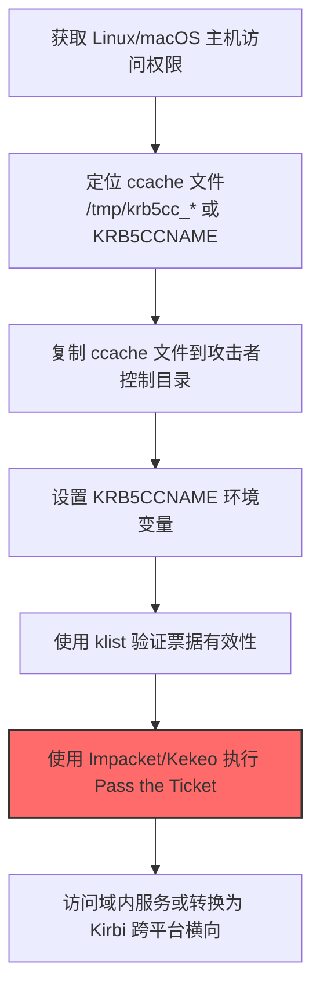
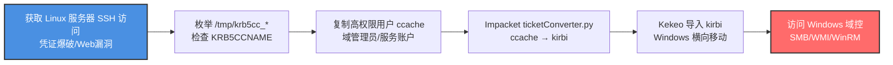

# Ccache文件 (T1558.005)

## 一句话通俗理解

> **在 Linux/macOS 上偷走用户的 Kerberos 票据缓存文件，无需密码就能冒充该用户访问域内服务**

## 30秒速查卡

| 维度 | 你需要知道的 |
|------|-------------|
| 这是什么？ | 窃取 Linux/macOS 上存储 Kerberos 票据的 ccache 文件，用于 Pass the Ticket 攻击 |
| 为什么危险？ | 拿到 ccache 就等于拿到了用户的"域通行证"，无需破解密码即可冒充该用户访问任何 Kerberos 服务 |
| 谁需要关心？ | Linux/macOS 系统管理员、混合环境安全工程师、SOC 分析师 |
| 你的第一步防御 | 限制 /tmp 目录中 krb5cc_* 文件的访问权限，部署 auditd 监控异常读取 |
| 如果只做一件事 | 在所有 Linux 主机部署 auditd 规则监控对 /tmp/krb5cc_* 的非属主访问 |

## 难度等级

⭐⭐ 中级 - 需要理解 Kerberos 协议和 Linux/macOS 文件系统

## 前置知识检查

**读这个文件需要什么？**

- [ ] Kerberos 认证协议基础（TGT/TGS/KDC）
- [ ] Linux 文件系统与权限模型（/tmp、文件属主）
- [ ] 环境变量在 Unix 系统中的作用（KRB5CCNAME）
- [ ] macOS Kerberos framework 与内存票据缓存

## 技术描述

**Ccache 文件**（T1558.005）是 **窃取或伪造 Kerberos 票据**（T1558）的一个子技术，专指在 Linux 和 macOS 系统上窃取凭证缓存（Credential Cache，简称 ccache）文件中存储的 Kerberos 票据。该技术于 2024 年 9 月 17 日在 ATT&CK v19.1 中首次引入。

> 🔓 **打个比方**：ccache 文件就像 Linux 用户登录后放在 /tmp 抽屉里的"通行证副本"——任何能打开这个抽屉的人都能拿着副本进入公司任何房间，不需要知道原始密码。

### 具体怎么理解？

在 Linux 系统上，用户使用 `kinit` 命令向 KDC 申请 TGT（票据授权票据）后，票据会被存储到本地 ccache 文件中，避免每次访问服务都重新输入密码。默认存储位置为 `/tmp/krb5cc_%UID%`（如 `/tmp/krb5cc_1000`），文件属主为该用户。部分系统使用 `krb5.ccache` 命名。存储位置由 `/etc/krb5.conf` 配置文件和 `KRB5CCNAME` 环境变量控制。

在 macOS 上，ccache 默认存储在内存中，使用 `API:{uuid}` 命名方案（如 `API:7E2A1B3C-...`），通过 Kerberos framework API 访问。攻击者可使用开源工具（如 Bifrost）或调用底层 API 提取 TGT 和服务票据。

攻击者窃取 ccache 文件后，可以执行 **Pass the Ticket**（T1550.003）攻击——通过设置 `KRB5CCNAME` 环境变量指向窃取的 ccache 文件，即可在不持有密码的情况下以原用户身份访问域内任何 Kerberos 服务。攻击者还可使用 **Kekeo** 等工具将 ccache 文件转换为 Windows Kirbi 格式，实现跨平台横向移动（从 Linux/macOS 跳转到 Windows 系统）。

### 为什么有效？

1. **无需破解密码**：与 Kerberoasting/AS-REP Roasting 不同，窃取 ccache 不需要离线破解，票据立即可用
2. **隐蔽性高**：读取 /tmp 文件是常见操作，传统 EDR 难以区分合法与恶意访问
3. **跨平台跳板**：Linux 服务器常作为混合环境中的关键节点（如 Samba AD 集成、SSH 跳板），票据可被转换为 Windows 格式继续横向
4. **票据生命周期长**：TGT 默认有效期 10 小时（可续期至 7 天），给攻击者充足的窗口期

**与父技术 T1558 的关系**：T1558 涵盖所有 Kerberos 票据窃取/伪造技术，T1558.001-004 主要面向 Windows 环境（金票/银票/Kerberoasting/AS-REP Roasting 通常使用 Rubeus/mimikatz 操作），而 T1558.005 是 ATT&CK v19.1 中首次为 Linux/macOS 平台单独定义的子技术。

## 真实攻击流程

### 典型场景

攻击者在 **凭证访问** 阶段使用 ccache 窃取技术，典型步骤如下：



**步骤详解：**

1. **获取 Linux/macOS 主机访问权限** - 攻击者通过 SSH 暴力破解、Web 漏洞利用或钓鱼获取 Linux 服务器的初始 foothold
2. **定位 ccache 文件** - 枚举 `/tmp/krb5cc_*` 文件，检查 `/etc/krb5.conf` 配置和 `KRB5CCNAME` 环境变量确定自定义路径
3. **复制 ccache 文件** - 使用 `cp` 命令复制目标用户的 ccache 文件到攻击者可写目录，或直接读取文件内容
4. **设置 KRB5CCNAME 环境变量** - `export KRB5CCNAME=/tmp/stolen_ccache` 让 Kerberos 客户端使用窃取的票据
5. **使用 klist 验证票据** - `klist` 命令查看票据剩余有效期和可访问的服务
6. **执行 Pass the Ticket** - 使用 `Impacket` 的 `getST.py`/`ticketer.py`、`psexec.py` 等工具以原用户身份访问域内服务
7. **跨平台横向移动** - 使用 Kekeo 将 ccache 转换为 Kirbi 格式，导入 Windows 系统继续横向

## 攻击流程



**关键步骤说明：**

1. **获取 Linux 服务器 SSH 访问** - 攻击者通过 SSH 凭证爆破（Hydra）、Web 应用漏洞（如 Log4Shell CVE-2021-44228）或钓鱼获得 Linux 服务器的初始访问权限，APT29 在 SolarWinds 后续活动中即通过此方式进入目标混合环境的 Linux 节点
2. **枚举 ccache 文件** - 使用 `ls -la /tmp/krb5cc_*` 列出所有用户的票据缓存文件，重点关注属主为 root、域管理员或服务账户的文件，同时检查 `env | grep KRB5CCNAME` 确认是否有自定义存储路径
3. **复制高权限用户 ccache** - 选择有效期内的 TGT 票据（通过 `klist` 验证），使用 `cp /tmp/krb5cc_0 /tmp/.stolen_ccache` 复制 root 用户的票据缓存
4. **Impacket ticketConverter.py 转换格式** - 使用 `impacket-ticketConverter.py /tmp/.stolen_ccache stolen.kirbi` 将 Linux ccache 转换为 Windows Kirbi 格式，为跨平台横向做准备
5. **Kekeo 导入 kirbi 横向移动** - 在 Windows 攻击机上使用 `kekeo # kerberos::ptt stolen.kirbi` 导入票据，随后使用 `psexec.py`/`wmiexec.py` 等工具以域管理员身份访问 Windows 域控制器，完成从 Linux 到 Windows 的横向移动

## 真实案例

### 案例1：APT29 SolarWinds 后续活动针对 Linux 基础设施的 ccache 票据窃取（2021-2024）

- **时间**: 2021-2024 年
- **目标**: 欧洲政府机构和跨国企业的混合 IT 基础设施（Linux 邮件服务器 + Windows 域控）
- **攻击组织**: APT29（Nobelium / Cozy Bear）
- **手法**: APT29 在 SolarWinds 供应链攻击被公开披露后，将活动重心扩展到目标的 Linux 基础设施。攻击者通过 SSH 凭证复用进入 Linux 邮件中继服务器，枚举 `/tmp/krb5cc_*` 文件定位域管理员的 TGT 票据缓存。使用 Impacket 的 `ticketConverter.py` 将 ccache 转换为 Kirbi 格式后导入 Windows 攻击机，再通过 `wmiexec.py` 以域管理员身份访问 Windows 域控制器，绕过了 Windows 端的所有 EDR 检测
- **影响**: 多个欧洲政府机构的混合域环境被完全攻陷，攻击者在不触发 Windows 端告警的情况下横向到域控，窃取了内部通信和外交文件
- **参考链接**: [Mandiant - APT29 持续活动报告](https://www.mandiant.com/resources/blog/golden-saml-and-golden-certificates) | [CISA AA21-148A SolarWinds Advisory](https://www.cisa.gov/news-events/cybersecurity-advisories/aa21-148a)

### 案例2：MuddyWater 针对中东电信运营商的 Linux 服务器 Kerberos 票据窃取（2022-2023）

- **时间**: 2022-2023 年
- **目标**: 中东多个国家电信运营商和政府机构的 Linux 邮件与应用服务器
- **攻击组织**: MuddyWater（Mercury / Seedworm）
- **手法**: MuddyWater 通过 PowerShell Empire 的 Phineas 后门获得 Linux 服务器初始访问后，使用 Cisco CX Security 开源的 **linikatz** 工具一键提取 `/tmp/krb5cc_*` 文件、SSH 密钥和 SSSD 凭证。提取的 ccache 文件被传递给 Impacket 的 `getST.py` 工具，以原用户身份请求域内其他服务的 TGS 票据，实现从 Linux 服务器到 Windows Exchange 邮件系统的横向移动
- **影响**: 多个中东电信运营商的内部邮件通信被长期窃听，攻击者获取了政府客户的通信记录
- **参考链接**: [Palo Alto Unit42 - MuddyWater 报告](https://unit42.paloaltonetworks.com/muddywater/) | [CiscoCXSecurity linikatz](https://github.com/CiscoCXSecurity/linikatz)

### 案例3：Wizard Spider (Conti) 勒索软件在混合环境中的 ccache 票据滥用（2021）

- **时间**: 2021 年
- **目标**: 全球医疗、制造、政府等关键基础设施组织（爱尔兰 HSE、哥斯达黎加政府等）
- **攻击组织**: Wizard Spider（Conti 勒索软件运营方，俄罗斯背景）
- **手法**: 根据泄露的 Conti 内部操作手册，该团伙在被入侵的 Linux Samba AD 集成服务器上使用 `linikatz` 工具批量提取所有用户的 ccache 文件。提取的 TGT 票据通过 `impacket-ticketConverter.py` 转换为 Kirbi 格式，导入 Windows 攻击机后使用 Kekeo 进行 Pass the Ticket，绕过 Windows 域控的多因素认证要求。攻击者特别关注 root 和域管理员的 ccache 文件，因为这些票据可以访问混合环境中的所有关键资源
- **影响**: 至少 1000+ 组织遭受勒索攻击，爱尔兰 HSE 医疗系统瘫痪数周；Conti 通过 ccache 滥用显著缩短了从 Linux 边界到 Windows 域控的横向时间
- **参考链接**: [CISA Advisory AA21-265A Conti Ransomware](https://www.cisa.gov/news-events/cybersecurity-advisories/aa21-265a) | [Talos Conti Leaked Manual Translation](https://blog.talosintelligence.com/conti-leak-translation/)

## 红队视角

> ⚠️ **免责声明**：以下内容仅用于合法的安全测试、渗透测试和教育目的。未经授权对他人系统进行测试是违法行为。

### 实战技巧

1. **优先枚举 root 和服务账户 ccache**：`ls -la /tmp/krb5cc_*` 关注 UID 为 0 或服务账户的票据
2. **检查自定义路径**：`cat /etc/krb5.conf` 和 `env | grep KRB5` 排查非默认存储位置
3. **macOS 上使用 Bifrost**：通过 Kerberos framework API 提取内存中的 `API:{uuid}` 票据
4. **格式转换跨平台**：使用 `ticketConverter.py` 在 ccache 和 Kirbi 之间双向转换
5. **OPSEC 注意**：复制 ccache 而非移动，避免触发原用户的票据失效告警

### 常用工具

| 工具名称 | 用途 | 平台 | 链接 |
| -------- | ---- | ---- | ---- |
| Impacket ticketConverter.py | ccache ↔ Kirbi 格式转换 | 跨平台 | [Impacket](https://github.com/fortra/impacket) |
| Impacket getST.py | 使用 ccache 请求服务票据 | 跨平台 | [Impacket](https://github.com/fortra/impacket) |
| linikatz | Linux 一键凭证提取（ccache/SSH/SSSD） | Linux | [linikatz](https://github.com/CiscoCXSecurity/linikatz) |
| Kekeo | Windows 端票据注入和转换 | Windows | [Kekeo](https://github.com/gentilkiwi/kekeo) |
| Bifrost | macOS Kerberos framework 交互工具 | macOS | [Bifrost](https://github.comitsSecrets/Bifrost) |
| klist | 系统自带工具，查看 ccache 票据 | Linux/macOS | 系统自带 |

### 注意事项

- 在授权的测试环境中使用这些技术
- 复制 ccache 时使用 `cp --preserve=timestamps` 避免时间戳异常
- 注意 ccache 票据有效期（默认 10 小时），过期后需要重新窃取
- macOS 上的内存票据缓存需要进程级访问权限

## 蓝队视角

### 检测要点

1. **auditd 文件访问监控**：审计对 `/tmp/krb5cc_*` 文件的非属主读取/复制操作
2. **环境变量变更**：监控 `KRB5CCNAME` 环境变量的设置，特别是指向非标准路径的情况
3. **异常进程票据操作**：检测非 `kinit`/`klist` 进程访问 ccache 文件
4. **跨平台票据格式转换**：监控 `ticketConverter.py`、`kekeo` 等工具的执行
5. **macOS Kerberos API 调用**：监控非系统进程调用 Kerberos framework API

### 监控建议

- 部署 auditd 规则监控对 `/tmp/krb5cc_*` 和 `/tmp/krb5.ccache` 的 open/read 操作
- 配置 SIEM 关联 ccache 访问与后续 Kerberos 认证异常（来自同一源 IP 的大量 TGS 请求）
- 在 macOS 上部署 EDR 监控调用 `KerberosRetrieveTicket` 等 API 的进程
- 定期审计 `/etc/krb5.conf` 配置变更，发现非默认存储路径

## 避坑指南

组织中最危险的盲区：**只关注 Windows 域控告警，忽视 Linux/macOS 端点**。

许多组织在 Windows 域控上部署了完整的 Kerberos 监控（事件 ID 4768/4769/4771），却忽略了 Linux 服务器上 ccache 文件的访问控制。攻击者发现这一盲区后，会主动从 Linux/macOS 端发起 Pass the Ticket，绕过 Windows 端的所有检测。同理，`/tmp` 目录的默认权限（1777）允许任何用户列举文件，使得发现目标 ccache 变得极其简单。

**关键反盲区措施**：
1. 在所有 Linux 主机部署 auditd 规则监控 ccache 访问
2. 限制 `/tmp` 目录的执行权限，使用 `nodev,nosuid,noexec` 挂载选项
3. 启用 SELinux 或 AppArmor 限制进程对 ccache 文件的访问

## 检测建议

### 检测思路

检测 T1558.005 的关键是识别对 ccache 文件的异常访问和非标准进程的票据操作。以下是三层检测方法：

### 网络层检测

**方法**：监控 Kerberos 协议流量中的异常模式

```bash
# 检测来自 Linux 服务器但使用其他用户票据的 TGS 请求
# 异常特征：源 IP 为 Linux 服务器，但 CNameString 与该服务器注册账户不匹配
tshark -r capture.pcap -Y "kerberos.msg_type == 13" -T fields \
  -e ip.src -e kerberos.CNameString -e kerberos.SName \
  | sort | uniq -c | sort -rn | head -20

# 检测票据格式转换工具的网络行为（Impacket 通常产生异常 SMB/LDAP 流量）
tshark -r capture.pcap -Y "smb2.cmd == 0x01 && ip.src == <linux_server_ip>" \
  -T fields -e ip.src -e smb2.filename
```

### 主机层检测

**Linux auditd 规则**：

```bash
# /etc/audit/rules.d/audit.rules
# 监控 ccache 文件访问
-w /tmp/ -p r -k krb5cc_access -f 2
# 监控 KRB5CCNAME 环境变量修改（通过 PAM 配置）
-w /etc/pam.d/ -p wa -k pam_config_change
# 监控 linikatz 等凭证提取工具的执行
-w /usr/local/bin/linikatz -p x -k linikatz_exec
```

**日志查询命令**：

```bash
# 检查 ccache 文件被非属主访问的记录
ausearch -k krb5cc_access | aureport -f -i | \
  awk '$3 != $NF {print}' | grep krb5cc

# 检查 KRB5CCNAME 环境变量设置
grep -E "KRB5CCNAME\s*=" /var/log/audit/audit.log
```

**macOS 端点检测**：

```bash
# 使用 log 命令查询 Kerberos framework 调用
log show --predicate 'process != "kinit" AND process != "klist" AND \
  eventMessage CONTAINS "KerberosRetrieveTicket"' --last 24h
```

### 应用层检测

**Sigma 规则示例**：

```yaml
title: 检测 Linux Ccache 文件非授权访问
id: 7e2a1b3c-4d5e-6789-abcd-ef0123456789
status: experimental
description: 检测对 Kerberos ccache 文件的异常读取，可能是 T1558.005 Pass the Ticket 攻击
references:
    - https://attack.mitre.org/techniques/T1558/005/
    - https://adepts.of0x.cc/kerberos-thievery-linux/
logsource:
    product: linux
    service: auditd
detection:
    selection_ccache_access:
        type: PATH
        name|contains:
            - '/tmp/krb5cc_'
            - 'krb5.ccache'
    filter_legitimate_processes:
        exe:
            - '/usr/bin/kinit'
            - '/usr/bin/klist'
            - '/usr/sbin/sssd'
            - '/usr/lib/systemd/systemd'
    condition: selection_ccache_access and not filter_legitimate_processes
falsepositives:
    - 合法的 Kerberos 客户端工具更新
    - 系统管理员手动检查票据
level: medium
tags:
    - attack.credential_access
    - attack.t1558.005
```

## 缓解措施

### 优先级1：关键措施

**措施名称**：加固 ccache 文件访问控制

**具体实施步骤**：
1. 配置 auditd 规则监控所有 ccache 文件的访问（见检测建议章节）
2. 限制 `/tmp` 目录权限，使用 `nodev,nosuid,noexec` 挂载选项
3. 启用 SELinux 或 AppArmor 强制访问控制，限制非 Kerberos 服务访问 ccache

**配置示例**：

```bash
# /etc/fstab 加固 /tmp 挂载选项
tmpfs /tmp tmpfs defaults,nodev,nosuid,noexec 0 0

# 启用 SELinux 保护 ccache
setsebool -P daemons_use_tcp_wrapper 1
```

### 优先级2：重要措施

**措施名称**：缩短票据有效期和监控异常使用

**具体实施步骤**：
1. 在 `/etc/krb5.conf` 中缩短 TGT 有效期（默认 10 小时 → 4 小时）
2. 启用 Kerberos 票据续期审计，监控异常续期行为
3. 部署 EDR 监控非标准进程的票据操作

**配置示例**：

```ini
# /etc/krb5.conf 缩短票据有效期
[libdefaults]
    ticket_lifetime = 4h
    renew_lifetime = 24h
    forwardable = false
```

### 优先级3：建议措施

**措施名称**：定期审计和凭证轮换

**具体实施步骤**：
1. 定期审计 `/etc/krb5.conf` 配置变更，发现非默认存储路径
2. 对 Linux/macOS 系统管理员进行 Kerberos 安全培训
3. 在混合环境部署 Microsoft Defender for Identity 监控跨平台 Kerberos 异常

### MITRE ATT&CK 缓解措施映射

| 缓解措施ID | 缓解措施名称 | 适用性 | 说明 |
|------------|-------------|--------|------|
| M1047 | Audit | 适用 | 使用 auditd 审计 ccache 文件访问、`/tmp` 操作和机器票据 |
| M1043 | Credential Access Protection | 适用 | 使用 SELinux 定义入口点、进程类型和文件标签保护 ccache |

## 动手实验

> ⚠️ **所有实验必须在隔离的实验室环境中进行**

### 实验1：理解 ccache 文件结构（初级）

**目标**：理解 Linux Kerberos ccache 文件的位置和内容

**步骤**：
1. 在 Linux 虚拟机中安装 Kerberos 客户端：`sudo apt install krb5-user`
2. 使用 `kinit username@DOMAIN.COM` 获取 TGT
3. 运行 `klist` 查看当前票据缓存
4. 检查 `/tmp/krb5cc_$UID` 文件：`ls -la /tmp/krb5cc_* && file /tmp/krb5cc_*`
5. 使用 `kdestroy` 销毁票据，观察文件消失

**学习要点**：理解 ccache 文件的位置、命名规则和生命周期

### 实验2：模拟 ccache 窃取与 Pass the Ticket（中级）

**目标**：在隔离环境中模拟攻击者窃取 ccache 并执行 Pass the Ticket

**步骤**：
1. 在 Linux 主机 A 上以 user1 身份执行 `kinit` 获取 TGT
2. 切换到 user2 身份，复制 user1 的 ccache：`cp /tmp/krb5cc_1000 /tmp/.stolen`
3. 设置环境变量：`export KRB5CCNAME=/tmp/.stolen`
4. 使用 `klist` 验证 user2 现在持有 user1 的票据
5. 使用 Impacket `smbexec.py` 访问 Windows 域内共享

**学习要点**：掌握 Pass the Ticket 攻击的完整流程和检测点

### 实验3：跨平台票据转换（高级）

**目标**：掌握 ccache 与 Kirbi 格式转换，理解跨平台横向移动

**步骤**：
1. 在 Linux 上使用 `kinit` 获取 TGT
2. 使用 `impacket-ticketConverter.py /tmp/krb5cc_1000 stolen.kirbi` 转换为 Kirbi
3. 在 Windows 攻击机上使用 `kekeo # kerberos::ptt stolen.kirbi` 导入票据
4. 使用 `dir \\DC01\C$` 验证以域用户身份访问域控
5. 部署 auditd 规则并复现攻击，验证检测告警

**学习要点**：理解跨平台 Kerberos 攻击的检测盲区和应对策略

## 术语解释

| 术语 | 通俗解释 |
|------|---------|
| **Ccache** | 凭证缓存文件，Linux/macOS 上存储 Kerberos 票据的临时文件，相当于 Windows 的 LSASS 票据存储 |
| **KRB5CCNAME** | 环境变量，指定 ccache 文件位置，攻击者可修改此变量指向窃取的票据 |
| **TGT** | 票据授权票据，KDC 签发的"通票"，用于换取具体服务的 TGS 票据 |
| **Kirbi** | Windows 平台的 Kerberos 票据格式（mimikatz/Kekeo 使用），可通过工具与 ccache 互转 |
| **Pass the Ticket** | 票据传递攻击，使用窃取的票据冒充原用户访问服务，无需知道密码 |
| **linikatz** | Cisco CX Security 开发的 Linux 凭证提取工具，类比 Windows 的 mimikatz |
| **Bifrost** | macOS 上的 Kerberos framework 交互工具，可提取内存中的票据 |
| **SELinux** | Security-Enhanced Linux，Linux 内核的强制访问控制模块，可限制 ccache 访问 |

## 被引用情况

以下父技术文档引用了本子技术：

- [T1558 - 窃取或伪造Kerberos票据](../T1558-Steal-or-Forge-Kerberos-Tickets.md)

## 参考资料

### 📚 官方文档（深入了解）

- [MITRE ATT&CK - Ccache Files (T1558.005)](https://attack.mitre.org/techniques/T1558/005/)
- [MITRE ATT&CK - 窃取或伪造Kerberos票据 (T1558)](https://attack.mitre.org/techniques/T1558/)
- [MITRE ATT&CK Detection Strategy DET0024 - Kerberos Ccache File Theft](https://attack.mitre.org/detectionstrategies/DET0024/)

### 📰 安全报告（真实攻击）

- [Adepts of 0xCC - Kerberos Credential Thievery Compendium (GNU/Linux)](https://adepts.of0x.cc/kerberos-thievery-linux/) - Linux Kerberos 票据窃取综合指南
- [Binary Defense - Shining a Light in the Dark (APT Lurking in IT Shadows)](https://www.binarydefense.com/resources/blog/shining-a-light-in-the-dark-how-binary-defense-uncovered-an-apt-lurking-in-shadows-of-it/) - APT 在 Linux 环境中潜伏的真实案例
- [SpecterOps - When Kirbi Walks the Bifrost](https://posts.specterops.io/when-kirbi-walks-the-bifrost-4c727807744f) - macOS Kerberos 票据窃取深度分析
- [FireEye - Kerberos Tickets on Linux Red Teams](https://www.fireeye.com/blog/threat-research/2020/04/kerberos-tickets-on-linux-red-teams.html) - 红队视角的 Linux Kerberos 攻击
- [Tim Wadhwa-Brown - Where 2 Worlds Collide: Bringing Mimikatz to UNIX](https://labs.portcullis.co.uk/download/eu-18-Wadhwa-Brown-Where-2-worlds-collide-Bringing-Mimikatz-et-al-to-UNIX.pdf) - linikatz 工具原理与防御

### 🔧 工具与资源（动手试试）

- [Impacket - 网络协议工具集（含 ticketConverter.py）](https://github.com/fortra/impacket)
- [Kekeo - Windows 端 Kerberos 票据操作工具](https://github.com/gentilkiwi/kekeo)
- [linikatz - Linux 凭证提取工具](https://github.com/CiscoCXSecurity/linikatz)
- [Audit Rules - linikatz 配套审计规则](https://github.com/CiscoCXSecurity/linikatz/blob/master/blue/audit/audit.rules)
- [Abusing Kerberos From Linux - OnSecurity 博客](https://www.onsecurity.io/blog/abusing-kerberos-from-linux/)

### 📚 学习资料（深入了解）

- [MITRE ATT&CK 知识库资源中心](https://attack.mitre.org/resources/)
- [Microsoft - Kerberos 跨平台认证指南](https://learn.microsoft.com/en-us/windows-server/security/kerberos/kerberos-authentication-overview)
