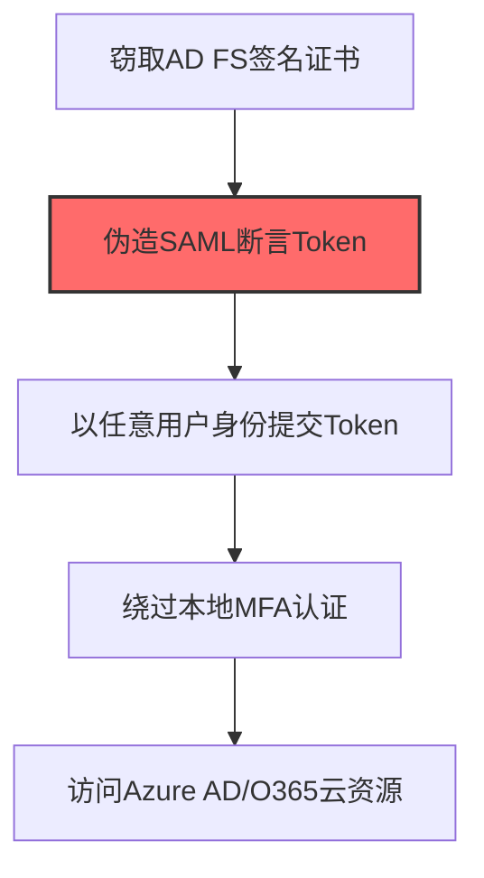
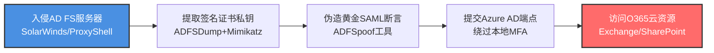

# SAML Tokens (T1606.001)

## 一句话通俗理解

> **伪造SAML单点登录断言，冒充任何用户访问企业应用**

## 30秒速查卡

| 维度 | 你需要知道的 |
|------|-------------|
| 这是什么？ | 伪造SAML单点登录断言，冒充任何用户访问企业应用 |
| 为什么危险？ | SAML令牌是企业SSO的'万能钥匙'，伪造它就能以任何用户身份访问所有企业应用 |
| 谁需要关心？ | 云安全工程师、身份安全工程师、SOC分析师 |
| 你的第一步防御 | 监控SAML令牌的异常签发和使用，实施证书轮换 |
| 如果只做一件事 | 监控AD FS等身份提供商的签名证书是否被导出或篡改 |

## 难度等级

⭐⭐⭐ 高级 - 需要深入的技术知识和实践

## 前置知识检查

**读这个文件需要什么？**

- [ ] Windows认证体系（NTLM/Kerberos/LSASS）
- [ ] 哈希基础（NTLM Hash/SHA）
- [ ] 网络认证协议（SMB/LDAP/Kerberos）

## 技术描述

**SAML令牌**（T1606.001）是 **伪造Web凭证**（T1606）的一个具体变体，属于 **凭证访问** 阶段的攻击技术。

> 🆔 **打个比方**：就像伪造了一张身份证去办理各种业务——攻击者伪造SAML令牌，冒充任何用户访问支持SAML认证的应用。

### 具体怎么理解？

伪造SAML单点登录断言，冒充任何用户访问企业应用

攻击者使用这种技术时，通常是在凭证访问阶段，想要达到特定的攻击目标。与父技术 T1606 相比，T1606.001 有自己独特的特点和使用场景。

### 为什么有效？

这种技术之所以有效，是因为：
1. **隐蔽性**：利用了正常系统功能或常见协议，不容易被发现
2. **技术门槛适中**：不需要特别高深的技术知识就能实施

**过渡段：** 不要误解凭证访问只是'窃取密码'——在现代企业中，凭证存在于内存、磁盘、网络流量等多个位置。
3. **广泛适用**：可以在多种环境和系统中使用

## 真实攻击流程

### 典型场景

攻击者在 **凭证访问** 阶段使用 SAML令牌 技术，以下是典型的攻击步骤：



 **步骤详解：**

1. **窃取AD FS签名证书** - 从AD FS服务器的证书存储中导出Token Signing Certificate私钥，或通过DCSync获取
2. **伪造SAML断言Token** - 使用窃取的签名证书构造包含任意用户身份和权限的SAML断言（黄金SAML）
3. **以任意用户身份提交Token** - 将伪造的SAML Token发送到Azure AD的联合认证端点进行验证
4. **绕过本地MFA认证** - 由于SAML Token来自受信任的AD FS，Azure AD认为已通过本地MFA验证
5. **访问Azure AD/O365云资源** - 获得任意用户的Azure AD访问令牌，可访问Exchange Online、SharePoint、Teams等

## 攻击流程



**关键步骤说明：**

1. **入侵AD FS服务器** - 攻击者通过SolarWinds Orion供应链后门或Exchange ProxyShell漏洞攻陷本地AD FS服务器获取管理员权限，APT29在Nobelium行动中即以此方式入侵美国财政部的AD FS基础设施，作为黄金SAML攻击的起点。
2. **提取签名证书私钥** - 使用ADFSDump从AD FS配置数据库导出EncryptedPFX证书blob，或用Mimikatz的`crypto::cert`命令从LSASS进程内存提取Token Signing Certificate私钥，必要时配合azuread_decrypt.exe离线解密Magic Hound案例中的EncryptedPFX blob。
3. **伪造黄金SAML断言** - 用窃取的签名证书运行ADFSpoof（Python工具）构造包含任意用户UPN（如美国司法部助理部长邮箱）和声明的SAML断言，签名后的Token与合法AD FS签发的从加密层面无法区分。
4. **提交Azure AD联合认证端点** - 将伪造的SAML Token发送到Azure AD的`/adfs/services/trust`联合认证端点，由于Token签名合法且来源为受信任的AD FS，Azure AD认为已通过本地MFA验证，直接签发云访问令牌绕过所有云端MFA挑战。
5. **访问O365云资源** - 获得任意用户的Azure AD访问令牌后直接登录Exchange Online读取邮件、SharePoint下载文件、Teams查看消息，APT29在SolarWinds攻击中以此手法维持云访问长达9个月，窃取了数千封国务院官员邮件。

## 真实案例

### 案例1：APT29 Nobelium SolarWinds 供应链攻击中的 Golden SAML

- **时间**: 2020-2021年
- **目标**: 美国财政部、国务院、商务部、能源部等9个联邦机构及100+企业
- **攻击组织**: APT29（Nobelium / Midnight Blizzard / Cozy Bear）
- **手法**: 通过SolarWinds Orion后门入侵本地AD FS服务器，用ADFSDump+Mimikatz crypto::cert提取Token Signing Certificate私钥，用ADFSpoof伪造任意用户（包括美国司法部助理部长）的SAML令牌绕过MFA访问O365邮箱和SharePoint
- **影响**: 攻击者维持云访问长达9个月，窃取了数千封国务院官员邮件，重置AD FS签名证书+Azure AD信任关系才彻底清除
- **参考链接**: [CISA Alert AA21-008A](https://www.cisa.gov/news-events/cybersecurity-advisories/aa21-008a)

### 案例2：Magic Hound 针对中东政府组织的 SAML 伪造

- **时间**: 2021-2022年
- **目标**: 中东政府组织和智库
- **攻击组织**: Magic Hound（APT35 / Charming Kitten / Phosphorus，伊朗背景）
- **手法**: 利用Exchange ProxyShell漏洞攻陷本地Exchange服务器，从AD FS服务器导出 EncryptedPFX blob，用azuread_decrypt.exe离线解密签名证书私钥，伪造外交官SAML令牌访问O365和第三方SaaS应用
- **影响**: 长期窃取外交邮件和智库研究报告，绕过所有本地MFA防护
- **参考链接**: [Microsoft MSTIC 2021年报告](https://www.microsoft.com/en-us/security/blog/2021/05/28/new-sophisticated-email-based-attack-from-nobelium/)

### 案例3：Octo Tempest通过SIM卡劫持接管管理员账户后滥用SAML令牌实施跨云勒索（2023）

- **时间**: 2023年2月起
- **目标**: 北美和欧洲大型企业（含Microsoft、Cleo、Atlas等SaaS厂商客户），重点是拥有Okta/Microsoft Entra ID身份提供商的组织
- **攻击组织**: Octo Tempest（Scattered Spider/UNC3944，英语为母语的跨平台威胁组织，与BlackCat/ALPHV勒索软件即服务团伙协作）
- **手法**: Octo Tempest通过SIM卡交换劫持目标企业高管的移动电话号码，重置密码并接管Okta或Microsoft Entra ID管理员控制台，随后在身份提供商中创建伪造SAML断言或注册恶意企业应用，将SAML令牌授予攻击者控制的账户，从而以合法身份绕过MFA访问Salesforce、Microsoft 365、Google Workspace等SaaS应用，最终窃取数据并部署BlackCat勒索软件
- **影响**: 至少攻陷100+组织，包括多家财富500强企业，造成数亿美元损失；2023年10月Microsoft发布专项威胁报告披露其跨云滥用SAML/OAuth令牌的攻击链
- **参考链接**: [Microsoft Security Blog: Octo Tempest crosses boundaries to facilitate extortion, encryption, and destruction](https://www.microsoft.com/en-us/security/blog/2023/10/25/octo-tempest-crosses-boundaries-to-facilitate-extortion-encryption-and-destruction/) | [CISA Alert AA23-320A: Scattered Spider](https://www.cisa.gov/news-events/cybersecurity-advisories/aa23-320a)

## 红队视角

> ⚠️ **免责声明**：以下内容仅用于合法的安全测试、渗透测试和教育目的。未经授权对他人系统进行测试是违法行为。

### 实战技巧

1. **深入理解原理**：在实战应用前，充分理解SAML Tokens的技术原理和适用场景
2. **环境适配**：根据目标系统的操作系统版本、安全配置等因素调整攻击策略
3. **组合使用**：将该技术与其他技术组合使用，构建完整的攻击链
4. **隐蔽性考虑**：注意操作痕迹的清理，避免被安全设备检测

### 常用工具

| 工具名称 | 用途 | 平台 | 链接 |
| -------- | ---- | ---- | ---- |
| ADFSpoof | 用窃取的AD FS签名证书伪造SAML断言令牌 | Python/Linux | [ADFSpoof](https://github.com/fireeye/ADFSpoof) |
| ADFSDump | 从AD FS服务器导出签名证书和配置密钥 | Windows/.NET | [ADFSDump](https://github.com/fireeye/ADFSpoof) |
| Mimikatz cloud::saml | 从AD FS服务器的LSASS提取Token Signing证书私钥 | Windows | [Mimikatz](https://github.com/gentilkiwi/mimikatz) |
| azuread_decrypt | 离线解密AD FS配置数据库中的EncryptedPFX证书blob | Python | [AzureADDecryptTools](https://github.com/ahouston/azuread_decrypt) |

### 注意事项

- 在授权的测试环境中使用这些技术
- 注意操作安全（OPSEC），避免被检测系统发现
- 使用匿名化技术和代理隐藏真实身份

## 蓝队视角

### 检测要点

1. **系统日志监控**：关注与SAML Tokens相关的系统日志和审计记录
2. **异常行为检测**：监控系统中与该技术相关的异常进程、网络连接和文件操作
3. **工具特征识别**：识别攻击者可能使用的工具在系统中的运行特征

### 监控建议

- 部署端点检测和响应（EDR）系统，监控与SAML Tokens相关的异常行为
- 配置SIEM规则，关联分析来自多个来源的告警
- 定期进行安全评估和渗透测试，验证检测规则的有效性

## 避坑指南

组织中最危险盲区：认为强密码就足够安全。

## 检测建议

### 检测思路

检测 SAML令牌 的关键是识别异常行为模式。以下是三个层面的检测方法：

### 网络层检测

**方法**：监控网络流量中的异常模式

```bash
# 检测异常的网络连接和数据传输
# 根据具体协议和端口设置检测规则
```

### 主机层检测

**Windows事件ID**：
- 事件ID 4688：进程创建（监控可疑进程）
- 事件ID 4104：PowerShell执行（监控可疑脚本）

**Linux日志**：
- /var/log/auth.log：认证日志
- /var/log/syslog：系统日志

```bash
# 检测异常进程和命令执行
grep -i "suspicious" /var/log/auth.log
```

### 应用层检测

**用人话说：** 这条规则在监控SAML令牌的签发和使用是否异常。SAML令牌是企业单点登录（SSO）的核心，用户登录一次就能访问所有企业应用。攻击者如果拿到签名证书，就能伪造任意用户的SAML令牌。监控签名证书的导出和SAML令牌的异常使用，能发现这种高级攻击。

**Sigma规则示例**：

```yaml
title: 检测SAML令牌
status: experimental
description: 检测可能的SAML令牌活动
logsource:
    category: process_creation
    product: windows
detection:
    selection:
        EventID: 4688
    condition: selection
level: medium
tags:
    - attack.T1606001
```

## 缓解措施

### 优先级1：关键措施

**限制攻击面**：减少暴露的服务和端口，降低被利用的风险

```bash
# 防火墙规则示例：只允许必要的出站连接
iptables -A OUTPUT -p tcp --dport 443 -j ACCEPT  # 允许HTTPS
iptables -A OUTPUT -p tcp --dport 80 -j ACCEPT   # 允许HTTP
iptables -A OUTPUT -p tcp -j DROP                 # 阻止其他TCP
```

### 优先级2：重要措施

**加强监控**：部署EDR和SIEM系统，实时监控异常行为

### 优先级3：建议措施

**安全意识培训**：教育员工识别相关攻击手法

## 动手实验

> ⚠️ **所有实验必须在隔离的实验室环境中进行**

### 实验1：理解基本原理（初级）

**目标**：理解 SAML令牌 的工作原理

**步骤**：
1. 在隔离环境中搭建测试系统
2. 使用基础工具模拟攻击行为
3. 观察系统日志和网络流量

**学习要点**：理解该技术的核心机制

### 实验2：实际操作（中级）

**目标**：掌握 SAML令牌 的实际使用方法

**步骤**：
1. 使用专业工具进行攻击模拟
2. 尝试不同的绕过技术
3. 分析检测日志的特征

**学习要点**：掌握工具使用和日志分析

### 实验3：防御验证（高级）

**目标**：验证检测规则的有效性

**步骤**：
1. 部署检测规则
2. 执行攻击模拟
3. 验证检测告警是否触发

**学习要点**：理解攻防对抗的实际效果

## 术语解释

| 术语 | 通俗解释 |
|------|---------|
| **ATT&CK** | MITRE公司维护的攻击技术知识库，像一本"黑客手法百科全书" |
| **SAML令牌** | T1606.001，ATT&CK框架中定义的一种具体攻击技术 |
| **伪造Web凭证** | T1606，SAML令牌所属的父技术类别 |
| **凭证访问** | 攻击链中的一个阶段，攻击者在这个阶段的目标 |
| **C2** | 命令与控制，攻击者用来远程控制被入侵系统的"遥控器" |
| **EDR** | 端点检测与响应，部署在电脑上的安全监控软件 |

## 被引用情况

以下父技术文档引用了本子技术：

- [T1606 - 伪造Web凭证](../T1606-Forge-Web-Credentials.md)

## 参考资料

### 📚 官方文档（深入了解）

- [MITRE ATT&CK - SAML Tokens (T1606.001)](https://attack.mitre.org/techniques/T1606/001/)
- [MITRE ATT&CK - 伪造Web凭证 (T1606)](https://attack.mitre.org/techniques/T1606/)

### 📰 安全报告（真实攻击）

- [MITRE ATT&CK 官方文档](https://attack.mitre.org/) - ATT&CK 框架官方资源

### 🔧 工具与资源（动手试试）

- [Atomic Red Team](https://github.com/redcanaryco/atomic-red-team) - 检测规则测试框架
- [MITRE ATT&CK Navigator](https://mitre-attack.github.io/attack-navigator/) - ATT&CK 可视化工具

### 📚 学习资料（深入了解）

- [MITRE ATT&CK 知识库](https://attack.mitre.org/resources/) - ATT&CK 官方资源中心
