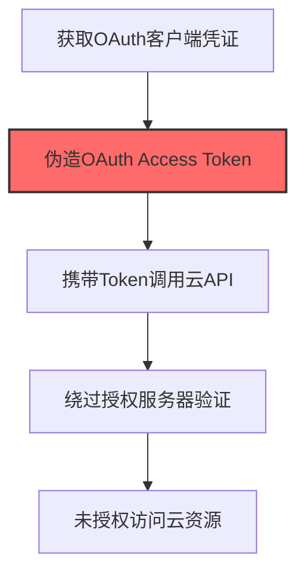
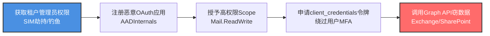

# OAuth Tokens (T1606.002)

## 一句话通俗理解

> **伪造OAuth访问令牌，未经授权访问云API和资源**

## 30秒速查卡

| 维度 | 你需要知道的 |
|------|-------------|
| 这是什么？ | 伪造OAuth访问令牌，未经授权访问云API和资源 |
| 为什么危险？ | OAuth令牌是云API的'通行证'，伪造它就能以任何用户身份调用云服务 |
| 谁需要关心？ | 云安全工程师、SOC分析师 |
| 你的第一步防御 | 实施OAuth令牌绑定和生命周期管理，监控异常的API调用 |
| 如果只做一件事 | 监控OAuth令牌的签发日志，关注异常的令牌申请和使用模式 |

## 难度等级

⭐⭐⭐ 高级 - 需要深入的技术知识和实践

## 前置知识检查

**读这个文件需要什么？**

- [ ] Windows认证体系（NTLM/Kerberos/LSASS）
- [ ] 哈希基础（NTLM Hash/SHA）
- [ ] 网络认证协议（SMB/LDAP/Kerberos）

## 技术描述

**OAuth令牌**（T1606.002）是 **伪造Web凭证**（T1606）的一个具体变体，属于 **凭证访问** 阶段的攻击技术。

> 🔑 **打个比方**：就像用偷来的钥匙扣可以开很多把锁——攻击者伪造OAuth令牌，获得对多个云服务和API的访问权限。

### 具体怎么理解？

伪造OAuth访问令牌，未经授权访问云API和资源

攻击者使用这种技术时，通常是在凭证访问阶段，想要达到特定的攻击目标。与父技术 T1606 相比，T1606.002 有自己独特的特点和使用场景。

### 为什么有效？

这种技术之所以有效，是因为：
1. **隐蔽性**：利用了正常系统功能或常见协议，不容易被发现
2. **技术门槛适中**：不需要特别高深的技术知识就能实施

**过渡段：** 不要误解凭证访问只是'窃取密码'——在现代企业中，凭证存在于内存、磁盘、网络流量等多个位置。
3. **广泛适用**：可以在多种环境和系统中使用

## 真实攻击流程

### 典型场景

攻击者在 **凭证访问** 阶段使用 OAuth令牌 技术，以下是典型的攻击步骤：



**步骤详解：**

1. **获取OAuth客户端凭证** - 从代码仓库、配置文件或云控制台获取OAuth client_id和client_secret
2. **伪造OAuth Access Token** - 使用窃取的客户端凭证直接向Token端点请求访问令牌，或伪造JWT格式的Token
3. **携带Token调用云API** - 在HTTP请求头中添加Authorization: Bearer [token]，以合法客户端身份调用API
4. **绕过授权服务器验证** - 由于Token由合法客户端凭证生成，授权服务器和资源服务器均认为请求合法
5. **未授权访问云资源** - 使用合法Token访问API端点，获取用户数据、修改配置或执行管理操作

## 攻击流程



**关键步骤说明：**

1. **获取租户管理员权限** - Octo Tempest通过SIM卡交换劫持目标企业高管的移动电话号码重置密码接管Okta或Microsoft Entra ID管理员控制台，APT29则通过SolarWinds供应链后门窃取Global Admin凭据，作为后续注册恶意OAuth应用的前提。
2. **注册恶意OAuth应用** - 使用AADInternals（PowerShell工具集）在受害者租户中创建多租户OAuth应用程序或高权限服务主体（Service Principal），Storm-1283即以此方式在多个Azure云租户环境中注册恶意服务主体作为长期持久化载体。
3. **授予高权限Scope** - 通过窃取的Global Admin同意权限委派应用`Mail.ReadWrite`、`Directory.Read.All`、`Mail.Read`等高权限范围，APT29在Nobelium行动中即授予Mail.Read和Directory.Read权限用于长期外传O365邮件。
4. **申请client_credentials令牌** - 使用窃取的客户端凭证通过client_credentials或authorization_code流向Azure AD Token端点请求长期有效的OAuth访问令牌和刷新令牌，由于令牌本身代表已完成的MFA认证状态且服务主体不触发用户登录日志，可绕过后续MFA挑战从任意IP访问。
5. **调用Graph API窃数据** - 在HTTP请求头中添加`Authorization: Bearer [token]`以合法身份调用Microsoft Graph API端点，长期访问Salesforce、Microsoft 365、Google Workspace等SaaS应用窃取邮件、目录数据，Storm-1283以此手法维持云访问6个月以上未被MFA检测到。

## 真实案例

### 案例1：APT29 Nobelium 伪造 OAuth 应用令牌劫持云账户

- **时间**: 2020-2021年
- **目标**: 美国政府机构和NGO组织（持续SolarWinds供应链攻击的后阶段）
- **攻击组织**: APT29（Nobelium / Midnight Blizzard）
- **手法**: 在受害者租户中注册恶意多租户OAuth应用，使用窃取的Global Admin同意权限委派应用Mail.Read和Directory.Read权限，通过Microsoft Graph API长期外传O365邮件
- **影响**: 2021年5月攻击者用此手法窃取了USAID相关组织的邮件，影响3,000+邮箱，2021年7月再攻击150+组织
- **参考链接**: [CISA Alert AA21-148A](https://www.cisa.gov/news-events/cybersecurity-advisories/aa21-148a)

### 案例2：Storm-1283 滥用 Azure 服务主体令牌横向移动

- **时间**: 2022-2023年
- **目标**: 多个Azure云租户环境
- **攻击组织**: Storm-1283（STRRAT/Pikabot分发团伙，财务驱动）
- **手法**: 通过钓鱼获得租户管理员权限后，使用AADInternals创建高权限服务主体（Service Principal），生成client_credentials OAuth令牌，绕过用户MFA和条件访问策略横向调用Microsoft Graph API枚举用户和邮件
- **影响**: 持续维持云访问6个月+，未被MFA检测到，因服务主体不触发用户登录日志
- **参考链接**: [Microsoft Defender for Cloud 2023年报告](https://www.microsoft.com/en-us/security/blog/2023/04/18/detect-and-mitigate-attacks-against-azure-active-directory/)

### 案例3：Octo Tempest通过SIM卡劫持+OAuth令牌滥用跨云劫持企业SaaS账户实施勒索（2023）

- **时间**: 2023年2月起
- **目标**: 北美和欧洲大型企业（含Microsoft、Cleo、Atlas等SaaS厂商客户），重点为拥有Okta/Microsoft Entra ID身份提供商的组织
- **攻击组织**: Octo Tempest（Scattered Spider/UNC3944，英语为母语的跨平台威胁组织，与BlackCat/ALPHV勒索软件即服务团伙协作）
- **手法**: Octo Tempest通过SIM卡交换劫持目标企业高管的移动电话号码，重置密码并接管Okta或Microsoft Entra ID管理员控制台，随后注册恶意OAuth应用程序并授予`Mail.ReadWrite`、`Directory.Read.All`等高权限范围（scope），使用client_credentials或authorization_code流获取长期有效的OAuth访问令牌和刷新令牌；由于令牌本身代表已完成的MFA认证状态，攻击者据此绕过后续MFA挑战从任意IP访问Salesforce、Microsoft 365、Google Workspace等SaaS应用，窃取敏感数据后部署BlackCat勒索软件
- **影响**: 至少攻陷100+组织，包括多家财富500强企业，造成数亿美元损失；2023年10月Microsoft发布专项威胁报告披露其跨云滥用SAML/OAuth令牌的攻击链
- **参考链接**: [Microsoft Security Blog: Octo Tempest crosses boundaries to facilitate extortion, encryption, and destruction](https://www.microsoft.com/en-us/security/blog/2023/10/25/octo-tempest-crosses-boundaries-to-facilitate-extortion-encryption-and-destruction/) | [CISA Alert AA23-320A: Scattered Spider](https://www.cisa.gov/news-events/cybersecurity-advisories/aa23-320a)

## 红队视角

> ⚠️ **免责声明**：以下内容仅用于合法的安全测试、渗透测试和教育目的。未经授权对他人系统进行测试是违法行为。

### 实战技巧

1. **深入理解原理**：在实战应用前，充分理解OAuth Tokens的技术原理和适用场景
2. **环境适配**：根据目标系统的操作系统版本、安全配置等因素调整攻击策略
3. **组合使用**：将该技术与其他技术组合使用，构建完整的攻击链
4. **隐蔽性考虑**：注意操作痕迹的清理，避免被安全设备检测

### 常用工具

| 工具名称 | 用途 | 平台 | 链接 |
| -------- | ---- | ---- | ---- |
| ROADtools | Azure AD OAuth令牌申请和服务主体管理 | Python/Windows | [ROADtools](https://github.com/dirkjanm/ROADtools) |
| TokenTactics | 生成和滥用Azure AD JWT格式访问令牌 | PowerShell | [TokenTactics](https://github.com/rvrsh3ll/TokenTactics) |
| AADInternals | 创建高权限服务主体、伪造OAuth令牌调用Graph API | PowerShell | [AADInternals](https://github.com/Gerenios/AADInternals) |
| AzureHound | 使用窃取的令牌枚举Azure AD完整攻击面 | Go/Windows | [AzureHound](https://github.com/BloodHoundAD/AzureHound) |

### 注意事项

- 在授权的测试环境中使用这些技术
- 注意操作安全（OPSEC），避免被检测系统发现
- 使用匿名化技术和代理隐藏真实身份

## 蓝队视角

### 检测要点

1. **系统日志监控**：关注与OAuth Tokens相关的系统日志和审计记录
2. **异常行为检测**：监控系统中与该技术相关的异常进程、网络连接和文件操作
3. **工具特征识别**：识别攻击者可能使用的工具在系统中的运行特征

### 监控建议

- 部署端点检测和响应（EDR）系统，监控与OAuth Tokens相关的异常行为
- 配置SIEM规则，关联分析来自多个来源的告警
- 定期进行安全评估和渗透测试，验证检测规则的有效性

## 避坑指南

组织中最危险盲区：认为强密码就足够安全。

## 检测建议

### 检测思路

检测 OAuth令牌 的关键是识别异常行为模式。以下是三个层面的检测方法：

### 网络层检测

**方法**：监控网络流量中的异常模式

```bash
# 检测异常的网络连接和数据传输
# 根据具体协议和端口设置检测规则
```

### 主机层检测

**Windows事件ID**：
- 事件ID 4688：进程创建（监控可疑进程）
- 事件ID 4104：PowerShell执行（监控可疑脚本）

**Linux日志**：
- /var/log/auth.log：认证日志
- /var/log/syslog：系统日志

```bash
# 检测异常进程和命令执行
grep -i "suspicious" /var/log/auth.log
```

### 应用层检测

**用人话说：** 这条规则在监控OAuth令牌的签发和使用是否异常。OAuth令牌是云API（如Azure、AWS）的访问凭证。正常情况下令牌会在固定设备和位置使用。如果发现有异常的令牌被签发，或者令牌从不同地理位置使用，那就是攻击者在伪造OAuth令牌访问云资源。

**Sigma规则示例**：

```yaml
title: 检测OAuth令牌
status: experimental
description: 检测可能的OAuth令牌活动
logsource:
    category: process_creation
    product: windows
detection:
    selection:
        EventID: 4688
    condition: selection
level: medium
tags:
    - attack.T1606002
```

## 缓解措施

### 优先级1：关键措施

**限制攻击面**：减少暴露的服务和端口，降低被利用的风险

```bash
# 防火墙规则示例：只允许必要的出站连接
iptables -A OUTPUT -p tcp --dport 443 -j ACCEPT  # 允许HTTPS
iptables -A OUTPUT -p tcp --dport 80 -j ACCEPT   # 允许HTTP
iptables -A OUTPUT -p tcp -j DROP                 # 阻止其他TCP
```

### 优先级2：重要措施

**加强监控**：部署EDR和SIEM系统，实时监控异常行为

### 优先级3：建议措施

**安全意识培训**：教育员工识别相关攻击手法

## 动手实验

> ⚠️ **所有实验必须在隔离的实验室环境中进行**

### 实验1：理解基本原理（初级）

**目标**：理解 OAuth令牌 的工作原理

**步骤**：
1. 在隔离环境中搭建测试系统
2. 使用基础工具模拟攻击行为
3. 观察系统日志和网络流量

**学习要点**：理解该技术的核心机制

### 实验2：实际操作（中级）

**目标**：掌握 OAuth令牌 的实际使用方法

**步骤**：
1. 使用专业工具进行攻击模拟
2. 尝试不同的绕过技术
3. 分析检测日志的特征

**学习要点**：掌握工具使用和日志分析

### 实验3：防御验证（高级）

**目标**：验证检测规则的有效性

**步骤**：
1. 部署检测规则
2. 执行攻击模拟
3. 验证检测告警是否触发

**学习要点**：理解攻防对抗的实际效果

## 术语解释

| 术语 | 通俗解释 |
|------|---------|
| **ATT&CK** | MITRE公司维护的攻击技术知识库，像一本"黑客手法百科全书" |
| **OAuth令牌** | T1606.002，ATT&CK框架中定义的一种具体攻击技术 |
| **伪造Web凭证** | T1606，OAuth令牌所属的父技术类别 |
| **凭证访问** | 攻击链中的一个阶段，攻击者在这个阶段的目标 |
| **C2** | 命令与控制，攻击者用来远程控制被入侵系统的"遥控器" |
| **EDR** | 端点检测与响应，部署在电脑上的安全监控软件 |

## 被引用情况

以下父技术文档引用了本子技术：

- [T1606 - 伪造Web凭证](../T1606-Forge-Web-Credentials.md)

## 参考资料

### 📚 官方文档（深入了解）

- [MITRE ATT&CK - OAuth Tokens (T1606.002)](https://attack.mitre.org/techniques/T1606/002/)
- [MITRE ATT&CK - 伪造Web凭证 (T1606)](https://attack.mitre.org/techniques/T1606/)

### 📰 安全报告（真实攻击）

- [MITRE ATT&CK 官方文档](https://attack.mitre.org/) - ATT&CK 框架官方资源

### 🔧 工具与资源（动手试试）

- [Atomic Red Team](https://github.com/redcanaryco/atomic-red-team) - 检测规则测试框架
- [MITRE ATT&CK Navigator](https://mitre-attack.github.io/attack-navigator/) - ATT&CK 可视化工具

### 📚 学习资料（深入了解）

- [MITRE ATT&CK 知识库](https://attack.mitre.org/resources/) - ATT&CK 官方资源中心
