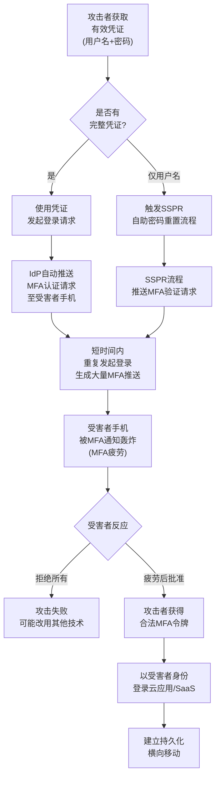

# 多因素认证请求生成 (T1621)

## 一句话通俗理解

**攻击者拿着你的账号密码不停点击"登录"，让你的手机被验证码弹窗轰炸，烦到你闭着眼睛点"同意"为止——这就是MFA疲劳攻击。**

## 30秒速查卡

| 维度 | 你需要知道的 |
|------|-------------|
| 这是什么？ | 滥用自动推送的MFA通知，骗用户自己点"同意"放攻击者进来 |
| 为什么危险？ | 不需要破解MFA设备本身，让合法用户亲手替攻击者按下"通过"按钮 |
| 谁需要关心？ | 身份提供商管理员、SOC分析师、所有启用推送MFA的员工 |
| 你的第一步防御 | 启用条件访问策略限制MFA推送次数，并要求显示地理位置和申请详情 |
| 如果只做一件事 | 把"一键通过"的推送MFA升级为需要输入一次性数字代码的MFA方式 |
| 数据来源 | IdP认证日志、MFA提供商审计日志、SSO登录日志、SIEM聚合事件 |

## 难度等级

- ⭐⭐ 中级（需要有效凭证和社会工程学技巧的结合）

## 前置知识检查

**读这个文件需要什么？**

- [ ] 多因素认证（MFA/2FA）基本原理
- [ ] 身份提供商（IdP）与单点登录（SSO）概念
- [ ] OAuth/SAML认证流程基础
- [ ] 条件访问策略（Conditional Access）

## 技术描述

多因素认证请求生成（T1621）是MITRE ATT&CK框架中凭证访问战术（TA0006）的一种技术，首次引入于ATT&CK v11（2022年4月），当前版本1.2（2025年10月修订）。

**通俗解释：**

**过渡段：** 不要以为有了MFA（多因素认证）就高枕无忧——T1621揭示了一个反直觉的事实：MFA机制本身可以被反过来武器化。攻击者不需要破解你的手机、不需要偷你的SIM卡，他们只需要让你的手机被推送通知淹没，让你在烦躁中亲手按下了那个致命的"批准"按钮。

多因素认证（Multi-Factor Authentication，MFA）的设计初衷是在密码之外再加一层验证。当你输入正确密码后，系统会向你的手机推送一个通知（如Duo Push、Microsoft Authenticator、Okta Verify），让你确认"是本人登录"。问题在于：这个推送动作不仅用户自己能触发，任何持有用户名和密码的攻击者也能触发。攻击者只需要用窃取到的凭证发起登录，系统就会自动向受害者的手机推送MFA请求。如果攻击者反复发起登录，受害者的手机就会在短时间内收到几十甚至上百条MFA提示——这就是"MFA疲劳"（MFA Fatigue）或"MFA轰炸"（MFA Bombing）。当用户被骚扰到失去耐心，往往会下意识地点击"批准"以让通知停下来，攻击者就此获得访问权限。

**技术原理：**

1. **凭证重放触发推送**：攻击者使用窃取到的有效凭证（用户名+密码）登录身份提供商（IdP），IdP自动触发MFA挑战，向注册设备推送认证请求。攻击者不需要绕过MFA，而是依赖用户主动批准。

2. **自助密码重置（SSPR）滥用**：当攻击者仅掌握用户名但缺少密码时，可以触发SSPR流程。许多SSPR流程会将MFA推送作为身份验证步骤，攻击者利用这一点对用户进行轰炸，诱导其批准重置请求，进而重置密码获取完全访问。

3. **MFA疲劳/轰炸**：攻击者在短时间内发起大量登录尝试，每次都触发新的MFA推送通知。部分IdP默认不限制推送次数，使用户设备被通知淹没。常见工具有Modlishka反向代理脚本、自动化登录脚本结合窃取的凭证列表。

4. **地理与上下文欺骗**：高级攻击者会配合伪造的登录上下文（如显示靠近用户常用地理位置的IP），让推送通知中的"登录位置"看起来合理，降低用户警觉，提高批准率。

**用途与影响：**

MFA请求生成技术是2022年以来云身份攻击激增的核心手法之一。Mandiant和Microsoft报告显示，2022-2024年间MFA疲劳攻击在高调入侵事件（如LAPSUS$、Scattered Spider针对电信和BPO的攻击）中扮演关键角色。该技术的可怕之处在于：它完全合法地使用了MFA系统设计的功能，没有任何漏洞利用，也没有任何异常代码执行——一切都发生在IdP的正常业务流程中，使得传统EDR和防病毒工具完全无法察觉。

## 攻击流程



**步骤详解：**

1. **获取有效凭证**
   - 通俗描述：攻击者首先需要拿到目标用户的用户名和密码（或仅用户名）
   - 技术细节：凭证通常来源于钓鱼攻击（T1566）、凭证填充（T1110.004）、暗网购买的泄露凭证库、信息窃取木马（如RedLine、Raccoon）窃取的浏览器保存密码
   - 常用工具：Modlishka反向代理、Evilginx2钓鱼框架、凭证数据库

2. **触发MFA推送请求**
   - 通俗描述：用窃取的凭证向IdP发起登录，系统自动向用户手机推送MFA请求
   - 技术细节：登录Microsoft 365、Okta、Duo、Google Workspace等IdP，输入正确凭证后系统触发推送通知。也可以触发SSPR流程，让IdP在重置密码前推送MFA验证
   - 常用工具：自动化登录脚本、Selenium浏览器自动化、PowerShell Invoke-WebRequest

3. **MFA疲劳轰炸**
   - 通俗描述：短时间内反复发起登录，让用户手机被推送通知淹没
   - 技术细节：在1-2分钟内发起数十到数百次登录尝试，每次都触发独立的MFA推送。部分IdP默认不限制推送频率，使得轰炸可行
   - 常用工具：自定义Python脚本、Bash循环脚本

4. **诱导用户批准**
   - 通俗描述：等待用户在烦躁中点击"批准"按钮
   - 技术细节：高级攻击者会配合伪装地理位置、选择用户工作时间（如清晨或深夜）发起轰炸，增加用户疲劳度和批准概率。部分攻击者还会冒充IT部门电话催促用户"批准"通知
   - 常用工具：社会工程学电话（Vishing）

5. **获得合法访问**
   - 通俗描述：用户批准后，攻击者获得合法的MFA令牌，可以正常登录
   - 技术细节：IdP在用户批准后签发会话令牌或OAuth访问令牌，攻击者使用该令牌访问云应用、邮件、VPN等资源。令牌通常有效期1-12小时，部分可刷新
   - 常用工具：浏览器、VPN客户端、云管理控制台

## 真实案例

### 案例1：APT29 - 重复MFA请求攻击（2022-2025）

- **时间**: 2022-2025年
- **目标**: 全球政府机构和外交组织
- **攻击组织**: APT29（Nobelium / Midnight Blizzard）
- **手法**: APT29在获取目标用户的有效凭证后，使用自动化脚本在短时间内向受害者发起大量登录尝试，每次登录都触发一次MFA推送通知。受害者的手机在几分钟内收到数十次MFA提示，部分用户在疲劳或困惑中批准了请求。APT29随后使用获得的MFA令牌访问了受害者的Microsoft 365邮箱和SharePoint资源，窃取邮件并建立持久化访问。2024-2025年间，APT29持续使用此手法针对西方政府机构。
- **影响**: 多个政府机构的邮件系统被长期入侵，敏感外交通信泄露
- **参考链接**: [MITRE ATT&CK - APT29](https://attack.mitre.org/groups/G0016/)

### 案例2：C0027 Campaign - Scattered Spider MFA推送攻击

- **时间**: 2022年
- **目标**: 大型电信公司和BPO（业务流程外包）服务商
- **攻击活动**: C0027（关联Scattered Spider组织）
- **手法**: 攻击者通过钓鱼和信息窃取木马获取了电信公司员工的凭证，随后持续向目标用户的手机发送MFA推送消息，直到受害者接受MFA推送挑战。攻击者还配合电话冒充IT部门员工，催促用户"批准"通知以"解决账户问题"。一旦获得MFA批准，攻击者登录员工的SSO门户，进而访问客户管理系统和SIM卡交换工具，实施了大规模SIM交换攻击。
- **影响**: 多家电信公司客户账户被入侵，进一步波及下游金融机构
- **参考链接**: [MITRE ATT&CK - C0027](https://attack.mitre.org/campaigns/C0027/)

### 案例3：LAPSUS$ - MFA提示轰炸（2022）

- **时间**: 2022年
- **目标**: NVIDIA、Microsoft、Okta、Samsung、Uber等大型科技公司
- **攻击组织**: LAPSUS$（G1004）
- **手法**: LAPSUS$组织使用从暗网购买或社交工程获取的凭证，向目标用户大量发送MFA提示，期望合法用户在烦躁中批准认证请求。在针对Okta的攻击中，LAPSUS$获得了Okta第三方工程师的MFA批准，进而访问了Okta的管理控制台，影响了Okta的下游客户。在针对Uber的攻击中，攻击者通过MFA疲劳攻击获得了Uber外部承包商的访问权限，进而访问了Uber的内部系统（Slack、G Suite、AWS等）。
- **影响**: 多家全球顶级科技公司遭入侵，影响范围广泛，造成重大声誉损失
- **参考链接**: [MITRE ATT&CK - LAPSUS$](https://attack.mitre.org/groups/G1004/)

### 案例4：Scattered Spider - 持续MFA疲劳攻击（2022-2025）

- **时间**: 2022-2025年
- **目标**: 全球电信、酒店、 casinos、BPO服务商
- **攻击组织**: Scattered Spider（G1015，UNC3944）
- **手法**: Scattered Spider将MFA疲劳攻击作为其核心入侵手法之一。攻击者使用自动化脚本结合窃取的凭证，向目标用户发送重复的MFA认证请求，频率高达每分钟数十次。攻击者还结合Vishing（语音钓鱼）电话，冒充IT支持人员要求用户"批准"MFA提示以"修复问题"。在2023-2025年间，Scattered Spider针对MGM Resorts、Caesars Entertainment等酒店集团实施此攻击，造成数亿美元损失。攻击者还利用此手法入侵了多家电信和托管服务提供商，进而实施下游攻击。
- **影响**: MGM Resorts运营中断（2023年约1亿美元损失）、Caesars支付1500万美元赎金
- **参考链接**: [MITRE ATT&CK - Scattered Spider](https://attack.mitre.org/groups/G1015/)

## 红队视角

> ⚠️ **免责声明**：以下内容仅用于合法的安全测试、渗透测试和教育目的。未经授权对他人系统进行测试是违法行为。

### 实战技巧

1. **MFA疲劳攻击自动化**：
   使用Python脚本结合requests库，针对支持推送MFA的IdP（如Microsoft 365、Okta）在短时间内发起大量登录尝试。每次登录使用窃取的有效凭证，触发IdP向用户设备推送MFA请求。关键是控制频率（避免触发账户锁定）和持续时间（让用户感到持续骚扰）。

2. **SSPR流程滥用**：
   当仅有用户名时，触发Azure AD自助密码重置流程。SSPR默认会向用户注册的设备推送MFA验证，攻击者可借此实施轰炸。如果用户批准，攻击者即可重置密码获取完全访问。Corradin & Wang（2023）的研究详细描述了此手法的可行性。

3. **配合Vishing增强成功率**：
   单纯的MFA轰炸成功率有限（约5-15%）。配合语音钓鱼（Vishing）电话冒充IT支持，可将成功率提升至40%以上。攻击者致电目标用户，声称"系统检测到异常登录需要您批准MFA提示以验证身份"，诱导用户主动批准。

4. **地理伪装**：
   使用靠近用户常用地理位置的VPN或代理IP发起登录，使MFA推送通知中显示的"登录位置"看起来合理，降低用户警觉。部分IdP（如Microsoft Authenticator）会显示登录的IP所在城市。

### 常用工具

| 巢具名称 | 用途 | 平台 | 链接 |
|----------|------|------|------|
| Python requests | 自动化登录脚本 | 跨平台 | https://docs.python-requests.org/ |
| Selenium | 浏览器自动化登录 | 跨平台 | https://www.selenium.dev/ |
| Modlishka | 反向代理钓鱼+MFA拦截 | Linux | https://github.com/drk1wi/Modlishka |
| Evilginx2 | 钓鱼框架+MFA令牌窃取 | 跨平台 | https://github.com/kgretzky/evilginx2 |
| PowerShell | 自动化登录脚本 | Windows | 系统内置 |

### 注意事项

- 控制登录尝试频率，避免触发IdP的账户锁定策略（通常5-10次失败后锁定）
- MFA轰炸可能触发IdP的异常行为检测，需在攻击窗口内快速完成
- 部分现代IdP（如启用Number Matching的Microsoft Authenticator）已增强抗疲劳能力，单纯推送轰炸无效
- 红队测试前必须获得书面授权，明确测试范围和免责条款

## 蓝队视角

### 检测要点

1. **异常MFA推送频率**
   - 日志来源：IdP认证日志（Azure AD Sign-in Logs、Okta System Log、Duo Administrator Log）
   - 关注字段：用户ID、MFA推送时间戳、推送结果（approved/denied/timeout）
   - 异常特征：单一用户在5分钟内收到超过3次MFA推送；MFA推送被多次拒绝后最终批准

2. **重复失败登录后快速MFA挑战**
   - 日志来源：IdP登录失败日志、SIEM聚合事件
   - 关注字段：登录结果、错误代码、IP地址、用户代理
   - 异常特征：同一用户在短时间内多次登录失败（错误码50126凭据错误）后突然出现MFA挑战

3. **异常地理位置或设备**
   - 日志来源：IdP登录日志中的地理位置和设备指纹
   - 关注字段：登录IP所在国家/城市、设备ID、浏览器指纹
   - 异常特征：MFA推送来自用户从未登录过的地理位置；使用未知设备发起登录

4. **SSPR流程异常**
   - 日志来源：Azure AD SSPR活动日志、Okta密码重置日志
   - 关注字段：SSPR发起时间、发起IP、身份验证方式、结果
   - 异常特征：用户在短时间内多次发起SSPR；SSPR的MFA验证被多次拒绝后最终批准

### 监控建议

- 在IdP管理控制台启用详细的MFA活动审计日志，保留至少90天
- 配置SIEM告警规则：单一用户5分钟内MFA推送超过阈值（如5次）即告警
- 监控MFA批准模式：用户连续多次拒绝后突然批准，应立即触发账户冻结和调查
- 部署UEBA（用户和实体行为分析）检测MFA批准行为偏离基线的情况
- 定期审计IdP中的MFA推送频率限制配置，确保启用了合理的上限

## 避坑指南

组织中最危险盲区：认为"启用了MFA就等于安全"。

**常见误区与纠正：**

1. **误区**："我们部署了推送式MFA，账户安全了。"
   **纠正**：推送式MFA（一键批准）是最容易被疲劳攻击绕过的MFA形式。应升级为需要输入数字代码的MFA（如Microsoft Authenticator的Number Matching模式、TOTP应用）。

2. **误区**："用户会自己拒绝可疑的MFA推送。"
   **纠正**：在疲劳轰炸下，用户的判断力会显著下降。必须通过技术手段限制推送频率，而非依赖用户警觉性。

3. **误区**："MFA推送没有次数限制也没关系。"
   **纠正**：必须配置MFA推送频率上限（如5分钟内不超过3次），超出后自动冻结账户并通知SOC。

4. **误区**："教育用户就够了，不需要技术控制。"
   **纠正**：用户培训和技术控制必须并重。即使最训练有素的用户，在凌晨3点被电话轰炸后也可能误操作。

## 检测建议

### 网络层检测

**检测方法：** 监控IdP认证API的异常调用模式，检测MFA请求生成的高频网络特征。

**具体规则/命令示例：**
```
# 检测短时间内对IdP登录端点的高频请求（以Azure AD为例）
# 在反向代理/网关日志中统计5分钟内对login.microsoftonline.com的请求数
awk '$7 ~ /login\.microsoftonline\.com/ {print $1, $4}' gateway.log | \
  cut -d: -f1-2 | sort | uniq -c | awk '$1 > 10 {print "告警: ", $0}'

# 检测来自单一IP对多个用户发起登录尝试（密码喷射+MFA轰炸组合）
zeek -C -r capture.pcap http.log | \
  awk '/login\.okta\.com|login\.microsoftonline\.com/ {print $3, $9}' | \
  sort | uniq -c | sort -rn | head -20

# 检测SSPR端点的异常调用频率
tshark -r capture.pcap -Y "http.request.uri contains \"passwordreset\"" \
  -T fields -e ip.src -e frame.time | sort | uniq -c | sort -rn
```

### 主机层检测

**检测方法：** 监控IdP服务器和MFA提供商系统上的认证事件模式。

**Windows事件ID（适用于本地AD FS / Azure AD Connect）：**
- 事件ID 4624（登录成功）：关注登录类型和源IP
- 事件ID 4625（登录失败）：统计失败频率
- AD FS事件ID 411（令牌请求）：监控异常令牌请求频率
- AD FS事件ID 501（认证请求）：监控MFA挑战触发频率

**具体命令示例：**
```powershell
# 检测短时间内多次登录失败后突然成功（MFA疲劳攻击特征）
Get-WinEvent -FilterHashtable @{LogName='Security';ID=@(4624,4625);StartTime=(Get-Date).AddHours(-1)} |
  Where-Object {$_.Properties[8].Value -match ' Negotiate|Kerberos|Negotiate'} |
  Group-Object -Property {$_.TimeCreated.ToString("yyyy-MM-dd HH:mm")} |
  Where-Object {$_.Count -gt 10} | Format-Table Name, Count -AutoSize

# 查询Azure AD登录日志中的MFA异常（需AzureAD模块）
Connect-AzureAD
Get-AzureADAuditSignInLogs -Top 1000 | 
  Where-Object {$_.ConditionalAccessStatus -eq 'success' -and $_.MfaDetail -ne $null} |
  Group-Object -Property UserPrincipalName |
  Where-Object {$_.Count -gt 5} | 
  Select-Object Name, Count
```

### 应用层检测

**Sigma规则示例：**
```yaml
title: 检测MFA疲劳攻击 - 短时间内大量MFA推送
id: 7e3f4c8a-2b1d-4e5f-9a8c-3b2e1f0a4d5c
status: experimental
description: 检测身份提供商日志中单一用户在短时间内收到异常数量的MFA推送请求，可能指示MFA疲劳攻击
references:
    - https://attack.mitre.org/techniques/T1621/
    - https://www.cisa.gov/news-events/cybersecurity-advisories
author: ATT&CK知识库
date: 2026/07/17
logsource:
    product: azure
    service: SignInLogs
detection:
    selection_mfa_event:
        AuthenticationRequirement: "multiFactorAuthentication"
        ConditionalAccessStatus: "success"
    timeframe: 5m
    condition: selection_mfa_event | count() by UserPrincipalName > 5
falsepositives:
    - 用户在多个设备间切换登录
    - 网络不稳定导致MFA推送重复触发
    - 用户主动多次尝试登录
level: high
tags:
    - attack.credential_access
    - attack.t1621
    - attack.ta0006
```

**Okta Sigma规则示例：**
```yaml
title: 检测Okta MFA疲劳攻击 - 重复MFA挑战
id: 8f4a5b9c-3d2e-4f1a-9b8c-2e3f4a5b6c7d
status: experimental
description: 检测Okta系统日志中单一用户在短时间内收到大量MFA挑战请求
references:
    - https://attack.mitre.org/techniques/T1621/
author: ATT&CK知识库
date: 2026/07/17
logsource:
    product: okta
    service: okta
detection:
    selection_mfa_challenge:
        eventType: "system.push.send_factor_verify_push"
    timeframe: 10m
    condition: selection_mfa_challenge | count() by actor.alternateId > 5
falsepositives:
    - 用户设备网络不稳定导致推送重复
    - 用户主动重试登录
level: high
tags:
    - attack.credential_access
    - attack.t1621
    - attack.ta0006
```

## 缓解措施

### 优先级1：关键措施

**措施名称：** 升级MFA方式至需要主动输入的强MFA

**具体实施步骤：**
1. 将Microsoft Authenticator配置为"Number Matching"模式（要求用户在应用中输入登录页面显示的数字）
2. 推广使用TOTP应用（如Google Authenticator、Authy）替代推送式MFA
3. 对高权限账户（管理员、财务、高管）部署硬件安全密钥（FIDO2/WebAuthn，如YubiKey）
4. 禁用"一键批准"的纯推送MFA选项

**配置示例：**
```powershell
# 在Microsoft Entra ID中启用Microsoft Authenticator的Number Matching
# 通过Microsoft Graph PowerShell模块
Connect-MgGraph -Scopes "Policy.ReadWrite.AuthenticationMethod"
$params = @{
    "@odata.type" = "#microsoft.graph.microsoftAuthenticatorAuthenticationMethodConfiguration"
    state = "enabled"
    additionalProperties = @{
        numberMatchingRequiredState = @{
            state = "enabled"
            applyToTargetedUsers = $false
        }
    }
}
Update-MgPolicyAuthenticationMethodPolicyAuthenticationMethodConfiguration `
    -AuthenticationMethodConfigurationId "MicrosoftAuthenticator" `
    -BodyParameter $params
```

### 优先级2：重要措施

**措施名称：** 配置条件访问策略和MFA推送频率限制

**具体实施步骤：**
1. 配置条件访问策略：阻止来自非合规设备或非信任IP的登录
2. 启用MFA推送频率限制（如5分钟内不超过3次推送）
3. 配置MFA推送的内容显示：包括登录位置、IP地址、应用名称、时间戳
4. 配置账户锁定策略：连续多次MFA拒绝后临时锁定账户并通知SOC

**配置示例：**
```powershell
# 创建条件访问策略阻止非信任IP的MFA推送（需Microsoft Entra ID P1+）
# 通过Microsoft Graph PowerShell模块
$policyParams = @{
    displayName = "阻止非信任位置的MFA推送"
    state = "enabled"
    conditions = @{
        locations = @{
            includeLocations = @("All")
            excludeLocations = @("信任的IP范围ID")
        }
        applications = @{
            includeApplications = @("All")
        }
        users = @{
            includeUsers = @("All")
            excludeRoles = @("Global Administrator")
        }
    }
    grantControls = @{
        operator = "OR"
        builtInControls = @("block")
    }
}
New-MgIdentityConditionalAccessPolicy -BodyParameter $policyParams
```

### 优先级3：建议措施

**措施名称：** 用户培训与应急响应流程

**具体实施步骤：**
1. 培训所有用户：只批准自己主动发起的登录的MFA请求；收到意外MFA推送立即拒绝并报告IT
2. 建立"异常MFA推送报告"快速通道（如Slack机器人、专用邮箱、服务台热线）
3. 制定MFA疲劳攻击应急响应剧本：收到报告后立即冻结账户、重置密码、撤销活动会话
4. 定期开展MFA疲劳攻击的模拟演练，测试用户警觉性和响应流程

### MITRE ATT&CK 缓解措施映射

| 缓解措施ID | 缓解措施名称 | 适用性 | 说明 |
|------------|-------------|--------|------|
| M1036 | 账户使用策略 | 适用 | 启用账户限制防止可疑位置登录及2FA/MFA请求；使用条件访问策略阻止不合规设备或组织IP范围外的登录 |
| M1032 | 多因素认证 | 适用 | 用更安全的2FA/MFA替代简单推送/一键式选项（如一次性代码、旋转代码硬件令牌）；实施MFA请求提示最大数量限制 |
| M1017 | 用户培训 | 适用 | 培训用户仅接受自己发起的登录的2FA/MFA请求，审查触发来源，报告可疑提示 |

## 动手实验

> ⚠️ **重要提示**：所有实验必须在隔离的实验室环境中进行，禁止对未授权的真实系统进行测试。

### 实验环境准备

**推荐靶场/实验平台：**

| 平台名称 | 类型 | 难度 | 链接 |
|----------|------|------|------|
| Microsoft Entra ID试用租户 | 云实验环境 | 中级 | https://azure.microsoft.com/free/ |
| Okta Developer免费版 | 云实验环境 | 中级 | https://developer.okta.com/ |
| TryHackMe - MFA Attack Lab | 虚拟靶场 | 中级 | https://tryhackme.com/ |

**所需工具：**
- Microsoft Entra ID P2试用租户（30天免费）
- 测试用户账户2个（攻击者+受害者）
- PowerShell 7+ with Microsoft.Graph模块
- 浏览器（用于登录测试）

### 实验1：配置MFA疲劳攻击防御（中级）

**实验目标：** 在Microsoft Entra ID试用租户中体验MFA疲劳攻击的防御配置，理解条件访问策略和Number Matching的作用。

**实验步骤：**
1. 创建Microsoft Entra ID试用租户，创建2个测试用户
2. 为测试用户启用Microsoft Authenticator推送MFA
3. **模拟攻击阶段**：用User A的凭证登录，观察User B的手机收到MFA推送（在另一台设备上模拟）
4. **启用Number Matching**：通过Microsoft Graph PowerShell配置Microsoft Authenticator的Number Matching
5. **验证防御效果**：再次尝试登录，观察MFA推送现在要求输入数字代码，无法通过疲劳轰炸绕过
6. **配置条件访问策略**：限制只允许特定IP范围发起MFA推送
7. **配置告警规则**：使用Azure Monitor设置5分钟内MFA推送超过5次的告警

**预期结果：** 理解Number Matching如何从根本上阻止MFA疲劳攻击；掌握条件访问策略的配置方法。

**学习要点：** 理解MFA方式的选择对安全性的关键影响；掌握Entra ID中MFA强化配置的实操技能。

### 实验2：MFA疲劳攻击检测规则编写（中级）

**实验目标：** 在SIEM中编写检测MFA疲劳攻击的告警规则。

**实验步骤：**
1. 在Entra ID租户中配置诊断设置，将Sign-in日志发送到Log Analytics工作区
2. 使用User A的凭证连续发起10次登录，触发10次MFA推送（模拟轰炸）
3. 在Log Analytics中编写KQL查询，检测5分钟内单一用户MFA推送超过5次的情况
4. 基于KQL查询创建Azure Monitor告警规则
5. 再次触发轰炸，验证告警是否触发

**KQL查询示例：**
```kusto
SigninLogs
| where TimeGenerated > ago(5m)
| where AuthenticationRequirement == "multiFactorAuthentication"
| summarize MFARequestCount = count() by UserPrincipalName, bin(TimeGenerated, 5m)
| where MFARequestCount > 5
| project TimeGenerated, UserPrincipalName, MFARequestCount
```

**预期结果：** 成功检测到模拟的MFA轰炸行为并触发告警。

**学习要点：** 掌握KQL查询语言；理解如何基于IdP日志构建MFA疲劳攻击检测规则。

### 实验3：MFA疲劳攻击用户培训演练（初级）

**实验目标：** 设计并执行一次MFA疲劳攻击的用户培训演练，测试员工警觉性。

**实验步骤：**
1. 编写演练剧本：IT部门在非工作时间向随机选择的员工发送3次MFA推送（在授权范围内）
2. 准备报告通道：告知员工通过Slack频道或服务台电话报告异常MFA推送
3. 执行演练：在指定时间发送测试MFA推送
4. 统计结果：多少员工拒绝、多少批准、多少主动报告
5. 编写演练报告：识别培训薄弱环节，制定改进计划
6. 向参与员工发送培训材料和演练总结

**预期结果：** 80%以上员工拒绝异常推送并主动报告；识别需要加强培训的群体。

**学习要点：** 理解用户培训在MFA疲劳攻击防御中的关键作用；掌握安全意识演练的设计方法。

## 术语解释

| 术语 | 英文原名 | 通俗解释 |
|------|----------|----------|
| MFA | Multi-Factor Authentication | 多因素认证，登录时除了密码还需要额外验证（如手机推送、短信、指纹） |
| 2FA | Two-Factor Authentication | 双因素认证，MFA的一种最简单形式，密码+一种额外验证 |
| 推送MFA | Push-based MFA | 通过手机App推送通知让用户点击"批准"或"拒绝"的MFA方式，最易被疲劳攻击绕过 |
| MFA疲劳 | MFA Fatigue | 通过短时间内发送大量MFA推送让用户疲惫，诱导其盲目批准的攻击手法 |
| MFA轰炸 | MFA Bombing | 同MFA疲劳，强调大量MFA请求"轰炸"用户设备 |
| Number Matching | 数字匹配 | MFA增强方式，登录页面显示数字，用户需在Authenticator应用中输入相同数字才能批准 |
| TOTP | Time-based One-Time Password | 基于时间的一次性密码，如Google Authenticator每30秒生成的6位数字 |
| FIDO2 | Fast Identity Online 2 | 基于硬件密钥的强认证标准（如YubiKey），对MFA疲劳攻击免疫 |
| WebAuthn | Web Authentication | W3C标准，允许网站使用FIDO2硬件密钥进行认证 |
| IdP | Identity Provider | 身份提供商，负责管理用户身份和认证的服务（如Azure AD、Okta、Ping） |
| SSPR | Self-Service Password Reset | 自助密码重置，用户无需联系IT即可重置密码的流程，可被攻击者滥用触发MFA |
| 条件访问 | Conditional Access | 基于用户、设备、位置、风险等条件动态决定是否允许登录的策略机制 |
| Vishing | Voice Phishing | 语音钓鱼，攻击者通过电话冒充IT支持等身份诱导用户操作 |
| Golden SAML | Golden SAML | 使用窃取的AD FS签名证书伪造SAML断言的攻击技术，与MFA疲劳攻击常配合使用 |

## 参考资料

### 📚 官方文档（深入了解）

- [MITRE ATT&CK - T1621 Multi-Factor Authentication Request Generation](https://attack.mitre.org/techniques/T1621/)
- [MITRE ATT&CK - TA0006 Credential Access](https://attack.mitre.org/tactics/TA0006/)
- [MITRE ATT&CK - M1036 Account Use Policies](https://attack.mitre.org/mitigations/M1036/)
- [MITRE ATT&CK - M1032 Multi-factor Authentication](https://attack.mitre.org/mitigations/M1032/)
- [MITRE ATT&CK - M1017 User Training](https://attack.mitre.org/mitigations/M1017/)

### 📰 安全报告（真实攻击）

- [Corradin & Wang (2023) - SSPR Abuse in Azure AD](https://research.nccgroup.com/) - Azure AD自助密码重置流程被滥用触发MFA轰炸的深入分析
- [Cimpanu (2021) - Russian hackers bypass 2FA](https://therecord.media/) - 俄罗斯黑客组织绕过2FA保护的早期报告
- [Haworth (2022) - MFA fatigue attacks](https://www.mandiant.com/resources/blog/mfa-fatigue-attacks) - Mandiant对MFA疲劳攻击手法的系统分析
- [Jenkins et al. (2021) - Suspected Russian Activity](https://www.cisa.gov/) - CISA关于APT29使用MFA疲劳攻击的预警报告
- [UK NCSC (2024) - SVR cyber actors](https://www.ncsc.gov.uk/) - 英国国家网络安全中心关于SVR（APT29）使用MFA疲劳攻击的通报
- [Parisi (2022) - CrowdStrike Telco/BPO](https://www.crowdstrike.com/) - CrowdStrike关于Scattered Spider针对电信和BPO行业MFA疲劳攻击的报告
- [MSTIC DART (2022) - DEV-0537](https://www.microsoft.com/) - Microsoft威胁情报中心关于LAPSUS$（DEV-0537）攻击手法的详细分析

### 🔧 工具与资源（动手试试）

- [CrowdStrike (2023) - SCATTERED SPIDER](https://www.crowdstrike.com/) - Scattered Spider组织TTPs详细分析报告
- [Check Point (2025) - Exposing Scattered Spider](https://research.checkpoint.com/) - Scattered Spider最新攻击手法追踪
- [Microsoft (2022) - Conditional Access templates](https://learn.microsoft.com/) - Microsoft条件访问策略模板官方指南
- [Microsoft Authenticator - Number Matching配置](https://learn.microsoft.com/en-us/azure/active-directory/authentication/how-to-mfa-number-match) - Number Matching功能配置文档
- [CISA - 多因素认证强化指南](https://www.cisa.gov/) - 美国CISA关于MFA强化的官方建议

### 📚 学习资料（深入了解）

- [NIST SP 800-63B - 数字身份指南](https://pages.nist.gov/800-63-3/sp800-63b.html) - NIST数字身份认证指南，包含MFA强度分级
- [Microsoft Entra ID - 安全默认值](https://learn.microsoft.com/en-us/azure/active-directory/fundamentals/concept-fundamentals-security-defaults) - Microsoft安全默认值配置指南
- [Okta - 防御MFA疲劳攻击最佳实践](https://help.okta.com/) - Okta官方MFA疲劳攻击防御指南
- [OWASP - 多因素认证](https://owasp.org/) - OWASP关于MFA实施的最佳实践
