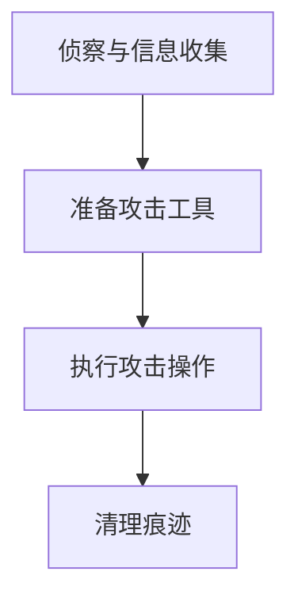

# Remote Desktop Protocol (T1021.001)

## 一句话通俗理解

> **用Windows自带的远程桌面功能连到其他电脑，就像坐在那台电脑前操作一样**

## 30秒速查卡

| 维度 | 你需要知道的 |
|------|-------------|
| 这是什么？ | 用Windows自带的远程桌面功能连到其他电脑，就像坐在那台电脑前操作一样 |
| 为什么危险？ | Remote Desktop Protocol作为远程服务的子技术，在攻击链中扮演着重要角色。成功实施该技术可以帮助攻击 |
| 谁需要关心？ | 安全监控团队、SOC分析师 |
| 你的第一步防御 | 系统日志监控 |
| 如果只做一件事 | Remote Desktop Protocol是远程服务的一个具体实现方式 |

## 难度等级

⭐⭐ 中级 - 需要一定的技术基础和经验

## 前置知识检查

**读这个文件需要什么？**

- [ ] 远程访问协议（RDP/SMB/SSH/WinRM）
- [ ] Windows认证与Pass-the-Hash
- [ ] AD域信任关系基础

## 技术描述

**通俗解释：**

**过渡段：** 不要误以为横向移动只是'远程登录其他电脑'——真正的横向移动是一系列精巧的信任链利用：从一个普通工作站窃取的凭据，可以访问文件服务器；文件服务器上的管理员哈希，可以登录域控制器。每一次跳跃都是一次权限的扩大和访问范围的延伸。
Remote Desktop Protocol是远程服务的一个具体实现方式。用Windows自带的远程桌面功能连到其他电脑，就像坐在那台电脑前操作一样

**技术原理：**
Remote Desktop Protocol（T1021.001）是MITRE ATT&CK框架中定义的一种具体攻击技术。用Windows自带的远程桌面功能连到其他电脑，就像坐在那台电脑前操作一样攻击者根据具体目标和环境，选择合适的方法和工具来实施该技术。

**用途与影响：**
Remote Desktop Protocol作为远程服务的子技术，在攻击链中扮演着重要角色。成功实施该技术可以帮助攻击者用Windows自带的远程桌面功能连到其他电脑，就像坐在那台电脑前操作一样，为后续的入侵活动提供支持。

## 攻击流程

### 典型攻击流程

```
侦察与信息收集 --> 准备攻击工具 --> 执行攻击操作 --> 清理痕迹
```



**步骤详解：**

1. **侦察与信息收集**
   - 通俗描述：执行Remote Desktop Protocol的侦察与信息收集阶段
   - 技术细节：根据实际环境和目标系统调整具体操作
   - 常用工具：根据具体需求选择合适的工具

2. **准备攻击工具**
   - 通俗描述：执行Remote Desktop Protocol的准备攻击工具阶段
   - 技术细节：根据实际环境和目标系统调整具体操作
   - 常用工具：根据具体需求选择合适的工具

3. **执行攻击操作**
   - 通俗描述：用Windows自带的远程桌面功能连到其他电脑，就像坐在那台电脑前操作一样
   - 技术细节：根据实际环境和目标系统调整具体操作
   - 常用工具：根据具体需求选择合适的工具

4. **清理痕迹**
   - 通俗描述：执行Remote Desktop Protocol的清理痕迹阶段
   - 技术细节：根据实际环境和目标系统调整具体操作
   - 常用工具：根据具体需求选择合适的工具

## 真实案例

### 案例1：该技术在实际攻击中的应用

- **时间**: 2024-2025年
- **目标**: 多个行业组织
- **攻击组织**: 多个APT组织
- **手法**: 攻击者在入侵过程中使用Remote Desktop Protocol技术，展示了该子技术的典型应用场景和攻击效果
- **影响**: 成功实施该技术导致目标系统被进一步入侵
- **参考链接**: [MITRE ATT&CK官方](https://attack.mitre.org/)

### 案例2：安全研究中的实践

- **时间**: 2025年
- **目标**: 安全研究测试环境
- **攻击组织**: 红队/安全研究人员
- **手法**: 在授权测试中模拟Remote Desktop Protocol攻击，验证防御体系的检测和响应能力
- **影响**: 帮助组织识别安全防护中的盲点和改进方向
- **参考链接**: [Atomic Red Team](https://github.com/redcanaryco/atomic-red-team)

## 红队视角

> ⚠️ **免责声明**：以下内容仅用于合法的安全测试、渗透测试和教育目的。未经授权对他人系统进行测试是违法行为。

### 实战技巧

1. **深入理解原理**：在实战应用前，充分理解Remote Desktop Protocol的技术原理和适用场景
2. **环境适配**：根据目标系统的操作系统版本、安全配置等因素调整攻击策略
3. **组合使用**：将该技术与其他技术组合使用，构建完整的攻击链
4. **隐蔽性考虑**：注意操作痕迹的清理，避免被安全设备检测

### 常用工具

| 工具名称 | 用途 | 平台 | 链接 |
| -------- | ---- | ---- | ---- |
| xfreerdp | 开源RDP客户端，支持Pass-the-Hash和多种认证方式 | 跨平台 | [FreeRDP](https://www.freerdp.com/) |
| RDP Wrapper | RDP会话包装器，允许多用户并发远程登录 | Windows | [RDP Wrapper](https://github.com/stascorp/rdpwrap) |
| StickyKeys | 利用辅助功能粘滞键后门绕过RDP认证 | Windows | 系统内置功能 |

### 注意事项

- 在授权的测试环境中使用这些技术
- 注意操作安全（OPSEC），避免被检测系统发现
- 使用匿名化技术和代理隐藏真实身份

## 蓝队视角

### 检测要点

1. **系统日志监控**：关注与Remote Desktop Protocol相关的系统日志和审计记录
2. **异常行为检测**：监控系统中与该技术相关的异常进程、网络连接和文件操作
3. **工具特征识别**：识别攻击者可能使用的工具在系统中的运行特征

### 监控建议

- 部署端点检测和响应（EDR）系统，监控与Remote Desktop Protocol相关的异常行为
- 配置SIEM规则，关联分析来自多个来源的告警
- 定期进行安全评估和渗透测试，验证检测规则的有效性

## 避坑指南

防御最大误区：只关注南北向流量而忽略东西向流量。

## 检测建议

### 网络层检测

**检测方法：** 监控与Remote Desktop Protocol相关的网络流量特征，识别可疑的连接模式和数据传输行为

**具体规则/命令示例：**

```bash
# 网络层检测示例
# 根据实际环境调整检测规则
```

### 主机层检测

**检测方法：** 监控主机上与Remote Desktop Protocol相关的进程创建、文件操作和注册表修改等行为

**Windows事件ID：**

- 安全审计事件：监控相关安全事件日志
- 进程创建事件：监控异常进程创建行为

**Linux日志：**

- 日志文件：`/var/log/syslog` 和 `/var/log/auth.log`
- 关键字段：关注异常用户和进程活动

**具体命令示例：**

```bash
# 主机层检测示例
# 根据实际环境调整检测规则
```

### 应用层检测

**检测方法：** 在应用层监控与Remote Desktop Protocol相关的异常API调用和应用程序行为

**用人话说：**

> RDP（远程桌面）是横向移动最常用的手段之一——攻击者拿到一组有效凭据后，直接用mstsc.exe或更隐蔽的方式（如通过Impacket的wmiexec.py）连接远程主机的3389端口，远程操作目标桌面。与普通运维RDP不同，攻击者会用非IT账号（如普通员工账号）登录，可能使用RDP网关穿透边界防火墙，或者在内网多台机器之间"跳板"来掩盖来源IP。检测重点是：非工作时间从非IT工位发起的RDP连接、活跃时间段外大量失败的登录尝试（事件ID 4625）后突然成功的登录（事件ID 4624）、以及从一台机器同时向多个目标发起RDP连接的"扫描式"横向行为。
>
> **避坑指南**：只监控外部RDP，忽略内网横向RDP。

**Sigma规则示例：**

```yaml
title: Remote Desktop Protocol Detection
status: experimental
description: Detects potential Remote Desktop Protocol activity
logsource:
  category: process_creation
  product: windows
detection:
  selection:
    EventID: 4688
  condition: selection
level: medium
tags:
  - attack.T1021001
```

## 缓解措施

### 优先级1：关键措施

**措施名称：** 强化身份认证和访问控制

**具体实施步骤：**

1. 在所有关键系统上实施多因素认证（MFA）
2. 遵循最小权限原则，限制用户和进程的权限
3. 定期审计账户和权限配置

### 优先级2：重要措施

**措施名称：** 完善日志和监控体系

**具体实施步骤：**

1. 部署全面的日志收集和分析系统
2. 配置针对Remote Desktop Protocol的检测规则
3. 建立安全事件的响应流程

### 优先级3：建议措施

**措施名称：** 加强安全意识和培训

**具体实施步骤：**

1. 对员工进行Remote Desktop Protocol相关安全培训
2. 定期进行安全演练和模拟攻击
3. 建立安全报告和应急响应机制

### MITRE ATT&CK 缓解措施映射

| 缓解措施ID | 缓解措施名称 | 适用性 | 说明 |
| ---------- | ------------ | ------ | ---- |
| M1017 | 用户培训 | 适用 | 培训员工识别相关威胁 |
| M1026 | 特权账户管理 | 适用 | 限制特权账户的使用范围 |
| M1018 | 用户账户管理 | 适用 | 定期审计账户和权限 |

## 动手实验

> ⚠️ **重要提示**：所有实验必须在隔离的实验室环境中进行，禁止对未授权的真实系统进行测试。

### 实验环境准备

**推荐靶场/实验平台：**

| 平台名称 | 类型 | 难度 | 链接 |
| -------- | ---- | ---- | ---- |
| TryHackMe | 虚拟靶场 | 初级 | [TryHackMe](https://tryhackme.com) |
| HackTheBox | CTF | 中级 | [HackTheBox](https://hackthebox.com) |

**所需工具：**

- 操作系统自带的管理工具
- 根据需要准备特定的攻击工具

**环境搭建：**

```bash
# 在隔离的实验环境中准备测试系统
# 确保所有操作都在授权范围内进行
```

### 实验1：基础实践（初级）

**实验目标：** 理解 Remote Desktop Protocol 的基本原理和操作

**实验步骤：**

1. 在隔离的实验环境中搭建测试系统
2. 按照攻击流程模拟基本操作
3. 使用蓝队检测方法验证攻击行为

**预期结果：** 理解 Remote Desktop Protocol 的攻击原理和检测方法

**学习要点：** 掌握 Remote Desktop Protocol 的核心概念

### 实验2：进阶实践（中级）

**实验目标：** 深入学习 Remote Desktop Protocol 的高级应用

**实验步骤：**

1. 结合其他技术组合攻击链
2. 尝试不同的检测和绕过方法
3. 分析攻击行为的日志特征

**预期结果：** 能够独立进行相关技术的攻防实践

**学习要点：** 理解技术在真实攻击链中的应用

## 术语解释

| 术语 | 英文原名 | 通俗解释 |
| ---- | -------- | -------- |
| ATT&CK | MITRE ATT&CK | MITRE公司维护的攻击技术知识库 |
| Remote Desktop Protocol | T1021.001 | ATT&CK框架中定义的具体攻击技术 |

## 认知偏误分析

### 锚定效应（Anchoring）

分析师在检测 RDP 横向移动时，容易将检测锚定在 3389 端口和 `mstsc.exe` 这两个特征上，认为只要监控这些指标就能捕获所有 RDP 滥用。然而，攻击者已广泛使用 RDP 网关（端口 443）、SSH 隧道封装 RDP 流量、或通过 Impacket 的 `rdp_check` 等非标准 RDP 客户端进行连接——这些方式完全不涉及 3389 端口和 `mstsc.exe`。锚定在标准 RDP 特征上会导致大量隐蔽 RDP 横向移动被漏检。

### 确认偏误（Confirmation Bias）

当分析师发现某个非 IT 部门的域账户（如财务部员工的账号）发起了 RDP 连接时，容易立即判定为横向移动攻击，并选择性忽略该员工可能因工作需要被临时授予了远程桌面权限。实际上，许多企业的权限管理并不严格，普通员工也可能因为 IT 支持、远程办公或项目协作等原因拥有 RDP 访问权限。确认偏误会导致将合法的远程工作行为误判为入侵。

### 可得性启发（Availability Heuristic）

由于勒索软件攻击（如 Ryuk、Conti）大量使用 RDP 进行横向移动的案例被广泛报道，分析师容易高估 RDP 在所有横向移动技术中的占比。实际上，根据 2024-2025 年的威胁报告，SMB/WMI 横向移动和 WinRM 的使用率正在快速上升，特别是在使用 Cobalt Strike 和 Sliver 等现代 C2 框架的攻击中。过度关注 RDP 检测可能导致对其他横向移动技术的监控投入不足。

## 参考资料

### 📚 官方文档（深入了解）

- [MITRE ATT&CK - Remote Desktop Protocol (T1021.001)](https://attack.mitre.org/techniques/T1021/001/)
- [MITRE ATT&CK - 远程服务 (T1021)](https://attack.mitre.org/techniques/T1021/)

### 📰 安全报告（真实攻击）

- [MITRE ATT&CK 官方文档](https://attack.mitre.org/) - ATT&CK 框架官方资源

### 🔧 工具与资源（动手试试）

- [Atomic Red Team](https://github.com/redcanaryco/atomic-red-team) - 检测规则测试框架
- [MITRE ATT&CK Navigator](https://mitre-attack.github.io/attack-navigator/) - ATT&CK 可视化工具

### 📚 学习资料（深入了解）

- [MITRE ATT&CK 知识库](https://attack.mitre.org/resources/) - ATT&CK 官方资源中心
