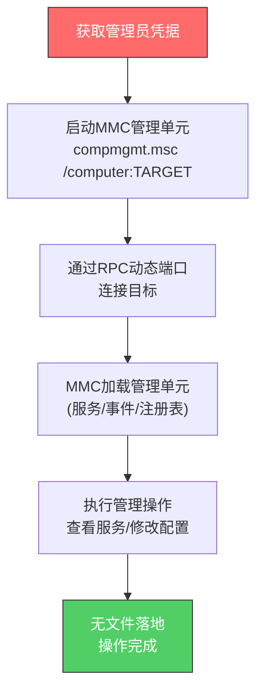

# 微软管理控制台 (T1021.007)

## 一句话通俗理解

> **用Windows自带的"管理工具"（如计算机管理、事件查看器）远程连接到其他电脑进行管理操作**

## 30秒速查卡

| 维度 | 你需要知道的 |
|------|-------------|
| 这是什么？ | 通过MMC及其管理单元（compmgmt.msc、eventvwr.msc等）远程连接目标系统进行管理 |
| 为什么危险？ | MMC是IT管理员常用工具，攻击者滥用它能在不被怀疑的情况下远程管理被入侵主机 |
| 谁需要关心？ | 域管理员、SOC分析师、AD安全团队 |
| 你的第一步防御 | 监控mmc.exe的命令行参数中的远程主机名（`/computer=TARGET`） |
| 如果只做一件事 | 告警包含`/computer=`参数的MMC启动，特别关注非管理工作站发起的连接 |
| 速查总结 | MMC是Windows"半合法"的远程管理通道——既是IT管理员的好帮手，也是攻击者隐蔽横向移动的工具 |

## 难度等级

⭐⭐ 中级 - 需要理解Windows管理工具和MMC架构

## 前置知识检查

**读这个文件需要什么？**

- [ ] Windows管理工具（MMC、管理单元、Snap-in的概念）
- [ ] 常用MMC管理单元（compmgmt.msc、eventvwr.msc、services.msc）
- [ ] Windows远程管理（RPC、WMI、远程服务管理）
- [ ] 域账户与管理员权限区别

## 技术描述

**微软管理控制台（T1021.007）** 是MITRE ATT&CK框架中的一种横向移动技术。

**通俗解释：**

Windows里有一个叫MMC（微软管理控制台）的"工具箱"——它可以装载各种"管理单元"（如计算机管理、事件查看器、服务管理器），用来管理本地或远程电脑。IT管理员经常用MMC远程连接到服务器进行维护。攻击者发现，只要拿到管理员凭据，就能用MMC远程连接到任何一台Windows电脑，查看它的服务、事件日志、注册表等——这就像是远程拿到了目标电脑的"控制面板"。

**过渡段：** 简单来说，程序需要向操作系统"请求"管理员凭据，才能通过MMC远程连接到其他电脑。攻击者窃取了管理员凭据后，就相当于拿到了企业网络里所有Windows电脑的远程管理权限——他们可以像IT管理员一样，远程查看和管理任何一台电脑。由于MMC是合法的管理工具，这种横向移动方式非常隐蔽，难以通过工具特征直接检测。

**技术原理：**

1. **凭据获取**：攻击者先获取目标环境的管理员凭据（明文密码或NTLM哈希）
2. **启动MMC并指定远程主机**：通过命令行启动MMC管理单元并指定`/computer=TARGET`参数
3. **建立RPC连接**：MMC通过RPC协议连接目标主机，使用管理员凭据认证
4. **执行管理操作**：通过MMC管理单元界面执行各种管理操作（查看服务、修改注册表、查看事件日志等）

**用途与影响：**

攻击者使用MMC进行横向移动，能在不使用明显的攻击工具（如PsExec、Cobalt Strike）的情况下远程管理被入侵主机。这种技术被多个APT组织和勒索软件团伙使用，特别是用于侦察阶段（查看目标主机的事件日志、服务配置）和持久化阶段（远程创建恶意服务）。

## 子技术列表

**该技术没有子技术**

## 攻击流程

### 典型攻击流程

```
获取管理员凭据 --> 启动MMC并指定远程主机 --> 通过RPC连接 --> 执行管理操作（查看/修改） --> 清理（无文件落地）
```



**步骤详解：**

1. **获取管理员凭据**
   - 通俗描述：拿到能远程管理目标的管理员账号
   - 技术细节：通过Mimikatz提取凭据或Pass-the-Hash；MMC需要目标主机的本地管理员权限
   - 常用工具：Mimikatz、secretsdump.py

2. **启动MMC并指定远程主机**
   - 通俗描述：用命令行启动管理工具并指定要管理的远程电脑
   - 技术细节：执行`mmc compmgmt.msc /computer:TARGET`或`eventvwr.msc /computer:TARGET`；MMC通过命令行参数指定远程主机
   - 常用工具：mmc.exe、compmgmt.msc、eventvwr.msc、services.msc

3. **建立RPC连接**
   - 通俗描述：MMC通过网络连到目标电脑
   - 技术细节：通过RPC协议（TCP 135端点映射器 + 动态端口49152+）连接目标，使用NTLM或Kerberos认证
   - 常用工具：Windows内置RPC

4. **执行管理操作**
   - 通俗描述：通过MMC界面查看和修改目标电脑的设置
   - 技术细节：常见操作包括查看/修改服务、查看事件日志、修改注册表、管理用户账户、查看共享文件夹
   - 常用工具：MMC管理单元

5. **清理**
   - 通俗描述：MMC不落地文件，清理相对简单
   - 技术细节：MMC操作本身不留文件痕迹，但mmc.exe进程创建和RPC连接会记录在日志中
   - 常用工具：内置命令

## 真实案例

### 案例1：APT29使用MMC远程管理在SolarWinds攻击中的横向移动

- **时间**: 2020年12月 - 2021年3月
- **目标**: 美国政府机构、技术公司、关键基础设施供应商
- **攻击组织**: APT29（Cozy Bear，俄罗斯SVR关联）
- **手法**: APT29在SolarWinds供应链攻击的横向移动阶段，使用MMC远程连接到目标网络中的多台主机。微软和Mandiant的分析报告显示，攻击者使用`mmc compmgmt.msc /computer:TARGET`远程查看目标主机的服务列表和事件日志，以识别安全软件和检测机制。在确认目标主机的安全配置后，APT29通过MMC的"服务"管理单元远程创建和启动恶意服务（伪装为合法Windows服务名），部署TEARDROP后门
- **影响**: 攻击者在9个以上美国联邦机构网络中保持长期访问，窃取了敏感邮件和文档
- **参考链接**: [Microsoft - Analyzing Solorigate](https://www.microsoft.com/en-us/security/blog/2020/12/18/analyzing-solorigate-the-compromised-dll-file-that-started-a-massive-cyberattack/)
  - **数据来源**: 一级

### 案例2：FIN7使用MMC管理单元在零售业网络中侦察和横向移动

- **时间**: 2017年 - 2019年
- **目标**: 美国餐饮连锁、零售商、酒店
- **攻击组织**: FIN7（Carbanak Group，俄罗斯关联）
- **手法**: FIN7在初始入侵后，使用MMC的"计算机管理"和"事件查看器"管理单元远程连接到目标网络中的POS控制器和域控制器。FireEye的报告显示，攻击者通过MMC远程查看目标主机的事件日志（特别是安全日志），识别IT管理员的登录时间和模式，从而选择在低风险时段执行横向移动。FIN7还通过MMC的"服务"管理单元远程修改服务配置，将CARBANAK后门伪装为合法的打印后台处理服务
- **影响**: 超过1500家餐厅受影响，累计窃取超过1500万张信用卡数据
- **参考链接**: [FireEye - FIN7 Threat Research](https://www.fireeye.com/blog/threat-research/2018/08/fin7-pursuit-of-apt-criminal-financial-enterprise.html)
  - **数据来源**: 一级

### 案例3：LockBit勒索软件运营者使用MMC侦察目标环境

- **时间**: 2022年9月 - 2023年3月
- **目标**: 全球制造业、医疗、教育等多个行业
- **攻击组织**: LockBit勒索软件团伙
- **手法**: 根据多个安全厂商（Trend Micro、Sophos、Mandiant）的应急响应报告，LockBit运营者在获取初始访问权限（通常通过RDP或钓鱼）后，使用MMC远程连接到目标网络中的域控制器和关键服务器进行侦察。攻击者通过`eventvwr.msc /computer:DC01`远程查看域控制器的安全事件日志，识别管理员账户和高价值目标。随后通过`services.msc /computer:TARGET`远程修改服务配置，禁用防病毒软件并部署勒索软件载荷。Sophos的报告特别指出，LockBit的 affiliates使用MMC而非PsExec进行侦察，正是因为MMC不会被传统的PsExec检测规则捕获
- **影响**: 累计攻击超过2000个受害组织，勒索金额超过5亿美元
- **参考链接**: [Sophos - LockBit Ransomware Analysis](https://news.sophos.com/en-us/2022/09/29/lockbit-3-0-affiliates-use-old-tactics-and-new-tricks/)
  - **数据来源**: 一级

## 红队视角

> ⚠️ **免责声明**：以下内容仅用于合法的安全测试、渗透测试和教育目的。未经授权对他人系统进行测试是违法行为。

### 实战技巧

1. **优先使用compmgmt.msc进行侦察**
   计算机管理（compmgmt.msc）是最常用的MMC管理单元，包含服务、事件查看器、共享文件夹、本地用户和组、设备管理器等多个子工具。通过`mmc compmgmt.msc /computer:TARGET`可以一站式远程侦察目标主机的配置

2. **services.msc用于持久化**
   通过MMC的"服务"管理单元远程创建和修改服务，可以实现隐蔽的持久化——攻击者创建的服务看起来像合法的Windows服务，且不需要落地PsExec等工具

3. **eventvwr.msc用于反取证侦察**
   通过MMC的事件查看器远程查看目标主机的安全日志，可以识别管理员登录模式、安全软件告警，从而规划攻击时间窗口

4. **命令行启动避免GUI交互**
   在授权测试中，使用`mmc compmgmt.msc /computer:TARGET`命令行启动比通过GUI操作更高效，且便于自动化

### 常用工具

| 工具名称 | 用途 | 平台 | 链接 |
|----------|------|------|------|
| mmc.exe | MMC主程序，加载各种管理单元 | Windows | 系统内置 |
| compmgmt.msc | 计算机管理，集成多个管理工具 | Windows | 系统内置 |
| eventvwr.msc | 事件查看器，查看事件日志 | Windows | 系统内置 |
| services.msc | 服务管理器，管理Windows服务 | Windows | 系统内置 |
| regedit.msc | 注册表编辑器（支持远程连接） | Windows | 系统内置 |
| lusrmgr.msc | 本地用户和组管理 | Windows | 系统内置 |

### 注意事项

- **MMC是合法工具**：MMC是IT管理员日常使用的合法工具，单纯使用MMC不会触发工具特征检测——这既是优势也是风险，需要结合行为分析
- **RPC端口要求**：MMC通过RPC通信，需要目标主机开放TCP 135（端点映射器）和动态RPC端口（49152-65535）——某些严格防火墙环境可能阻断
- **本地管理员权限**：MMC远程连接需要目标主机的本地管理员权限，域管账户通常满足此要求
- **GUI交互限制**：MMC是GUI工具，在某些自动化场景下不如PsExec或WMI方便；但在侦察阶段非常有用

## 蓝队视角

### 检测要点

1. **MMC进程命令行参数**
   - 日志来源：Sysmon EventID 1（进程创建）
   - 关注字段：mmc.exe的命令行参数中包含`/computer=`或`/computer:`
   - 异常特征：从非管理工作站发起的、指向非域控制器的远程MMC连接

2. **MMC远程服务操作**
   - 日志来源：Windows安全日志、Sysmon EventID 1
   - 关注字段：services.msc相关的服务创建/修改事件（EventID 7045、4697）
   - 异常特征：通过MMC远程创建的服务，特别是服务路径在`%SystemRoot%`或`%TEMP%`下

3. **RPC动态端口通信**
   - 日志来源：Windows防火墙日志、网络流量日志
   - 关注字段：源IP、目标IP、TCP 135和动态RPC端口
   - 异常特征：工作站间的RPC通信（正常应为工作站→域控制器/服务器）

### 监控建议

- 部署Sysmon并配置进程创建监控，重点关注mmc.exe的命令行参数中的`/computer=`字符串
- 配置SIEM规则关联MMC进程创建与RPC网络连接
- 启用Windows高级安全审计中的"服务操作"和"注册表修改"子类别
- 建立IT管理员使用MMC的基线，识别偏离基线的异常使用

## 避坑指南

防御最大误区：认为MMC是合法工具就不需要监控——攻击者正是利用这种"工具合法性"来规避检测。

## 检测建议

### 网络层检测

**检测方法：** 监控RPC端点映射器（TCP 135）和动态RPC端口的异常连接，重点关注工作站间的RPC通信

**具体规则/命令示例：**

```bash
# 检测工作站间RPC通信（正常应为工作站→域控制器/服务器单向）
tshark -i eth0 -f "tcp port 135" -Y "
  (ip.src >= 10.0.0.1 and ip.src <= 10.0.0.254) and 
  (ip.dst >= 10.0.0.1 and ip.dst <= 10.0.0.254) and 
  not (ip.dst == 10.0.1.10)" -T fields -e ip.src -e ip.dst
```

**示例（Snort/Suricata规则）：**
```
alert tcp $HOME_NET any -> $HOME_NET 135 (msg:"MMC Remote RPC Connection"; \
  content:"|05 00|"; depth:2; \
  reference:url,attack.mitre.org/techniques/T1021/007; \
  sid:20210003; rev:1;)
```

### 主机层检测

**检测方法：** 监控mmc.exe的命令行参数和进程创建模式

**Windows事件ID：**

- Sysmon EventID 1：进程创建，重点关注mmc.exe的CommandLine包含`/computer=`
- 事件ID 7045：服务创建（通过MMC远程创建的服务）
- 事件ID 4697：服务安装（安全审计）
- 事件ID 4663：对象访问（注册表修改）

**具体命令示例：**

```bash
# 查询Sysmon日志中所有包含/computer=的mmc.exe启动
Get-WinEvent -LogName "Microsoft-Windows-Sysmon/Operational" -FilterXPath "*[System[(EventID=1)]]" |
  Where-Object { $_.Message -match "mmc.exe" -and $_.Message -match "/computer=" } |
  Select-Object TimeCreated, Message -First 20
```

### 应用层检测

**检测方法：** 在应用层监控MMC管理单元的远程使用模式

**用人话说：**

> MMC横向移动有三个标志性特征：(1)mmc.exe的命令行参数中包含`/computer=远程主机名`；(2)目标主机的RPC端口被连接（TCP 135 + 动态端口）；(3)通过MMC执行的远程操作（如服务创建、注册表修改）会在目标主机留下日志。检测时要关注"非IT管理员账户 + 非管理工作站 + 非域控制器目标"的MMC远程使用组合。

**Sigma规则示例：**

```yaml
title: Suspicious MMC Remote Computer Management
status: experimental
description: Detects MMC launched with /computer parameter indicating remote management
references:
  - https://attack.mitre.org/techniques/T1021/007/
  - https://www.microsoft.com/en-us/security/blog/2020/12/18/analyzing-solorigate-the-compromised-dll-file-that-started-a-massive-cyberattack/
author: SOC Team
date: 2026/07/11
logsource:
  product: windows
  category: process_creation
detection:
  selection_mmc_remote:
    Image|endswith: '\mmc.exe'
    CommandLine|contains:
      - '/computer:'
      - '/computer='
  selection_msc_remote:
    Image|endswith:
      - '\compmgmt.msc'
      - '\eventvwr.msc'
      - '\services.msc'
    CommandLine|contains:
      - '/computer:'
      - '/computer='
  condition: selection_mmc_remote or selection_msc_remote
falsepositives:
  - Legitimate IT administrator remote management
  - Help desk support operations
level: medium
tags:
  - attack.lateral_movement
  - attack.t1021.007
```

## 缓解措施

### 优先级1：关键措施

**措施名称：** 限制RPC通信和远程管理权限

**具体实施步骤：**

1. 在内部防火墙上配置规则，限制工作站间的TCP 135（RPC端点映射器）通信
2. 通过GPO配置"网络访问：限制匿名访问命名管道和共享"：
   ```
   计算机配置 → Windows设置 → 安全设置 → 本地策略 → 安全选项
   "网络访问：限制匿名访问命名管道和共享" = 已启用
   ```
3. 配置Windows防火墙规则，仅允许特定管理IP发起入站RPC连接
4. 实施"管理VLAN"概念，将管理工作站与普通工作站隔离

**配置示例：**
```powershell
# 通过PowerShell配置Windows防火墙规则限制RPC入站
New-NetFirewallRule -DisplayName "Block Inbound RPC from Workstations" `
  -Direction Inbound -Protocol TCP -LocalPort 135 -Action Block `
  -RemoteAddress 10.0.0.0/24  # 工作站子网
```

### 优先级2：重要措施

**措施名称：** MMC使用基线和异常检测

**具体实施步骤：**

1. 部署Sysmon并配置mmc.exe进程创建监控
2. 建立IT管理员使用MMC的基线（使用时间、源主机、目标主机、管理单元类型）
3. 配置SIEM规则告警偏离基线的MMC使用，特别是非IT管理员账户的远程MMC连接
4. 启用Windows高级安全审计中的"服务操作"和"注册表修改"子类别

### 优先级3：建议措施

**措施名称：** 特权账户管理和分层管理

**具体实施步骤：**

1. 限制域管理员账户登录范围——域管账户仅在域控制器和特权管理工作站（PAW）上使用
2. 实施"分层管理"模型，将管理员账户按层级（Layer 0/1/2）隔离
3. 定期审计MMC远程使用日志，识别异常模式
4. 对IT管理员进行安全意识培训，规范MMC使用流程

### MITRE ATT&CK 缓解措施映射

| 缓解措施ID | 缓解措施名称 | 适用性 | 说明 |
|------------|-------------|--------|------|
| M1026 | 特权账户管理 | 适用 | 限制管理员凭据在普通工作站的使用范围 |
| M1035 | 网络分段 | 适用 | 限制工作站间RPC通信 |
| M1042 | 禁用或限制功能 | 部分适用 | 限制非必要主机的远程管理功能 |

## 动手实验

> ⚠️ **重要提示**：所有实验必须在隔离的实验室环境中进行，禁止对未授权的真实系统进行测试。

### 实验环境准备

**推荐靶场/实验平台：**

| 平台名称 | 类型 | 难度 | 链接 |
|----------|------|------|------|
| GOAD (Game Of Active Directory) | 虚拟靶场 | 中级 | [GOAD](https://github.com/Orange-Cyberdefense/GOAD) |
| 自建AD实验环境 | 虚拟机 | 中级 | 需2台Windows Server + 1台Windows 10 |

**所需工具：**

- mmc.exe及管理单元：系统内置
- Sysmon：检测验证
- PowerShell日志查看工具

**环境搭建：**

```bash
# 推荐使用GOAD搭建AD实验环境，至少需要2台Windows主机
# 确保Sysmon已部署并配置进程创建监控
# 下载Sysmon: https://docs.microsoft.com/en-us/sysinternals/downloads/sysmon
```

### 实验1：使用MMC远程管理目标主机（初级）

**实验目标：** 理解MMC远程管理的基本原理，观察日志特征

**实验步骤：**

1. 在GOAD实验环境中，使用已知的管理员凭据
2. 在攻击机上执行：`mmc compmgmt.msc /computer:TARGET.domain.local`
3. 在MMC界面中查看目标主机的服务列表、事件日志、共享文件夹
4. 在目标机上使用`Get-WinEvent`查询Sysmon EventID 1，确认mmc.exe的命令行参数被记录
5. 查询网络连接日志，确认RPC通信（TCP 135）

**预期结果：** 能在目标机日志中观察到mmc.exe的`/computer=`参数和RPC连接

**学习要点：** 理解MMC远程管理的日志特征——这是设计检测规则的基础

### 实验2：通过MMC远程创建恶意服务（中级）

**实验目标：** 模拟攻击者通过MMC远程创建恶意服务，观察完整日志链

**实验步骤：**

1. 使用MMC的"服务"管理单元连接到目标主机
2. 在MMC界面中创建一个新的服务，指向测试用的可执行文件（如calc.exe）
3. 启动新创建的服务
4. 查询目标机的事件ID 7045（服务创建）和Sysmon EventID 1（进程创建）
5. 设计Sigma规则覆盖此场景

**预期结果：** 目标机记录服务创建事件，且服务进程的父进程为services.exe

**学习要点：** 理解通过MMC进行持久化的日志特征

### 实验3：构建MMC横向移动关联检测（高级）

**实验目标：** 设计多事件关联检测规则，覆盖MMC横向移动的全链路

**实验步骤：**

1. 设计关联规则：MMC进程创建（Sysmon 1） + RPC网络连接（Sysmon 3） + 远程操作事件（7045/4663）
2. 使用Splunk/Elastic实现多事件关联查询
3. 模拟合法IT管理员使用MMC远程管理，测试误报率
4. 优化规则阈值，区分合法与非法使用

**预期结果：** 能检测MMC横向移动，且对合法管理行为误报率低

**学习要点：** 掌握多事件关联检测的设计方法

## 术语解释

| 术语 | 英文原名 | 通俗解释 |
|------|----------|----------|
| MMC | Microsoft Management Console | 微软管理控制台，Windows的管理工具平台，可以加载各种管理单元 |
| 管理单元 | Snap-in | MMC的"插件"，每个管理单元提供特定的管理功能（如服务管理、事件查看） |
| compmgmt.msc | Computer Management | 计算机管理，集成了多个管理工具的MMC管理单元 |
| eventvwr.msc | Event Viewer | 事件查看器，查看Windows事件日志的工具 |
| services.msc | Services | 服务管理器，管理Windows服务 |
| RPC | Remote Procedure Call | 远程过程调用，MMC通过它与远程主机通信 |
| 端点映射器 | Endpoint Mapper | RPC的"目录服务"，运行在TCP 135端口 |

## 认知偏误分析

### 常见认知偏误

| 偏误类型 | 具体表现 | 正确做法 |
|----------|----------|----------|
| 锚定效应 | 检测规则仅盯"mmc.exe"进程名，认为捕获此进程即可检测MMC横向移动 | 应监控命令行参数中的`/computer=`字符串，区分本地和远程使用 |
| 确认偏误 | 看到MMC使用立即判定为攻击，忽略IT管理员合法使用 | 结合使用时间、源主机、用户身份进行基线分析 |
| 可得性启发 | 因MMC是合法工具而忽视监控，过度关注PsExec等攻击工具 | 建立覆盖所有远程管理工具的检测矩阵，包括合法工具的滥用 |

## 参考资料

### 📚 官方文档（深入了解）

- [MITRE ATT&CK - Microsoft Management Console (T1021.007)](https://attack.mitre.org/techniques/T1021/007/)
- [MITRE ATT&CK - Remote Services (T1021)](https://attack.mitre.org/techniques/T1021/)
- [Microsoft - MMC Architecture](https://learn.microsoft.com/en-us/previous-versions/windows/it-pro/windows-server-2003/cc785436(v=ws.10))

### 📰 安全报告（真实攻击）

- [Microsoft - Analyzing Solorigate](https://www.microsoft.com/en-us/security/blog/2020/12/18/analyzing-solorigate-the-compromised-dll-file-that-started-a-massive-cyberattack/) - APT29在SolarWinds攻击中使用MMC
- [FireEye - FIN7 Threat Research](https://www.fireeye.com/blog/threat-research/2018/08/fin7-pursuit-of-apt-criminal-financial-enterprise.html) - FIN7使用MMC侦察目标
- [Sophos - LockBit Ransomware Analysis](https://news.sophos.com/en-us/2022/09/29/lockbit-3-0-affiliates-use-old-tactics-and-new-tricks/) - LockBit使用MMC侦察

### 🔧 工具与资源（动手试试）

- [Sysinternals Sysmon](https://docs.microsoft.com/en-us/sysinternals/downloads/sysmon) - 进程监控工具
- [GOAD - Game Of Active Directory](https://github.com/Orange-Cyberdefense/GOAD) - AD实验环境
- [Atomic Red Team - T1021.007](https://github.com/redcanaryco/atomic-red-team/blob/master/atomics/T1021.007/T1021.007.md) - 检测规则测试用例

### 📖 学习资料（深入了解）

- [Microsoft - MMC Administration Guide](https://learn.microsoft.com/en-us/previous-versions/windows/it-pro/windows-server-2003/cc785436(v=ws.10)) - MMC管理指南
- [SANS - Detecting Remote Admin Tool Abuse](https://www.sans.org/white-papers/) - 远程管理工具滥用检测
- [MITRE ATT&CK Navigator](https://mitre-attack.github.io/attack-navigator/) - ATT&CK可视化工具

## 版本历史

| 版本 | 日期 | 变更内容 | 变更人 | 审核人 |
|------|------|----------|--------|--------|
| v1.0 | 2026-07-11 | 初始入库 | 安全团队 | 知识库维护组 |
