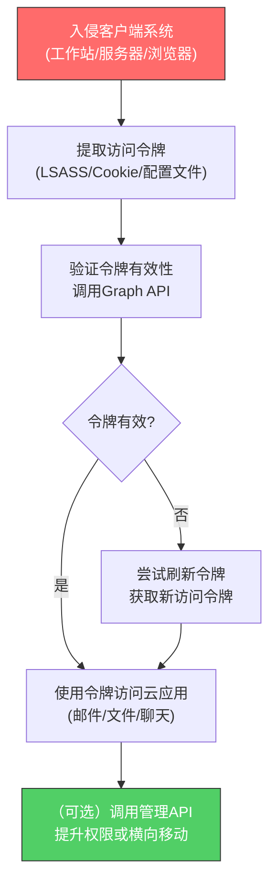

# 应用访问令牌 (T1550.001)

## 一句话通俗理解

> **用窃取的"应用通行证"（OAuth令牌/JWT）冒充合法用户或应用，绕过登录直接访问云应用和API**

## 30秒速查卡

| 维度 | 你需要知道的 |
|------|-------------|
| 这是什么？ | 使用窃取的OAuth/JWT访问令牌冒充合法用户或服务主体访问云应用和API |
| 为什么危险？ | 令牌无需密码即可访问，且令牌有效期长、权限范围广，MFA对令牌无效 |
| 谁需要关心？ | 云安全团队、Identity团队（Azure AD/Okta管理员）、SaaS应用管理员 |
| 你的第一步防御 | 监控Azure AD的SignInLogs中服务主体登录异常，配置条件访问策略限制令牌颁发 |
| 如果只做一件事 | 在Azure AD/Okta中配置条件访问策略，限制令牌有效期和颁发范围 |
| 速查总结 | 应用访问令牌是云时代的"万能钥匙"——一旦窃取，MFA、强密码都形同虚设 |

## 难度等级

⭐⭐⭐ 高级 - 需要深入理解OAuth 2.0、JWT、Azure AD和云身份架构

## 前置知识检查

**读这个文件需要什么？**

- [ ] OAuth 2.0授权框架（授权码流程、客户端凭证流程）
- [ ] JWT（JSON Web Token）结构和验证机制
- [ ] Azure AD / Microsoft Entra ID身份架构
- [ ] 服务主体（Service Principal）和应用程序注册概念
- [ ] 条件访问策略和MFA机制

## 技术描述

**应用访问令牌（T1550.001）** 是MITRE ATT&CK框架中的一种横向移动技术，属于"使用替代认证材料"父技术。

**通俗解释：**

现代云应用（如Microsoft 365、Salesforce、Google Workspace）不再用传统的"用户名+密码"认证，而是用一种叫"访问令牌"的东西——就像酒店的电子房卡，你用密码登录一次后，系统给你一张"房卡"（令牌），之后只要拿着这张卡就能进出房间，不需要再输密码。攻击者发现，如果能偷到这张"房卡"，就能完全冒充你访问所有云应用——而且多因素认证（MFA）对房卡无效，因为MFA只在"办卡"时检查一次。

**过渡段：** 简单来说，程序需要向云身份提供商（如Azure AD）"请求"一个访问令牌，才能调用云应用的API。攻击者窃取了令牌后，就相当于拿到了合法用户或应用的身份凭证——他们可以像合法用户一样访问邮箱、文件、聊天记录，甚至管理控制台。由于令牌是预认证的，传统的密码策略和MFA都无法阻止已签发的令牌被滥用。

**技术原理：**

1. **令牌窃取**：攻击者从被入侵的系统中提取访问令牌——常见来源包括：浏览器Cookie/LocalStorage、LSASS内存、配置文件、云代理日志、编译到应用中的凭据
2. **令牌验证**：攻击者使用窃取的令牌调用云应用API，验证令牌是否有效
3. **令牌滥用**：使用有效令牌访问邮箱、文件、聊天记录，或调用管理API执行特权操作
4. **令牌刷新**：如果窃取了刷新令牌（Refresh Token），攻击者可以在访问令牌过期后申请新的令牌，实现长期访问

**用途与影响：**

应用访问令牌滥用是云时代最严重的横向移动技术之一。由于令牌绕过了MFA，攻击者一旦窃取令牌就能访问用户的所有云资源。APT29（NOBELIUM）在SolarWinds攻击的云阶段大量使用了窃取的Azure AD令牌，访问了受害者的Microsoft 365邮件和文档。令牌滥用还难以检测，因为从云应用的角度看，攻击者的请求与合法用户的请求几乎无法区分。

## 子技术列表

**该技术没有子技术**

## 攻击流程

### 典型攻击流程

```
入侵客户端系统 --> 提取访问令牌 --> 验证令牌有效性 --> 使用令牌访问云应用 --> （可选）使用刷新令牌维持访问
```



**步骤详解：**

1. **入侵客户端系统**
   - 通俗描述：先攻陷一个能接触到云令牌的系统
   - 技术细节：常见入口包括用户工作站（浏览器、Office客户端）、AD FS服务器、云代理、CI/CD管道
   - 常用工具：钓鱼攻击、漏洞利用、供应链攻击

2. **提取访问令牌**
   - 通俗描述：从被攻陷的系统中"偷"出云访问令牌
   - 技术细节：从LSASS内存提取（使用Mimikatz的`sekurlsa::cloudap`）、从浏览器LocalStorage/Cookie提取、从Office应用的Token Cache文件提取、从配置文件提取服务主体凭据
   - 常用工具：Mimikatz、AzureADSigninTool、TokenTactics、ROADtools

3. **验证令牌有效性**
   - 通俗描述：试着用偷来的令牌访问一下云服务，看看还能不能用
   - 技术细节：调用Microsoft Graph API的`/me`端点或Azure AD Graph的`/myorganization`端点，验证令牌是否有效
   - 常用工具：curl、Postman、ROADtools

4. **使用令牌访问云应用**
   - 通俗描述：拿着令牌去访问邮箱、文件、聊天等云应用
   - 技术细节：使用Bearer Token调用Microsoft Graph API（`https://graph.microsoft.com/v1.0/me/messages`获取邮件）、SharePoint API、Teams API
   - 常用工具：Microsoft Graph Explorer、自定义Python脚本

5. **使用刷新令牌维持访问**
   - 通俗描述：如果偷到了"刷新令牌"，可以在访问令牌过期后一直续期
   - 技术细节：调用Azure AD的令牌刷新端点`https://login.microsoftonline.com/common/oauth2/v2.0/token`，用刷新令牌获取新的访问令牌
   - 常用工具：ROADtools、自定义脚本

## 真实案例

### 案例1：APT29（NOBELIUM）在SolarWinds攻击云阶段窃取Azure AD令牌

- **时间**: 2020年12月 - 2021年7月
- **目标**: 美国政府机构、技术公司、关键基础设施供应商
- **攻击组织**: APT29（Cozy Bear / NOBELIUM，俄罗斯SVR关联）
- **手法**: APT29在SolarWinds供应链攻击的云阶段，从被入侵的AD FS（Active Directory Federation Services）服务器上提取了Golden SAML令牌和Azure AD访问令牌。微软和CISA的分析报告显示，攻击者使用Mimikatz的`sekurlsa::cloudap`模块从LSASS内存中提取CloudAP（云认证提供程序）缓存的主刷新令牌（PRT），然后用PRT伪造访问令牌访问Microsoft 365服务。NOBELIUM还开发了一个名为"MagicWeb"的后门，专门用于在AD FS服务器上拦截和窃取SAML令牌——这个后门不是修改AD FS配置，而是直接注入到AD FS的.NET运行时，拦截认证流程
- **影响**: 攻击者成功访问了多个受害者的Microsoft 365邮箱和SharePoint文档，窃取了敏感通信内容；活动持续数月才被发现
- **参考链接**: [CISA - Analyzing NOBELIUM Identity Attack](https://www.cisa.gov/news-events/cybersecurity-advisories/aa21-148a)
  - **数据来源**: 一级

### 案例2：MuddyWater使用OAuth令牌滥用攻击中东政府

- **时间**: 2022年4月 - 2023年1月（被Microsoft和Mandiant跟踪期间）
- **目标**: 中东政府机构、电信公司、大学
- **攻击组织**: MuddyWater（Mercury，伊朗MOIS关联）
- **手法**: MuddyWater在钓鱼攻击成功后，从受害者的Outlook客户端和Edge浏览器中提取OAuth刷新令牌。Microsoft Threat Intelligence Center (MSTIC)的报告显示，攻击者通过自定义PowerShell脚本读取`%LOCALAPPDATA%\Microsoft\Office\16.0\TokenCache`目录下的令牌缓存文件，然后使用窃取的刷新令牌调用Azure AD令牌端点，获取访问Microsoft Graph API的新令牌。攻击者主要使用这些令牌读取受害者的邮件通信，识别高价值目标和内部敏感信息
- **影响**: 多个中东政府机构的邮件通信被长期监控，部分敏感外交通信内容泄露
- **参考链接**: [Microsoft - MuddyWater Threat Analysis](https://www.microsoft.com/en-us/security/blog/2022/04/12/muddywater-information-exfiltration/)
  - **数据来源**: 一级

### 案例3：Peach Sandstorm使用服务主体令牌滥用Azure环境

- **时间**: 2023年2月 - 2023年11月（被Microsoft跟踪期间）
- **目标**: 卫星运营商、国防承包商、能源公司
- **攻击组织**: Peach Sandstorm（HOLMIUM，伊朗IRGC关联）
- **手法**: Peach Sandstorm在初始入侵（通过密码喷洒攻击）成功后，从被入侵的Azure环境中提取服务主体（Service Principal）的应用ID和密钥。Microsoft的报告显示，攻击者通过读取Azure AD Connect服务器的配置文件，提取了同步服务账户的证书和密钥，然后用这些凭据调用Azure AD Graph API，以服务主体身份创建新的应用注册和OAuth同意授权。攻击者创建的恶意应用注册请求了`Mail.Read`、`Files.Read.All`、`User.Read.All`等高权限范围，然后使用这些应用的令牌访问整个租户的邮件和文件
- **影响**: 多个卫星运营商和国防承包商的Azure环境被渗透，敏感技术和合同文档被窃取
- **参考链接**: [Microsoft - Peach Sandstorm Analysis](https://www.microsoft.com/en-us/security/blog/2023/09/14/peach-sandstorm-password-spraying-campaign/)
  - **数据来源**: 一级

## 红队视角

> ⚠️ **免责声明**：以下内容仅用于合法的安全测试、渗透测试和教育目的。未经授权对他人系统进行测试是违法行为。

### 实战技巧

1. **优先提取主刷新令牌（PRT）**
   PRT是Azure AD混合身份环境中的"主令牌"——只要拿到PRT，就可以伪造任何用户的访问令牌。使用Mimikatz的`sekurlsa::cloudap`从LSASS提取PRT，然后用`sekurlsa::pth /user:USER /prt:PRT`传递

2. **关注AD FS服务器**
   AD FS服务器是本地AD到Azure AD的"桥梁"，存储了用于签发SAML令牌的私钥。攻陷AD FS服务器后，可以提取私钥并伪造任意用户的SAML令牌（即"Golden SAML"攻击），完全绕过Azure AD认证

3. **使用ROADtools处理Azure AD令牌**
   ROADtools是一套专门处理Azure AD令牌的Python工具，可以解析JWT、刷新令牌、调用Graph API。在授权测试中比手动编写脚本更高效

4. **滥用OAuth同意授权**
   创建一个恶意的应用注册，请求`Mail.Read`、`Files.Read.All`等高权限范围，然后通过钓鱼诱导用户同意授权——一旦用户同意，攻击者就能以应用身份访问用户的邮件和文件

### 常用工具

| 工具名称 | 用途 | 平台 | 链接 |
|----------|------|------|------|
| Mimikatz | 从LSASS提取PRT和令牌缓存 | Windows | [Mimikatz](https://github.com/gentilkiwi/mimikatz) |
| ROADtools | Azure AD令牌处理和Graph API访问 | 跨平台 | [ROADtools](https://github.com/dirkjanm/ROADtools) |
| TokenTactics | Azure AD令牌生成和滥用 | 跨平台 | [TokenTactics](https://github.com/rvrsh3ll/TokenTactics) |
| AzureHound | Azure AD环境侦察和数据收集 | 跨平台 | [AzureHound](https://github.com/BloodHoundAD/AzureHound) |
| AADInternals | Azure AD内部操作和滥用 | 跨平台 | [AADInternals](https://github.com/Gerenios/AADInternals) |
| Microsoft Graph Explorer | 测试Graph API调用 | Web | [Graph Explorer](https://developer.microsoft.com/graph/graph-explorer) |

### 注意事项

- **令牌有效期**：Azure AD访问令牌默认有效期为1小时，刷新令牌默认90天（可配置）——长期访问需要定期刷新
- **条件访问策略**：现代Azure AD环境通常配置了条件访问策略，限制令牌颁发——需要确认目标环境的策略配置
- **审计日志**：Azure AD的SignInLogs和AuditLogs会记录令牌使用情况——所有API调用都会留痕
- **合规边界**：云身份攻击在中国《网络安全法》、欧盟GDPR和美国CFAA下均属违法行为，仅在书面授权范围内执行

## 蓝队视角

### 检测要点

1. **服务主体登录异常**
   - 日志来源：Azure AD SignInLogs
   - 关注字段：ServicePrincipalId、ResourceId、ClientAppUsed、ConditionalAccessStatus
   - 异常特征：服务主体从异常IP登录、非工作时间的大量API调用、使用遗留认证协议

2. **OAuth应用同意授权异常**
   - 日志来源：Azure AD AuditLogs
   - 关注字段：OperationName="Consent to application"、TargetResources、InitiatedBy
   - 异常特征：用户同意了高权限范围（Mail.Read、Files.Read.All）的应用、新注册的应用快速获得同意

3. **令牌刷新异常**
   - 日志来源：Azure AD SignInLogs
   - 关注字段：AuthenticationProtocol、TokenIssuerType
   - 异常特征：同一用户频繁刷新令牌、从不同IP刷新令牌、刷新令牌被用于访问非预期资源

### 监控建议

- 配置Azure AD条件访问策略，限制令牌颁发范围和有效期
- 部署Microsoft Defender for Cloud Apps（前身为MCAS），监控异常API调用
- 配置Azure AD审计日志导出到SIEM（Sentinel/Splunk），建立令牌使用基线
- 启用Azure AD的"风险检测"，识别异常登录和令牌滥用
- 定期审计OAuth应用注册和同意授权，识别可疑应用

## 避坑指南

防御最大误区：认为MFA能阻止所有横向移动——令牌是MFA之后的产物，MFA对已签发的令牌完全无效。

## 检测建议

### 网络层检测

**检测方法：** 监控到Azure AD和Microsoft Graph的HTTPS流量模式，识别异常API调用

**具体规则/命令示例：**

```bash
# 检测到login.microsoftonline.com和graph.microsoft.com的异常调用
# 注意：HTTPS流量需要TLS解密才能深度检测
tshark -i eth0 -Y "
  (tls.handshake.type == 1 and 
   (tls.handshake.extensions_server_name contains 'login.microsoftonline.com' or 
    tls.handshake.extensions_server_name contains 'graph.microsoft.com'))" \
  -T fields -e ip.src -e tls.handshake.extensions_server_name
```

**示例（Snort/Suricata规则）：**
```
alert tls $HOME_NET any -> any any (msg:"Azure AD Token Endpoint Access"; \
  tls.sni; content:"login.microsoftonline.com"; \
  reference:url,attack.mitre.org/techniques/T1550/001; \
  sid:20210004; rev:1;)
```

### 主机层检测

**检测方法：** 监控LSASS的令牌提取、浏览器令牌缓存访问、Office应用的令牌使用

**Windows事件ID：**

- Sysmon EventID 10：进程访问LSASS（关注Mimikatz特征）
- Sysmon EventID 1：进程创建，关注ROADtools、TokenTactics、AADInternals等工具
- Sysmon EventID 11：文件创建，关注TokenCache目录的异常访问

**具体命令示例：**

```bash
# 查询Sysmon日志中访问LSASS的进程
Get-WinEvent -LogName "Microsoft-Windows-Sysmon/Operational" -FilterXPath "*[System[(EventID=10)]]" |
  Where-Object { $_.Message -match "lsass.exe" -and $_.Message -match "GrantedAccess.*0x1410|0x1010" } |
  Select-Object TimeCreated, Message -First 20

# 查询TokenCache目录的异常访问
Get-WinEvent -LogName "Microsoft-Windows-Sysmon/Operational" -FilterXPath "*[System[(EventID=11)]]" |
  Where-Object { $_.Message -match "TokenCache|LocalAppData.*Microsoft.*Office" } |
  Select-Object TimeCreated, Message -First 20
```

### 应用层检测

**检测方法：** 在Azure AD中监控服务主体登录、OAuth同意授权、令牌刷新模式

**用人话说：**

> 应用访问令牌滥用在Azure AD日志中有三个标志性特征：(1)SignInLogs中出现服务主体登录（非用户登录），且来源IP异常；(2)AuditLogs中出现新的OAuth应用同意授权，且请求了高权限范围（Mail.Read、Files.Read.All）；(3)同一用户在短时间内从不同IP刷新令牌。由于令牌滥用看起来像合法API调用，必须结合"用户行为基线"进行异常检测——例如，普通用户不会在凌晨3点从海外IP访问Graph API。

**Sigma规则示例（Azure AD）：**

```yaml
title: Suspicious Azure AD Service Principal Login from Anomalous Location
status: experimental
description: Detects service principal login from anomalous IP addresses
references:
  - https://attack.mitre.org/techniques/T1550/001/
  - https://www.cisa.gov/news-events/cybersecurity-advisories/aa21-148a
author: SOC Team
date: 2026/07/11
logsource:
  product: azure
  service: signinlogs
detection:
  selection_service_principal:
    Identity: "ServicePrincipal"
  selection_anomalous_location:
    Location|contains:
      - "Russia"
      - "China"
      - "Iran"
      - "North Korea"
  selection_legacy_auth:
    ClientAppUsed|contains:
      - "Exchange ActiveSync"
      - "IMAP"
      - "POP3"
      - "SMTP"
  condition: selection_service_principal and (selection_anomalous_location or selection_legacy_auth)
falsepositives:
  - Legitimate service principal integration from offshore developers
  - Legacy application using basic authentication
level: high
tags:
  - attack.lateral_movement
  - attack.t1550.001
```

**KQL查询示例（Azure Sentinel）：**

```kql
// 检测异常的OAuth应用同意授权
AuditLogs
| where OperationName == "Consent to application"
| extend TargetResource = parse_json(TargetResources)[0].DisplayName
| extend InitiatingUser = parse_json(InitiatedBy).user.userPrincipalName
| extend Permissions = parse_json(TargetResources)[0].modifiedProperties
| where Permissions has "Mail.Read" or Permissions has "Files.Read.All"
| project TimeGenerated, InitiatingUser, TargetResource, Permissions
```

## 缓解措施

### 优先级1：关键措施

**措施名称：** 配置Azure AD条件访问策略限制令牌颁发

**具体实施步骤：**

1. 在Azure AD中配置条件访问策略，限制令牌颁发范围：
   - 要求所有云应用访问必须来自合规设备
   - 限制遗留认证协议（IMAP、POP3、SMTP）
   - 要求高风险登录必须重新认证
2. 配置会话控制策略，限制会话有效期和刷新频率
3. 启用Azure AD身份保护，自动检测和阻止风险登录

**配置示例：**
```powershell
# 通过PowerShell配置Azure AD条件访问策略（需AzureAD模块）
Connect-AzureAD
$policy = New-AzureADMSConditionalAccessPolicy `
  -DisplayName "Block Legacy Authentication" `
  -State "Enabled" `
  -Conditions @{
    ClientAppTypes = @("Exchange ActiveSync", "IMAP", "POP3", "SMTP")
    Applications = @{ IncludeApplications = @("All") }
  } `
  -GrantControls @{
    Operator = "OR"
    BuiltInControls = @("Block")
  }
```

### 优先级2：重要措施

**措施名称：** OAuth应用治理和同意授权控制

**具体实施步骤：**

1. 在Azure AD中启用"用户可以同意应用访问公司数据"的限制：
   - 设置为"No"或"Allow for verified publishers"
   - 要求所有非验证发布者的应用同意必须经过管理员审批
2. 部署Microsoft Defender for Cloud Apps，监控异常应用行为
3. 定期审计OAuth应用注册和同意授权，识别可疑应用
4. 配置应用同意策略，限制用户可以同意的权限范围

### 优先级3：建议措施

**措施名称：** 令牌缓存保护和LSASS防护

**具体实施步骤：**

1. 在所有Windows主机上启用Credential Guard，保护LSASS中的凭据和令牌
2. 配置Sysmon监控LSASS访问，识别Mimikatz等令牌提取工具
3. 限制AD FS服务器的访问权限，定期轮换AD FS令牌签名证书
4. 教育用户识别OAuth同意钓鱼，不要同意未知应用的权限请求

### MITRE ATT&CK 缓解措施映射

| 缓解措施ID | 缓解措施名称 | 适用性 | 说明 |
|------------|-------------|--------|------|
| M1041 | 加密敏感信息 | 适用 | 启用Credential Guard保护令牌缓存 |
| M1018 | 用户账户管理 | 适用 | 限制用户同意OAuth应用的权限 |
| M1032 | 多因素认证 | 部分适用 | MFA对令牌签发有效，但对已签发令牌无效 |
| M1036 | 账户使用策略 | 适用 | 配置条件访问策略限制令牌颁发 |

## 动手实验

> ⚠️ **重要提示**：所有实验必须在隔离的实验室环境中进行，禁止对未授权的真实系统进行测试。

### 实验环境准备

**推荐靶场/实验平台：**

| 平台名称 | 类型 | 难度 | 链接 |
|----------|------|------|------|
| Azure AD免费租户 | 云环境 | 中级 | [Azure AD Free](https://azure.microsoft.com/en-us/free/) |
| Microsoft 365 Developer Program | 开发者租户 | 中级 | [M365 Dev](https://developer.microsoft.com/microsoft-365/dev-program) |
| GOAD (含AD FS) | 虚拟靶场 | 高级 | [GOAD](https://github.com/Orange-Cyberdefense/GOAD) |

**所需工具：**

- Mimikatz：从LSASS提取令牌
- ROADtools：Azure AD令牌处理
- AzureHound：Azure AD环境侦察
- PowerShell AzureAD模块：管理操作

**环境搭建：**

```bash
# 推荐使用Microsoft 365 Developer Program创建免费开发者租户
# 注册地址：https://developer.microsoft.com/microsoft-365/dev-program
# 创建租户后，配置测试用户和服务主体

# 安装必要工具
pip install roadtools roadlib roadrecon
Install-Module -Name AzureAD -Force
Install-Module -Name AzureADPreview -Force
```

### 实验1：使用ROADtools提取和解析Azure AD令牌（初级）

**实验目标：** 理解Azure AD令牌的结构和ROADtools的基本用法

**实验步骤：**

1. 在开发者租户中创建测试用户，并登录到Microsoft 365
2. 在测试用户的工作站上安装ROADtools
3. 使用ROADtools获取访问令牌：
   ```bash
   roadtx token --password testuser@tenant.onmicrosoft.com --password 'P@ssw0rd!'
   ```
4. 使用ROADtools解析令牌：
   ```bash
   roadtx describe --tokens roadtx_tokens.json
   ```
5. 使用令牌调用Graph API：
   ```bash
   roadtx graph --tokens roadtx_tokens.json /me
   ```

**预期结果：** 能成功获取、解析和使用Azure AD访问令牌

**学习要点：** 理解Azure AD令牌的结构（header、payload、signature）和权限范围（scope）

### 实验2：模拟OAuth同意钓鱼攻击（中级）

**实验目标：** 理解OAuth同意授权滥用的原理和检测方法

**实验步骤：**

1. 在开发者租户中注册一个测试应用，请求`Mail.Read`和`Files.Read.All`权限
2. 构造OAuth同意URL，模拟钓鱼链接
3. 在测试浏览器中访问同意URL，模拟用户同意授权
4. 使用应用令牌访问测试用户的邮件和文件
5. 在Azure AD AuditLogs中查询同意授权事件

**预期结果：** 应用获得授权后能访问用户邮件，且Azure AD日志记录了同意事件

**学习要点：** 理解OAuth同意钓鱼的攻击原理和Azure AD日志特征

### 实验3：构建令牌滥用检测规则（高级）

**实验目标：** 设计多维度检测规则，覆盖应用访问令牌滥用的主要场景

**实验步骤：**

1. 设计KQL查询规则：
   - 服务主体从异常IP登录
   - OAuth应用同意授权高权限范围
   - 令牌刷新异常模式
2. 在Azure Sentinel中实现检测规则
3. 模拟三种攻击场景，验证规则覆盖率
4. 优化规则阈值，降低误报率

**预期结果：** 能检测三种令牌滥用场景，误报率可控

**学习要点：** 掌握Azure AD日志分析和KQL查询优化

## 术语解释

| 术语 | 英文原名 | 通俗解释 |
|------|----------|----------|
| OAuth 2.0 | Open Authorization 2.0 | 开放授权协议，让应用能访问用户数据而不需要密码 |
| JWT | JSON Web Token | 一种紧凑的令牌格式，像一张电子身份证 |
| 访问令牌 | Access Token | 短期令牌（通常1小时），用于访问云应用API |
| 刷新令牌 | Refresh Token | 长期令牌（通常90天），用于申请新的访问令牌 |
| PRT | Primary Refresh Token | 主刷新令牌，Azure AD混合身份的"主钥匙" |
| 服务主体 | Service Principal | 应用在Azure AD中的身份，类似应用的"账号" |
| 条件访问 | Conditional Access | Azure AD的策略引擎，根据条件控制访问 |
| AD FS | Active Directory Federation Services | 本地AD到云身份的"桥梁"服务 |
| Golden SAML | Golden SAML | 伪造SAML令牌的攻击技术，类似Golden Ticket |
| LSASS | Local Security Authority Subsystem Service | Windows的安全子系统，存储凭据和令牌 |

## 认知偏误分析

### 常见认知偏误

| 偏误类型 | 具体表现 | 正确做法 |
|----------|----------|----------|
| 锚定效应 | 检测规则仅盯"MFA要求"，认为有MFA就安全——忽略令牌是MFA之后的产物 | 应监控令牌签发后的使用模式，识别异常API调用 |
| 确认偏误 | 看到服务主体登录立即判定为攻击，忽略合法的应用集成 | 结合应用注册基线、登录IP基线、API调用基线综合分析 |
| 可得性启发 | 因NOBELIUM案例被广泛报道，过度关注AD FS攻击而忽略浏览器令牌提取、OAuth同意钓鱼等变种 | 建立覆盖所有令牌窃取向量的检测矩阵 |

## 参考资料

### 📚 官方文档（深入了解）

- [MITRE ATT&CK - Application Access Token (T1550.001)](https://attack.mitre.org/techniques/T1550/001/)
- [MITRE ATT&CK - Use Alternate Authentication Material (T1550)](https://attack.mitre.org/techniques/T1550/)
- [Microsoft - Azure AD Security Documentation](https://learn.microsoft.com/en-us/azure/active-directory/fundamentals/security-overview)

### 📰 安全报告（真实攻击）

- [CISA Alert AA21-148A - NOBELIUM Identity Attack](https://www.cisa.gov/news-events/cybersecurity-advisories/aa21-148a) - APT29窃取Azure AD令牌的分析
- [Microsoft - MuddyWater Threat Analysis](https://www.microsoft.com/en-us/security/blog/2022/04/12/muddywater-information-exfiltration/) - MuddyWater使用OAuth令牌
- [Microsoft - Peach Sandstorm Analysis](https://www.microsoft.com/en-us/security/blog/2023/09/14/peach-sandstorm-password-spraying-campaign/) - Peach Sandstorm滥用服务主体令牌

### 🔧 工具与资源（动手试试）

- [ROADtools](https://github.com/dirkjanm/ROADtools) - Azure AD令牌处理工具套件
- [Mimikatz](https://github.com/gentilkiwi/mimikatz) - 凭据和令牌提取工具
- [AADInternals](https://github.com/Gerenios/AADInternals) - Azure AD内部操作工具
- [AzureHound](https://github.com/BloodHoundAD/AzureHound) - Azure AD环境侦察
- [Microsoft Graph Explorer](https://developer.microsoft.com/graph/graph-explorer) - Graph API测试工具

### 📖 学习资料（深入了解）

- [Microsoft - Azure AD Identity Security](https://learn.microsoft.com/en-us/azure/security/fundamentals/identity-management-overview) - Azure AD身份安全指南
- [Dirkjanm - Azure AD Attack Research](https://dirkjanm.io/) - Azure AD攻击研究博客
- [Cloud Security Alliance - Cloud Threats](https://cloudsecurityalliance.org/research/) - 云安全威胁研究
- [MITRE ATT&CK Navigator](https://mitre-attack.github.io/attack-navigator/) - ATT&CK可视化工具

## 版本历史

| 版本 | 日期 | 变更内容 | 变更人 | 审核人 |
|------|------|----------|--------|--------|
| v1.0 | 2026-07-11 | 初始入库 | 安全团队 | 知识库维护组 |
