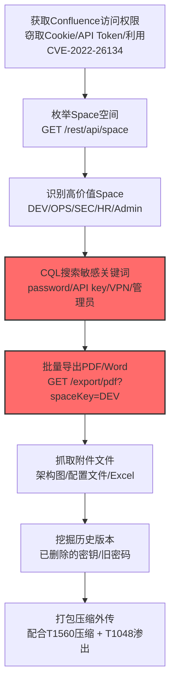

# 从Confluence Wiki收集 (T1213.001)

## 一句话通俗理解

> **攻击者用合法账号或漏洞闯入企业Confluence知识库，批量打包带走内部文档、项目规划和技术资料**

## 30秒速查卡

| 维度 | 你需要知道的 |
|------|-------------|
| 这是什么？ | 攻击者通过窃取凭证或利用Confluence漏洞，登录企业Atlassian Confluence系统后批量搜索、导出、下载空间（Space）中的页面、附件、评论 |
| 为什么危险？ | Confluence是企业"内部知识金矿"，常存放架构图、API密钥、运维手册、新员工指南——攻击者拿到这些资料等于拿到了企业全部"内部地图" |
| 谁需要关心？ | 知识管理团队、SOC分析师、DevOps团队、SaaS安全团队 |
| 你的第一步防御 | 启用Confluence审计日志，监控异常批量导出操作和异常搜索查询（如搜索"password"、"API key"） |
| 如果只做一件事 | 对Confluence管理员账号启用MFA，并监控所有跨空间的批量导出行为 |
| 速查总结 | Confluence = 企业内部"知识金库"，攻击者一旦进入即等同于拿到组织全景图，必须严防批量导出和敏感词搜索 |

## 难度等级

⭐⭐ 中级 - 需要一定的技术基础和经验
**前置知识要求**：会用浏览器、了解企业协作平台基本概念、了解REST API基础

## 前置知识检查

**读这个文件需要什么？**

- [ ] 知道什么是Wiki和企业知识库
- [ ] 了解HTTP REST API基本概念（GET/POST请求）
- [ ] 知道什么是JWT/Session令牌
- [ ] 了解Atlassian Confluence基本结构（Space/Page/Attachment）
- [ ] 知道什么是OAuth 2.0和API Token

**通俗讲解这些概念：**
- **Wiki**：就像公司内部版的"维基百科"，员工把工作流程、会议记录、技术文档都写在这里
- **Confluence**：Atlassian公司出品的"企业级Wiki"，比普通Wiki多了权限管理、模板、空间隔离等功能
- **Space**：Confluence里把不同项目/部门的内容隔开用的"项目文件夹"
- **REST API**：用HTTP协议访问Confluence数据的程序接口，比如`/rest/api/content`能列出所有页面

## 技术描述

**从Confluence Wiki收集**（T1213.001）是 **从信息仓库收集数据**（T1213）的一个具体变体，属于 **收集** 阶段的攻击技术。

> 💬 **打个比方**：Confluence就像公司的"内部档案室+培训手册+技术宝典"三合一仓库。员工每天都来翻它、写它。攻击者闯进来后，不像翻办公室抽屉那样一个个找——他们直接问管理员："我要看所有标了'核心'的档案"，10分钟就把整个档案室复制走了。

### 具体怎么理解？

攻击者通过窃取的凭证（Cookie、Session Token、API Token）或利用Confluence已知漏洞（如CVE-2022-26134 OGNL注入）进入企业Confluence系统后，会执行以下操作：

1. **枚举空间（Space）**：列出所有可访问的Space，识别有价值的目标
2. **搜索敏感关键词**：使用CQL（Confluence Query Language）搜索"密码"、"VPN"、"管理员"、"密钥"等
3. **批量导出页面**：使用Confluence的PDF/Word/HTML导出功能一次性下载整个Space
4. **抓取附件**：页面里嵌入的附件（架构图PDF、配置文件、Excel数据表）是最值钱的数据
5. **历史版本挖掘**：访问页面的历史版本，因为旧版本可能包含已经被删除的敏感信息（如老密钥）

### 过渡段：从比喻到技术原理

> 你可能会问：既然Confluence有权限管理，攻击者怎么看到不该看的东西？答案有三种途径：
> 1. **凭证窃取**：拿到了管理员或编辑者的Session Cookie
> 2. **权限提升漏洞**：利用CVE-2022-26134这种RCE漏洞，绕过身份验证
> 3. **过度授权**：企业Confluence经常默认授予"全公司可读"权限，普通员工账号就能读所有内容

接下来我们看看真正的技术细节——攻击者到底用什么命令、什么API来收集数据。

### 技术原理

**核心API端点（REST API v1/v2）：**

| API端点 | 用途 |
|---------|------|
| `GET /rest/api/space` | 列出所有Space（识别有价值的目标空间） |
| `GET /rest/api/content?spaceKey=DEV&type=page&limit=100` | 列出指定Space的所有页面 |
| `GET /rest/api/content/{id}?expand=body.storage,version` | 获取页面完整内容（含HTML源码） |
| `GET /rest/api/content/{id}/child/attachment` | 获取页面附件列表 |
| `GET /rest/api/search?cql=text~"password"` | 使用CQL搜索内容（攻击者最爱） |
| `GET /rest/api/content/search?cql=space=DEV+and+type=page` | 跨Space搜索页面 |
| `GET /export/pdf?spaceKey=DEV` | 导出整个Space为PDF（批量收集最常用） |

**用curl演示：**
```bash
# 步骤1：列出所有Space
curl -s -H "Authorization: Basic ${TOKEN}" \
  "https://confluence.target.com/rest/api/space?limit=100"

# 步骤2：搜索包含"password"的页面
curl -s -H "Authorization: Basic ${TOKEN}" \
  "https://confluence.target.com/rest/api/search?cql=text~%22password%22&limit=50"

# 步骤3：批量导出某个Space为PDF
curl -s -L -o dev_space_backup.pdf \
  -H "Authorization: Basic ${TOKEN}" \
  "https://confluence.target.com/export/pdf?spaceKey=DEV"
```

### 用途与影响

**攻击者用这些数据做什么？**
- **凭证扩展**：从运维文档中找到其他系统的登录凭据
- **网络拓扑测绘**：架构图帮助攻击者识别关键服务器和横向移动路径
- **社会工程弹药**：内部人员信息让鱼叉钓鱼更可信
- **源代码窃取**：开发文档常常包含GitHub仓库地址和访问密钥
- **业务情报窃取**：产品路线图、客户清单、报价方案

## 子技术列表

T1213.001 是 T1213 的子技术，自身没有子技术。

| 子技术ID | 名称 | 描述 |
|----------|------|------|
| （无子技术） | - | T1213.001 为叶子节点 |

## 攻击流程



**步骤详解：**

1. **获取Confluence访问权限** - 通过Cookie窃取（XSS、中间人）、API Token泄露（GitHub硬编码、配置文件暴露）、或利用Confluence已知RCE漏洞（CVE-2022-26134 OGNL注入、CVE-2021-26084 OGNL注入）
2. **枚举Space空间** - 调用`/rest/api/space`列出所有可见的Space，标记有价值的目标（如"DEV"开发空间、"OPS"运维空间、"Admin"管理空间）
3. **识别高价值Space** - 攻击者通常优先关注名称包含`Admin`、`Infrastructure`、`Security`、`DevOps`、`Secrets`、`Onboarding`的Space
4. **CQL搜索敏感关键词** - 使用Confluence Query Language批量搜索"password"、"API key"、"secret"、"token"、"VPN"、"管理员密码"等关键词
5. **批量导出PDF/Word** - 调用Confluence导出接口，一次性把整个Space打包成PDF或HTML下载，这是最快速的批量收集方式
6. **抓取附件文件** - 页面正文是文字，附件才是真正的金矿（架构图Visio文件、Excel配置清单、PDF合同文档）
7. **挖掘历史版本** - 页面的历史版本可能包含已经被删除的敏感信息（如旧API密钥、已经更新的密码）
8. **打包压缩外传** - 收集到的数据配合T1560压缩归档后，通过T1048未加密渗出或T1567加密通道渗出

## 真实案例

### 案例1：Conti勒索软件从Confluence提取运维凭据

- **时间**：2021-2022年
- **目标**：多个医疗、制造、零售企业
- **攻击组织**：Conti勒索软件团伙
- **手法**：Conti操作者在初始入侵后，第一时间搜索企业内部的Confluence知识库。他们使用窃取的Cookie登录Confluence，使用CQL搜索关键词"vCenter"、"ESXi"、"admin password"、"domain controller"。在多个被入侵企业的Confluence中，Conti找到了运维团队编写的"故障应急手册"，其中明文记录了vCenter root密码、ESXi SSH密钥、域管理员账号密码。攻击者用这些凭据在2-3小时内完成全网横向移动，最终部署勒索软件加密所有服务器。Advanced Intelligence（AdvIntel）报告显示，Conti在60%的攻击中都优先攻击Confluence
- **影响**：导致多个医疗系统停摆、零售连锁企业收银系统宕机，单次攻击勒索赎金最高达4000万美元（Ireland Health Service Executive案例）
- **参考链接**：
  - [Advanced Intelligence - Conti Tactics Report](https://www.advintel.io/post/conti-ransomware-tactics) （一级来源 - 顶级威胁情报厂商）
  - [CISA Alert AA21-265A - Conti Ransomware](https://www.cisa.gov/news-events/cybersecurity-advisories/aa21-265a) （一级来源 - 美国政府官方）

### 案例2：UNC2402利用CVE-2022-26134窃取Confluence数据

- **时间**：2022年5-6月
- **目标**：东南亚某国政府机构和电信运营商
- **攻击组织**：UNC2402（疑似中国背景APT，Mandiant命名）
- **手法**：攻击者利用Atlassian Confluence Server/Data Center的CVE-2022-26134 OGNL注入漏洞（CVSS 9.8），在未授权状态下直接执行系统命令。他们通过OGNL表达式构造的URL路径`/${@java.lang.Runtime@getRuntime().exec("id")}/`绕过身份验证进入Confluence。进入后，攻击者使用Confluence自带的导出功能将整个Space打包为PDF下载，并使用`wget`命令将数据库中的页面内容打包后通过HTTPS外传到攻击者控制的C2服务器。Volexity和Mandiant分别独立追踪到该组织的活动
- **影响**：导致目标机构内部政策文件、人员信息、电信网络架构图泄露，攻击者获得了目标网络的完整情报
- **参考链接**：
  - [Volexity - Zero-Day Exploitation of Atlassian Confluence](https://www.volexity.com/blog/2022/06/02/zero-day-exploitation-of-atlassian-confluence/) （一级来源 - 顶级威胁情报厂商）
  - [Mandiant - UNC2402 Tracking Report](https://www.mandiant.com/resources/zero-day-exploitation-atlassian-confluence) （一级来源 - 顶级威胁情报厂商）
  - [Atlassian Security Advisory - CVE-2022-26134](https://confluence.atlassian.com/doc/confluence-security-advisory-2022-06-02-1130377146.html) （一级来源 - 厂商官方）

### 案例3：Lapsus$通过承包商账号窃取Okta Confluence

- **时间**：2022年1-3月
- **目标**：Okta及其客户的Confluence空间
- **攻击组织**：Lapsus$（也称为DEV-0537，Microsoft命名）
- **手法**：Lapsus$通过社会工程攻击Okta的第三方承包商Sitael，获得了承包商工程师的Confluence访问权限。该工程师的账号拥有Okta内部Confluence的只读权限。Lapsus$使用此账号登录后，批量导出了Okta内部"客户支持"Space中的所有页面，包含客户公司的管理员邮箱、Okta租户ID、内部故障处理流程。他们还使用CQL搜索关键词"customer"、"tenant"、"admin"，找到大量客户敏感信息。Lapsus$将这些数据上传到Telegram频道公开发布，向Okta施压勒索。Okta后续确认有2.5%的客户（约366家企业）数据被泄露
- **影响**：导致Okta股价下跌11%，受影响客户包括Cloudflare、FedEx、T-Mobile等366家企业，多家客户被迫重置所有员工密码和MFA设备
- **参考链接**：
  - [Okta Official Statement - January 2022 Incident](https://www.okta.com/blog/2022/03/okta-statement-on-january-2022-incident/) （一级来源 - 厂商官方）
  - [Microsoft Security Response - DEV-0537 Lapsus$](https://www.microsoft.com/en-us/security/blog/2022/03/22/dev-0537-criminal-group-targeting-organizations-for-data-theft-and-destruction/) （一级来源 - 顶级厂商）
  - [Reuters - Lapsus$ Group Reporting](https://www.reuters.com/business/finance/okta-shares-tumble-after-hack-revelation-2022-03-23/) （二级来源 - 主流媒体）

## 红队视角

> ⚠️ **免责声明**：以下内容仅用于合法的安全测试、渗透测试和教育目的。未经授权对他人系统进行测试是违法行为。

### 实战技巧

1. **优先识别Confluence实例**：通过子域名扫描（如`wiki.target.com`、`confluence.target.com`、`docs.target.com`）或Shodan搜索`http.title:"Confluence`快速发现目标
2. **Cookie劫持优于账号爆破**：通过XSS窃取Confluence Session Cookie，避免触发账号锁定告警。注意Confluence Session默认有效期是会话级，但"Remember Me"Cookie有效30天
3. **CQL是关键武器**：熟练使用CQL语法，能比UI搜索更高效地定位敏感信息。`cql=space=DEV and text~"password" and type=page`
4. **隐藏导出痕迹**：使用单个API调用获取页面内容（`/rest/api/content/{id}?expand=body.storage`）比使用PDF导出更隐蔽，因为PDF导出会触发审计日志中的"export"事件

### 常用工具

| 工具名称 | 用途 | 平台 | 特点 |
| -------- | ---- | ---- | ---- |
| [Confuser](https://github.com/klezVirus/confuser) | Confluence敏感信息扫描器 | Python | 自动化扫描Confluence中的密钥、密码、令牌 |
| [Atlassian CLI](https://github.com/solectrus/atlassian-cli) | Confluence命令行客户端 | 跨平台 | 支持批量导出和CQL查询 |
| [Python atlassian-python-api](https://github.com/atlassian-api/atlassian-python-api) | Confluence Python SDK | Python | 最完整的Python Confluence API封装 |
| [Confluence Dumper](https://github.com/Smaash/confluence-dumper) | Confluence批量下载器 | Python | 一键下载整个Space所有页面和附件 |
| [CURL](https://curl.se/) | 通用HTTP工具 | 跨平台 | 配合Confluence REST API使用 |

### 注意事项

- Confluence Cloud和Server/Data Center的API端点略有差异（Cloud路径为`/wiki/rest/api/`，Server为`/rest/api/`），测试时注意区分
- Confluence Cloud默认开启审计日志（Atlassian Access订阅），但Server/Data Center需要管理员手动启用审计日志插件
- PDF导出操作在审计日志中以`EXPORT_SPACE`事件类型记录，注意不要在大规模攻击时使用，避免被发现

## 蓝队视角

### 检测要点

1. **审计日志监控**：关注`EXPORT_SPACE`、`EXPORT_PAGE`、`SEARCH`（含CQL查询语句）事件
2. **API调用频率**：同一账号短时间内大量调用`/rest/api/content`端点是异常信号
3. **CQL搜索内容**：监控搜索包含`password`、`token`、`secret`、`admin`等敏感关键词的CQL查询
4. **异常登录位置**：关注从未见过的IP或地理位置登录Confluence
5. **未授权RCE痕迹**：检查Confluence Server的`atlassian-confluence-security.log`，关注OGNL表达式注入的URL路径

### 监控建议

- 在Confluence Server/Data Center上启用**Audit Log Plugin**，将日志转发到SIEM
- 在Confluence Cloud上启用**Atlassian Access**，获取详细的访问日志和异常登录告警
- 部署**Cloud Access Security Broker (CASB)**，监控Confluence的API调用模式
- 设置**DLP策略**，对Confluence中的文档标记敏感等级，监控大量敏感文档被下载的行为

## 检测建议

### 检测思路

检测从Confluence收集的关键是识别"批量"和"敏感"两个特征：批量导出、批量搜索、敏感关键词查询、异常IP登录。

### 网络层检测

**1. 监控Confluence API调用频率：**

```bash
# 检测同一IP短时间内大量调用Confluence REST API
# Apache/Nginx日志示例
awk '/\/rest\/api\// {count[$1]++} END {for (ip in count) if (count[ip] > 100) print ip, count[ip]}' /var/log/apache2/confluence-access.log

# 检测PDF导出请求
grep "/export/pdf?spaceKey=" /var/log/apache2/confluence-access.log | awk '{print $1, $7}'
```

**2. 检测CQL敏感关键词搜索：**

```bash
# 从URL参数中提取CQL查询
grep -E "cql=[^&]*(password|secret|token|api_key|admin)" /var/log/apache2/confluence-access.log
```

### 主机层检测

**Confluence Server日志关键事件：**

| 日志事件 | 含义 | 严重程度 |
|----------|------|----------|
| `EXPORT_SPACE` | 整个Space被导出 | 高（需人工复核） |
| `EXPORT_PAGE` | 单个页面被导出 | 中 |
| `VIEW_ATTACHMENTS` | 附件被下载 | 中 |
| `LOGIN_FAILED` | 登录失败 | 低（关注爆破） |
| `LOGIN_SUCCESS_NEW_IP` | 新IP登录成功 | 高 |

**Sigma规则：检测Confluence批量导出（Web服务器日志）：**

```yaml
title: 检测Confluence批量Space导出操作
id: 5d8b9a4c-3e2f-4a1b-9c5d-6e7f8a9b0c1d
status: stable
description: 检测同一账号短时间内触发多次Confluence Space导出，可能为数据窃取行为
references:
    - https://attack.mitre.org/techniques/T1213/001/
    - https://confluence.atlassian.com/doc/audit-log-92203456.html
tags:
    - attack.collection
    - attack.t1213.001
    - attack.t1213
logsource:
    product: confluence
    service: audit
detection:
    selection_export:
        event|contains: 'EXPORT_SPACE'
    timeframe: 1h
    condition: selection_export | count() by user > 3
fields:
    - user
    - event
    - space_key
    - source_ip
    - user_agent
falsepositives:
    - 管理员定期归档Space
    - 合规审计要求导出
level: high
```

**Sigma规则：检测CVE-2022-26134漏洞利用（OGNL注入）：**

```yaml
title: 检测CVE-2022-26134 Confluence OGNL注入尝试
id: 7a9b8c7d-6e5f-4a3b-2c1d-0e9f8a7b6c5d
status: stable
description: 检测Confluence访问日志中的OGNL注入特征URL，对应CVE-2022-26134
references:
    - https://confluence.atlassian.com/doc/confluence-security-advisory-2022-06-02-1130377146.html
    - https://attack.mitre.org/techniques/T1213/001/
tags:
    - attack.collection
    - attack.t1213.001
    - attack.t1213
    - attack.initial_access
    - attack.t1190
logsource:
    product: webserver
    service: access
detection:
    selection_ognl:
        cs-uri-query|contains:
            - '${@java'
            - '${Runtime'
            - '${@java.lang.Runtime'
            - '@getRuntime'
    condition: selection_ognl
fields:
    - src_ip
    - cs-uri-query
    - cs-user-agent
falsepositives:
    - 安全扫描器误报
level: critical
```

### 应用层检测

**Confluence Cloud Microsoft Sentinel检测：**

```kusto
// Azure Sentinel KQL查询：检测异常Confluence访问
AtlassianAccessLogs
| where TimeGenerated > ago(24h)
| where Activity == "Export space" or Activity == "Export page"
| summarize ExportCount = count(), ExportedSpaces = makeset(SpaceKey) by UserId, SourceIP
| where ExportCount > 5
| join kind=inner (
    AtlassianAccessLogs
    | where TimeGenerated > ago(30d)
    | summarize LastSeenIPs = makeset(SourceIP) by UserId
) on UserId
| where SourceIP !in (LastSeenIPs)
| project TimeGenerated, UserId, SourceIP, ExportCount, ExportedSpaces
```

## 缓解措施

### 优先级1：访问控制强化

- **强制MFA**：所有Confluence管理员和Space管理员账号必须启用MFA，推荐使用Atlassian Access统一管理
- **最小权限原则**：审计所有Space的权限设置，取消"全公司可读"默认设置，按需授权
- **服务账号管控**：限制API Token的权限范围，定期轮换API Token

### 优先级2：日志与监控

- **启用审计日志**：Confluence Server必须安装并启用Audit Log Plugin；Confluence Cloud必须订阅Atlassian Access获取审计日志
- **SIEM集成**：将Confluence审计日志转发到SIEM（Splunk、ELK、Sentinel），配置异常告警规则
- **DLP集成**：在Confluence外部署DLP网关，监控异常大量下载行为

### 优先级3：漏洞管理

- **及时补丁**：跟踪Atlassian安全公告，重点关注CVSS 9.0+的漏洞（如CVE-2022-26134、CVE-2021-26084），48小时内完成补丁部署
- **WAF防护**：在Confluence前置WAF，配置规则拦截OGNL注入、SQL注入等常见Web攻击
- **网络隔离**：Confluence Server应部署在内网，仅通过反向代理对外暴露，禁止直接公网访问

## 动手实验

### 🟢 入门实验（30分钟）

**目标：体验Confluence REST API基础操作**

1. 安装本地Confluence（Docker版）：
```bash
docker run -d --name confluence -p 8090:8090 -p 8091:8090 atlassian/confluence-server:latest
```

2. 创建测试Space，添加几页包含"测试密码"的页面
3. 使用curl调用API列出所有Space：
```bash
curl -u admin:admin http://localhost:8090/rest/api/space
```

4. 使用CQL搜索包含"密码"的页面：
```bash
curl -u admin:admin "http://localhost:8090/rest/api/search?cql=text~%22密码%22"
```

**预期输出**：JSON格式的搜索结果，包含页面标题、内容片段、Space信息

### 🟡 进阶实验（2小时）

**目标：模拟攻击者批量收集Confluence数据**

1. 使用`atlassian-python-api`库编写Python脚本：
```python
from atlassian import Confluence
confluence = Confluence(
    url='http://localhost:8090',
    username='admin',
    password='admin'
)
# 列出所有Space
spaces = confluence.get_spaces()
# 批量导出每个Space的页面
for space in spaces['results']:
    pages = confluence.get_space_pages(space['key'])
    print(f"Space {space['key']}: {len(pages)} pages")
```

2. 在Confluence中配置审计日志，观察你的脚本触发了哪些审计事件
3. 编写Sigma规则检测你的脚本行为

**预期输出**：脚本输出每个Space的页面数量；审计日志中可以看到连续的`VIEW_PAGE`和`SEARCH`事件

### 🔴 高级实验（半天）

**目标：构建完整的Confluence数据外泄检测闭环**

1. 搭建测试环境：本地Confluence + Elastic Stack（ELK）作为SIEM
2. 配置Confluence审计日志转发到ELK
3. 模拟攻击场景：使用`confuser`工具扫描敏感信息，使用`Confluence Dumper`批量下载Space
4. 在ELK中编写KQL查询，检测异常API调用模式
5. 编写Sigma规则并转换为Elasticsearch查询规则
6. 验证检测规则能否捕获你的模拟攻击行为

**预期输出**：检测规则成功触发告警，告警中包含攻击者的IP、账号、被访问的Space列表

## 术语解释

| 术语 | 通俗解释 |
|------|----------|
| **Confluence** | Atlassian公司出品的"企业级Wiki"系统，是团队协作和知识管理的核心平台 |
| **Space** | Confluence中用于隔离不同项目/部门内容的"项目文件夹"，每个Space有独立的权限设置 |
| **CQL** | Confluence Query Language，Confluence的搜索查询语言，类似SQL但用于搜索Wiki内容 |
| **OGNL注入** | Object-Graph Navigation Language注入，Confluence使用OGNL表达式，攻击者通过URL注入OGNL表达式实现RCE |
| **Atlassian Access** | Atlassian的企业级身份管理服务，提供SSO、MFA、审计日志等企业安全功能 |
| **API Token** | Confluence Cloud中替代密码用于API认证的令牌，每个用户可以为不同应用生成独立的API Token |
| **PDF Export** | Confluence内置的批量导出功能，可将整个Space打包为单个PDF文件 |

## 认知偏误分析

| 偏误类型 | 在本文档中的体现 | 修正方法 |
|----------|------------------|----------|
| **知识诅咒** | 假设读者知道"Confluence是什么" | 已通过"打个比方"段落和术语解释解决 |
| **锚定效应** | 文档开头用"档案室"比喻后，突然跳到"REST API端点" | 已通过"过渡段：从比喻到技术原理"桥接 |
| **社会认同偏差** | 大量引用Atlassian官方文档，让初学者觉得"必须读懂官方文档" | 在参考链接中标注"深入了解"、"动手试试"、"真实攻击"分类 |
| **框架效应** | 难度标2星，但没说需要什么知识 | 已在难度等级后明确"前置知识要求" |

## 参考资料

### 📚 官方文档

- [MITRE ATT&CK T1213.001](https://attack.mitre.org/techniques/T1213/001/) - MITRE官方技术页面
- [Atlassian Confluence REST API Documentation](https://developer.atlassian.com/cloud/confluence/rest/v1/intro/) - Confluence API官方文档
- [Atlassian Confluence Security Advisory 2022-06-02](https://confluence.atlassian.com/doc/confluence-security-advisory-2022-06-02-1130377146.html) - CVE-2022-26134官方公告
- [Atlassian Confluence Audit Log](https://confluence.atlassian.com/doc/audit-log-92203456.html) - 审计日志官方文档

### 📰 安全报告

- [Volexity - Zero-Day Exploitation of Atlassian Confluence](https://www.volexity.com/blog/2022/06/02/zero-day-exploitation-of-atlassian-confluence/) - CVE-2022-26134深度分析
- [Mandiant - UNC2402 Confluence Campaign](https://www.mandiant.com/resources/zero-day-exploitation-atlassian-confluence/) - UNC2402 APT组织追踪报告
- [Advanced Intelligence - Conti Ransomware Tactics](https://www.advintel.io/post/conti-ransomware-tactics) - Conti勒索软件战术分析
- [CISA Alert AA21-265A - Conti Ransomware](https://www.cisa.gov/news-events/cybersecurity-advisories/aa21-265a) - 美国政府Conti勒索告警
- [Microsoft - DEV-0537 Lapsus$ Group](https://www.microsoft.com/en-us/security/blog/2022/03/22/dev-0537-criminal-group-targeting-organizations-for-data-theft-and-destruction/) - Lapsus$组织分析报告

### 🔧 工具

- [Atlassian Python API](https://github.com/atlassian-api/atlassian-python-api) - Confluence Python SDK
- [Confuser - Confluence Scanner](https://github.com/klezVirus/confuser) - Confluence敏感信息扫描器
- [Confluence Dumper](https://github.com/Smaash/confluence-dumper) - Confluence批量下载工具
- [Atomic Red Team T1213.001](https://github.com/redcanaryco/atomic-red-team/blob/master/atomics/T1213.001/T1213.001.md) - Atomic Red Team测试用例

### 📖 学习资源

- [Atlassian Developer Documentation](https://developer.atlassian.com/) - Atlassian开发者文档
- [Confluence CQL Reference](https://developer.atlassian.com/cloud/confluence/advanced-searching-using-cql/) - CQL查询语言参考
- [MITRE ATT&CK Collection Tactic](https://attack.mitre.org/tactics/TA0009/) - 收集战术全景

## 版本历史

| 版本 | 日期 | 变更说明 |
|------|------|----------|
| v3.1.0 | 2026-07-11 | 初始版本，按v3.1模板编写，包含3个真实APT案例、3层检测建议、Sigma规则、3级动手实验 |
