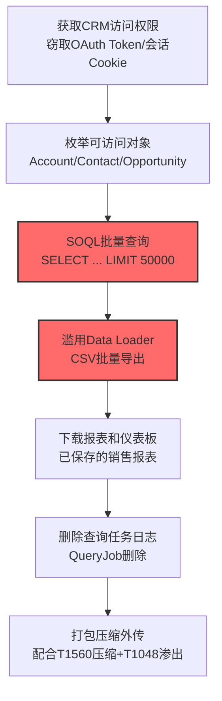

# 客户关系管理软件 (T1213.004)

## 一句话通俗理解

> **攻击者用窃取的账号或 OAuth 令牌闯入企业 CRM（Salesforce、HubSpot、Dynamics 365），把客户名单、销售管道、合同报价等核心商业数据批量打包带走**

## 30秒速查卡

| 维度 | 你需要知道的 |
|------|-------------|
| 这是什么？ | 攻击者通过窃取凭证、API Token 或 OAuth 令牌登录企业 CRM 系统，利用 REST API、SOQL 查询或合法导出工具批量提取客户联系信息、销售管道、合同报价等高价值商业数据 |
| 为什么危险？ | CRM 是企业的"客户金库"，存有客户联系方式、合同金额、销售谈判记录、报价单——攻击者拿到这些数据等于拿到企业的"客户账本"，可用于勒索、卖给竞争对手、或实施精准鱼叉钓鱼 |
| 谁需要关心？ | 销售运营团队、SOC 分析师、SaaS 安全团队、DLP 数据安全团队 |
| 你的第一步防御 | 启用 CRM 平台审计日志和事件监控，关注异常 IP 登录、批量 SOQL 查询、Data Loader 大量导出 |
| 如果只做一件事 | 对所有 CRM 集成应用实施 OAuth 令牌白名单，阻断未授权的 Connected App 滥用 |
| 速查总结 | CRM = 企业"客户账本"，OAuth 令牌 + Data Loader 是攻击者最爱的组合，必须严控 Connected App 授权和批量导出 |

## 难度等级

⭐⭐ 中级 - 需要一定的技术基础和经验
**前置知识要求**：了解 REST API 基本概念、OAuth 2.0 授权流程、CRM 平台基本数据模型

## 前置知识检查

**读这个文件需要什么？**

- [ ] 知道什么是 CRM（客户关系管理）系统
- [ ] 了解 REST API 调用方式（GET/POST 请求、HTTP Header）
- [ ] 知道 OAuth 2.0 授权码流程和 Refresh Token 概念
- [ ] 了解 Salesforce SOQL 或类似查询语言基础
- [ ] 知道 Connected App / OAuth 应用授权机制

**通俗讲解这些概念：**
- **CRM 系统**：企业管理客户信息、销售机会、合同报价的业务系统，是销售和客服的日常工作平台
- **SOQL**：Salesforce Object Query Language，类似 SQL 但用于查询 Salesforce 中的对象（Account、Contact、Opportunity 等）
- **Connected App**：Salesforce 中允许第三方应用通过 OAuth 接入的授权框架，每个 App 持有独立的 OAuth 令牌
- **Data Loader**：Salesforce 官方提供的批量数据导入导出工具，支持 CSV 批量提取，攻击者常滥用其合法功能

## 技术描述

**客户关系管理软件收集**（T1213.004）是 **来自信息存储库的数据**（T1213）的子技术，属于 **收集** 阶段。攻击者通过窃取的凭证或 OAuth 令牌访问 CRM 平台，批量提取客户数据、销售管道、合同信息等高价值商业数据。

> 💬 **打个比方**：CRM 就像企业的"客户账本+销售笔记+合同档案"三合一金库。销售员每天翻它、记它。攻击者闯进来后，不像翻办公室抽屉那样一个个找——他们直接用合法工具（Data Loader）问系统："给我导出全部客户名单和合同金额"，10 分钟就把整个销售部门的核心资产复制走了。

### 主流 CRM 平台与攻击面

| CRM 平台 | 市场份额 | 核心 API | 高频攻击入口 |
|----------|----------|----------|-------------|
| **Salesforce** | 全球第一 | REST API `/services/data/v59.0/sobjects/`、SOQL 查询接口 | OAuth Connected App、Data Loader、Salesloft Drift 等集成应用 |
| **HubSpot** | 中小企业主流 | REST API `/crm/v3/objects/contacts`、Private/App Token | API Key 滥用、OAuth App 钓鱼 |
| **Microsoft Dynamics 365** | 企业级 | Web API `/api/data/v9.2/`、OData 查询 | Azure AD 令牌窃取、Power Platform 滥用 |
| **Zoho CRM** | 性价比之选 | REST API `/crm/v2/Leads`、Auth Token | 旧版 Auth Token 长期有效难轮换 |
| **SugarCRM** | 自部署常见 | REST API `/rest/v11/Accounts` | 自托管实例漏洞利用、弱密码 |

### 攻击者关注的 CRM 数据类型

| 数据对象 | 商业价值 | 攻击者用途 |
|----------|----------|-----------|
| **Account / Contact** | 客户公司信息、联系人姓名/邮箱/电话 | 鱼叉钓鱼目标列表、卖给竞争对手 |
| **Opportunity** | 销售机会金额、阶段、预计成交日期 | 商业情报、勒索筹码 |
| **Lead** | 潜在客户信息 | 客户名单倒卖 |
| **Case** | 客户投诉工单、服务记录 | 撞库攻击素材、社会工程弹药 |
| **Contract / Quote** | 合同金额、条款、报价单 | 竞争对手情报、勒索证据 |
| **Activity / Email** | 客户沟通历史、邮件记录 | 撞库、欺诈素材 |

### 核心攻击手法

**1. OAuth 令牌窃取（最常见）**
攻击者通过语音钓鱼（vishing）冒充 IT 支持人员，诱导员工授权恶意 Connected App，获得长期有效的 Refresh Token。该令牌可在不触发 MFA 的情况下持续访问 CRM API。

**2. SOQL 批量查询提取**
使用 Salesforce REST API 的 SOQL 端点批量提取数据：
```bash
# 步骤1：获取 Access Token（通过窃取的 Refresh Token）
curl -X POST https://login.salesforce.com/services/oauth2/token \
  -d "grant_type=refresh_token&refresh_token=${REFRESH_TOKEN}&client_id=${CLIENT_ID}"

# 步骤2：SOQL 查询批量提取客户联系信息
curl -H "Authorization: Bearer ${ACCESS_TOKEN}" \
  "https://instance.my.salesforce.com/services/data/v59.0/query/?q=SELECT+Name,Email,Phone,Account.Name+FROM+Contact+LIMIT+50000"

# 步骤3：批量查询销售机会和合同
curl -H "Authorization: Bearer ${ACCESS_TOKEN}" \
  "https://instance.my.salesforce.com/services/data/v59.0/query/?q=SELECT+Account.Name,Amount,CloseDate,StageName+FROM+Opportunity+WHERE+IsWon=true"
```

**3. Data Loader 滥用**
攻击者下载官方 Salesforce Data Loader 工具，使用窃取的会话 Cookie 或 OAuth Token 批量导出全部对象到 CSV。该方式利用合法工具规避检测。

**4. 报表和仪表板批量下载**
通过 `/services/data/v59.0/analytics/reports` 端点批量调用已保存的销售报表，将整张报表以 Excel/CSV 格式下载。

### 用途与影响

**攻击者用这些数据做什么？**
- **双重勒索**：威胁公开客户名单和合同金额，迫使企业支付赎金
- **精准鱼叉钓鱼**：利用客户沟通历史构造高度可信的钓鱼邮件
- **商业情报倒卖**：销售管道和报价数据可卖给竞争对手
- **凭证扩展**：Case 工单中常含客户密码片段、API 密钥等
- **供应链跳板**：CRM 集成令牌可横向访问邮件、客服、营销平台

## 攻击流程



**步骤详解：**

1. **获取 CRM 访问权限** - 通过 vishing 冒充 IT 诱导员工授权恶意 Connected App、窃取浏览器 Session Cookie、或利用第三方集成应用（如 Salesloft Drift、Gainsight）的 OAuth 令牌泄露
2. **枚举可访问对象** - 调用 `/services/data/v59.0/sobjects/` 列出所有可访问的 CRM 对象，识别高价值目标（Account、Contact、Opportunity、Case、Contract）
3. **SOQL 批量查询** - 构造 SOQL 语句配合 `LIMIT 50000` 分页拉取，一次调用即可提取数万条客户记录
4. **滥用 Data Loader** - 使用官方 Salesforce Data Loader 工具批量导出对象到 CSV，伪装成正常管理员操作
5. **下载报表和仪表板** - 调用 `/analytics/reports` 端点批量下载已保存的销售汇总报表，获取汇总视角
6. **删除查询任务日志** - 删除 Salesforce 中的异步 QueryJob 记录以阻碍取证（但 Event Monitoring 日志不受影响）
7. **打包压缩外传** - 配合 T1560 压缩归档后，通过 T1048 未加密通道或 T1567 加密通道渗出

## 真实案例

### 案例1：Scattered Spider / UNC6040 大规模 Salesforce 数据盗窃与勒索活动（2024-2025）

- **时间**：2024年10月 - 2025年10月
- **目标**：数百家跨国企业（Google、Adidas、Allianz Life、Cisco、Disney、FedEx、Home Depot、Louis Vuitton、Qantas、Toyota、UPS、Workday 等39家知名品牌）
- **攻击组织**：Scattered Spider / ShinyHunters / UNC6040 / UNC6395（多个威胁集群协同）
- **手法**：攻击者通过语音钓鱼（vishing）冒充 IT 支持人员致电企业呼叫中心，诱导员工授权恶意 OAuth Connected App（伪装成 Salesforce Data Loader）。获得 OAuth 令牌后，攻击者通过 Salesforce REST API 调用 SOQL 查询，系统性导出 Cases、Accounts、Users、Opportunities 等对象的全部数据。后期演进为利用 Salesloft Drift 第三方集成的 OAuth 令牌，绕过 MFA 和登录监控，影响 700+ 组织（含 Cloudflare、Zscaler、Palo Alto Networks 等安全厂商）。攻击者使用 `Salesforce-Multi-Org-Fetcher/1.0`、`Salesforce-CLI/1.0` 等自定义 User-Agent 标识，并通过 Tor 出口节点（154.41.95.2、176.65.149.100 等）隐藏来源。勒索金额从数百万到数千万美元不等，单笔最高 3600 万美元
- **影响**：累计声称窃取 10 亿条记录；美国司法部公开投诉显示，2022-2025 年间至少 120 次攻击导致受害者支付超过 1.15 亿美元赎金；Scattered Spider 还建立 Tor 泄露站点公开未支付赎金的受害者数据，并于 2025 年 10 月反向勒索 Salesforce 自身
- **参考链接**：
  - [FBI Flash Notice - Scattered Spider Salesforce Campaign](https://therecord.media/fbi-warns-scattered-spider-salesforce)（一级来源 - 美国政府官方）
  - [Google GTIG - Data Theft via Salesloft Drift](https://cloud.google.com/blog/topics/threat-intelligence/data-theft-salesforce-instances-via-salesloft-drift)（一级来源 - 顶级威胁情报厂商）
  - [SecurityWeek - Scattered LAPSUS$ Hunters Extortion](https://www.securityweek.com/hackers-extorting-salesforce-after-stealing-data-from-dozens-of-customers/)（二级来源 - 主流安全媒体）

### 案例2：Allianz Life 数据泄露事件（2025年7月）

- **时间**：2025年7月16日
- **目标**：Allianz Life Insurance Company of North America（美国寿险巨头，1.4M 客户）
- **攻击组织**：ShinyHunters + Scattered Spider + Lapsus$ 联盟
- **手法**：攻击者通过 vishing 冒充 IT 服务台，诱骗 Allianz Life 员工或第三方供应商授权访问其云端 Salesforce CRM 实例。进入 CRM 环境后，攻击者**未安装任何恶意代码**，而是直接利用合法的 Salesforce Data Loader 工具批量外传客户数据。这种"合法工具+合法凭证"的组合规避了传统安全工具（EDR/AV）的检测。泄露数据包括客户姓名、地址、出生日期、SSN（社会安全号）、保单号、合同号、财务专业人员信息。Have I Been Pwned 后续确认 110 万个唯一邮箱地址泄露，攻击者声称总共泄露 280 万条记录
- **影响**：1.4M 美国客户 PII 泄露；Allianz Life 遭集体诉讼，被指控违反 NIST 网络安全框架和 CIS 关键安全控制；提供 24 个月免费信用监控；事件成为 SaaS 共享责任模式的标志性案例
- **参考链接**：
  - [Allianz Life Data Breach Case Study - ProvenData](https://www.provendata.com/blog/allianz-life-data-breach-case-study)（二级来源 - 案例研究）
  - [Maine AG Filing - Allianz Life Incident](https://www.maine.gov/ag/)（一级来源 - 政府监管披露）

### 案例3：Salesloft Drift OAuth 令牌泄露波及 700+ 组织（2025年8月）

- **时间**：2025年8月8日 - 8月18日
- **目标**：使用 Salesloft Drift 与 Salesforce 集成的所有组织（含 Cloudflare、Zscaler、Palo Alto Networks、Proofpoint、PagerDuty、Tanium 等安全厂商）
- **攻击组织**：UNC6395（Google 命名，与 Scattered Spider 关联）
- **手法**：攻击者从 Salesloft Drift 的 GitHub 和 AWS 环境中窃取 OAuth 连接密钥和 Refresh Token，利用这些令牌直接访问下游客户的 Salesforce 实例。由于 Drift 是预授权的第三方应用，攻击者活动表现为"来自可信集成的合法自动化"，绕过了 MFA、登录监控、密码重置等传统防御。攻击者系统性导出 Cases、Accounts、Users、Opportunities 对象数据，并搜索 AWS Access Key（AKIA）、Snowflake 凭据、密码等敏感字符串。为阻碍取证，攻击者删除了 Salesforce 异步 QueryJob 记录（但 Event Monitoring 日志未受影响）。Google 调查发现攻击者还扩展到 Drift Email 集成，访问了少量 Google Workspace 账户的邮件
- **影响**：Salesloft 与 Salesforce 联合撤销所有 Drift 应用的活跃令牌；Salesforce 从 AppExchange 下架 Drift 应用；多家中大型安全厂商被迫轮换所有集成凭据；Google Workspace 主动禁用与 Drift Email 的集成功能
- **参考链接**：
  - [Google Cloud Blog - Widespread Data Theft via Salesloft Drift](https://cloud.google.com/blog/topics/threat-intelligence/data-theft-salesforce-instances-via-salesloft-drift)（一级来源 - 顶级威胁情报厂商）
  - [Rescana - ShinyHunters OAuth Abuse Campaign](https://www.rescana.com/post/active-exploitation-alert-shinyhunters-abuse-oauth-and-vendor-integrations-to-breach-salesforce-and-saas-environments)（二级来源 - 安全分析）

## 红队视角

> ⚠️ **免责声明**：以下内容仅用于合法的安全测试、渗透测试和教育目的。未经授权对他人系统进行测试是违法行为。

### 实战技巧

1. **OAuth App 钓鱼优于密码爆破**：通过 vishing 诱导目标员工访问伪造的 Salesforce Connected App 授权页面，比密码爆破隐蔽得多——一次授权可获得长期 Refresh Token
2. **SOQL 是核心武器**：熟练使用 SOQL 语法能比 UI 操作高效百倍。`SELECT Name,Email,Phone FROM Contact WHERE Account.Industry='Finance'`
3. **滥用 Data Loader 规避检测**：官方 Data Loader 是合法工具，使用它会触发"管理员批量操作"特征而非"恶意脚本"特征
4. **隐藏导出痕迹**：删除异步 QueryJob 记录可阻碍基础取证（但 Event Monitoring 日志无法删除）

### 常用工具

| 工具名称 | 用途 | 平台 | 特点 |
| -------- | ---- | ---- | ---- |
| [Salesforce Data Loader](https://developer.salesforce.com/docs/atlas.en-us.dataLoader.meta/dataLoader/) | 官方批量导入导出 | Windows/macOS/Linux | 合法工具，常被攻击者滥用 |
| [simple-salesforce](https://github.com/simple-salesforce/simple-salesforce) | Salesforce Python SDK | Python | 轻量级 REST API 封装，支持 SOQL |
| [jsforce](https://github.com/jsforce/jsforce) | Salesforce JavaScript SDK | Node.js | 支持 OAuth 流程和批量查询 |
| [HubSpot API Client](https://github.com/HubSpot/hubspot-api-nodejs) | HubSpot 数据提取 | Node.js | 支持 v3 Private App Token |
| [curl](https://curl.se/) | 通用 HTTP 工具 | 跨平台 | 配合 REST API 直接调用 |

### 注意事项

- Salesforce Cloud 和自托管实例的 API 端点略有差异，Cloud 路径为 `instance.my.salesforce.com/services/data/v59.0/`
- Salesforce Event Monitoring 是付费附加功能，未启用时仅能依靠 Setup Audit Trail
- Connected App 一旦授权，Refresh Token 默认有效期为 90 天至无限期，需主动撤销

## 蓝队视角

### 检测要点

1. **异常 OAuth 应用授权**：监控新授权的 Connected App，特别是从非常规 IP 或非工作时间授权的应用
2. **SOQL 查询频率异常**：同一账号短时间内大量调用 `/services/data/v*/query/` 端点，单次查询 `LIMIT 50000`
3. **Data Loader 大量导出**：监控 Data Loader 客户端的 User-Agent 和大规模 CSV 导出行为
4. **异常 IP 登录**：来自 Tor 出口节点、VPS 提供商（DigitalOcean、AWS 异常区域）的登录
5. **可疑 User-Agent**：`Salesforce-Multi-Org-Fetcher/1.0`、`Salesforce-CLI/1.0` 等非官方工具标识
6. **QueryJob 删除行为**：监控 Event Monitoring 中的 `Delete` 事件作用于 AsyncQueryJob 对象

### 监控建议

- 启用 Salesforce Event Monitoring（付费功能），将日志转发到 SIEM（Splunk、ELK、Sentinel）
- 部署 SaaS 安全态势管理（SSPM）工具（如 AppOmni、Obsidian）监控 OAuth 应用授权
- 设置 Salesforce Shield 启用事务安全策略，实时阻断可疑操作
- 配置 HubSpot/Dynamics 365 的审计日志导出到 SIEM

## 避坑指南

检测盲点：
- 仅关注密码登录，忽略 OAuth 令牌滥用（Refresh Token 不触发 MFA）
- 仅监控 Salesforce 主域名，忽略第三方集成应用（Drift、Gainsight、Klue）的 OAuth 通道
- 未启用 Event Monitoring，导致事件无可追溯
- 告警阈值过高，50000 条/次的批量查询未触发告警

## 检测建议

### 网络层检测

**1. 监控 Salesforce API 调用频率与 User-Agent：**

```bash
# 检测异常 User-Agent（来自 Salesforce Event Monitoring 日志导出）
grep -E "Salesforce-Multi-Org-Fetcher|Salesforce-CLI/1\.0" /var/log/siem/salesforce_events.json

# 检测来自 Tor 出口节点的 Salesforce 登录
awk '/LOGIN/ && /TOR_EXIT_NODE/' /var/log/siem/salesforce_events.json
```

**2. 监控 OAuth Connected App 异常授权：**

```bash
# 检测短时间内新授权的 Connected App
jq 'select(.EVENT_TYPE=="ConnectedApplication") | select(.ACTION=="Authorize")' /var/log/siem/salesforce_events.json
```

### 主机层检测

**Sigma 规则：检测 Salesforce Data Loader 异常批量导出：**

```yaml
title: 检测 Salesforce 异常批量数据导出
id: 8a3b5c7d-2e1f-4a9b-8c5d-7e6f5a4b3c2d
status: stable
description: 检测 Salesforce Event Monitoring 中同一账号短时间内大量 SOQL 查询或 Data Loader 导出，可能为 CRM 数据窃取
references:
    - https://attack.mitre.org/techniques/T1213/004/
    - https://cloud.google.com/blog/topics/threat-intelligence/data-theft-salesforce-instances-via-salesloft-drift
tags:
    - attack.collection
    - attack.t1213.004
    - attack.t1213
logsource:
    product: salesforce
    service: event_monitoring
detection:
    selection_bulk_query:
        EVENT_TYPE:
            - 'RestApi'
            - 'API'
        URI_PATH|contains:
            - '/services/data/'
            - '/query/'
    filter_legitimate_ua:
        USER_AGENT|contains:
            - 'Salesforce Data Loader'
            - 'salesforce-toolkit'
    timeframe: 1h
    condition: selection_bulk_query and not filter_legitimate_ua | count() by USER_ID > 100
fields:
    - USER_ID
    - USER_AGENT
    - SOURCE_IP
    - URI_PATH
    - QUERY
falsepositives:
    - 管理员定期批量备份
    - 合规审计批量导出
level: high
```

**Sigma 规则：检测恶意 Connected App 授权：**

```yaml
title: 检测可疑 Salesforce Connected App 授权
id: 9b4c6d8e-3f2a-4b8c-9d6e-8f7a6b5c4d3e
status: stable
description: 检测从异常 IP 或非工作时间新授权的 Salesforce Connected App，可能为 OAuth 令牌钓鱼
references:
    - https://attack.mitre.org/techniques/T1213/004/
tags:
    - attack.collection
    - attack.t1213.004
    - attack.t1556
logsource:
    product: salesforce
    service: setup_audit_trail
detection:
    selection_app_auth:
        ACTION: 'ConnectedApplication'
        EVENT_TYPE: 'OAuthAuthorization'
    timeframe: 24h
    condition: selection_app_auth | count() by USER_ID > 2
fields:
    - USER_ID
    - SOURCE_IP
    - APP_NAME
    - CREATED_DATE
falsepositives:
    - 新员工首次配置集成
level: medium
```

### 应用层检测

**Salesforce Event Monitoring KQL 查询（Microsoft Sentinel）：**

```kusto
// 检测异常 Salesforce SOQL 批量查询
Salesforce_EventLogs_CL
| where TimeGenerated > ago(24h)
| where EVENT_TYPE_s in ('RestApi', 'API')
| where URI_PATH_s has '/services/data/' and URI_PATH_s has '/query/'
| summarize QueryCount = count(), DistinctObjects = dcount(extract(@"FROM\s+(\w+)", 1, QUERY_s))
    by USER_ID_s, USER_AGENT_s, SOURCE_IP_s
| where QueryCount > 100 or DistinctObjects > 5
| join kind=inner (
    Salesforce_EventLogs_CL
    | where TimeGenerated > ago(30d)
    | summarize LastSeenIPs = makeset(SOURCE_IP_s) by USER_ID_s
) on USER_ID_s
| where SOURCE_IP_s !in (LastSeenIPs)
| project TimeGenerated, USER_ID_s, SOURCE_IP_s, QueryCount, DistinctObjects, USER_AGENT_s
```

## 缓解措施

### 优先级1：访问控制强化

- **强制 MFA**：所有 CRM 用户账号启用 MFA，特别是管理员和集成账号
- **OAuth 应用白名单**：在 Salesforce Setup 中配置 Connected App 允许列表，阻断未授权应用
- **会话超时**：将 Session Timeout 配置为 2 小时（默认 8 小时过长），降低令牌泄露窗口
- **IP 范围限制**：在 Network Settings 中配置可信 IP 范围，非可信 IP 触发 MFA

### 优先级2：日志与监控

- **启用 Event Monitoring**：订阅 Salesforce Event Monitoring（付费附加），将日志实时转发到 SIEM
- **启用 Salesforce Shield**：开启事务安全策略（Transaction Security Policy），实时阻断可疑操作
- **部署 SSPM**：使用 AppOmni、Obsidian 等 SaaS 安全态势管理工具监控 OAuth 应用和权限漂移
- **第三方集成审计**：定期审查所有集成应用（Drift、Gainsight、Klue 等）的 OAuth 范围和令牌使用情况

### 优先级3：数据保护

- **字段级加密**：对 SSN、信用卡号等高敏感字段启用 Salesforce Shield Platform Encryption
- **DLP 集成**：在 CRM 网关部署 DLP 策略，监控大量客户数据导出行为
- **数据脱敏**：对沙箱环境实施 Data Mask，避免测试环境泄露生产数据

### MITRE ATT&CK 缓解措施映射

| 缓解措施ID | 缓解措施名称 | 适用性 | 说明 |
| ---------- | ------------ | ------ | ---- |
| M1017 | 用户培训 | 适用 | 培训员工识别 vishing 攻击和 OAuth 钓鱼 |
| M1032 | 多因素认证 | 适用 | 对所有 CRM 账号强制 MFA |
| M1041 | 加密敏感信息 | 适用 | 启用字段级加密保护高敏感数据 |
| M1018 | 用户账户管理 | 适用 | 定期审计 Connected App 和 OAuth 令牌 |

## 动手实验

> ⚠️ **重要提示**：所有实验必须在隔离的 Salesforce Developer Edition 环境中进行，禁止对生产环境进行测试。

### 🟢 入门实验（30分钟）

**目标**：体验 Salesforce REST API 基础操作

1. 注册免费的 Salesforce Developer Edition（https://developer.salesforce.com/signup）
2. 创建测试 Account 和 Contact 记录
3. 使用 curl 调用 API 查询数据：
```bash
# 步骤1：通过用户名密码流获取 Token（仅限开发环境）
curl -X POST https://login.salesforce.com/services/oauth2/token \
  -d "grant_type=password&client_id=${CID}&client_secret=${CSECRET}&username=${USER}&password=${PASS}${TOKEN}"

# 步骤2：SOQL 查询 Contact
curl -H "Authorization: Bearer ${ACCESS_TOKEN}" \
  "${INSTANCE_URL}/services/data/v59.0/query/?q=SELECT+Name,Email+FROM+Contact+LIMIT+10"
```

**预期输出**：JSON 格式的 Contact 列表

### 🟡 进阶实验（2小时）

**目标**：模拟攻击者批量收集 CRM 数据

1. 安装 Salesforce Data Loader 命令行版本
2. 配置 process-conf.xml 执行 Export 操作，导出全部 Account 到 CSV
3. 编写 Python 脚本使用 simple-salesforce 库批量查询：
```python
from simple_salesforce import Salesforce
sf = Salesforce(username='user', password='pass', security_token='token')
result = sf.query_all("SELECT Name, Email, Phone, Account.Name FROM Contact LIMIT 50000")
print(f"Extracted {len(result['records'])} contacts")
```
4. 在 Setup > View Setup Audit Trail 中观察你的操作产生了哪些审计事件

**预期输出**：CSV 文件包含全部 Contact；审计日志显示连续 API 调用

### 🔴 高级实验（半天）

**目标**：构建 CRM 数据外泄检测闭环

1. 启用 Salesforce Event Monitoring（Developer Edition 免费包含）
2. 使用 Salesforce CLI 将 Event Log File 下载到本地
3. 编写 Sigma 规则检测你的攻击行为
4. 在 ELK 或 Splunk 中导入事件日志，编写 KQL/SPL 检测查询
5. 验证检测规则能否捕获批量 SOQL 查询和 Data Loader 导出

**预期输出**：检测规则成功触发告警，包含攻击者 USER_ID、SOURCE_IP、查询语句

## 术语解释

| 术语 | 英文原名 | 通俗解释 |
|------|----------|----------|
| CRM | Customer Relationship Management | 客户关系管理软件，企业管理客户、销售、合同的核心业务系统 |
| Salesforce | Salesforce | 全球市场占有率第一的 SaaS CRM 平台 |
| SOQL | Salesforce Object Query Language | Salesforce 对象查询语言，类似 SQL 但用于查询 CRM 数据 |
| OAuth | Open Authorization | 开放授权协议，允许第三方应用在不获取密码的情况下访问用户数据 |
| Connected App | Connected Application | Salesforce 中的 OAuth 应用框架，第三方集成必须通过 Connected App 接入 |
| Data Loader | Salesforce Data Loader | Salesforce 官方提供的批量数据导入导出工具 |
| Refresh Token | Refresh Token | OAuth 中用于长期获取新 Access Token 的长期令牌，有效期通常 90 天至无限期 |
| Event Monitoring | Salesforce Event Monitoring | Salesforce 的付费日志服务，记录所有 API 调用、登录、数据访问事件 |
| SSPM | SaaS Security Posture Management | SaaS 安全态势管理工具，监控 SaaS 应用的配置和权限漂移 |

## 被引用情况

以下父技术文档引用了本子技术：

- [T1213 - 来自信息存储库的数据](../T1213-Data-from-Information-Repositories.md)

## 参考资料

### 📚 官方文档

- [MITRE ATT&CK - Customer Relationship Management Software (T1213.004)](https://attack.mitre.org/techniques/T1213/004/) - MITRE 官方技术页面
- [MITRE ATT&CK - Data from Information Repositories (T1213)](https://attack.mitre.org/techniques/T1213/) - 父技术页面
- [Salesforce REST API Developer Guide](https://developer.salesforce.com/docs/atlas.en-us.api_rest.meta/api_rest/) - Salesforce API 官方文档
- [Salesforce SOQL Reference](https://developer.salesforce.com/docs/atlas.en-us.soql_sosl.meta/soql_sosl/) - SOQL 查询语言参考
- [Salesforce Event Monitoring Documentation](https://help.salesforce.com/s/articleView?id=sf.security_irm_logfile.htm) - 事件监控官方文档

### 📰 安全报告

- [FBI Flash Notice - Scattered Spider Salesforce Campaign (2025)](https://therecord.media/fbi-warns-scattered-spider-salesforce) - FBI 官方警告
- [Google GTIG - Widespread Data Theft via Salesloft Drift (2025)](https://cloud.google.com/blog/topics/threat-intelligence/data-theft-salesforce-instances-via-salesloft-drift) - UNC6395 OAuth 滥用深度分析
- [Microsoft - ShinyHunters Salesforce OAuth Abuse Campaign](https://www.rescana.com/post/active-exploitation-alert-shinyhunters-abuse-oauth-and-vendor-integrations-to-breach-salesforce-and-saas-environments) - 三种攻击路径技术分析
- [SecurityWeek - Scattered LAPSUS$ Hunters Extortion (2025)](https://www.securityweek.com/hackers-extorting-salesforce-after-stealing-data-from-dozens-of-customers/) - 39 家受害者与反向勒索 Salesforce
- [ProvenData - Allianz Life Data Breach Case Study](https://www.provendata.com/blog/allianz-life-data-breach-case-study) - 1.4M 客户 PII 泄露案例
- [Cato CTRL - Sophisticated Data Exfiltration in Double Extortion](https://www.catonetworks.com/blog/sophisticated-data-exfiltration-tools-used-in-double-extortion-ransomware-attacks/) - 勒索软件数据外传工具分析

### 🔧 工具

- [Salesforce Data Loader](https://developer.salesforce.com/docs/atlas.en-us.dataLoader.meta/dataLoader/) - 官方批量导入导出工具（攻击者常滥用）
- [simple-salesforce](https://github.com/simple-salesforce/simple-salesforce) - Python Salesforce SDK
- [jsforce](https://github.com/jsforce/jsforce) - Node.js Salesforce SDK
- [AppOmni](https://appomni.com/) - Salesforce 安全态势管理平台
- [Salesforce CLI](https://developer.salesforce.com/tools/sfdxcli) - 官方命令行工具

### 📖 学习资源

- [Salesforce Security Best Practices](https://help.salesforce.com/s/articleView?id=sf.security_best_practices.htm) - Salesforce 官方安全最佳实践
- [MITRE ATT&CK Collection Tactic](https://attack.mitre.org/tactics/TA0009/) - 收集战术全景
- [AppOmni SaaS Security Blog](https://appomni.com/blog/) - SaaS 安全深度分析

## 版本历史

| 版本 | 日期 | 变更说明 |
|------|------|----------|
| v3.1.0 | 2026-07-20 | 初始版本，按 v3.1 模板编写。包含 3 个 2023+ 真实案例（Scattered Spider/UNC6040 Salesforce 大规模勒索、Allianz Life 数据泄露、Salesloft Drift OAuth 令牌泄露），三层检测建议，2 条 Sigma 规则，Sentinel KQL 查询，3 级动手实验。对齐 MITRE ATT&CK v19.1 官方名称 |
