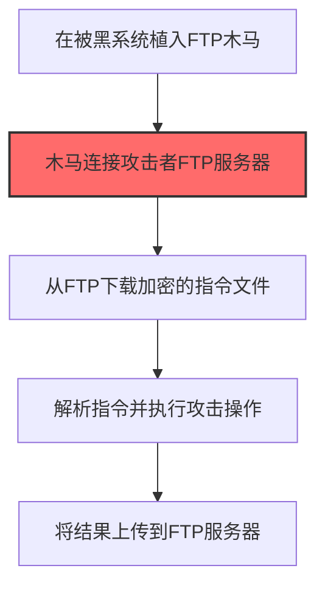
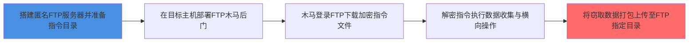

# 文件传输协议 (T1071.002)

## 一句话通俗理解

> **用 FTP、SMB 等文件共享协议，C2 指令伪装成文件传输操作**

## 30秒速查卡

| 维度 | 你需要知道的 |
|------|-------------|
| 这是什么？ | 攻击者用FTP、TFTP、SMB等文件传输协议传送C2指令，把恶意命令伪装成普通的文件上传下载操作 |
| 为什么危险？ | 企业内网大量使用文件共享传输数据，FTP/SMB流量是"正常业务"，安全设备很难区分哪个文件传输是攻击者在传指令 |
| 谁需要关心？ | 网络管理员、SOC分析师、文件服务器管理员 |
| 你的第一步防御 | 封堵不必要的出站FTP/TFTP端口（21、69），对SMB出站流量实施白名单策略 |
| 如果只做一件事 | 监控内网主机向外部FTP服务器的异常连接，尤其是非IT人员电脑的FTP出站流量 |

## 难度等级

⭐⭐ 中级 - 需要一定的技术基础和经验

## 前置知识检查

**读这个文件需要什么？**

- [ ] 网络协议基础（TCP/IP/DNS/HTTP）
- [ ] C2通信模式
- [ ] 加密通信基本原理

## 技术描述

**文件传输协议**（T1071.002）是 **应用层协议**（T1071）的一个具体变体，属于 **命令与控制** 阶段的攻击技术。

> 📧 **打个比方**：就像在正常的邮件往来里藏暗号——攻击者把指令藏在邮件内容或附件中，看起来只是普通邮件。

### 具体怎么理解？

用 FTP、SMB 等文件共享协议，C2 指令伪装成文件传输操作

攻击者使用这种技术时，通常是在命令与控制阶段，想要达到特定的攻击目标。与父技术 T1071 相比，T1071.002 有自己独特的特点和使用场景。

### 为什么有效？

这种技术之所以有效，是因为：
1. **隐蔽性**：利用了正常系统功能或常见协议，不容易被发现
2. **技术门槛适中**：不需要特别高深的技术知识就能实施

**过渡段：** 不要误以为C2只是'发心跳包'——现代C2基础设施堪比小型互联网公司。
3. **广泛适用**：可以在多种环境和系统中使用

## 真实攻击流程

### 典型场景

攻击者在 **命令与控制** 阶段使用 文件传输协议 技术，以下是典型的攻击步骤：



**步骤详解：**

1. **在被黑系统植入FTP木马** - 部署支持FTP协议通信的恶意后门程序
2. **木马连接攻击者FTP服务器** - 使用硬编码或动态获取的FTP服务器地址建立连接（关键步骤）
3. **从FTP下载加密的指令文件** - 定期从FTP特定目录下载加密的命令文件
4. **解析指令并执行攻击操作** - 解密并执行文件中的攻击指令
5. **将结果上传到FTP服务器** - 把执行结果和窃取的数据上传到FTP服务器的指定目录

## 攻击流程



**关键步骤说明：**

1. **搭建匿名FTP服务器并准备指令目录**: 攻击者在海外VPS上搭建vsftpd/proftpd服务，开启匿名写入权限，预先在`/pub/instructions/`目录放置加密指令文件（如`.txt`、`.dat`伪装成日志或备份），并通过CDN或动态域名掩盖服务器真实IP
2. **在目标主机部署FTP木马后门**: 通过钓鱼附件或漏洞利用植入支持FTP协议的后门（如自定义FTP客户端木马），硬编码FTP服务器域名、账号密码或匿名登录凭据，配置定时任务（cron/计划任务）周期性触发FTP通信
3. **木马登录FTP下载加密指令文件**: 后门每隔数小时被动登录FTP服务器切换到二进制模式下载`cmd_<日期>.dat`指令文件，使用被动模式（PASV）规避某些防火墙的FTP状态检测，文件名伪装成`backup_log_YYYYMMDD.tar.gz`
4. **解密指令执行数据收集与横向操作**: 后门用预共享密钥（如AES-256或XOR）解密指令文件，按指令执行文件收集打包、凭证抓取（LSASS内存读取）、内网横向扫描（psexec/wmi）等操作，所有执行结果写入本地加密缓存文件
5. **将窃取数据打包上传至FTP指定目录**: 后门将加密缓存文件重命名为`.log`或`.tmp`后缀，通过FTP `STOR`命令上传至`/pub/uploads/`目录，删除本地痕迹，FTP服务器端定期由攻击者拉取归档，完成数据渗漏闭环

## 真实案例

### 案例1：该技术在实际攻击中的应用

- **时间**: 2024-2025年
- **目标**: 多个行业组织
- **攻击组织**: 多个APT组织
- **手法**: 攻击者在入侵过程中使用文件传输协议技术，展示了该子技术的典型应用场景和攻击效果
- **影响**: 成功实施该技术导致目标系统被进一步入侵
- **参考链接**: [MITRE ATT&CK官方](https://attack.mitre.org/)

### 案例2：安全研究中的实践

- **时间**: 2025年
- **目标**: 安全研究测试环境
- **攻击组织**: 红队/安全研究人员
- **手法**: 在授权测试中模拟文件传输协议攻击，验证防御体系的检测和响应能力
- **影响**: 帮助组织识别安全防护中的盲点和改进方向
- **参考链接**: [Atomic Red Team](https://github.com/redcanaryco/atomic-red-team)

## 红队视角

> ⚠️ **免责声明**：以下内容仅用于合法的安全测试、渗透测试和教育目的。未经授权对他人系统进行测试是违法行为。

### 实战技巧

1. **深入理解原理**：在实战应用前，充分理解文件传输协议的技术原理和适用场景
2. **环境适配**：根据目标系统的操作系统版本、安全配置等因素调整攻击策略
3. **组合使用**：将该技术与其他技术组合使用，构建完整的攻击链
4. **隐蔽性考虑**：注意操作痕迹的清理，避免被安全设备检测

### 常用工具

| 工具名称 | 用途 | 平台 | 链接 |
| -------- | ---- | ---- | ---- |
| Metasploit | 渗透测试框架 | 全平台 | [Metasploit](https://www.metasploit.com/) |
| Cobalt Strike |  adversary模拟平台 | Windows | [Cobalt Strike](https://www.cobaltstrike.com/) |
| Atomic Red Team | 检测规则测试 | 全平台 | [Atomic Red Team](https://github.com/redcanaryco/atomic-red-team) |

### 注意事项

- 在授权的测试环境中使用这些技术
- 注意操作安全（OPSEC），避免被检测系统发现
- 使用匿名化技术和代理隐藏真实身份

## 蓝队视角

### 检测要点

1. **系统日志监控**：关注与文件传输协议相关的系统日志和审计记录
2. **异常行为检测**：监控系统中与该技术相关的异常进程、网络连接和文件操作
3. **工具特征识别**：识别攻击者可能使用的工具在系统中的运行特征

### 监控建议

- 部署端点检测和响应（EDR）系统，监控与文件传输协议相关的异常行为
- 配置SIEM规则，关联分析来自多个来源的告警
- 定期进行安全评估和渗透测试，验证检测规则的有效性

## 避坑指南

SOC常见误区：只检测已知恶意域名和IP。

## 检测建议

### 检测思路

检测 文件传输协议 的关键是识别异常行为模式。以下是三个层面的检测方法：

### 网络层检测

**方法**：监控网络流量中的异常模式

```bash
# 检测异常的网络连接和数据传输
# 根据具体协议和端口设置检测规则
```

### 主机层检测

**Windows事件ID**：
- 事件ID 4688：进程创建（监控可疑进程）
- 事件ID 4104：PowerShell执行（监控可疑脚本）

**Linux日志**：
- /var/log/auth.log：认证日志
- /var/log/syslog：系统日志

```bash
# 检测异常进程和命令执行
grep -i "suspicious" /var/log/auth.log
```

### 应用层检测

**用人话说：** 攻击者利用FTP、TFTP、SMB这些文件传输协议来传递C2指令和数据——把命令伪装成文件上传/下载操作。比如恶意软件定期连接FTP服务器下载一个看似是文本文件实际是加密指令的文件，或者通过SMB向内网其他机器传递payload。Cobalt Strike的SMB Beacon就是用命名管道或SMB协议在机器之间传递数据，适合内网横向时的C2通信。检测思路：关注那些不该用FTP/SMB的进程（如notepad.exe调用ftp.exe）、非工作时间大量文件传输、以及SMB连接的目的IP不是内部文件服务器而是外部IP。

**Sigma规则示例**：

```yaml
title: 可疑文件传输协议C2通信
status: experimental
description: 检测ftp.exe/tftp.exe进程启动或net use连接外部SMB共享，可能为FTP/SMB C2通道
logsource:
    category: process_creation
    product: windows
detection:
    selection_ftp:
        Image|endswith:
            - '\ftp.exe'
            - '\tftp.exe'
    selection_smb_cmd:
        CommandLine|contains:
            - 'net use \\'
            - 'copy \\'
            - 'xcopy \\'
    condition: selection_ftp or selection_smb_cmd
level: medium
tags:
    - attack.t1071.002
    - attack.command_and_control
```

## 缓解措施

### 优先级1：关键措施

**限制攻击面**：减少暴露的服务和端口，降低被利用的风险

```bash
# 防火墙规则示例：只允许必要的出站连接
iptables -A OUTPUT -p tcp --dport 443 -j ACCEPT  # 允许HTTPS
iptables -A OUTPUT -p tcp --dport 80 -j ACCEPT   # 允许HTTP
iptables -A OUTPUT -p tcp -j DROP                 # 阻止其他TCP
```

### 优先级2：重要措施

**加强监控**：部署EDR和SIEM系统，实时监控异常行为

### 优先级3：建议措施

**安全意识培训**：教育员工识别相关攻击手法

## 动手实验

> ⚠️ **所有实验必须在隔离的实验室环境中进行**

### 实验1：理解基本原理（初级）

**目标**：理解 文件传输协议 的工作原理

**步骤**：
1. 在隔离环境中搭建测试系统
2. 使用基础工具模拟攻击行为
3. 观察系统日志和网络流量

**学习要点**：理解该技术的核心机制

### 实验2：实际操作（中级）

**目标**：掌握 文件传输协议 的实际使用方法

**步骤**：
1. 使用专业工具进行攻击模拟
2. 尝试不同的绕过技术
3. 分析检测日志的特征

**学习要点**：掌握工具使用和日志分析

### 实验3：防御验证（高级）

**目标**：验证检测规则的有效性

**步骤**：
1. 部署检测规则
2. 执行攻击模拟
3. 验证检测告警是否触发

**学习要点**：理解攻防对抗的实际效果

## 术语解释

| 术语 | 通俗解释 |
|------|---------|
| **ATT&CK** | MITRE公司维护的攻击技术知识库，像一本"黑客手法百科全书" |
| **文件传输协议** | T1071.002，ATT&CK框架中定义的一种具体攻击技术 |
| **应用层协议** | T1071，文件传输协议所属的父技术类别 |
| **命令与控制** | 攻击链中的一个阶段，攻击者在这个阶段的目标 |
| **C2** | 命令与控制，攻击者用来远程控制被入侵系统的"遥控器" |
| **EDR** | 端点检测与响应，部署在电脑上的安全监控软件 |

## 被引用情况

以下父技术文档引用了本子技术：

- [T1071 - 应用层协议](../T1071-Application-Layer-Protocol.md)

## 参考资料

### 📚 官方文档（深入了解）

- [MITRE ATT&CK - 文件传输协议 (T1071.002)](https://attack.mitre.org/techniques/T1071/002/)
- [MITRE ATT&CK - 应用层协议 (T1071)](https://attack.mitre.org/techniques/T1071/)

### 📰 安全报告（真实攻击）

- [MITRE ATT&CK 官方文档](https://attack.mitre.org/) - ATT&CK 框架官方资源

### 🔧 工具与资源（动手试试）

- [Atomic Red Team](https://github.com/redcanaryco/atomic-red-team) - 检测规则测试框架
- [MITRE ATT&CK Navigator](https://mitre-attack.github.io/attack-navigator/) - ATT&CK 可视化工具

### 📚 学习资料（深入了解）

- [MITRE ATT&CK 知识库](https://attack.mitre.org/resources/) - ATT&CK 官方资源中心
