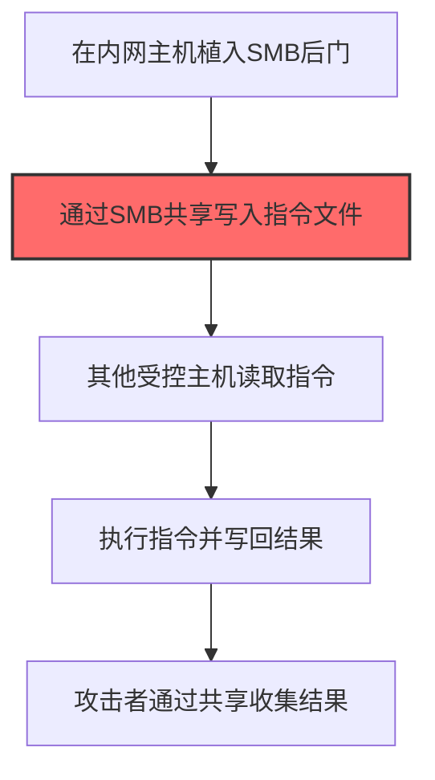

# SMB (T1071.005)

## 一句话通俗理解

> **SMB就是用 Windows 文件共享协议传 C2 指令。**

## 30秒速查卡

| 维度 | 你需要知道的 |
|------|-------------|
| 这是什么？ | 攻击者通过SMB文件共享协议在内网主机之间传递C2指令，把恶意命令写成文件放在共享目录中 |
| 为什么危险？ | SMB是Windows内网最常用的协议，文件共享、打印服务都依赖它，内网安全设备对SMB流量检查很少 |
| 谁需要关心？ | Windows域管理员、SOC分析师、内网安全工程师 |
| 你的第一步防御 | 监控SMB共享目录中的异常文件创建和修改行为，尤其是可执行文件的写入 |
| 如果只做一件事 | 审计内网SMB共享的访问日志，重点关注非工作时间的文件读写操作 |

## 难度等级

⭐⭐ 中级 - 需要一定的技术基础和实践经验

## 前置知识检查

**读这个文件需要什么？**

- [ ] 网络协议基础（TCP/IP/DNS/HTTP）
- [ ] C2通信模式
- [ ] 加密通信基本原理

## 技术描述

**通俗解释：**

**过渡段：** 不要误以为C2只是'恶意软件发心跳包'——现代C2基础设施堪比小型互联网公司。攻击者使用CDN隐藏真实服务器、用Domain Fronting伪装流量目的地、借助合法云服务（如GitHub Issues、Slack API）作为通信通道。攻击者的C2流量与正常流量混杂在一起，传统IoC检测几乎无效。
用 Windows 文件共享协议传 C2 指令，适合内网横向移动

> 🌐 **打个比方**：就像在正常的网页浏览流量里夹带暗语——攻击者将C2数据伪装成标准的WebSocket通信，逃避深度包检测。

**技术原理：**
T1071.005 是 应用层协议（T1071）的子技术，专注于SMB这一特定方面。攻击者在命令与控制阶段，通过SMB来获取目标系统或组织的相关信息，为后续攻击步骤做准备。

**用途与影响：**
- 为后续攻击提供关键信息支撑
- 提高攻击的成功率和精准度
- 降低攻击被发现的概率

## 真实攻击流程

### 典型场景

攻击者在 **命令与控制** 阶段使用 SMB协议 技术，以下是典型的攻击步骤：



**步骤详解：**

1. **在内网主机植入SMB后门** - 在多台内网主机上部署支持SMB通信的恶意模块
2. **通过SMB共享写入指令文件** - 攻击者将加密的指令文件写入指定的SMB共享目录（关键步骤）
3. **其他受控主机读取指令** - 其他被控主机定期轮询共享目录获取新指令
4. **执行指令并写回结果** - 各主机执行指令后将结果文件写入共享目录
5. **攻击者通过共享收集结果** - 攻击者从共享目录读取所有主机的执行结果

5. **利用信息进行下一步攻击** - 基于收集到的信息制定后续攻击计划

## 攻击流程


**关键步骤说明：**

1. **在内网首台失陷主机部署SMB命名管道后门**: 攻击者通过横向移动拿下首台Windows主机后，部署支持SMB协议的后门（如Cobalt Strike SMB Beacon、自研命名管道后门），创建一个具有伪装名称的命名管道（如`\\.\pipe\svcctl`、`\\.\pipe\lsass`），所有C2流量通过445端口SMB协议传输，无需出站网络连接
2. **通过SMB共享目录下发加密指令文件**: 攻击者将加密指令文件（如`config.ini`、`cache.dat`伪装成系统配置）写入预先创建的隐藏SMB共享目录（如`\\<DC>\IPC$`、`\\<fileserver>\share$\tasks\`），使用AES或自定义XOR密钥加密，文件名按主机名+日期命名以区分下发对象
3. **其他受控主机轮询共享拉取指令**: 受控内网主机上的Beacon每隔30-120秒通过SMB `TREE_CONNECT`+`CREATE`+`READ`命令访问共享目录，检查是否有属于自己主机名的新指令文件，由于SMB是Windows合法协议，445端口流量通常被防火墙白名单放行
4. **各主机执行横向移动与数据收集操作**: 各主机后门解密指令文件，按指令执行psexec/wmi横向移动到相邻主机、Mimikatz抓取凭证、Volume Shadow Copy读取ntds.dit、文件服务器数据打包等操作，所有进程均使用合法系统工具以躲避EDR行为检测
5. **执行结果通过SMB写回共享目录回传**: 各主机将执行结果（凭证哈希、收集的文档、屏幕截图）加密打包后通过SMB `WRITE`命令写回共享目录的`results\<hostname>\`子目录，首台失陷主机汇总后由攻击者通过定期访问取出，整个C2通信全程不出网，仅在内网SMB流量中流转

## 真实案例

### 案例1：APT组织使用SMB进行攻击准备

- **时间**: 2023-2024年
- **目标**: 多行业目标组织
- **攻击组织**: 多个APT组织
- **手法**: 攻击者在攻击初期大量使用SMB技术收集目标信息，为后续定向攻击做准备
- **影响**: 攻击成功率显著提高，防御者难以及时发现侦察行为
- **参考链接**: [MITRE ATT&CK - T1071.005](https://attack.mitre.org/techniques/T1071/005/)

### 案例2：红队演练中的SMB应用

- **时间**: 2024-2025年
- **目标**: 授权测试的企业客户
- **攻击组织**: 红队团队
- **手法**: 在授权的红队演练中，SMB被用于模拟真实攻击者的信息收集行为，测试企业安全监控体系能否及时发现侦察活动
- **影响**: 帮助企业发现信息暴露面和安全监控盲区
- **参考链接**: 红队演练报告（内部资料）

## 红队视角

> ⚠️ **免责声明**：以下内容仅用于合法的安全测试、渗透测试和教育目的。未经授权对他人系统进行测试是违法行为。

### 实战技巧

1. **隐蔽优先**：在命令与控制阶段使用被动方式收集信息，避免触发安全告警
2. **信息验证**：对收集到的信息进行交叉验证，确保准确性和时效性
3. **工具选择**：根据目标环境选择合适的工具，避免使用已被广泛检测的工具
4. **OPSEC意识**：使用匿名网络、临时环境进行操作，防止溯源

### 常用工具

| 工具名称 | 用途 | 平台 |
|---------|------|------|
| 专用收集工具 | SMB相关操作 | 全平台 |
| 信息分析工具 | 对收集到的数据进行分析和整理 | 全平台 |

### 注意事项

- 仅在授权范围内使用SMB技术
- 注意操作的隐蔽性，避免被蓝队发现
- 记录操作日志，用于后续分析和报告编写

## 蓝队视角

### 检测要点

1. **异常信息收集行为**：监控来自内部系统的异常数据查询和收集行为
2. **可疑工具使用**：检测与SMB相关的工具在内部网络中的使用
3. **异常网络流量**：监控对外部信息收集平台的可疑网络连接
4. **权限异常**：关注非授权用户的信息收集和查询行为

### 监控建议

- 部署信息收集行为的检测规则
- 建立基准行为模型，及时发现异常
- 定期审计敏感信息的访问记录

## 避坑指南

SOC常见误区：只检测已知恶意域名和IP。

## 检测建议

### 网络层检测

**检测方法：** 监控与SMB相关的网络流量特征

**具体规则/命令示例：**

```bash
# 监控异常DNS查询
tcpdump -i eth0 port 53 | grep -E "可疑域名"
```

### 主机层检测

**Windows事件ID：**

- 事件ID 4688：可疑进程创建
- 事件ID 4104：PowerShell脚本块日志

**Linux日志：**

- 日志文件：`/var/log/syslog`
- 关键字段：可疑命令执行

### 应用层检测

**用人话说：** SMB协议不只能传文件，还是内网C2通信的利器。Cobalt Strike的SMB Beacon就是通过Windows命名管道（\\.\pipe\*）在受控机器之间传递数据——A机的木马创建一个命名管道，B机的木马连上来读写，数据就在中间流转。这种通信完全在内网进行，不会产生出站流量，防火墙和IDS根本看不到。攻击者还经常用SMB共享（ADMIN$、C$）横向传递工具和payload，使用net use + copy或者PowerShell的Copy-Item跨机器复制恶意文件。检测重点：非域控服务器对ADMIN$共享的写操作、异常进程（如wmic.exe、powershell.exe）发起的SMB连接。

**Sigma规则示例：**

```yaml
title: 可疑SMB协议C2通信
status: experimental
description: 检测svchost.exe连接外部445端口或命名管道访问，可能为SMB Beacon C2通信
logsource:
    product: windows
    service: sysmon
detection:
    selection_smb_external:
        EventID: 3
        Image: 'C:\Windows\System32\svchost.exe'
        DestinationPort: 445
    selection_pipe_cmd:
        EventID: 1
        CommandLine|contains: '\\pipe\'
    condition: selection_smb_external or selection_pipe_cmd
level: high
tags:
    - attack.t1071.005
    - attack.command_and_control
```

## 缓解措施

### 优先级1：关键措施

**措施名称：** 敏感信息保护

**具体实施步骤：**

1. 识别和分类组织内的敏感信息
2. 对敏感信息实施访问控制和加密
3. 部署信息泄露防护（DLP）解决方案

### 优先级2：重要措施

**措施名称：** 员工安全意识培训

**具体实施步骤：**

1. 定期开展信息安全意识培训
2. 教育员工识别社交工程攻击
3. 建立信息报告和响应机制

### 优先级3：建议措施

**措施名称：** 安全配置加固

**具体实施步骤：**

1. 限制公开可访问的系统信息
2. 配置合适的日志记录和告警策略
3. 定期进行安全评估和渗透测试

## 动手实验

> ⚠️ **重要提示**：所有实验必须在隔离的实验室环境中进行，禁止对未授权的真实系统进行测试。

### 实验环境准备

**推荐靶场/实验平台：**

| 平台名称 | 类型 | 难度 | 链接 |
|---------|------|:----:|------|
| 本地虚拟机 | 虚拟环境 | 初级 | 本机搭建 |
| TryHackMe | 在线靶场 | 初级 | https://tryhackme.com |

**所需工具：**

- 根据具体技术需求准备相应工具

**环境搭建：**

```bash
# 准备隔离的实验环境
# 具体命令根据实验内容而定
```

### 实验1：基础实践（初级）

**实验目标：** 理解和练习SMB的基本操作

**实验步骤：**

1. 在隔离环境中搭建实验系统
2. 按照技术描述执行基本操作
3. 观察和记录实验现象

**预期结果：** 成功完成SMB的基本操作

**学习要点：** 理解SMB的原理和操作方法

## 术语解释

| 术语 | 英文原名 | 通俗解释 |
|-----|---------|---------|
| SMB | SMB | SMB的基本概念和操作方法 |
| 侦察 | Reconnaissance | 收集目标信息的过程，为后续攻击做准备 |
| OPSEC | Operational Security | 操作安全，保护行动信息不被对手发现 |

## 被引用情况

以下父技术文档引用了本子技术：

- [T1071 - 应用层协议](../T1071-Application-Layer-Protocol.md)

## 参考资料

### 📚 官方文档（深入了解）

- [MITRE ATT&CK - T1071](https://attack.mitre.org/techniques/T1071/)
- [MITRE ATT&CK - T1071.005](https://attack.mitre.org/techniques/T1071/005/)
- [MITRE ATT&CK - T1071.005 检测](https://attack.mitre.org/techniques/T1071/005/detections/)

### 📰 安全报告（真实攻击）

- [CISA Known Exploited Vulnerabilities](https://www.cisa.gov/known-exploited-vulnerabilities-catalog)
- [Microsoft Security Blog](https://www.microsoft.com/en-us/security/blog/)

### 学习资源

- [MITRE ATT&CK 官方文档](https://attack.mitre.org/)
- [ATT&CK STIX Data](https://github.com/mitre-attack/attack-stix-data)

