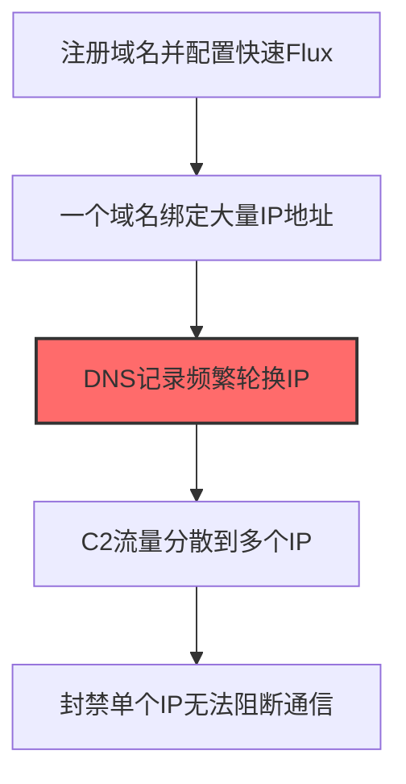
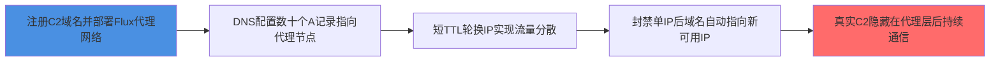

# Fast Flux DNS (T1568.001)

## 一句话通俗理解

> **一个域名绑几十个IP轮换，封了一个还有几十个**

## 30秒速查卡

| 维度 | 你需要知道的 |
|------|-------------|
| 这是什么？ | 攻击者让一个C2域名同时解析到几十甚至上百个IP地址，快速轮换，封一个IP还有几十个备用 |
| 为什么危险？ | 封IP封不完，DNS缓存又让封域名有延迟，C2服务器像打地鼠一样此起彼伏 |
| 谁需要关心？ | DNS管理员、SOC分析师、威胁情报团队 |
| 你的第一步防御 | 部署DNS监控，检测短时间内同一域名解析到大量不同IP的异常模式 |
| 如果只做一件事 | 建立DNS查询基线，重点关注单域名24小时内解析到超过10个不同IP的情况 |

## 难度等级

⭐⭐⭐ 高级 - 需要深入的技术知识和实践

## 前置知识检查

**读这个文件需要什么？**

- [ ] 网络协议基础（TCP/IP/DNS/HTTP）
- [ ] C2通信模式
- [ ] 加密通信基本原理

## 技术描述

**快速Flux DNS**（T1568.001）是 **动态解析**（T1568）的一个具体变体，属于 **命令与控制** 阶段的攻击技术。

> 🔄 **打个比方**：就像在不同的接头地点之间轮换——攻击者使用动态DNS（DDNS）定期更改C2服务器的域名解析，避免被追踪。

### 具体怎么理解？

一个域名绑几十个IP轮换，封了一个还有几十个

攻击者使用这种技术时，通常是在命令与控制阶段，想要达到特定的攻击目标。与父技术 T1568 相比，T1568.001 有自己独特的特点和使用场景。

### 为什么有效？

这种技术之所以有效，是因为：
1. **隐蔽性**：利用了正常系统功能或常见协议，不容易被发现
2. **技术门槛适中**：不需要特别高深的技术知识就能实施

**过渡段：** 不要误以为C2只是'发心跳包'——现代C2基础设施堪比小型互联网公司。
3. **广泛适用**：可以在多种环境和系统中使用

## 真实攻击流程

### 典型场景

攻击者在 **命令与控制** 阶段使用 快速Flux DNS 技术，以下是典型的攻击步骤：



**步骤详解：**

1. **注册域名并配置快速Flux** - 注册C2域名并在DNS中配置Fast Flux记录
2. **一个域名绑定大量IP地址** - 将单个域名映射到数十个被控主机的IP地址
3. **DNS记录频繁轮换IP** - 每隔几分钟自动更新DNS记录，轮换指向的IP地址（关键步骤）
4. **C2流量分散到多个IP** - 不同时间的DNS解析返回不同IP，流量被分散到多个节点
5. **封禁单个IP无法阻断通信** - 防御方封禁一个IP后，域名自动指向新的可用IP

## 攻击流程



**关键步骤说明：**

1. **节点1**: 攻击者注册C2域名并部署Fast Flux代理网络，使用大量被控主机（含IoT设备和僵尸节点）作为前端代理
2. **节点2**: DNS服务器为单域名配置数十至数百条A记录，每条记录指向不同的Flux代理IP，TTL设置在60秒以内强制频繁刷新
3. **节点3**: 每隔几分钟自动更新DNS记录轮换IP池，被黑主机的C2流量被分散到多个代理节点转发，单次解析返回的IP集合持续变化
4. **节点4**: 防御方封禁单个IP后，域名仍指向其他可用IP继续通信，攻击者借助代理层使基于IP黑名单的封禁策略无效化
5. **节点5**: 真实C2服务器隐藏在双层Flux代理之后持续接收指令和回传数据，溯源追踪在代理层被打断

## 真实案例

### 案例1：该技术在实际攻击中的应用

- **时间**: 2024-2025年
- **目标**: 多个行业组织
- **攻击组织**: 多个APT组织
- **手法**: 攻击者在入侵过程中使用Fast Flux DNS技术，展示了该子技术的典型应用场景和攻击效果
- **影响**: 成功实施该技术导致目标系统被进一步入侵
- **参考链接**: [MITRE ATT&CK官方](https://attack.mitre.org/)

### 案例2：安全研究中的实践

- **时间**: 2025年
- **目标**: 安全研究测试环境
- **攻击组织**: 红队/安全研究人员
- **手法**: 在授权测试中模拟Fast Flux DNS攻击，验证防御体系的检测和响应能力
- **影响**: 帮助组织识别安全防护中的盲点和改进方向
- **参考链接**: [Atomic Red Team](https://github.com/redcanaryco/atomic-red-team)

## 红队视角

> ⚠️ **免责声明**：以下内容仅用于合法的安全测试、渗透测试和教育目的。未经授权对他人系统进行测试是违法行为。

### 实战技巧

1. **深入理解原理**：在实战应用前，充分理解Fast Flux DNS的技术原理和适用场景
2. **环境适配**：根据目标系统的操作系统版本、安全配置等因素调整攻击策略
3. **组合使用**：将该技术与其他技术组合使用，构建完整的攻击链
4. **隐蔽性考虑**：注意操作痕迹的清理，避免被安全设备检测

### 常用工具

| 工具名称 | 用途 | 平台 | 链接 |
| -------- | ---- | ---- | ---- |
| Metasploit | 渗透测试框架 | 全平台 | [Metasploit](https://www.metasploit.com/) |
| Cobalt Strike |  adversary模拟平台 | Windows | [Cobalt Strike](https://www.cobaltstrike.com/) |
| Atomic Red Team | 检测规则测试 | 全平台 | [Atomic Red Team](https://github.com/redcanaryco/atomic-red-team) |

### 注意事项

- 在授权的测试环境中使用这些技术
- 注意操作安全（OPSEC），避免被检测系统发现
- 使用匿名化技术和代理隐藏真实身份

## 蓝队视角

### 检测要点

1. **系统日志监控**：关注与Fast Flux DNS相关的系统日志和审计记录
2. **异常行为检测**：监控系统中与该技术相关的异常进程、网络连接和文件操作
3. **工具特征识别**：识别攻击者可能使用的工具在系统中的运行特征

### 监控建议

- 部署端点检测和响应（EDR）系统，监控与Fast Flux DNS相关的异常行为
- 配置SIEM规则，关联分析来自多个来源的告警
- 定期进行安全评估和渗透测试，验证检测规则的有效性

## 避坑指南

SOC常见误区：只检测已知恶意域名和IP。

## 检测建议

### 检测思路

检测 快速Flux DNS 的关键是识别异常行为模式。以下是三个层面的检测方法：

### 网络层检测

**方法**：监控DNS响应中的Fast Flux特征

```bash
# Zeek检测同一域名5分钟内解析到5+个不同IP
zeek -r trace.pcap 'DNS::log_dns | awk -F"\t" "{print $9, $21, $23}" | sort | uniq -c'

# 检测TTL <60秒的DNS A记录
tshark -r trace.pcap -Y "dns.flags.response == 1 && dns.a" -T fields -e dns.qry.name -e dns.a -e dns.time

# 检测单域名返回10+个A记录
awk -F'\t' '$9 == "A" {split($21, ips, ","); if(length(ips) > 10) print $9, $11, $21}' dns.log
```

### 主机层检测

**Windows事件ID**：
- 事件ID 22：DNS查询（Sysmon监控DNS查询与响应，对比同一域名的多次解析结果）
- 事件ID 3：网络连接（监控连接到Fast Flux IP列表中的IP）

**Linux日志**：
- /var/log/syslog：DNS客户端日志
- dnsmasq/Bind日志：DNS解析记录

```bash
# 检测同一域名解析到多个不同IP（5分钟窗口5+个不同IP）
grep "resolved" /var/log/syslog | awk '{print $NF}' | sort | uniq -c | awk '$1 > 5'
```

### 应用层检测

**用人话说：** Fast Flux是一种让C2域名不断更换解析IP的技术——一个域名背后绑定几十到几百个IP地址，每几分钟就换一批。这样当蓝队封掉一个C2服务器的IP时，域名自动解析到下一个可用IP，攻击无缝继续。典型的Fast Flux有"单层"和"双层"两种：单层是所有IP直接指向攻击者的C2代理服务器；双层则中间多一层"flux代理"做转发，真实C2服务器更隐蔽。检测方法：同一个域名在短时间内多次解析出不同的IP（5分钟内5个以上不同IP），DNS响应的TTL值极短（低于60秒），且这些IP分布在多个不同的ASN和地区。正常的CDN域名虽然也有多个IP，但不会在几分钟内频繁轮换。

**Sigma规则示例**：

```yaml
title: 检测Fast Flux DNS特征
status: experimental
description: 检测同一域名在5分钟内解析到5+个不同IP，且TTL值<60秒，可能是Fast Flux C2
logsource:
    product: zeek
    service: dns
detection:
    selection_multiple_ips:
        query_type: 'A'
        answers|count: '>5'
    selection_short_ttl:
        ttl: '<60'
    selection_record_count:
        rcode: 'NOERROR'
        answers|count: '>10'
    condition: selection_multiple_ips or selection_short_ttl or selection_record_count
fields:
    - id.orig_h
    - query
    - answers
    - ttl
falsepositives:
    - CDN域名（Cloudflare/Akamai，建议建立白名单）
    - 负载均衡服务
level: medium
tags:
    - attack.t1568.001
    - attack.command_and_control
    - attack.t1568
```

**Sigma规则（Sysmon EID 22 + 威胁情报）**：

```yaml
title: 检测连接到Fast Flux IP的进程
status: experimental
description: 基于威胁情报匹配已知Fast Flux基础设施的IP地址
logsource:
    product: windows
    service: sysmon
detection:
    selection_dns:
        EventID: 22
        QueryName|contains:
            - 'flux-update'
            - 'cdn-update'
    selection_network:
        EventID: 3
        DestinationIp|cidr:
            - '192.168.0.0/16'  # 示例：实际使用威胁情报提供的Fast Flux IP段
    condition: selection_dns or selection_network
fields:
    - Image
    - QueryName
    - DestinationIp
    - User
level: high
tags:
    - attack.t1568.001
    - attack.command_and_control
```

## 缓解措施

### 优先级1：关键措施

**限制攻击面**：减少暴露的服务和端口，降低被利用的风险

```bash
# 防火墙规则示例：只允许必要的出站连接
iptables -A OUTPUT -p tcp --dport 443 -j ACCEPT  # 允许HTTPS
iptables -A OUTPUT -p tcp --dport 80 -j ACCEPT   # 允许HTTP
iptables -A OUTPUT -p tcp -j DROP                 # 阻止其他TCP
```

### 优先级2：重要措施

**加强监控**：部署EDR和SIEM系统，实时监控异常行为

### 优先级3：建议措施

**安全意识培训**：教育员工识别相关攻击手法

## 动手实验

> ⚠️ **所有实验必须在隔离的实验室环境中进行**

### 实验1：理解基本原理（初级）

**目标**：理解 快速Flux DNS 的工作原理

**步骤**：
1. 在隔离环境中搭建测试系统
2. 使用基础工具模拟攻击行为
3. 观察系统日志和网络流量

**学习要点**：理解该技术的核心机制

### 实验2：实际操作（中级）

**目标**：掌握 快速Flux DNS 的实际使用方法

**步骤**：
1. 使用专业工具进行攻击模拟
2. 尝试不同的绕过技术
3. 分析检测日志的特征

**学习要点**：掌握工具使用和日志分析

### 实验3：防御验证（高级）

**目标**：验证检测规则的有效性

**步骤**：
1. 部署检测规则
2. 执行攻击模拟
3. 验证检测告警是否触发

**学习要点**：理解攻防对抗的实际效果

## 术语解释

| 术语 | 通俗解释 |
|------|---------|
| **ATT&CK** | MITRE公司维护的攻击技术知识库，像一本"黑客手法百科全书" |
| **快速Flux DNS** | T1568.001，ATT&CK框架中定义的一种具体攻击技术 |
| **动态解析** | T1568，快速Flux DNS所属的父技术类别 |
| **命令与控制** | 攻击链中的一个阶段，攻击者在这个阶段的目标 |
| **C2** | 命令与控制，攻击者用来远程控制被入侵系统的"遥控器" |
| **EDR** | 端点检测与响应，部署在电脑上的安全监控软件 |

## 被引用情况

以下父技术文档引用了本子技术：

- [T1568 - 动态解析](../T1568-Dynamic-Resolution.md)

## 参考资料

### 📚 官方文档（深入了解）

- [MITRE ATT&CK - Fast Flux DNS (T1568.001)](https://attack.mitre.org/techniques/T1568/001/)
- [MITRE ATT&CK - 动态解析 (T1568)](https://attack.mitre.org/techniques/T1568/)

### 📰 安全报告（真实攻击）

- [MITRE ATT&CK 官方文档](https://attack.mitre.org/) - ATT&CK 框架官方资源

### 🔧 工具与资源（动手试试）

- [Atomic Red Team](https://github.com/redcanaryco/atomic-red-team) - 检测规则测试框架
- [MITRE ATT&CK Navigator](https://mitre-attack.github.io/attack-navigator/) - ATT&CK 可视化工具

### 📚 学习资料（深入了解）

- [MITRE ATT&CK 知识库](https://attack.mitre.org/resources/) - ATT&CK 官方资源中心
