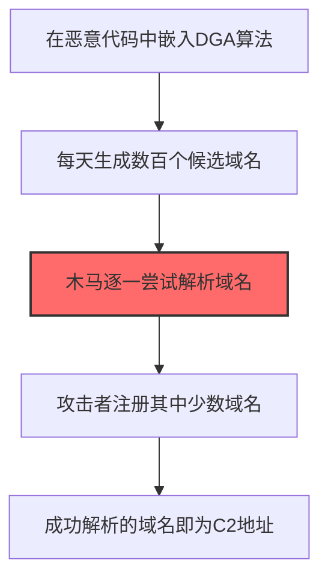
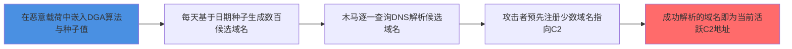

# 域名生成算法（DGA） (T1568.002)

## 一句话通俗理解

> **每天自动生成几百个域名，只要攻击者注册其中几个就行**

## 30秒速查卡

| 维度 | 你需要知道的 |
|------|-------------|
| 这是什么？ | 恶意软件内置域名生成算法，每天自动计算出几百个候选域名，攻击者只需注册其中少数几个 |
| 为什么危险？ | 黑名单永远跟不上DGA的生成速度，防御者无法提前封锁所有可能的C2域名 |
| 谁需要关心？ | DNS管理员、威胁狩猎团队、恶意软件分析师 |
| 你的第一步防御 | 部署DGA检测工具，识别异常长、高熵值的DNS查询模式 |
| 如果只做一件事 | 监控每台主机每天的DNS失败查询次数，DGA恶意软件会产生大量NXDOMAIN响应 |

## 难度等级

⭐⭐⭐ 高级 - 需要深入的技术知识和实践

## 前置知识检查

**读这个文件需要什么？**

- [ ] 网络协议基础（TCP/IP/DNS/HTTP）
- [ ] C2通信模式
- [ ] 加密通信基本原理

## 技术描述

**域名生成算法（DGA）**（T1568.002）是 **动态解析**（T1568）的一个具体变体，属于 **命令与控制** 阶段的攻击技术。

> 🎲 **打个比方**：就像从一组候选地址中随机选择一个接头地点——攻击者使用域名生成算法（DGA）生成大量候选域名，选择其一作为C2服务器。

### 具体怎么理解？

每天自动生成几百个域名，只要攻击者注册其中几个就行

攻击者使用这种技术时，通常是在命令与控制阶段，想要达到特定的攻击目标。与父技术 T1568 相比，T1568.002 有自己独特的特点和使用场景。

### 为什么有效？

这种技术之所以有效，是因为：
1. **隐蔽性**：利用了正常系统功能或常见协议，不容易被发现
2. **技术门槛适中**：不需要特别高深的技术知识就能实施

**过渡段：** 不要误以为C2只是'发心跳包'——现代C2基础设施堪比小型互联网公司。
3. **广泛适用**：可以在多种环境和系统中使用

## 真实攻击流程

### 典型场景

攻击者在 **命令与控制** 阶段使用 域名生成算法（DGA） 技术，以下是典型的攻击步骤：



**步骤详解：**

1. **在恶意代码中嵌入DGA算法** - 将域名生成算法集成到恶意载荷中
2. **每天生成数百个候选域名** - 算法基于日期/种子生成大量随机域名字符串
3. **木马逐一尝试解析域名** - 恶意载荷按算法生成的列表逐个进行DNS查询（关键步骤）
4. **攻击者注册其中少数域名** - 攻击者预先注册算法生成列表中的少量域名作为C2
5. **成功解析的域名即为C2地址** - 能够成功解析的域名就是当前活跃的C2服务器地址

## 攻击流程



**关键步骤说明：**

1. **节点1**: 攻击者将域名生成算法和硬编码种子值集成到恶意软件中，算法以当前日期、时间或密钥作为输入计算候选域名
2. **节点2**: 木马每天按算法生成数百到数万个候选域名字符串（如LockBit 3.0使用AES加密日期生成，Conficker每天生成250-50000个域名）
3. **节点3**: 恶意软件对生成的域名列表逐个发起DNS查询，未注册域名产生大量NXDOMAIN响应（DGA典型检测特征）
4. **节点4**: 攻击者只需提前注册算法生成列表中的少数几个域名并指向C2基础设施即可建立通信，大幅降低注册成本
5. **节点5**: 能够成功解析的域名即为当前活跃的C2地址，C2被查封后第二天算法自动生成新批次域名继续尝试连接

## 真实案例

### 案例1：该技术在实际攻击中的应用

- **时间**: 2024-2025年
- **目标**: 多个行业组织
- **攻击组织**: 多个APT组织
- **手法**: 攻击者在入侵过程中使用域名生成算法（DGA）技术，展示了该子技术的典型应用场景和攻击效果
- **影响**: 成功实施该技术导致目标系统被进一步入侵
- **参考链接**: [MITRE ATT&CK官方](https://attack.mitre.org/)

### 案例2：安全研究中的实践

- **时间**: 2025年
- **目标**: 安全研究测试环境
- **攻击组织**: 红队/安全研究人员
- **手法**: 在授权测试中模拟域名生成算法（DGA）攻击，验证防御体系的检测和响应能力
- **影响**: 帮助组织识别安全防护中的盲点和改进方向
- **参考链接**: [Atomic Red Team](https://github.com/redcanaryco/atomic-red-team)

## 红队视角

> ⚠️ **免责声明**：以下内容仅用于合法的安全测试、渗透测试和教育目的。未经授权对他人系统进行测试是违法行为。

### 实战技巧

1. **深入理解原理**：在实战应用前，充分理解域名生成算法（DGA）的技术原理和适用场景
2. **环境适配**：根据目标系统的操作系统版本、安全配置等因素调整攻击策略
3. **组合使用**：将该技术与其他技术组合使用，构建完整的攻击链
4. **隐蔽性考虑**：注意操作痕迹的清理，避免被安全设备检测

### 常用工具

| 工具名称 | 用途 | 平台 | 链接 |
| -------- | ---- | ---- | ---- |
| Metasploit | 渗透测试框架 | 全平台 | [Metasploit](https://www.metasploit.com/) |
| Cobalt Strike |  adversary模拟平台 | Windows | [Cobalt Strike](https://www.cobaltstrike.com/) |
| Atomic Red Team | 检测规则测试 | 全平台 | [Atomic Red Team](https://github.com/redcanaryco/atomic-red-team) |

### 注意事项

- 在授权的测试环境中使用这些技术
- 注意操作安全（OPSEC），避免被检测系统发现
- 使用匿名化技术和代理隐藏真实身份

## 蓝队视角

### 检测要点

1. **系统日志监控**：关注与域名生成算法（DGA）相关的系统日志和审计记录
2. **异常行为检测**：监控系统中与该技术相关的异常进程、网络连接和文件操作
3. **工具特征识别**：识别攻击者可能使用的工具在系统中的运行特征

### 监控建议

- 部署端点检测和响应（EDR）系统，监控与域名生成算法（DGA）相关的异常行为
- 配置SIEM规则，关联分析来自多个来源的告警
- 定期进行安全评估和渗透测试，验证检测规则的有效性

## 避坑指南

SOC常见误区：只检测已知恶意域名和IP。

## 检测建议

### 检测思路

检测 域名生成算法（DGA） 的关键是识别异常行为模式。以下是三个层面的检测方法：

### 网络层检测

**方法**：监控DNS NXDOMAIN响应频率和域名特征

```bash
# Zeek检测主机产生大量NXDOMAIN响应（50+/小时）
awk -F'\t' '$14 == "NXDOMAIN" {print $9, $11}' dns.log | sort | uniq -c | sort -rn | head -20

# 检测DGA特征：随机字符域名（辅音+元音交替模式）
awk -F'\t' '$9 == "A" {print $11}' dns.log | grep -E '^[bcdfghjklmnpqrstvwxyz]{1,3}[aeiou]{1,2}[bcdfghjklmnpqrstvwxyz]{1,3}\.(com|net|org|info|biz|cc|ru|cn)$'

# 检测域名长度8-25字符且字符分布异常（熵值高）
python dga_detect.py --dns-log dns.log --min-length 8 --max-length 25 --entropy-threshold 3.0
```

### 主机层检测

**Windows事件ID**：
- 事件ID 22：DNS查询（Sysmon监控DNS查询和响应，统计NXDOMAIN比例）
- 事件ID 3：网络连接（监控进程发起大量失败DNS查询后连接成功的IP）

**Linux日志**：
- /var/log/syslog：系统日志
- /etc/resolv.conf：DNS配置变更监控

```bash
# 检测单主机DNS查询失败率>50%
grep "NXDOMAIN" /var/log/syslog | awk '{print $NF}' | sort | uniq -c | awk '$1 > 50'
```

### 应用层检测

**用人话说：** DGA（域名生成算法）是恶意软件自动批量生成潜在C2域名的方式。木马用一个种子值（如当前日期）通过算法计算出数百个域名，然后逐个尝试解析——只要攻击者提前注册了其中任何一个，木马就能连上。这避免了硬编码IP或域名被直接封杀，即使蓝队发现了当前用的域名并封掉它，第二天木马会生成一批全新的域名继续尝试。Conficker、Zeus、TrickBot等知名恶意家族都使用DGA。检测特征：一台主机每天产生大量DNS NXDOMAIN响应（数百到数千次），且查询的域名是随机字符组合（如"jf83k2dn9.cc"），域名长度在8-25字符之间。正常的DNS查询失败率应该远低于1%。

**Sigma规则示例**：

```yaml
title: 检测DGA域名查询特征
status: experimental
description: 检测主机产生大量NXDOMAIN响应且查询域名符合DGA随机字符特征
logsource:
    product: zeek
    service: dns
detection:
    selection_nxdomain:
        rcode: 'NXDOMAIN'
    filter_legit:
        query|endswith:
            - '.in-addr.arpa'
            - '.local'
            - '.msftconnecttest.com'
            - '.msocsp.com'
    condition: selection_nxdomain and not filter_legit
fields:
    - id.orig_h
    - query
    - rcode
falsepositives:
    - 系统自检（建议建立白名单）
    - 网络设备扫描
level: medium
tags:
    - attack.t1568.002
    - attack.command_and_control
    - attack.t1568
```

**Sigma规则（DGA域名模式匹配）**：

```yaml
title: 检测DGA随机域名模式
status: experimental
description: 基于正则匹配辅音+元音随机组合的DGA域名特征
logsource:
    product: zeek
    service: dns
detection:
    selection_dga_pattern:
        query_type: 'A'
        query|re: '^[bcdfghjklmnpqrstvwxyz]{2,4}[aeiou]{1,2}[bcdfghjklmnpqrstvwxyz]{2,4}[0-9]{0,3}\.(com|net|org|info|biz|cc|ru|cn|tk|ml|ga)$'
    selection_length_entropy:
        query|re: '^[a-z0-9]{8,25}\.(com|net|org|info|biz|cc|ru|cn)$'
    filter_legit:
        query|endswith:
            - '.google.com'
            - '.microsoft.com'
            - '.apple.com'
            - '.amazonaws.com'
            - '.windowsupdate.com'
    condition: (selection_dga_pattern or selection_length_entropy) and not filter_legit
fields:
    - id.orig_h
    - query
    - query_type
level: high
tags:
    - attack.t1568.002
    - attack.command_and_control
```

**Sigma规则（Sysmon EID 22 + 高NXDOMAIN率）**：

```yaml
title: 检测主机DNS查询失败率异常
status: experimental
description: 主机在10分钟内产生50+次DNS查询失败(NXDOMAIN)，可能是DGA域名查询
logsource:
    product: windows
    service: sysmon
detection:
    selection:
        EventID: 22
        ResultType: 'NXDOMAIN'
    timeframe: 10m
    condition: selection | count() by Image > 50
fields:
    - Image
    - QueryName
    - QueryStatus
falsepositives:
    - 网络扫描工具
    - 邮件服务器反垃圾邮件查询
level: high
tags:
    - attack.t1568.002
    - attack.command_and_control
```

## 缓解措施

### 优先级1：关键措施

**限制攻击面**：减少暴露的服务和端口，降低被利用的风险

```bash
# 防火墙规则示例：只允许必要的出站连接
iptables -A OUTPUT -p tcp --dport 443 -j ACCEPT  # 允许HTTPS
iptables -A OUTPUT -p tcp --dport 80 -j ACCEPT   # 允许HTTP
iptables -A OUTPUT -p tcp -j DROP                 # 阻止其他TCP
```

### 优先级2：重要措施

**加强监控**：部署EDR和SIEM系统，实时监控异常行为

### 优先级3：建议措施

**安全意识培训**：教育员工识别相关攻击手法

## 动手实验

> ⚠️ **所有实验必须在隔离的实验室环境中进行**

### 实验1：理解基本原理（初级）

**目标**：理解 域名生成算法（DGA） 的工作原理

**步骤**：
1. 在隔离环境中搭建测试系统
2. 使用基础工具模拟攻击行为
3. 观察系统日志和网络流量

**学习要点**：理解该技术的核心机制

### 实验2：实际操作（中级）

**目标**：掌握 域名生成算法（DGA） 的实际使用方法

**步骤**：
1. 使用专业工具进行攻击模拟
2. 尝试不同的绕过技术
3. 分析检测日志的特征

**学习要点**：掌握工具使用和日志分析

### 实验3：防御验证（高级）

**目标**：验证检测规则的有效性

**步骤**：
1. 部署检测规则
2. 执行攻击模拟
3. 验证检测告警是否触发

**学习要点**：理解攻防对抗的实际效果

## 术语解释

| 术语 | 通俗解释 |
|------|---------|
| **ATT&CK** | MITRE公司维护的攻击技术知识库，像一本"黑客手法百科全书" |
| **域名生成算法（DGA）** | T1568.002，ATT&CK框架中定义的一种具体攻击技术 |
| **动态解析** | T1568，域名生成算法（DGA）所属的父技术类别 |
| **命令与控制** | 攻击链中的一个阶段，攻击者在这个阶段的目标 |
| **C2** | 命令与控制，攻击者用来远程控制被入侵系统的"遥控器" |
| **EDR** | 端点检测与响应，部署在电脑上的安全监控软件 |

## 被引用情况

以下父技术文档引用了本子技术：

- [T1568 - 动态解析](../T1568-Dynamic-Resolution.md)

## 参考资料

### 📚 官方文档（深入了解）

- [MITRE ATT&CK - 域名生成算法（DGA） (T1568.002)](https://attack.mitre.org/techniques/T1568/002/)
- [MITRE ATT&CK - 动态解析 (T1568)](https://attack.mitre.org/techniques/T1568/)

### 📰 安全报告（真实攻击）

- [MITRE ATT&CK 官方文档](https://attack.mitre.org/) - ATT&CK 框架官方资源

### 🔧 工具与资源（动手试试）

- [Atomic Red Team](https://github.com/redcanaryco/atomic-red-team) - 检测规则测试框架
- [MITRE ATT&CK Navigator](https://mitre-attack.github.io/attack-navigator/) - ATT&CK 可视化工具

### 📚 学习资料（深入了解）

- [MITRE ATT&CK 知识库](https://attack.mitre.org/resources/) - ATT&CK 官方资源中心
