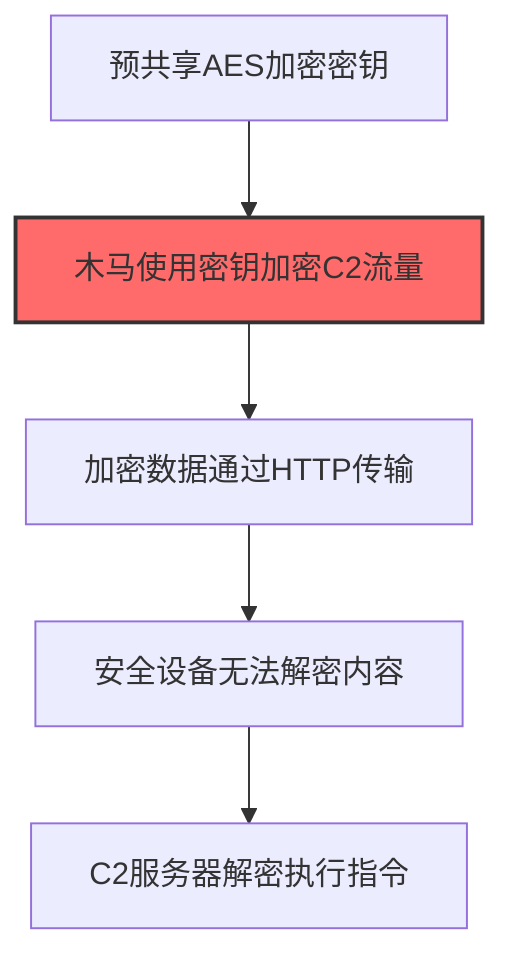
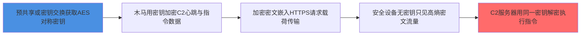

# 对称加密 (T1573.001)

## 一句话通俗理解

> **加密解密用同一把钥匙，速度快，适合大量C2通信**

## 30秒速查卡

| 维度 | 你需要知道的 |
|------|-------------|
| 这是什么？ | 攻击者用AES等对称加密算法对C2通信加密，发送方和接收方共享同一把密钥，加密解密速度快 |
| 为什么危险？ | 加密后的C2流量与正常HTTPS流量无法区分，安全设备的DPI无法解密内容，传统检测手段完全失效 |
| 谁需要关心？ | SOC分析师、网络安全架构师、威胁狩猎团队 |
| 你的第一步防御 | 部署SSL/TLS解密设备（如TLS Inspection），对加密流量进行深度检测 |
| 如果只做一件事 | 监控异常的加密流量模式，如非浏览器进程发起的TLS握手、非常规端口上的加密通信 |

## 难度等级

⭐⭐ 中级 - 需要一定的技术基础和经验

## 前置知识检查

**读这个文件需要什么？**

- [ ] 网络协议基础（TCP/IP/DNS/HTTP）
- [ ] C2通信模式
- [ ] 加密通信基本原理

## 技术描述

**对称加密**（T1573.001）是 **加密通道**（T1573）的一个具体变体，属于 **命令与控制** 阶段的攻击技术。

> 🔒 **打个比方**：就像用只有双方才知道的暗语交流——攻击者使用对称加密（AES等）对C2通信加密，即使被截获也无法解读。

### 具体怎么理解？

加密解密用同一把钥匙，速度快，适合大量C2通信

攻击者使用这种技术时，通常是在命令与控制阶段，想要达到特定的攻击目标。与父技术 T1573 相比，T1573.001 有自己独特的特点和使用场景。

### 为什么有效？

这种技术之所以有效，是因为：
1. **隐蔽性**：利用了正常系统功能或常见协议，不容易被发现
2. **技术门槛适中**：不需要特别高深的技术知识就能实施

**过渡段：** 不要误以为C2只是'发心跳包'——现代C2基础设施堪比小型互联网公司。
3. **广泛适用**：可以在多种环境和系统中使用

## 真实攻击流程

### 典型场景

攻击者在 **命令与控制** 阶段使用 对称加密 技术，以下是典型的攻击步骤：



**步骤详解：**

1. **预共享AES加密密钥** - 恶意载荷内置或通过密钥交换获取对称加密密钥
2. **木马使用密钥加密C2流量** - 使用AES等算法对C2通信数据进行加密（关键步骤）
3. **加密数据通过HTTP传输** - 将加密后的密文嵌入正常的HTTP请求/响应中传输
4. **安全设备无法解密内容** - 由于没有密钥，安全设备只能看到乱码般的密文
5. **C2服务器解密执行指令** - C2服务器使用相同密钥解密数据，获取明文指令

## 攻击流程



**关键步骤说明：**

1. **节点1**: 恶意软件通过硬编码预置或首次上线时的密钥交换获取AES/RC4/ChaCha20等对称加密密钥，通信双方共享同一密钥
2. **节点2**: 木马使用预共享密钥对C2通信数据（心跳请求、回传数据、指令响应）进行对称加密，加解密速度快适合大量数据传输
3. **节点3**: 加密后的密文嵌入HTTP/HTTPS请求body、Cookie或自定义字段中传输，外层可能叠加标准TLS形成双重加密
4. **节点4**: 安全设备的DPI即使解密了外层TLS，看到的仍是高熵密文，IDS签名和深度包检测对内层载荷完全失效
5. **节点5**: C2服务器使用相同的对称密钥解密数据获取明文指令内容，下发加密后的响应继续维持双向加密通信

## 真实案例

### 案例1：该技术在实际攻击中的应用

- **时间**: 2024-2025年
- **目标**: 多个行业组织
- **攻击组织**: 多个APT组织
- **手法**: 攻击者在入侵过程中使用对称加密技术，展示了该子技术的典型应用场景和攻击效果
- **影响**: 成功实施该技术导致目标系统被进一步入侵
- **参考链接**: [MITRE ATT&CK官方](https://attack.mitre.org/)

### 案例2：安全研究中的实践

- **时间**: 2025年
- **目标**: 安全研究测试环境
- **攻击组织**: 红队/安全研究人员
- **手法**: 在授权测试中模拟对称加密攻击，验证防御体系的检测和响应能力
- **影响**: 帮助组织识别安全防护中的盲点和改进方向
- **参考链接**: [Atomic Red Team](https://github.com/redcanaryco/atomic-red-team)

## 红队视角

> ⚠️ **免责声明**：以下内容仅用于合法的安全测试、渗透测试和教育目的。未经授权对他人系统进行测试是违法行为。

### 实战技巧

1. **深入理解原理**：在实战应用前，充分理解对称加密的技术原理和适用场景
2. **环境适配**：根据目标系统的操作系统版本、安全配置等因素调整攻击策略
3. **组合使用**：将该技术与其他技术组合使用，构建完整的攻击链
4. **隐蔽性考虑**：注意操作痕迹的清理，避免被安全设备检测

### 常用工具

| 工具名称 | 用途 | 平台 | 链接 |
| -------- | ---- | ---- | ---- |
| Metasploit | 渗透测试框架 | 全平台 | [Metasploit](https://www.metasploit.com/) |
| Cobalt Strike |  adversary模拟平台 | Windows | [Cobalt Strike](https://www.cobaltstrike.com/) |
| Atomic Red Team | 检测规则测试 | 全平台 | [Atomic Red Team](https://github.com/redcanaryco/atomic-red-team) |

### 注意事项

- 在授权的测试环境中使用这些技术
- 注意操作安全（OPSEC），避免被检测系统发现
- 使用匿名化技术和代理隐藏真实身份

## 蓝队视角

### 检测要点

1. **系统日志监控**：关注与对称加密相关的系统日志和审计记录
2. **异常行为检测**：监控系统中与该技术相关的异常进程、网络连接和文件操作
3. **工具特征识别**：识别攻击者可能使用的工具在系统中的运行特征

### 监控建议

- 部署端点检测和响应（EDR）系统，监控与对称加密相关的异常行为
- 配置SIEM规则，关联分析来自多个来源的告警
- 定期进行安全评估和渗透测试，验证检测规则的有效性

## 避坑指南

SOC常见误区：只检测已知恶意域名和IP。

## 检测建议

### 检测思路

检测 对称加密 的关键是识别异常行为模式。以下是三个层面的检测方法：

### 网络层检测

**方法**：监控TLS握手特征和加密流量模式

```bash
# Zeek检测非浏览器进程发起的TLS连接（排除chrome/msedge/firefox/iexplore）
zeek -r trace.pcap 'ssl.log[!(ClientIssuer in {"Google Trust Services LLC","DigiCert Inc","Let's Encrypt R3"})]'

# 检测JA3指纹匹配Cobalt Strike默认证书（基于威胁情报库）
python ja3_match.py --ja3-db cobalt_strike_ja3.txt --ssl-log ssl.log

# 检测固定间隔心跳包（10-60秒周期）
awk -F'\t' '{print $1, $6, $9}' conn.log | sort | uniq -c | awk '$1 > 100'
```

### 主机层检测

**Windows事件ID**：
- 事件ID 3：网络连接（监控非浏览器进程powershell/cmd/rundll32/svchost发起的TLS连接）
- 事件ID 1：进程创建（监控certutil.exe/openssl.exe执行加密相关参数）
- 事件ID 7：镜像加载（监控非加密相关进程加载bcrypt.dll/crypt32.dll）

**Linux日志**：
- auditd：监控openssl/curl调用加密参数
- /var/log/syslog：系统日志

```bash
# 检测非浏览器进程发起的TLS连接到443/8443
grep -E " DestinationPort.*(443|8443)" /var/log/syslog | grep -vE "(chrome|msedge|firefox|iexplore)"
```

### 应用层检测

**用人话说：** 对称加密C2是指攻击者和木马用同一把密钥加密通信内容。常用AES、RC4、ChaCha20等算法，因为加解密速度快，适合大量数据回传。Cobalt Strike的默认通信模式就是用AES加密payload——木马和teamserver共享一个预置的AES密钥，所有心跳请求和指令响应都经过AES加密后再用HTTPS传输。检测这类加密C2不能靠解密内容（没密钥），而是看行为模式：同一台机器用同一个进程定时访问同一个IP，TLS握手的JA3指纹与已知恶意指纹库匹配，或者证书是自签名的、过期很久的。正常的HTTPS流量走的是受信任CA签发的证书。

**Sigma规则示例**：

```yaml
title: 检测对称加密C2通信
status: experimental
description: 检测非浏览器进程发起的TLS连接到外部443/8443端口，可能是Cobalt Strike/Sliver等对称加密C2
logsource:
    product: windows
    service: sysmon
detection:
    selection_network:
        EventID: 3
        DestinationPort:
            - 443
            - 8443
        Image|endswith:
            - '\powershell.exe'
            - '\pwsh.exe'
            - '\cmd.exe'
            - '\rundll32.exe'
            - '\svchost.exe'
            - '\wscript.exe'
            - '\cscript.exe'
            - '\certutil.exe'
    filter_browser:
        Image|endswith:
            - '\chrome.exe'
            - '\msedge.exe'
            - '\firefox.exe'
            - '\iexplore.exe'
    condition: selection_network and not filter_browser
fields:
    - Image
    - DestinationIp
    - DestinationPort
    - User
falsepositives:
    - 系统更新程序（建议建立白名单）
    - 企业内部代理客户端
level: medium
tags:
    - attack.t1573.001
    - attack.command_and_control
    - attack.t1573
```

**Zeek Sigma规则（JA3指纹检测）**：

```yaml
title: 检测Cobalt Strike默认JA3指纹
status: experimental
description: 基于JA3 TLS指纹库匹配已知Cobalt Strike/Sliver C2客户端
logsource:
    product: zeek
    service: ssl
detection:
    selection_ja3:
        ja3|contains:
            - '72a589da586844d7f0818ce684948eea'  # Cobalt Strike默认
            - 'e7d705a3286e19ea42f587b344ee6865'  # Sliver默认
    selection_cert:
        certificate.issuer|contains:
            - 'Cobalt Strike'
            - 'Unknown'
        certificate.subject|contains:
            - 'Cobalt Strike'
    condition: selection_ja3 or selection_cert
fields:
    - id.orig_h
    - id.resp_h
    - ja3
    - certificate.issuer
level: high
tags:
    - attack.t1573.001
    - attack.command_and_control
```

## 缓解措施

### 优先级1：关键措施

**限制攻击面**：减少暴露的服务和端口，降低被利用的风险

```bash
# 防火墙规则示例：只允许必要的出站连接
iptables -A OUTPUT -p tcp --dport 443 -j ACCEPT  # 允许HTTPS
iptables -A OUTPUT -p tcp --dport 80 -j ACCEPT   # 允许HTTP
iptables -A OUTPUT -p tcp -j DROP                 # 阻止其他TCP
```

### 优先级2：重要措施

**加强监控**：部署EDR和SIEM系统，实时监控异常行为

### 优先级3：建议措施

**安全意识培训**：教育员工识别相关攻击手法

## 动手实验

> ⚠️ **所有实验必须在隔离的实验室环境中进行**

### 实验1：理解基本原理（初级）

**目标**：理解 对称加密 的工作原理

**步骤**：
1. 在隔离环境中搭建测试系统
2. 使用基础工具模拟攻击行为
3. 观察系统日志和网络流量

**学习要点**：理解该技术的核心机制

### 实验2：实际操作（中级）

**目标**：掌握 对称加密 的实际使用方法

**步骤**：
1. 使用专业工具进行攻击模拟
2. 尝试不同的绕过技术
3. 分析检测日志的特征

**学习要点**：掌握工具使用和日志分析

### 实验3：防御验证（高级）

**目标**：验证检测规则的有效性

**步骤**：
1. 部署检测规则
2. 执行攻击模拟
3. 验证检测告警是否触发

**学习要点**：理解攻防对抗的实际效果

## 术语解释

| 术语 | 通俗解释 |
|------|---------|
| **ATT&CK** | MITRE公司维护的攻击技术知识库，像一本"黑客手法百科全书" |
| **对称加密** | T1573.001，ATT&CK框架中定义的一种具体攻击技术 |
| **加密通道** | T1573，对称加密所属的父技术类别 |
| **命令与控制** | 攻击链中的一个阶段，攻击者在这个阶段的目标 |
| **C2** | 命令与控制，攻击者用来远程控制被入侵系统的"遥控器" |
| **EDR** | 端点检测与响应，部署在电脑上的安全监控软件 |

## 被引用情况

以下父技术文档引用了本子技术：

- [T1573 - 加密通道](../T1573-Encrypted-Channel.md)

## 参考资料

### 📚 官方文档（深入了解）

- [MITRE ATT&CK - 对称加密 (T1573.001)](https://attack.mitre.org/techniques/T1573/001/)
- [MITRE ATT&CK - 加密通道 (T1573)](https://attack.mitre.org/techniques/T1573/)

### 📰 安全报告（真实攻击）

- [MITRE ATT&CK 官方文档](https://attack.mitre.org/) - ATT&CK 框架官方资源

### 🔧 工具与资源（动手试试）

- [Atomic Red Team](https://github.com/redcanaryco/atomic-red-team) - 检测规则测试框架
- [MITRE ATT&CK Navigator](https://mitre-attack.github.io/attack-navigator/) - ATT&CK 可视化工具

### 📚 学习资料（深入了解）

- [MITRE ATT&CK 知识库](https://attack.mitre.org/resources/) - ATT&CK 官方资源中心
