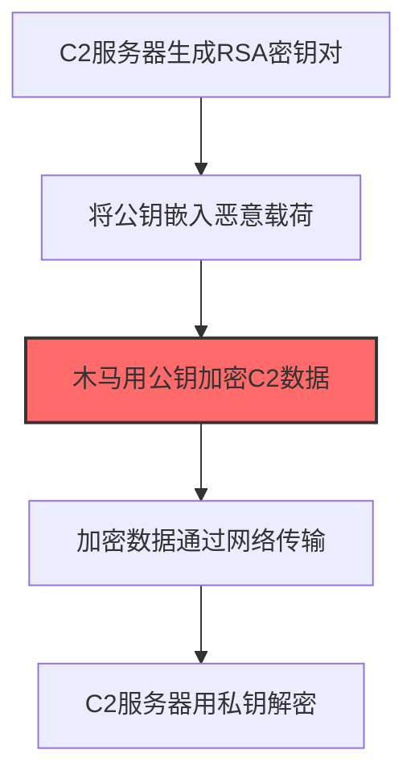
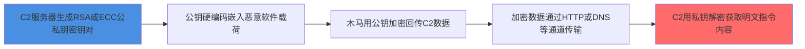

# 非对称加密 (T1573.002)

## 一句话通俗理解

> **用公钥加密、私钥解密，更安全但慢，常用于交换密钥**

## 30秒速查卡

| 维度 | 你需要知道的 |
|------|-------------|
| 这是什么？ | 攻击者用RSA等非对称加密保护C2通信，公钥加密数据只有私钥能解，常用于密钥交换阶段 |
| 为什么危险？ | 非对称加密提供了更强的保密性，即使公钥被获取也无法解密已捕获的C2流量，溯源难度极大 |
| 谁需要关心？ | SOC分析师、密码学工程师、威胁情报分析师 |
| 你的第一步防御 | 监控异常的密钥生成行为和大文件加密操作，建立进程级加密行为基线 |
| 如果只做一件事 | 关注非浏览器进程中出现的RSA密钥生成操作，尤其是PowerShell或cmd.exe调用OpenSSL |

## 难度等级

⭐⭐ 中级 - 需要一定的技术基础和经验

## 前置知识检查

**读这个文件需要什么？**

- [ ] 网络协议基础（TCP/IP/DNS/HTTP）
- [ ] C2通信模式
- [ ] 加密通信基本原理

## 技术描述

**非对称加密**（T1573.002）是 **加密通道**（T1573）的一个具体变体，属于 **命令与控制** 阶段的攻击技术。

> 🔐 **打个比方**：就像用一对公钥和私钥来加密通信——攻击者使用非对称加密（RSA等）保护C2通信，更安全但计算开销更大。

### 具体怎么理解？

用公钥加密、私钥解密，更安全但慢，常用于交换密钥

攻击者使用这种技术时，通常是在命令与控制阶段，想要达到特定的攻击目标。与父技术 T1573 相比，T1573.002 有自己独特的特点和使用场景。

### 为什么有效？

这种技术之所以有效，是因为：
1. **隐蔽性**：利用了正常系统功能或常见协议，不容易被发现
2. **技术门槛适中**：不需要特别高深的技术知识就能实施

**过渡段：** 不要误以为C2只是'发心跳包'——现代C2基础设施堪比小型互联网公司。
3. **广泛适用**：可以在多种环境和系统中使用

## 真实攻击流程

### 典型场景

攻击者在 **命令与控制** 阶段使用 非对称加密 技术，以下是典型的攻击步骤：



**步骤详解：**

1. **C2服务器生成RSA密钥对** - 攻击者生成RSA/ECC公私钥对
2. **将公钥嵌入恶意载荷** - 把公钥硬编码到植入目标系统的恶意程序中
3. **木马用公钥加密C2数据** - 使用公钥对C2通信数据进行非对称加密（关键步骤）
4. **加密数据通过网络传输** - 将密文通过HTTP/DNS等通道传输到C2服务器
5. **C2服务器用私钥解密** - C2服务器使用私钥解密数据，获取明文内容

## 攻击流程



**关键步骤说明：**

1. **节点1**: 攻击者在C2服务器上使用OpenSSL等工具生成RSA 2048/4096位或ECDSA非对称密钥对，私钥始终保留在C2侧不外泄
2. **节点2**: 公钥（仅能加密无法解密）以二进制形式硬编码到恶意软件载荷中，攻击者确保即使样本被捕获也无法反向解密历史流量
3. **节点3**: 木马使用内置公钥对C2通信数据进行非对称加密，回传数据只有持有私钥的攻击者才能解密，蓝队无法冒充C2与木马通信
4. **节点4**: 加密后的密文通过HTTP、DNS隧道等通道传输到C2服务器，流量呈现高熵特征但协议外壳可能完全合法
5. **节点5**: C2服务器使用私钥解密数据获取明文内容，常用于安全交换对称会话密钥后切换到对称加密通信以兼顾性能

## 真实案例

### 案例1：该技术在实际攻击中的应用

- **时间**: 2024-2025年
- **目标**: 多个行业组织
- **攻击组织**: 多个APT组织
- **手法**: 攻击者在入侵过程中使用非对称加密技术，展示了该子技术的典型应用场景和攻击效果
- **影响**: 成功实施该技术导致目标系统被进一步入侵
- **参考链接**: [MITRE ATT&CK官方](https://attack.mitre.org/)

### 案例2：安全研究中的实践

- **时间**: 2025年
- **目标**: 安全研究测试环境
- **攻击组织**: 红队/安全研究人员
- **手法**: 在授权测试中模拟非对称加密攻击，验证防御体系的检测和响应能力
- **影响**: 帮助组织识别安全防护中的盲点和改进方向
- **参考链接**: [Atomic Red Team](https://github.com/redcanaryco/atomic-red-team)

## 红队视角

> ⚠️ **免责声明**：以下内容仅用于合法的安全测试、渗透测试和教育目的。未经授权对他人系统进行测试是违法行为。

### 实战技巧

1. **深入理解原理**：在实战应用前，充分理解非对称加密的技术原理和适用场景
2. **环境适配**：根据目标系统的操作系统版本、安全配置等因素调整攻击策略
3. **组合使用**：将该技术与其他技术组合使用，构建完整的攻击链
4. **隐蔽性考虑**：注意操作痕迹的清理，避免被安全设备检测

### 常用工具

| 工具名称 | 用途 | 平台 | 链接 |
| -------- | ---- | ---- | ---- |
| Metasploit | 渗透测试框架 | 全平台 | [Metasploit](https://www.metasploit.com/) |
| Cobalt Strike |  adversary模拟平台 | Windows | [Cobalt Strike](https://www.cobaltstrike.com/) |
| Atomic Red Team | 检测规则测试 | 全平台 | [Atomic Red Team](https://github.com/redcanaryco/atomic-red-team) |

### 注意事项

- 在授权的测试环境中使用这些技术
- 注意操作安全（OPSEC），避免被检测系统发现
- 使用匿名化技术和代理隐藏真实身份

## 蓝队视角

### 检测要点

1. **系统日志监控**：关注与非对称加密相关的系统日志和审计记录
2. **异常行为检测**：监控系统中与该技术相关的异常进程、网络连接和文件操作
3. **工具特征识别**：识别攻击者可能使用的工具在系统中的运行特征

### 监控建议

- 部署端点检测和响应（EDR）系统，监控与非对称加密相关的异常行为
- 配置SIEM规则，关联分析来自多个来源的告警
- 定期进行安全评估和渗透测试，验证检测规则的有效性

## 避坑指南

SOC常见误区：只检测已知恶意域名和IP。

## 检测建议

### 检测思路

检测 非对称加密 的关键是识别异常行为模式。以下是三个层面的检测方法：

### 网络层检测

**方法**：监控TLS证书特征和密钥生成行为

```bash
# Zeek检测自签名证书（subject == issuer）
zeek -r trace.pcap 'ssl.log[certificate.subject == certificate.issuer]'

# 检测TLS证书issuer包含可疑关键词
awk -F'\t' '$9 ~ /Cobalt Strike|Unknown|Default/' ssl.log

# 检测短时效证书（<30天，C2常用）
python cert_analysis.py --ssl-log ssl.log --min-validity 30
```

### 主机层检测

**Windows事件ID**：
- 事件ID 1：进程创建（监控openssl.exe执行genrsa/req命令、PowerShell New-SelfSignedCertificate）
- 事件ID 7：镜像加载（监控非加密相关进程加载bcrypt.dll/crypt32.dll/nCrypt.dll）
- 事件ID 3：网络连接（监控非浏览器进程到443端口的自签名证书TLS连接）

**Linux日志**：
- auditd：监控openssl genrsa/rsa命令
- /var/log/auth.log：认证日志

```bash
# 检测openssl生成RSA密钥对
auditctl -a always,exit -F arch=b64 -S execve -F path=/usr/bin/openssl
ausearch -k openssl_genrsa | grep -E "genrsa|rsa|req"

# 检测非加密进程加载加密库
grep -E "bcrypt\.dll|crypt32\.dll|nCrypt\.dll" /var/log/audit/audit.log | grep -vE "(lsass|wininit|services|svchost)"
```

### 应用层检测

**用人话说：** 非对称加密C2使用RSA或ECC密钥对——木马内置攻击者的公钥用来加密回传数据，只有攻击者掌握私钥能解密。这样即使安全设备捕获了全部C2流量也无法解密内容，而且没有私钥的蓝队无法冒充服务器与木马通信。一些高级木马会先用非对称加密交换临时的对称密钥（类似TLS握手），然后用对称加密传输大量数据，兼顾安全性和速度。检测角度：关注进程加载加密库的行为（如CryptAcquireContextA调用、openssl.exe执行genrsa命令），以及异常的长连接中流量模式呈现"小请求大响应"或"大请求小响应"的非对称特征。

**Sigma规则示例**：

```yaml
title: 检测非对称加密密钥生成行为
status: experimental
description: 检测openssl/PowerShell生成RSA密钥对或自签名证书，可能是C2非对称加密密钥准备阶段
logsource:
    product: windows
    service: sysmon
detection:
    selection_openssl:
        EventID: 1
        Image|endswith: '\openssl.exe'
        CommandLine|contains:
            - 'genrsa'
            - 'req'
            - 'rsa'
            - 'ecparam'
    selection_powershell:
        EventID: 1
        Image|endswith:
            - '\powershell.exe'
            - '\pwsh.exe'
        CommandLine|contains:
            - 'New-SelfSignedCertificate'
            - '-CertStoreLocation'
            - 'RSA'
            - 'Export-Certificate'
    selection_certutil:
        EventID: 1
        Image|endswith: '\certutil.exe'
        CommandLine|contains:
            - '-generate'
            - '-create'
    condition: selection_openssl or selection_powershell or selection_certutil
fields:
    - Image
    - CommandLine
    - User
falsepositives:
    - 系统管理员合法生成证书（建议建立白名单）
    - 开发人员测试加密功能
level: medium
tags:
    - attack.t1573.002
    - attack.command_and_control
    - attack.t1573
```

**Sigma规则（非浏览器进程加载加密库）**：

```yaml
title: 检测非加密进程加载加密DLL
status: experimental
description: 检测非加密相关进程加载bcrypt.dll/crypt32.dll，可能是C2木马调用加密API
logsource:
    product: windows
    service: sysmon
detection:
    selection_image_load:
        EventID: 7
        ImageLoaded|endswith:
            - '\bcrypt.dll'
            - '\crypt32.dll'
            - '\nCrypt.dll'
            - '\ncryptprov.dll'
    filter_legit:
        Image|endswith:
            - '\lsass.exe'
            - '\wininit.exe'
            - '\services.exe'
            - '\svchost.exe'
            - '\explorer.exe'
            - '\chrome.exe'
            - '\msedge.exe'
            - '\firefox.exe'
            - '\iexplore.exe'
            - '\outlook.exe'
            - '\teams.exe'
    condition: selection_image_load and not filter_legit
fields:
    - Image
    - ImageLoaded
    - User
level: medium
tags:
    - attack.t1573.002
    - attack.command_and_control
```

## 缓解措施

### 优先级1：关键措施

**限制攻击面**：减少暴露的服务和端口，降低被利用的风险

```bash
# 防火墙规则示例：只允许必要的出站连接
iptables -A OUTPUT -p tcp --dport 443 -j ACCEPT  # 允许HTTPS
iptables -A OUTPUT -p tcp --dport 80 -j ACCEPT   # 允许HTTP
iptables -A OUTPUT -p tcp -j DROP                 # 阻止其他TCP
```

### 优先级2：重要措施

**加强监控**：部署EDR和SIEM系统，实时监控异常行为

### 优先级3：建议措施

**安全意识培训**：教育员工识别相关攻击手法

## 动手实验

> ⚠️ **所有实验必须在隔离的实验室环境中进行**

### 实验1：理解基本原理（初级）

**目标**：理解 非对称加密 的工作原理

**步骤**：
1. 在隔离环境中搭建测试系统
2. 使用基础工具模拟攻击行为
3. 观察系统日志和网络流量

**学习要点**：理解该技术的核心机制

### 实验2：实际操作（中级）

**目标**：掌握 非对称加密 的实际使用方法

**步骤**：
1. 使用专业工具进行攻击模拟
2. 尝试不同的绕过技术
3. 分析检测日志的特征

**学习要点**：掌握工具使用和日志分析

### 实验3：防御验证（高级）

**目标**：验证检测规则的有效性

**步骤**：
1. 部署检测规则
2. 执行攻击模拟
3. 验证检测告警是否触发

**学习要点**：理解攻防对抗的实际效果

## 术语解释

| 术语 | 通俗解释 |
|------|---------|
| **ATT&CK** | MITRE公司维护的攻击技术知识库，像一本"黑客手法百科全书" |
| **非对称加密** | T1573.002，ATT&CK框架中定义的一种具体攻击技术 |
| **加密通道** | T1573，非对称加密所属的父技术类别 |
| **命令与控制** | 攻击链中的一个阶段，攻击者在这个阶段的目标 |
| **C2** | 命令与控制，攻击者用来远程控制被入侵系统的"遥控器" |
| **EDR** | 端点检测与响应，部署在电脑上的安全监控软件 |

## 被引用情况

以下父技术文档引用了本子技术：

- [T1573 - 加密通道](../T1573-Encrypted-Channel.md)

## 参考资料

### 📚 官方文档（深入了解）

- [MITRE ATT&CK - 非对称加密 (T1573.002)](https://attack.mitre.org/techniques/T1573/002/)
- [MITRE ATT&CK - 加密通道 (T1573)](https://attack.mitre.org/techniques/T1573/)

### 📰 安全报告（真实攻击）

- [MITRE ATT&CK 官方文档](https://attack.mitre.org/) - ATT&CK 框架官方资源

### 🔧 工具与资源（动手试试）

- [Atomic Red Team](https://github.com/redcanaryco/atomic-red-team) - 检测规则测试框架
- [MITRE ATT&CK Navigator](https://mitre-attack.github.io/attack-navigator/) - ATT&CK 可视化工具

### 📚 学习资料（深入了解）

- [MITRE ATT&CK 知识库](https://attack.mitre.org/resources/) - ATT&CK 官方资源中心
